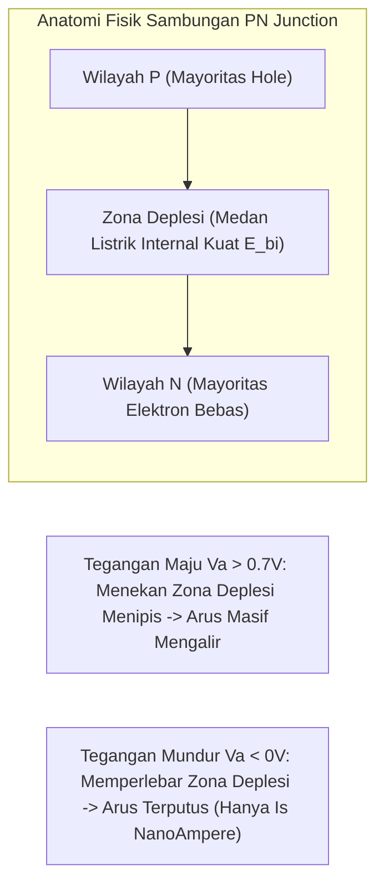

# Modul 037: Fisika Semikonduktor & Rekayasa Silikon (Doping Tipe-P/N, Rekombinasi, Sambungan PN Junction)

**Navigasi**: [⬅️ Master Index](../../INDEX.md) | [Tingkat 2: Tingkat 2: Fisika Klasik, Elektromagnetisme & Kimia Semikonduktor](./README.md)
*Sebelumnya*: [036. fisika-kuantum-dasar-teori-pita-energi](./036-fisika-kuantum-dasar-teori-pita-energi.md) | *Berikutnya*: [038. analisis-rangkaian-listrik-dc](../03-rangkaian-mikroelektronika/038-analisis-rangkaian-listrik-dc.md)

---

## 1. Intuisi Dasar Tanpa Jargon ("Seperti Bayi Baru Lahir")
Bayangkan jalan raya yang macet total di mana mobil-mobil parkir rapat bumper-ke-bumper tanpa celah. Tidak ada satu mobil pun yang bisa bergerak (Arus listrik nol). Ini adalah kristal Silikon Murni pada suhu dingin: semua elektron terikat kuat dalam ikatan kovalen, bertindak seperti isolator penyekat.

Sekarang bayangkan dua skenario rekayasa:
1. Anda menyusupkan sebuah mobil tambahan yang lincah ke bahu jalan (Doping Tipe-N): Mobil ini bebas melesat kencang kemana saja!
2. Atau, Anda mengangkat satu mobil dari jalanan macet tersebut, menyisakan satu **tempat parkir kosong (Hole/Lubang)** (Doping Tipe-P): Mobil di belakangnya bisa maju mengisi lubang itu, meninggalkan lubang baru di belakangnya. Lubang kosong itu tampak seolah-olah 'bergerak mundur' seperti gelembung udara di dalam air!

Dengan sengaja menyuntikkan atom pengotor (doping) sebanyak 1 per 1.000.000 atom silikon, kita bisa mengendalikan konduktivitas listrik silikon hingga bermiliar-miliar kali lipat. Inilah sihir **Rekayasa Semikonduktor**!
[📚 Pelajari: MIT OCW Microelectronic Devices and Circuits](https://ocw.mit.edu/courses/6-012-microelectronic-devices-and-circuits-fall-2009/)

## 2. Fondasi Teoretis & Aksiomatik / Matematis
### 37.1 Semikonduktor Intrinsik & Statistik Fermi-Dirac ([Streetman Semiconductor](https://www.pearson.com/))
Probabilitas suatu keadaan energi $E$ terisi oleh elektron pada suhu $T$:
$$f(E) = \frac{1}{1 + e^{\frac{E - E_F}{k_B T}}}$$
Di mana $E_F$ adalah Tingkat Energi Fermi (*Fermi Level*).
Konsentrasi pembawa muatan intrinsik $n_i$ (untuk Silikon pada $300\text{ K}$, $n_i \approx 1.5 \times 10^{10} \text{ cm}^{-3}$):
$$n_i = \sqrt{N_c N_v} e^{-\frac{E_g}{2 k_B T}}$$
Hukum Aksi Massa Kesetimbangan Termal:
$$n \cdot p = n_i^2$$

### 37.2 Doping Ekstrinsik Tipe-N & Tipe-P ([HyperPhysics Semiconductors](http://hyperphysics.phy-astr.gsu.edu/hbase/solids/semcn.html))
- **Doping Tipe-N (Donor $N_D$)**: Doping dengan elemen Golongan V (Fosfor / Arsenik) yang memiliki 5 elektron valensi. 4 elektron berikatan, 1 elektron bebas masuk ke pita konduksi:
  $$n \approx N_D, \quad p \approx \frac{n_i^2}{N_D}, \quad E_F \text{ bergeser mendekati } E_c$$
- **Doping Tipe-P (Akseptor $N_A$)**: Doping dengan elemen Golongan III (Boron) yang memiliki 3 elektron valensi, menciptakan lubang (*hole*):
  $$p \approx N_A, \quad n \approx \frac{n_i^2}{N_A}, \quad E_F \text{ bergeser mendekati } E_v$$

Arus Total Semikonduktor (Drift + Difusi):
$$J_{\text{total}} = J_{\text{drift}} + J_{\text{diff}} = (q n \mu_n + q p \mu_p) E + q D_n \frac{dn}{dx} - q D_p \frac{dp}{dx}$$
Hubungan Einstein: $\frac{D}{\mu} = \frac{k_B T}{q} = V_t \approx 25.86 \text{ mV}$ pada $300\text{ K}$.

### 37.3 Sambungan PN Junction & Persamaan Dioda Shockley ([MIT 6.012](https://ocw.mit.edu/courses/6-012-microelectronic-devices-and-circuits-fall-2009/))
Ketika silikon tipe-P dan tipe-N disatukan, elektron dan hole berdifusi melintasi batas sambungan dan saling berekombinasi, meninggalkan ion donor positif dan ion akseptor negatif yang tidak dapat bergerak di **Daerah Deplesi** (*Depletion Region* $W$):
$$W = \sqrt{\frac{2 \varepsilon_s}{q} \left( \frac{1}{N_A} + \frac{1}{N_D} \right) (V_{bi} - V_a)}$$
Potensial Kontak Bawaan (*Built-in Potential* $V_{bi}$):
$$V_{bi} = \frac{k_B T}{q} \ln\left( \frac{N_A N_D}{n_i^2} \right) \approx 0.7 \text{ Volt (untuk Silikon)}$$
Karakteristik I-V Persamaan Dioda Ideal Shockley:
$$I = I_s \left( e^{\frac{q V_a}{\eta k_B T}} - 1 \right)$$

## 3. Anatomi Teknis & Cara Kerja Internal

Mekanisme Breakdown Tegangan Mundur:
- **Zener Breakdown**: Terjadi pada konsentrasi doping sangat tinggi di mana zona deplesi sangat tipis ($< 10	ext{ nm}$), memicu tunneling mekanika kuantum elektron melintasi bandgap pada tegangan $< 5	ext{ V}$.
- **Avalanche Breakdown**: Terjadi pada doping sedang/rendah di mana medan listrik akselerasi tinggi membuat elektron menabrak atom kisi dan melepaskan pasangan elektron-hole baru secara berantai (*impact ionization*).

## 4. Implementasi Praktis & Kode / Simulasi Riil
import numpy as np

def calculate_pn_junction_parameters(Na_cm3: float, Nd_cm3: float, temp_kelvin: float = 300.0) -> dict:
    """
    Menghitung parameter fisik sambungan PN Silikon: Built-in potential dan lebar depletion layer W.
    """
    k_B = 1.380649e-23
    q = 1.602176634e-19
    eps_0 = 8.8541878e-14 # F/cm
    eps_si = 11.7 * eps_0  # Permitivitas Silikon F/cm
    n_i = 1.5e10           # cm^-3 pada 300K
    
    V_t = (k_B * temp_kelvin) / q # Tegangan termal ~ 25.86 mV
    V_bi = V_t * np.log((Na_cm3 * Nd_cm3) / (n_i**2))
    
    # Lebar daerah deplesi pada bias nol (Va = 0)
    w_cm = np.sqrt(((2.0 * eps_si) / q) * (1.0 / Na_cm3 + 1.0 / Nd_cm3) * V_bi)
    w_micrometers = w_cm * 10000.0
    
    # Medan listrik puncak di sambungan
    E_max_v_cm = (2.0 * V_bi) / w_cm
    
    return {
        "built_in_voltage_v": V_bi,
        "depletion_width_um": w_micrometers,
        "max_electric_field_kv_cm": E_max_v_cm / 1000.0
    }

res = calculate_pn_junction_parameters(Na_cm3=1e16, Nd_cm3=1e17)
print(f"Potensial Kontak Built-in (V_bi): {res['built_in_voltage_v']:.3f} Volt")
print(f"Lebar Zona Deplesi (W)          : {res['depletion_width_um']:.3f} um")
print(f"Medan Listrik Puncak Internal   : {res['max_electric_field_kv_cm']:.1f} kV/cm")

## 5. Miskonsepsi & Jebakan Industri
1. **Confusing Majority and Minority Carriers**: Dalam analisis transistor bipolar (BJT), banyak pemula lupa bahwa arus kolektor justru dikendalikan oleh injeksi pembawa minoritas di daerah basis yang tipis, bukan pembawa mayoritas.
2. **Thermal Runaway in Silicon Diodes**: Mengabaikan fakta bahwa tegangan maju dioda silikon turun sekitar $-2	ext{ mV}/^\circ	ext{C}$ saat suhu naik; jika dioda dipasang paralel tanpa resistor penyeimbang arus, dioda yang lebih panas akan menyedot seluruh arus hingga terbakar.
3. **Assuming Depletion Capacitance is Constant**: Kapasitansi sambungan PN ($C_j = arepsilon A / W$) berubah secara nonlinier terhadap tegangan bias mundur ($C_j \propto 1 / \sqrt{V_{bi} - V_a}$), menyebabkan distorsi harmonik pada sinyal frekuensi radio RF.

## 6. Proyek Latihan & Rubrik Penilaian Mandiri
### Tingkat 1 (Pemula) - Karakteristik Kurva I-V Dioda Shockley
Tulis skrip Python untuk memplot kurva arus-tegangan $I-V$ dari dioda silikon menggunakan persamaan Shockley dengan arus saturasi $I_s = 10^{-14}	ext{ A}$ dan faktor idealitas $\eta = 1.0$ untuk rentang tegangan $-1.0	ext{ V} \le V_a \le 0.8	ext{ V}$. Gunakan skala linier dan skala semi-logaritmik.

### Tingkat 2 (Menengah) - Perhitungan Profil Doping Gaussian Thermal Diffusion
Modelkan difusi atom dopan Boron ke dalam wafer silikon menggunakan solusi persamaan difusi Fick kedua untuk sumber terbatas (*limited source*): $N(x, t) = rac{Q}{\sqrt{\pi D t}} \exp\left(-rac{x^2}{4 D t}
ight)$. Tentukan kedalaman sambungan junction ($x_j$) di mana konsentrasi Boron sama dengan doping latar belakang substrat $N_D = 10^{15} 	ext{ cm}^{-3}$.

### Tingkat 3 (Mahir) - Simulasi Numerik Drift-Diffusion 1D Poisson-Continuity
Implementasikan pemecah semikonduktor 1D skema Gummel (*Gummel's Method*) untuk menyelesaikan coupled Poisson equation dan continuity equations pada PN junction silikon di bawah bias maju. Plot profil potensial elektrostatik $V(x)$, konsentrasi elektron $n(x)$, dan hole $p(x)$ melintasi struktur piranti.

#### Rubrik Penilaian
- **40% Ketepatan Teori Pita & Statistik Pembawa Muatan**: Hubungan Fermi-Dirac, hukum aksi massa, dan tegangan termal dihitung benar.
- **30% Konvergensi Iterasi Gummel**: Menggunakan dekomposisi Bernoulli untuk penanganan arus difusi numerik (skema Scharfetter-Gummel).
- **30% Validitas Kondisi Batas Kontak Ohmik**: Menerapkan kondisi netralitas muatan lokal pada kontak elektroda luar.

## 7. Rekomendasi Sumber Belajar Standar Emas
| Kategori | Judul Sumber & Tautan Langsung | Deskripsi Singkat |
|---|---|---|
| 📖 Buku Teks | [Solid State Electronic Devices (Streetman & Banerjee)](https://www.pearson.com/) | Buku standar rujukan internasional untuk fisika semikonduktor dan PN junction. |
| 🎓 Kuliah Terbuka | [MIT OCW 6.012 Microelectronic Devices and Circuits](https://ocw.mit.edu/courses/6-012-microelectronic-devices-and-circuits-fall-2009/) | Kuliah legendaris Jesus del Alamo tentang fisika peranti semikonduktor silikon. |
| 🔬 Makalah Seminal | [The Theory of p-n Junctions in Semiconductors and p-n Junction Transistors (Shockley, 1949)](https://doi.org/10.1002/j.1538-7305.1949.tb03645.x) | Makalah monumental William Shockley yang melahirkan revolusi transistor dunia. |
| 💻 Lab Interaktif | [Nanohub PN Junction Lab Simulator](https://nanohub.org/resources/pntoy) | Simulator piranti semikonduktor interaktif cloud dari Purdue University. |

---
*Navigasi Cepat*: [Ke Tingkat 2](./README.md) | [Ke Master Index](../../INDEX.md) | *Sebelumnya*: [036. fisika-kuantum-dasar-teori-pita-energi](./036-fisika-kuantum-dasar-teori-pita-energi.md) | *Berikutnya*: [038. analisis-rangkaian-listrik-dc](../03-rangkaian-mikroelektronika/038-analisis-rangkaian-listrik-dc.md)
