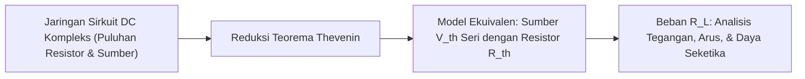

# Modul 038: Analisis Rangkaian Listrik DC (Hukum Ohm, KCL, KVL, Thevenin, Norton, Analisis Nodal)

**Navigasi**: [⬅️ Master Index](../../INDEX.md) | [Tingkat 3: Tingkat 3: Rangkaian Listrik, Elektronika & Microelectronics](./README.md)
*Sebelumnya*: [037. fisika-semikonduktor-rekayasa-silikon](../02-fisika-semikonduktor/037-fisika-semikonduktor-rekayasa-silikon.md) | *Berikutnya*: [039. analisis-rangkaian-listrik-ac](./039-analisis-rangkaian-listrik-ac.md)

---

## 1. Intuisi Dasar Tanpa Jargon ("Seperti Bayi Baru Lahir")
Bayangkan sistem pipa saluran air di rumah Anda. Pompa air mendorong air dengan tekanan tertentu (Tegangan / Voltase), air mengalir melalui pipa (Arus / Ampere), dan keran atau penyempitan pipa menghambat aliran air tersebut (Hambatan / Resistansi).

Jika sebuah pipa bercabang menjadi dua, jumlah air yang masuk ke percabangan PASTI sama dengan jumlah total air yang keluar dari kedua cabang tersebut—air tidak bisa lenyap begitu saja ke dimensi lain! Ini adalah **Hukum Arus Kirchhoff (KCL)**.
Dan jika Anda berjalan mengelilingi rumah mengikuti jalur pipa tertutup dan kembali ke titik semula, total kenaikan tekanan dari pompa pasti impas dengan total penurunan tekanan akibat gesekan pipa: **Hukum Tegangan Kirchhoff (KVL)**.
Dengan dua aturan konservasi sederhana ini, Anda bisa membedah dan menganalisis sirkuit listrik apa pun di dunia.
[📚 Pelajari: MIT OCW 6.002 Circuits and Electronics](https://ocw.mit.edu/courses/6-002-circuits-and-electronics-spring-2007/)

## 2. Fondasi Teoretis & Aksiomatik / Matematis
### 38.1 Hukum Ohm & Hukum Konservasi Kirchhoff ([All About Circuits DC](https://www.allaboutcircuits.com/textbook/direct-current/))
- **Hukum Ohm**: Beda potensial pada konduktor linier sebanding dengan arus:
  $$V = I \cdot R, \quad P = V \cdot I = I^2 R = \frac{V^2}{R}$$
- **Hukum Arus Kirchhoff (KCL - Konservasi Muatan)**: Jumlah aljabar arus di sembarang simpul (*node*) adalah nol:
  $$\sum_{k=1}^n I_k = 0$$
- **Hukum Tegangan Kirchhoff (KVL - Konservasi Energi)**: Jumlah aljabar tegangan mengelilingi sembarang lintasan tertutup (*loop*) adalah nol:
  $$\sum_{k=1}^m V_k = 0$$

### 38.2 Analisis Simpul (Nodal Analysis) & Matriks Konduktansi ([MIT 6.002](https://ocw.mit.edu/courses/6-002-circuits-and-electronics-spring-2007/))
Untuk rangkaian dengan $N$ simpul, pilih satu simpul sebagai referensi Tanah (*Ground* $V_0 = 0$). Persamaan KCL pada $N-1$ simpul bebas membentuk sistem linier matriks:
$$\mathbf{G} \mathbf{v} = \mathbf{i}_s$$
Di mana $\mathbf{G}$ adalah matriks konduktansi simpul ($G_{ii} = \sum \text{konduktansi yang terhubung ke simpul } i$, $G_{ij} = -\text{konduktansi antara simpul } i \text{ dan } j$), $\mathbf{v}$ adalah vektor tegangan simpul, dan $\mathbf{i}_s$ adalah vektor sumber arus independen.

### 38.3 Teorema Thévenin & Norton ([HyperPhysics Thevenin](http://hyperphysics.phy-astr.gsu.edu/hbase/electric/thev.html))
Sembarang jaringan resistor linier dua-terminal dapat digantikan oleh sirkuit ekuivalen sederhana:
- **Ekuivalen Thévenin**: Sumber tegangan terbuka $V_{\text{th}}$ seri dengan resistansi $R_{\text{th}}$.
- **Ekuivalen Norton**: Sumber arus hubung singkat $I_{\text{no}} = \frac{V_{\text{th}}}{R_{\text{th}}}$ paralel dengan $R_{\text{th}}$.
- **Teorema Transfer Daya Maksimum**: Daya yang diserap beban $R_L$ maksimal jika dan hanya jika resistansi beban sama dengan resistansi internal Thévenin:
  $$R_L = R_{\text{th}} \implies P_{\max} = \frac{V_{\text{th}}^2}{4 R_{\text{th}}}$$

## 3. Anatomi Teknis & Cara Kerja Internal

Algoritma Modified Nodal Analysis (MNA) dalam Simulator SPICE:
Simulator sirkuit (seperti LTspice / ngspice) mengubah skematik menjadi matriks MNA teraugmentasi yang menggabungkan KCL simpul dengan variabel arus untuk sumber tegangan ideal dan induktor, diselesaikan via faktorisasi LU sparse matrix di setiap langkah waktu.

## 4. Implementasi Praktis & Kode / Simulasi Riil
import numpy as np

def solve_nodal_analysis_dc():
    """
    Menyelesaikan sirkuit jembatan Wheatstone dengan Analisis Simpul MNA.
    Simpul 1: Terhubung ke sumber 12V.
    Simpul 2: Titik tengah kiri (R1 = 100 ohm ke simpul 1, R2 = 200 ohm ke ground, R5 = 50 ohm ke simpul 3).
    Simpul 3: Titik tengah kanan (R3 = 150 ohm ke simpul 1, R4 = 300 ohm ke ground).
    """
    # Matriks konduktansi G untuk simpul 2 dan simpul 3
    # Simpul 2: (V2 - 12)/100 + V2/200 + (V2 - V3)/50 = 0
    # => V2*(1/100 + 1/200 + 1/50) - V3*(1/50) = 12/100
    # Simpul 3: (V3 - 12)/150 + V3/300 + (V3 - V2)/50 = 0
    # => -V2*(1/50) + V3*(1/150 + 1/300 + 1/50) = 12/150
    
    G = np.array([
        [(1/100 + 1/200 + 1/50), -1/50],
        [-1/50, (1/150 + 1/300 + 1/50)]
    ])
    
    I_inj = np.array([12/100, 12/150])
    
    V_nodes = np.linalg.solve(G, I_inj)
    V2, V3 = V_nodes[0], V_nodes[1]
    
    bridge_voltage = V2 - V3
    return V2, V3, bridge_voltage

v2, v3, v_bridge = solve_nodal_analysis_dc()
print(f"Tegangan Simpul V2 : {v2:.3f} Volt")
print(f"Tegangan Simpul V3 : {v3:.3f} Volt")
print(f"Beda Potensial Jembatan (V2 - V3): {v_bridge:.4f} Volt")

## 5. Miskonsepsi & Jebakan Industri
1. **Treating Voltage Sources as Pure Open/Short in Superposition**: Saat mematikan sumber independen untuk mencari Thévenin: sumber tegangan digantikan dengan kawat hubung singkat (short circuit, $V=0$), sedangkan sumber arus digantikan dengan rangkaian terbuka (open circuit, $I=0$).
2. **Ground Loop Hum**: Menghubungkan ground analog sensitif dan ground daya arus tinggi pada dua titik terpisah di sasis logam, menciptakan loop arus tanah yang menginduksikan derau dengung 50/60 Hz pada sistem audio.
3. **Resistor Tolerance Stack-Up**: Merancang pembagi tegangan presisi dengan resistor bertoleransi biasa 5%, menghasilkan variasi tegangan output hingga $\pm 10\%$ yang melampaui batas referensi ADC.

## 6. Proyek Latihan & Rubrik Penilaian Mandiri
### Tingkat 1 (Pemula) - Verifikasi Hukum Pembagi Tegangan dan Arus
Rancang rangkaian pembagi tegangan untuk menurunkan tegangan baterai mobil $12	ext{ V}$ menjadi $3.3	ext{ V}$ untuk menyalakan mikrokontroler dengan arus beban $10	ext{ mA}$. Hitung disipasi daya pada masing-masing resistor dan efisiensi dayanya.

### Tingkat 2 (Menengah) - Perhitungan Resistansi Ekuivalen Thévenin Jaringan Kompleks
Tentukan sirkuit ekuivalen Thévenin ($V_{	ext{th}}, R_{	ext{th}}$) dari sebuah jaringan jembatan berbeban sumber dependen arus terkontrol tegangan (VCCS). Buktikan bahwa metode injeksi sumber uji $V_{	ext{test}} / I_{	ext{test}}$ memberikan hasil yang sama dengan rasio $V_{oc} / I_{sc}$.

### Tingkat 3 (Mahir) - Pemecah Sirkuit MNA Otomatis dari Netlist SPICE
Tulis parser netlist SPICE sederhana dalam Python yang membaca daftar komponen resistor dan sumber tegangan/arus DC independen, membangun matriks MNA $\mathbf{G}$ secara otomatis, dan menyelesaikan seluruh tegangan simpul jaringan.

#### Rubrik Penilaian
- **40% Kepatuhan Hukum Kirchhoff**: Persamaan KCL dan KVL dirumuskan secara konsisten tanpa kesalahan tanda aljabar.
- **30% Ketepatan Teorema Thévenin/Norton**: Nilai tegangan sirkuit terbuka dan resistansi ekuivalen terverifikasi via transfer daya maksimum.
- **30% Validitas Analisis Sensitivitas**: Menyertakan perhitungan pengaruh toleransi komponen terhadap tegangan keluaran.

## 7. Rekomendasi Sumber Belajar Standar Emas
| Kategori | Judul Sumber & Tautan Langsung | Deskripsi Singkat |
|---|---|---|
| 📖 Buku Teks | [Foundations of Analog and Digital Electronic Circuits (Agarwal & Lang)](https://www.elsevier.com/) | Buku teks revolusioner MIT yang menyatukan teori sirkuit dengan logika komputasi. |
| 🎓 Kuliah Terbuka | [MIT OCW 6.002 Circuits and Electronics](https://ocw.mit.edu/courses/6-002-circuits-and-electronics-spring-2007/) | Kuliah legendaris Anant Agarwal tentang KCL, KVL, Thévenin, dan op-amp. |
| 🔬 Makalah Seminal | [Ueber den Durchgang eines elektrischen Stromes (Gustav Kirchhoff, 1845)](https://doi.org/10.1002/andp.18451401202) | Makalah historis yang mempublikasikan Hukum Kirchhoff I dan II untuk sirkuit listrik. |
| 💻 Lab Interaktif | [Falstad Circuit Simulator: DC Circuits](https://www.falstad.com/circuit/) | Simulator sirkuit interaktif grafis animasi aliran elektron real-time di browser. |

---
*Navigasi Cepat*: [Ke Tingkat 3](./README.md) | [Ke Master Index](../../INDEX.md) | *Sebelumnya*: [037. fisika-semikonduktor-rekayasa-silikon](../02-fisika-semikonduktor/037-fisika-semikonduktor-rekayasa-silikon.md) | *Berikutnya*: [039. analisis-rangkaian-listrik-ac](./039-analisis-rangkaian-listrik-ac.md)
