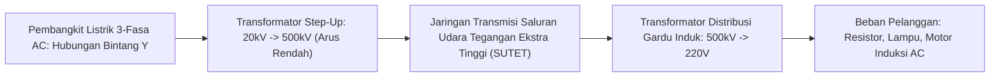

# Modul 039: Analisis Rangkaian Listrik AC (Gelombang Sinusoidal, Fasor, Impedansi Kompleks, Faktor Daya)

**Navigasi**: [⬅️ Master Index](../../INDEX.md) | [Tingkat 3: Tingkat 3: Rangkaian Listrik, Elektronika & Microelectronics](./README.md)
*Sebelumnya*: [038. analisis-rangkaian-listrik-dc](./038-analisis-rangkaian-listrik-dc.md) | *Berikutnya*: [040. respons-transien-filter-frekuensi](./040-respons-transien-filter-frekuensi.md)

---

## 1. Intuisi Dasar Tanpa Jargon ("Seperti Bayi Baru Lahir")
Di sirkuit DC, arus listrik mengalir searah seperti air sungai yang tenang. Namun di dinding rumah Anda, tegangan listrik bergetar bolak-balik (AC) maju-mundur sebanyak 50 atau 60 kali per detik ($50\text{ Hz}$). Mengapa kita repot-repot menggunakan listrik bolak-balik yang pusing ini?

Alasannya adalah **Transformator**: Listrik AC bisa dinaikkan tegangannya hingga ratusan ribu volt ($150.000\text{ V}$) untuk dikirim melintasi ratusan kilometer dengan arus sangat kecil (sehingga kerugian panas kabel $I^2 R$ mendekati nol), lalu diturunkan kembali dengan aman ke $220\text{ V}$ saat tiba di perumahan.
Untuk menganalisis gelombang sinus yang berosilasi ini tanpa terjebak dalam persamaan diferensial turunan yang rumit, para insinyur menggunakan trik jenius: mengubah gelombang waktu menjadi **Bilangan Kompleks (Fasor)**.
[📚 Pelajari: MIT OCW AC Circuit Analysis](https://ocw.mit.edu/courses/6-002-circuits-and-electronics-spring-2007/)

## 2. Fondasi Teoretis & Aksiomatik / Matematis
### 39.1 Gelombang Sinusoidal & Representasi Fasor Domain Frekuensi ([HyperPhysics AC](http://hyperphysics.phy-astr.gsu.edu/hbase/electric/phase.html))
Sinyal tegangan sinusoidal domain waktu:
$$v(t) = V_m \cos(\omega t + \phi)$$
Dinyatakan dalam bentuk fasor bilangan kompleks menggunakan identitas Euler:
$$v(t) = \text{Re}\left\{ V_m e^{j\phi} e^{j\omega t} \right\} \implies \mathbf{V} = V_m \angle \phi = V_{\text{rms}} e^{j\phi}$$
Di mana tegangan efektif Root-Mean-Square (RMS):
$$V_{\text{rms}} = \frac{V_m}{\sqrt{2}}$$

### 39.2 Impedansi Kompleks ($Z$) Resistor, Induktor & Kapasitor ([All About Circuits AC](https://www.allaboutcircuits.com/textbook/alternating-current/))
Hukum Ohm dalam domain frekuensi fasor: $\mathbf{V} = \mathbf{I} \cdot \mathbf{Z}$
- **Resistor ($R$)**: Tegangan dan arus sefase: $\mathbf{Z}_R = R$
- **Induktor ($L$)**: Tegangan mendahului arus sebesar $90^\circ$ (*ELI*):
  $$\mathbf{Z}_L = j\omega L = \omega L \angle 90^\circ$$
- **Kapasitor ($C$)**: Arus mendahului tegangan sebesar $90^\circ$ (*ICE*):
  $$\mathbf{Z}_C = \frac{1}{j\omega C} = -\frac{j}{\omega C} = \frac{1}{\omega C} \angle -90^\circ$$

### 39.3 Segitiga Daya Kompleks & Koreksi Faktor Daya ([MIT 6.002](https://ocw.mit.edu/courses/6-002-circuits-and-electronics-spring-2007/))
Daya Kompleks $\mathbf{S}$:
$$\mathbf{S} = \mathbf{V}_{\text{rms}} \mathbf{I}_{\text{rms}}^* = P + jQ$$
- **Daya Nyata ($P$)**: Daya rata-rata yang diubah menjadi kerja/panas nyata ($\text{Watt}$):
  $$P = V_{\text{rms}} I_{\text{rms}} \cos(\theta_v - \theta_i)$$
- **Daya Reaktif ($Q$)**: Daya bolak-balik yang disimpan-dilepaskan oleh medan magnet/listrik ($\text{VAR}$):
  $$Q = V_{\text{rms}} I_{\text{rms}} \sin(\theta_v - \theta_i)$$
- **Daya Semu ($S$)**: Magnitudo total daya: $S = |\mathbf{S}| = \sqrt{P^2 + Q^2}$ ($\text{VA}$).
- **Faktor Daya (*Power Factor* PF)**:
  $$\text{PF} = \cos(\theta) = \frac{P}{S}$$
Pabrik industri dikenakan denda oleh PLN jika $\text{PF} < 0.85$ karena arus reaktif membebani jaringan transmisi tanpa menghasilkan kerja. Solusi: memasang bank kapasitor paralel untuk menetralkan daya reaktif induktif motor listrik.

## 3. Anatomi Teknis & Cara Kerja Internal

Keunggulan Sistem 3-Fasa Seimbang:
Tiga gelombang AC berjarak fase $120^\circ$ menghasilkan transfer daya sesaat total yang konstan sempurna ($P_{	ext{total}} = 3 V_p I_p \cos\phi$) tanpa getaran pulsasi torsi pada motor listrik, dan arus kawat netral saling meniadakan menjadi nol ($I_N = 0$).

## 4. Implementasi Praktis & Kode / Simulasi Riil
import numpy as np

def calculate_ac_power_factor_correction(v_rms: float, freq_hz: float, 
                                          load_p_watts: float, initial_pf: float, 
                                          target_pf: float = 0.98) -> dict:
    """
    Menghitung ukuran kapasitor koreksi faktor daya (PFC) untuk beban induktif pabrik.
    """
    omega = 2.0 * np.pi * freq_hz
    
    # Sudut fase awal dan target (lagging/induktif)
    theta1 = np.arccos(initial_pf)
    theta2 = np.arccos(target_pf)
    
    # Daya reaktif awal dan target
    q1 = load_p_watts * np.tan(theta1)
    q2 = load_p_watts * np.tan(theta2)
    
    # Daya reaktif yang harus diserap kapasitor: Qc = Q1 - Q2
    q_c = q1 - q2
    # Qc = V^2 / Xc = V^2 * omega * C  => C = Qc / (omega * V^2)
    capacitance_farads = q_c / (omega * (v_rms**2))
    
    current_initial = load_p_watts / (v_rms * initial_pf)
    current_corrected = load_p_watts / (v_rms * target_pf)
    
    return {
        "initial_reactive_power_var": q1,
        "required_capacitor_var": q_c,
        "capacitance_uf": capacitance_farads * 1e6,
        "current_reduction_pct": ((current_initial - current_corrected) / current_initial) * 100.0
    }

res = calculate_ac_power_factor_correction(v_rms=220.0, freq_hz=50.0, load_p_watts=10000.0, initial_pf=0.72)
print(f"Daya Reaktif Induktif Awal: {res['initial_reactive_power_var']:.1f} VAR")
print(f"Kapasitor Koreksi Dibutuhkan: {res['capacitance_uf']:.1f} uF ({res['required_capacitor_var']:.1f} VAR)")
print(f"Penurunan Tarikan Arus Kabel: {res['current_reduction_pct']:.1f}% (Menghemat pemanasan trafo & kabel)")

## 5. Miskonsepsi & Jebakan Industri
1. **Confusing Peak Voltage with RMS**: Menyentuh kawat AC $220	ext{ V}$ PLN; puncak tegangan riilnya adalah $V_{	ext{peak}} = 220 	imes \sqrt{2} pprox 311	ext{ Volt}$, dan tegangan puncak-ke-puncak (*peak-to-peak*) adalah $622	ext{ Volt}$ yang dapat merusak komponen jika rating tegangan kapasitor salah dipilih.
2. **Harmonics from Non-Linear Loads**: Mengasumsikan arus AC selalu berbentuk sinus murni. Beban nonlinier komputer SMPS menyedot arus dalam pulsa-pulsa tajam kaya harmonik ganjil ke-3 (150 Hz) yang menumpuk di kawat netral dan dapat membakar trafo distribusi.
3. **Resonance Disaster during PFC**: Memasang bank kapasitor koreksi daya pada jaringan industri tanpa induktor detuning, yang dapat membentuk sirkuit resonansi paralel dengan trafo pada frekuensi harmonik beban dan memicu lonjakan tegangan destruktif.

## 6. Proyek Latihan & Rubrik Penilaian Mandiri
### Tingkat 1 (Pemula) - Diagram Fasor Rangkaian Seri RLC
Tulis skrip Python untuk menghitung arus fasor $\mathbf{I} = rac{\mathbf{V}}{\mathbf{Z}}$ dari rangkaian seri $R=50\,\Omega$, $L=100	ext{ mH}$, $C=10\,\mu	ext{F}$ yang dihubungkan ke sumber AC $100	ext{ V RMS}$ pada $50	ext{ Hz}$. Plot diagram fasor $\mathbf{V}_R$, $\mathbf{V}_L$, $\mathbf{V}_C$, dan $\mathbf{V}_{	ext{total}}$ pada bidang kompleks.

### Tingkat 2 (Menengah) - Analisis Daya Sistem 3-Fasa Tak Seimbang
Implementasikan metode Komponen Simetris Fortescue (*Fortescue Symmetrical Components*) dalam Python untuk menguraikan sistem tegangan 3-fasa yang tidak seimbang menjadi tiga sistem seimbang: urutan positif ($V_1$), urutan negatif ($V_2$), dan urutan nol ($V_0$).

### Tingkat 3 (Mahir) - Simulasi Jaringan Transmisi AC Saluran Panjang (Telegrapher's Equation)
Modelkan saluran transmisi daya tegangan ekstra tinggi sepanjang 300 km menggunakan model parameter terdistribusi ($\mathcal{R}, \mathcal{L}, \mathcal{C}, \mathcal{G}$). Simulasikan efek Ferranti (tegangan di ujung beban terbuka menjadi lebih tinggi daripada tegangan di pembangkit) dan rancang reaktor shunt kompensasi.

#### Rubrik Penilaian
- **40% Ketepatan Aritmatika Bilangan Kompleks**: Perhitungan impedansi fasor $j\omega L$ dan $1/j\omega C$ akurat.
- **30% Analisis Segitiga Daya**: Memisahkan daya aktif, reaktif, dan distorsi harmonik secara tepat.
- **30% Validitas Sistem Multi-Fasa**: Memahami pergeseran sudut fase $120^\circ$ dan hubungan tegangan jepit line-to-line vs line-to-neutral ($V_{LL} = \sqrt{3} V_{LN}$).

## 7. Rekomendasi Sumber Belajar Standar Emas
| Kategori | Judul Sumber & Tautan Langsung | Deskripsi Singkat |
|---|---|---|
| 📖 Buku Teks | [Electric Circuits (Nilsson & Riedel)](https://www.pearson.com/) | Buku standar rujukan internasional untuk analisis sirkuit AC domain fasor. |
| 🎓 Kuliah Terbuka | [MIT OCW 6.002 Circuits and Electronics](https://ocw.mit.edu/courses/6-002-circuits-and-electronics-spring-2007/) | Seri kuliah lengkap mengenai impedansi kompleks, resonansi, dan daya AC. |
| 🔬 Makalah Seminal | [Complex Quantities and Their Use in Electrical Engineering (Steinmetz, 1893)](https://doi.org/10.1109/T-AIEE.1893.4768007) | Karya legendaris Charles Proteus Steinmetz yang pertama kali memperkenalkan fasor bilangan kompleks ke sirkuit AC. |
| 💻 Lab Interaktif | [Falstad AC Circuit Simulator & Phasor Grapher](https://www.falstad.com/circuit/) | Simulator sirkuit AC interaktif dengan plot fasor dinamis real-time. |

---
*Navigasi Cepat*: [Ke Tingkat 3](./README.md) | [Ke Master Index](../../INDEX.md) | *Sebelumnya*: [038. analisis-rangkaian-listrik-dc](./038-analisis-rangkaian-listrik-dc.md) | *Berikutnya*: [040. respons-transien-filter-frekuensi](./040-respons-transien-filter-frekuensi.md)
