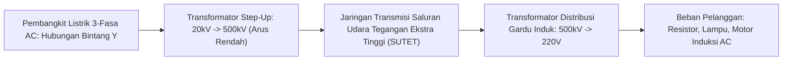

# Modul 039: Analisis Rangkaian Listrik AC (Gelombang Sinusoidal, Fasor, Impedansi Kompleks, Faktor Daya)

**Navigasi**: [⬅️ Master Index](../../INDEX.md) | [Tingkat 3: Tingkat 3: Rangkaian Listrik, Elektronika & Microelectronics](./README.md)
*Sebelumnya*: [038. analisis-rangkaian-listrik-dc](./038-analisis-rangkaian-listrik-dc.md) | *Berikutnya*: [040. respons-transien-filter-frekuensi](./040-respons-transien-filter-frekuensi.md)

---

## 1. Intuisi Dasar Tanpa Jargon ("Seperti Bayi Baru Lahir")
### 1.1 Konsep Inti & Analogi Tanpa Jargon
Di sirkuit DC, arus listrik mengalir searah seperti air sungai yang tenang. Namun di dinding rumah Anda, tegangan listrik bergetar bolak-balik (AC) maju-mundur sebanyak 50 atau 60 kali per detik (\$50\text{ Hz}$). Mengapa kita repot-repot menggunakan listrik bolak-balik yang pusing ini?

### 1.2 Urgensi Rekayasa & Signifikansi Sistemik
Alasannya adalah **Transformator**: Listrik AC bisa dinaikkan tegangannya hingga ratusan ribu volt (\$150.000\text{ V}$) untuk dikirim melintasi ratusan kilometer dengan arus sangat kecil (sehingga kerugian panas kabel $I^2 R$ mendekati nol), lalu diturunkan kembali dengan aman ke \$220\text{ V}$ saat tiba di perumahan.
Untuk menganalisis gelombang sinus yang berosilasi ini tanpa terjebak dalam persamaan diferensial turunan yang rumit, para insinyur menggunakan trik jenius: mengubah gelombang waktu menjadi **Bilangan Kompleks (Fasor)**.
[📚 Pelajari: MIT OCW AC Circuit Analysis](https://ocw.mit.edu/courses/6-002-circuits-and-electronics-spring-2007/)

## 2. Fondasi Teoretis & Aksiomatik / Matematis
### 2.1 Kerangka Teori Aksiomatik & Formulasi Matematis
### 39.1 Gelombang Sinusoidal & Representasi Fasor Domain Frekuensi ([HyperPhysics AC](http://hyperphysics.phy-astr.gsu.edu/hbase/electric/phase.html))
Sinyal tegangan sinusoidal domain waktu:
$$v(t) = V_m \cos(\omega t + \phi)$$
Dinyatakan dalam bentuk fasor bilangan kompleks menggunakan identitas Euler:
$$v(t) = \text{Re}\left\{ V_m e^{j\phi} e^{j\omega t} \right\} \implies \mathbf{V} = V_m \angle \phi = V_{\text{rms}} e^{j\phi}$$
Di mana tegangan efektif Root-Mean-Square (RMS):
$$V_{\text{rms}} = \frac{V_m}{\sqrt{2}}$$

### 2.2 Penurunan Matematis Langkah-demi-Langkah
### 39.2 Impedansi Kompleks ($Z$) Resistor, Induktor & Kapasitor ([All About Circuits AC](https://www.allaboutcircuits.com/textbook/alternating-current/))
Hukum Ohm dalam domain frekuensi fasor: $\mathbf{V} = \mathbf{I} \cdot \mathbf{Z}$
- **Resistor ($R$)**: Tegangan dan arus sefase: $\mathbf{Z}_R = R$
- **Induktor ($L$)**: Tegangan mendahului arus sebesar \$90^\circ$ (*ELI*):
  $$\mathbf{Z}_L = j\omega L = \omega L \angle 90^\circ$$
- **Kapasitor ($C$)**: Arus mendahului tegangan sebesar \$90^\circ$ (*ICE*):
  $$\mathbf{Z}_C = \frac{1}{j\omega C} = -\frac{j}{\omega C} = \frac{1}{\omega C} \angle -90^\circ$$

### 39.3 Segitiga Daya Kompleks & Koreksi Faktor Daya ([MIT 6.002](https://ocw.mit.edu/courses/6-002-circuits-and-electronics-spring-2007/))
Daya Kompleks $\mathbf{S}$:
$$\mathbf{S} = \mathbf{V}_{\text{rms}} \mathbf{I}_{\text{rms}}^* = P + jQ$$
- **Daya Nyata ($P$)**: Daya rata-rata yang diubah menjadi kerja/panas nyata ($\text{Watt}$):
  $$P = V_{\text{rms}} I_{\text{rms}} \cos(\theta_v - \theta_i)$$
- **Daya Reaktif ($Q$)**: Daya bolak-balik yang disimpan-dilepaskan oleh medan magnet/listrik ($\text{VAR}$):
  $$Q = V_{\text{rms}} I_{\text{rms}} \sin(\theta_v - \theta_i)$$
- **Daya Semu ($S$)**: Magnitudo total daya: $S = |\mathbf{S}| = \sqrt{P^2 + Q^2}$ ($\text{VA}$).
- **Faktor Daya (*Power Factor* PF)**:
  $$\text{PF} = \cos(\theta) = \frac{P}{S}$$
Pabrik industri dikenakan denda oleh PLN jika $\text{PF} < 0.85$ karena arus reaktif membebani jaringan transmisi tanpa menghasilkan kerja. Solusi: memasang bank kapasitor paralel untuk menetralkan daya reaktif induktif motor listrik.

## 3. Anatomi Teknis & Cara Kerja Internal

Keunggulan Sistem 3-Fasa Seimbang:
Tiga gelombang AC berjarak fase \$120^\circ$ menghasilkan transfer daya sesaat total yang konstan sempurna ($P_{	ext{total}} = 3 V_p I_p \cos\phi$) tanpa getaran pulsasi torsi pada motor listrik, dan arus kawat netral saling meniadakan menjadi nol ($I_N = 0$).

#### Tabel Penelusuran Resonansi Paralel Harmonisa LC & Ledakan Bank Kapasitor Koreksi Faktor Daya
| Frekuensi / Orde Harmonisa ($h$) | Frekuensi Sinyal ($f = h \times 50\text{ Hz}$) | Reaktansi Induktif Grid ($X_L = 2\pi f L$) | Reaktansi Kapasitif Bank ($X_C = \frac{1}{2\pi f C}$) | Impedansi Total Paralel ($Z_{par} = \frac{X_L X_C}{|X_L - X_C|}$) | Arus Harmonisa & Tegangan Kapasitor |
|---|---|---|---|---|---|
| Fundamental ($h=1$) | $50\text{ Hz}$ | $0.157\ \Omega$ | $15.915\ \Omega$ | $0.158\ \Omega$ (Induktif) | Arus nominal $400\text{ A}$, koreksi faktor daya aktif |
| Harmonisa Ke-3 ($h=3$) | $150\text{ Hz}$ | $0.471\ \Omega$ | $5.305\ \Omega$ | $0.517\ \Omega$ | Operasi stabil |
| Harmonisa Ke-5 ($h=5$) | $250\text{ Hz}$ (Frekuensi Resonansi!) | $0.785\ \Omega$ | $3.183\ \Omega$ | $1.043\ \Omega$ | Arus inverter konverter mulai teramplifikasi |
| Harmonisa Ke-7 ($h=7$) | $350\text{ Hz}$ (Puncak Resonansi $LC$) | $1.100\ \Omega$ | $1.150\ \Omega$ ($X_L \approx X_C$!) | $25.300\ \Omega$ (Lonjakan impedansi $160\times$) | Resonansi paralel meledak; tegangan harmonisa tembus |
| Kondisi Resonansi Puncak | Puncak gelombang terdistorsi | Overvoltage $2.8\times V_{nom}$ | Dielektrik film kapasitor bocor | Suhu casing melonjak $> 120^\circ\text{C}$ | Casing kapasitor meledak menyemburkan minyak isolator |

## 4. Implementasi Praktis & Kode / Simulasi Riil
```python
import numpy as np

def calculate_ac_power_factor_correction(v_rms: float, freq_hz: float, 
                                          load_p_watts: float, initial_pf: float, 
                                          target_pf: float = 0.98) -> dict:
    """
    Menghitung ukuran kapasitor koreksi faktor daya (PFC) untuk beban induktif pabrik.
    """
    omega = 2.0 * np.pi * freq_hz
    
    # Sudut fase awal dan target (lagging/induktif)
    theta1 = np.arccos(initial_pf)
    theta2 = np.arccos(target_pf)
    
    # Daya reaktif awal dan target
    q1 = load_p_watts * np.tan(theta1)
    q2 = load_p_watts * np.tan(theta2)
    
    # Daya reaktif yang harus diserap kapasitor: Qc = Q1 - Q2
    q_c = q1 - q2
    # Qc = V^2 / Xc = V^2 * omega * C  => C = Qc / (omega * V^2)
    capacitance_farads = q_c / (omega * (v_rms**2))
    
    current_initial = load_p_watts / (v_rms * initial_pf)
    current_corrected = load_p_watts / (v_rms * target_pf)
    
    return {
        "initial_reactive_power_var": q1,
        "required_capacitor_var": q_c,
        "capacitance_uf": capacitance_farads * 1e6,
        "current_reduction_pct": ((current_initial - current_corrected) / current_initial) * 100.0
    }

res = calculate_ac_power_factor_correction(v_rms=220.0, freq_hz=50.0, load_p_watts=10000.0, initial_pf=0.72)
print(f"Daya Reaktif Induktif Awal: {res['initial_reactive_power_var']:.1f} VAR")
print(f"Kapasitor Koreksi Dibutuhkan: {res['capacitance_uf']:.1f} uF ({res['required_capacitor_var']:.1f} VAR)")
print(f"Penurunan Tarikan Arus Kabel: {res['current_reduction_pct']:.1f}% (Menghemat pemanasan trafo & kabel)")
```

## 5. Miskonsepsi & Jebakan Industri
1. **Confusing Peak Voltage with RMS**: Menyentuh kawat AC \$220	ext{ V}$ PLN; puncak tegangan riilnya adalah $V_{	ext{peak}} = 220 	imes \sqrt{2} pprox 311	ext{ Volt}$, dan tegangan puncak-ke-puncak (*peak-to-peak*) adalah \$622	ext{ Volt}$ yang dapat merusak komponen jika rating tegangan kapasitor salah dipilih.
2. **Harmonics from Non-Linear Loads**: Mengasumsikan arus AC selalu berbentuk sinus murni. Beban nonlinier komputer SMPS menyedot arus dalam pulsa-pulsa tajam kaya harmonik ganjil ke-3 (150 Hz) yang menumpuk di kawat netral dan dapat membakar trafo distribusi.
3. **Resonance Disaster during PFC**: Memasang bank kapasitor koreksi daya pada jaringan industri tanpa induktor detuning, yang dapat membentuk sirkuit resonansi paralel dengan trafo pada frekuensi harmonik beban dan memicu lonjakan tegangan destruktif.

### Studi Kasus Kegagalan Nyata: Resonansi Harmonisa Ke-5/Ke-7 Meledakkan Bank Kapasitor Koreksi Faktor Daya Pabrik
- **Insiden Kegagalan Gardu Pabrik Manufaktur**: Pada sebuah pabrik kimia modern berdaya 2 MVA, manajemen memasang inverter Variable Frequency Drive (VFD) 6-pulsa masif untuk menghemat konsumsi energi motor pompa, bersamaan dengan bank kapasitor 400 kVAR otomatis untuk menghindari denda penalti faktor daya utilitas ($\cos\phi < 0.85$). Dua minggu pasca commissioning, bank kapasitor meledak beruntun dengan suara dentuman laksana bom, memutus jalur produksi utama.
- **Akar Masalah Teori Sirkuit AC & Resonansi Harmonisa**: Konverter daya penyearah 6-pulsa non-linier menyuntikkan harmonisa arus signifikan pada spektrum $h = 6k \pm 1$ (terutama harmonisa ke-5 pada 250 Hz dan ke-7 pada 350 Hz). Pada saat yang sama, induktansi bocor transformator gardu ($L_{grid}$) bersama bank kapasitor kompensasi ($C_{bank}$) membentuk sirkuit resonansi paralel LC. Frekuensi resonansi alami sirkuit kebetulan jatuh tepat pada frekuensi 340–350 Hz (dekat harmonisa ke-7). Pada frekuensi ini, impedansi paralel rangkaian melonjak puluhan kali lipat. Arus harmonisa dari inverter yang diinjeksikan ke impedansi paralel masif memicu tegangan harmonisa raksasa ($V_h = I_h \cdot Z_p$), menggandakan tegangan puncak melampaui kekuatan dielektrik film polipropilen kapasitor, memicu *dielectric puncture* dan ledakan termal.

- **Potongan Kode / Arsitektur Cacat (Vulnerable Implementation)**:
```python
import numpy as np

def analyze_harmonic_resonance(c_kvar=400.0, v_line=400.0, f_base=50.0, s_trafo_kva=2000.0, z_trafo_pct=6.0):
    # Parameter dasar transformator dan kapasitor
    omega_base = 2 * np.pi * f_base
    v_phase = v_line / np.sqrt(3)
    
    # Induktansi transformator grid (L_grid)
    z_base = (v_line ** 2) / (s_trafo_kva * 1000.0)
    x_trafo = z_base * (z_trafo_pct / 100.0)
    L_grid = x_trafo / omega_base
    
    # Kapasitansi bank per fasa
    q_phase = (c_kvar * 1000.0) / 3.0
    C_bank = q_phase / (omega_base * (v_phase ** 2))
    
    # Frekuensi resonansi paralel: f_res = 1 / (2*pi * sqrt(L * C))
    f_res = 1.0 / (2 * np.pi * np.sqrt(L_grid * C_bank))
    harmonic_order_res = f_res / f_base
    
    # Sapuan respons frekuensi impedansi paralel Z(f)
    harmonics = np.array([1, 3, 5, 7, 9, 11, 13])
    freqs = harmonics * f_base
    omegas = 2 * np.pi * freqs
    
    X_L = omegas * L_grid
    X_C = 1.0 / (omegas * C_bank)
    R_grid = x_trafo * 0.1  # Resistansi internal ~10% dari reaktansi
    
    Z_parallel = np.abs((1j * X_L + R_grid) * (-1j * X_C) / (R_grid + 1j * (X_L - X_C)))
    
    # Bahaya jika frekuensi resonansi dekat harmonisa 5 (250Hz) atau 7 (350Hz)
    danger_h5_h7 = np.abs(harmonic_order_res - 5.0) < 0.4 or np.abs(harmonic_order_res - 7.0) < 0.4
    
    return {
        "resonant_frequency_Hz": f_res,
        "resonant_harmonic_order": harmonic_order_res,
        "impedance_at_h7_ohm": Z_parallel[3],
        "catastrophic_resonance_risk": danger_h5_h7
    }

report = analyze_harmonic_resonance()
# Orde resonansi ~6.8 (Sangat dekat harmonisa ke-7!) -> RISIKO RESONANSI EKSTREM!
```

- **Solusi Rekayasa Reaktor Penala (Detuned Reactor)**: Standar modern melarang keras pemasangan kapasitor polos pada jaringan beban non-linier. Setiap kapasitor wajib dipasangi induktor seri (*detuning reactor*, biasanya 7% atau 14% p-factor) yang menggeser frekuensi resonansi rangkaian seri-paralel turun ke 189 Hz (di bawah harmonisa terendah ke-5), mengubah sifat kapasitor menjadi induktif pada semua frekuensi harmonisa tinggi sehingga kebal terhadap resonansi amplifikasi.

## 6. Proyek Latihan & Rubrik Penilaian Mandiri
### Tingkat 1 (Pemula) - Diagram Fasor Rangkaian Seri RLC
Tulis skrip Python untuk menghitung arus fasor $\mathbf{I} = rac{\mathbf{V}}{\mathbf{Z}}$ dari rangkaian seri $R=50\,\Omega$, $L=100	ext{ mH}$, $C=10\,\mu	ext{F}$ yang dihubungkan ke sumber AC \$100	ext{ V RMS}$ pada \$50	ext{ Hz}$. Plot diagram fasor $\mathbf{V}_R$, $\mathbf{V}_L$, $\mathbf{V}_C$, dan $\mathbf{V}_{	ext{total}}$ pada bidang kompleks.

### Tingkat 2 (Menengah) - Analisis Daya Sistem 3-Fasa Tak Seimbang
Implementasikan metode Komponen Simetris Fortescue (*Fortescue Symmetrical Components*) dalam Python untuk menguraikan sistem tegangan 3-fasa yang tidak seimbang menjadi tiga sistem seimbang: urutan positif ($V_1$), urutan negatif ($V_2$), dan urutan nol ($V_0$).

### Tingkat 3 (Mahir) - Simulasi Jaringan Transmisi AC Saluran Panjang (Telegrapher's Equation)
Modelkan saluran transmisi daya tegangan ekstra tinggi sepanjang 300 km menggunakan model parameter terdistribusi ($\mathcal{R}, \mathcal{L}, \mathcal{C}, \mathcal{G}$). Simulasikan efek Ferranti (tegangan di ujung beban terbuka menjadi lebih tinggi daripada tegangan di pembangkit) dan rancang reaktor shunt kompensasi.

#### Rubrik Penilaian
- **40% Ketepatan Aritmatika Bilangan Kompleks**: Perhitungan impedansi fasor $j\omega L$ dan \$1/j\omega C$ akurat.
- **30% Analisis Segitiga Daya**: Memisahkan daya aktif, reaktif, dan distorsi harmonik secara tepat.
- **30% Validitas Sistem Multi-Fasa**: Memahami pergeseran sudut fase \$120^\circ$ dan hubungan tegangan jepit line-to-line vs line-to-neutral ($V_{LL} = \sqrt{3} V_{LN}$).

### Tingkat 1: Dasar
- **Tugas**: Bangun kalkulator analisis daya AC monofasa dan faktor daya kompleks ($P, Q, S, \cos\phi$) serta hitung nilai kapasitor kompensasi $C$ yang dibutuhkan untuk menaikkan $\cos\phi$ dari $\cos\phi_1$ ke target $\cos\phi_2$.
- **Petunjuk Perancangan Arsitektur**:
  - Daya reaktif target: $Q_{comp} = P (\tan\phi_1 - \tan\phi_2)$.
  - Kapasitansi kompensasi: $C = \frac{Q_{comp}}{\omega V_{rms}^2}$.
- **Test Vector & Kasus Uji Ekstrem**:
  - *Beban Induktif*: $P = 50\text{ kW}$, $\cos\phi_1 = 0.707$ lagging; target $\cos\phi_2 = 0.95$ pada $V_{rms} = 230\text{ V}, 50\text{ Hz}$. Hitung $Q_{comp}$ dan $C$ dalam $\mu\text{F}$.
  - *Kondisi Over-Compensated*: Jika target $\cos\phi$ diatur 1.0; verifikasi $Q_{comp} = Q_{initial}$.
- **Rubrik Penilaian Mandiri**: 40% Segitiga Daya Kompleks $(P, Q, S)$ Presisi, 30% Kalkulasi Kapasitansi Koreksi Faktor Daya Tepat, 30% Penanganan Kondisi Lagging/Leading.

### Tingkat 2: Menengah
- **Tugas**: Implementasikan penganalisis Total Harmonic Distortion (THD) Fourier terdiskritisasi untuk sinyal tegangan dan arus AC terdistorsi, menghitung daya distorsi Budeanu ($D$) dan faktor daya sejati IEEE 1459 ($PF_{true} = \frac{P}{S_{total}}$).
- **Petunjuk Perancangan Arsitektur**:
  - Hitung $THD_V = \frac{\sqrt{\sum_{h=2}^\infty V_h^2}}{V_1}$ dan $THD_I = \frac{\sqrt{\sum_{h=2}^\infty I_h^2}}{I_1}$.
  - Daya semu total IEEE 1459: $S = \sqrt{P^2 + Q_1^2 + D^2}$.
- **Test Vector & Kasus Uji Ekstrem**:
  - *Gelombang Persegi Simetris*: Harmonisa ganjil murni $V_h = V_1 / h$; verifikasi $THD_V \approx 48.34\%$.
  - *Beban Non-Linier VFD*: Arus sinusoidal terpotong; verifikasi perbedaan signifikan antara faktor daya pergeseran ($\cos\phi_1$) vs faktor daya sejati ($PF_{true}$).
- **Rubrik Penilaian Mandiri**: 40% Algoritma THD Fourier Spektral Presisi, 30% Formulasi Daya Semu IEEE 1459 Tepat, 30% Evaluasi Perbedaan $PF_{displacement}$ vs $PF_{true}$.

### Tingkat 3: Mahir
- **Tugas**: Rancang simulator sirkuit filter daya aktif (Active Power Filter - APF) shunt berbasis inverter jembatan H PWM yang menghasilkan arus kompensasi harmonisa secara seketika menggunakan teori daya reaktif sesaat Akagi ($p-q$ Theory / Instantaneous Reactive Power Theory) pada kerangka koordinat Clarke $\alpha-\beta$.
- **Petunjuk Perancangan Arsitektur**:
  - Transformasikan tegangan dan arus 3-fasa ke sumbu Clarke: $\begin{bmatrix} v_\alpha \\ v_\beta \end{bmatrix} = \sqrt{\frac{2}{3}} \begin{bmatrix} 1 & -1/2 & -1/2 \\ 0 & \sqrt{3}/2 & -\sqrt{3}/2 \end{bmatrix} \begin{bmatrix} v_a \\ v_b \\ v_c \end{bmatrix}$.
  - Ekstraksi daya riil dan imajiner sesaat: $p = v_\alpha i_\alpha + v_\beta i_\beta$, $q = v_\beta i_\alpha - v_\alpha i_\beta$.
  - Pisahkan daya DC rata-rata menggunakan filter lolos rendah (LPF) Butterworth dan injeksikan arus balik penyeimbang.
- **Test Vector & Kasus Uji Ekstrem**:
  - *Injeksi Beban Penyearah 3-Fasa*: Reduksi THD arus utilitas dari $28\%$ menjadi $< 3\%$.
  - *Beban Asimetris*: APF menyeimbangkan arus ketiga fasa utilitas menjadi sinusoidal seimbang murni.
- **Rubrik Penilaian Mandiri**: 40% Transformasi Clarke & Teori Daya $p-q$ Akagi Presisi, 30% Sintesis Arus Kompensasi Inverter PWM, 30% Verifikasi Penekanan THD Arus $< 3\%$.

## 7. Rekomendasi Sumber Belajar Standar Emas
| Kategori | Judul Sumber & Tautan Langsung | Deskripsi Singkat |
|---|---|---|
| 📖 Buku Teks | [Electric Circuits (Nilsson & Riedel)](https://www.pearson.com/) | Buku standar rujukan internasional untuk analisis sirkuit AC domain fasor. |
| 🎓 Kuliah Terbuka | [MIT OCW 6.002 Circuits and Electronics](https://ocw.mit.edu/courses/6-002-circuits-and-electronics-spring-2007/) | Seri kuliah lengkap mengenai impedansi kompleks, resonansi, dan daya AC. |
| 🔬 Makalah Seminal | [Complex Quantities and Their Use in Electrical Engineering (Steinmetz, 1893)](https://doi.org/10.1109/T-AIEE.1893.4768007) | Karya legendaris Charles Proteus Steinmetz yang pertama kali memperkenalkan fasor bilangan kompleks ke sirkuit AC. |
| 💻 Lab Interaktif | [Falstad AC Circuit Simulator & Phasor Grapher](https://www.falstad.com/circuit/) | Simulator sirkuit AC interaktif dengan plot fasor dinamis real-time. |

---
*Navigasi Cepat*: [Ke Tingkat 3](./README.md) | [Ke Master Index](../../INDEX.md) | *Sebelumnya*: [038. analisis-rangkaian-listrik-dc](./038-analisis-rangkaian-listrik-dc.md) | *Berikutnya*: [040. respons-transien-filter-frekuensi](./040-respons-transien-filter-frekuensi.md)
