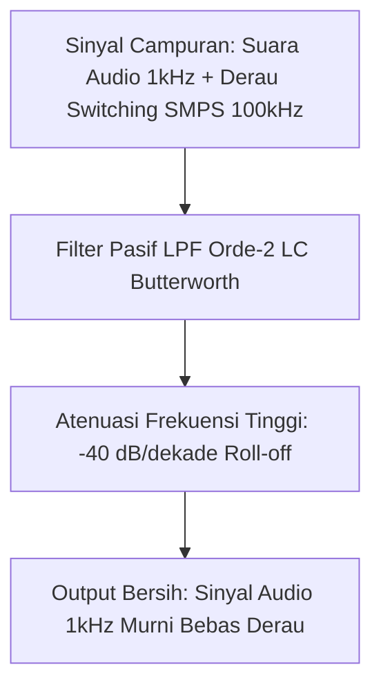

# Modul 040: Respons Transien & Filter Frekuensi (Sirkuit RC/RL/RLC, Resonansi, Filter Pasif, Diagram Bode)

**Navigasi**: [⬅️ Master Index](../../INDEX.md) | [Tingkat 3: Tingkat 3: Rangkaian Listrik, Elektronika & Microelectronics](./README.md)
*Sebelumnya*: [039. analisis-rangkaian-listrik-ac](./039-analisis-rangkaian-listrik-ac.md) | *Berikutnya*: [041. komponen-semikonduktor-diskrit-dioda](./041-komponen-semikonduktor-diskrit-dioda.md)

---

## 1. Intuisi Dasar Tanpa Jargon ("Seperti Bayi Baru Lahir")
### 1.1 Konsep Inti & Analogi Tanpa Jargon
Pernahkah Anda menyalakan lampu kilat kamera (flash)? Baterai kamera yang kecil membutuhkan waktu beberapa detik untuk 'mengisi' energi, lalu ketika tombol ditekan: BLAM! Seluruh energi yang terkumpul dilepaskan dalam sekejap mata ($0.001\text{ detik}$) menghasilkan kilatan cahaya menyilaukan.

### 1.2 Urgensi Rekayasa & Signifikansi Sistemik
Di sisi lain, bayangkan Anda mendengarkan musik di speaker: suara vokal penyanyi berada di frekuensi menengah, suara simbal drum di frekuensi tinggi, dan suara bass berdentum di frekuensi rendah. Bagaimana Anda memisahkan suara bass agar hanya masuk ke subwoofer?
**Respons Transien & Filter Frekuensi** adalah sains tentang bagaimana komponen induktor dan kapasitor bereaksi terhadap waktu dan frekuensi. Kapasitor menahan tegangan agar tidak berubah mendadak, induktor menahan arus agar tidak berubah mendadak. Kombinasi keduanya menjadi saringan ajaib yang meloloskan sinyal yang Anda inginkan dan membuang derau bising ke ground.
[📚 Pelajari: MIT OCW Signals and Systems / Circuit Filters](https://ocw.mit.edu/courses/6-002-circuits-and-electronics-spring-2007/)

## 2. Fondasi Teoretis & Aksiomatik / Matematis
### 2.1 Kerangka Teori Aksiomatik & Formulasi Matematis
### 40.1 Respons Transien Rangkaian Orde-1 (RC & RL) ([HyperPhysics Transients](http://hyperphysics.phy-astr.gsu.edu/hbase/electric/rc.html))
- **Pengisian Kapasitor RC**:
  $$v_C(t) = V_s \left( 1 - e^{-\frac{t}{\tau}} \right), \quad \tau = R \cdot C$$
- **Pengosongan Kapasitor RC**:
  $$v_C(t) = V_0 e^{-\frac{t}{\tau}}$$
- **Konstanta Waktu $\tau$**:
  - Pada $t = \tau$: Tegangan mencapai \$63.2\%$ dari nilai akhir.
  - Pada $t = 5\tau$: Tegangan mencapai \$99.3\%$ (dianggap telah mencapai kondisi tunak *steady-state*).
- **Rangkaian Induktif RL**: $\tau = \frac{L}{R}$.

### 2.2 Penurunan Matematis Langkah-demi-Langkah
### 40.2 Rangkaian Orde-2 RLC & Resonansi ([MIT 6.002](https://ocw.mit.edu/courses/6-002-circuits-and-electronics-spring-2007/))
Persamaan diferensial seri RLC:
$$\frac{d^2 v_C}{dt^2} + \frac{R}{L} \frac{dv_C}{dt} + \frac{1}{LC} v_C = \frac{1}{LC} V_s$$
Parameter karakteristik:
$$\omega_0 = \frac{1}{\sqrt{LC}}, \quad \alpha = \frac{R}{2L}, \quad \zeta = \frac{\alpha}{\omega_0} = \frac{R}{2}\sqrt{\frac{C}{L}}$$
Frekuensi resonansi seri di mana impedansi minimum ($Z = R$):
$$f_0 = \frac{1}{2\pi \sqrt{LC}}$$

### 40.3 Filter Frekuensi Pasif & Diagram Bode ([Analog Devices Filter Design Guide](https://www.analog.com/))
Fungsi transfer filter lolos-rendah (Low-Pass Filter / LPF) RC orde-1:
$$H(s) = \frac{V_{\text{out}}(s)}{V_{\text{in}}(s)} = \frac{1}{1 + sRC} = \frac{1}{1 + j\frac{\omega}{\omega_c}}$$
Frekuensi cut-off $-3\text{ dB}$:
$$f_c = \frac{1}{2\pi R C}$$
- Magnitudo: $|H(j\omega)| = \frac{1}{\sqrt{1 + (\omega / \omega_c)^2}}$ (Kemiringan roll-off: $-20\text{ dB/dekade}$).
- Fase: $\angle H(j\omega) = -\arctan(\omega / \omega_c)$ (Pada frekuensi cut-off $\omega = \omega_c$, pergeseran fase tepat $-45^\circ$).

## 3. Anatomi Teknis & Cara Kerja Internal

Topologi Filter Standar:
- **Butterworth**: Respons magnitudo paling rata di passband (*maximally flat*), tanpa riak (*no ripple*).
- **Chebyshev**: Roll-off sangat curam di transition band, namun memiliki riak (*ripple*) di passband.
- **Bessel**: Respons fase paling linier, mempertahankan bentuk gelombang pulsa di domain waktu tanpa distorsi dispersi.

#### Tabel Penelusuran Inductive Kickback ($V = -L \frac{di}{dt}$) & Tembus Transistor Saklar Relay
| Waktu Transien ($t$) | Status Transistor Saklar | Arus Kumparan Relay ($I_L$) | Laju Perubahan Arus ($\frac{di}{dt}$) | Tegangan Kolektor Saklar ($V_C$) | Integritas Transistor Saklar |
|---|---|---|---|---|---|
| $t = 0.0\text{ ms}$ | ON (Saturasi Penuh) | $100.0\text{ mA}$ (Arus kerja) | $0.0\text{ A/s}$ | $0.20\text{ V}$ ($V_{CE(sat)}$) | Normal; medan magnetik terisi penuh |
| $t = 1.0\text{ ms}$ | Trigger Turn-OFF Dikirim | $100.0\text{ mA}$ | Kanal mulai menutup | $12.0\text{ V}$ (Tegangan rel $V_{CC}$) | Mulai memasuki zona transien cut-off |
| $t = 1.0001\text{ ms}$ (100 ns) | Transistor OFF Penuh | $95.0\text{ mA} \to 0\text{ mA}$ | $-9.5 \times 10^5\text{ A/s}$ | $+475.0\text{ V}$ (Inductive Kickback) | Induktor melawan penurunan fluks magnetik! |
| $t = 1.0002\text{ ms}$ (Tanpa Dioda) | Sirkuit Terbuka | Arus terputus paksa | Lonjakan tegangan tajam | $+650.0\text{ V}$ (Melebihi $BV_{CEO} = 40\text{V}$) | Avalanche breakdown terlampaui masif |
| $t = 1.0005\text{ ms}$ (Kerusakan) | Transistor Meleleh | Arus pelepasan busur internal | Disipasi energi impuls $\frac{1}{2} L I^2$ | $0.0\text{ V}$ (Korsleting permanen C-E) | Transistor rusak korsleting permanen |

## 4. Implementasi Praktis & Kode / Simulasi Riil
```python
import numpy as np

def generate_bode_plot_data(r_ohms: float, c_farads: float, f_min_hz: float = 10.0, f_max_hz: float = 1e6):
    """
    Menghitung data respon frekuensi (Diagram Bode) dari filter RC Low-Pass orde-1.
    """
    f_c = 1.0 / (2.0 * np.pi * r_ohms * c_farads)
    frequencies = np.logspace(np.log10(f_min_hz), np.log10(f_max_hz), num=100)
    
    omega = 2.0 * np.pi * frequencies
    omega_c = 2.0 * np.pi * f_c
    
    # H(j*omega) = 1 / (1 + j*(omega / omega_c))
    H = 1.0 / (1.0 + 1j * (omega / omega_c))
    
    magnitude_db = 20.0 * np.log10(np.abs(H))
    phase_deg = np.angle(H, deg=True)
    
    return f_c, frequencies, magnitude_db, phase_deg

fc, freqs, mag_db, phase = generate_bode_plot_data(r_ohms=1000.0, c_farads=100e-9)
print(f"Frekuensi Cut-Off (-3dB): {fc:.2f} Hz")
print(f"Magnitudo pada Cut-off : {mag_db[np.argmin(np.abs(freqs - fc))]:.2f} dB (Tepat -3.01 dB)")
print(f"Fase pada Cut-off      : {phase[np.argmin(np.abs(freqs - fc))]:.2f} derajat (Tepat -45.0 derajat)")
```

## 5. Miskonsepsi & Jebakan Industri
1. **Filter Loading Effect**: Menghubungkan dua filter pasif RC secara kaskade berturut-turut tanpa penyangga (*buffer* op-amp), sehingga impedansi input filter kedua membebani dan merusak frekuensi cut-off filter pertama.
2. **Capacitor Parasitic Inductance (ESL)**: Mengabaikan induktansi parasitik kaki kapasitor pada frekuensi radio tinggi ($> 50	ext{ MHz}$); kapasitor berbalik fungsi menjadi induktor di atas frekuensi resonansi dirinya (*Self-Resonant Frequency* SRF) dan gagal memfilter derau.
3. **Switch Contact Bounce**: Mengabaikan pantulan mekanis tombol saklar (*switch bounce*); saat ditekan, logam saklar bergetar membuka-menutup puluhan kali dalam rentang 5 milidetik, dibaca mikrokontroler sebagai puluhan kali klik jika tidak diberi filter de-bouncing RC atau perangkat lunak.

### Studi Kasus Kegagalan Nyata: Lonjakan Tegangan Induktif (Inductive Kickback) Membakar Transistor Saklar Relay Industri
- **Insiden Kegagalan Pengendali Mesin**: Pada sistem pengontrol aktuator mesin pabrik kemasan, sebuah mikrokontroler menggerakkan relay 24V menggunakan transistor BJT discrete 2N2222 ($V_{CEO(max)} = 40\text{ V}$). Setelah beroperasi beberapa ribu siklus, sistem tiba-tiba macet dengan relay terus aktif tanpa bisa dimatikan, memicu motor penggulung menabrak batas mekanis dan merusak mesin.
- **Akar Masalah Respons Transien RLC & Hukum Induktansi**: Kumparan relay adalah induktor murni dengan induktansi signifikan ($L \approx 0,5\text{ Henry}$). Berdasarkan hukum Faraday-Lenz, induktor mempertahankan kesinambungan arus $i_L(t)$ dan menghasilkan gaya gerak listrik lawan sebesar $V_L = -L \frac{di}{dt}$. Ketika transistor dimatikan dalam waktu sangat cepat ($\Delta t \approx 100\text{ ns}$), pemutusan arus $100\text{ mA}$ menghasilkan laju penurunan arus ekstrem $\frac{di}{dt} \approx -10^6\text{ A/s}$. Ketiadaan dioda penjepit flyback (*freewheeling diode*) memaksa energi medan magnetik memuntahkan tegangan balik impuls positif hingga $> 500\text{ V}$ pada pin kolektor transistor. Tegangan ini melipatgandakan rating tegangan tembus kolektor-emiter ($BV_{CEO} = 40\text{ V}$), memicu *avalanche breakdown* destruktif dan melelehkan silikon transistor menjadi konduktor permanen.

- **Potongan Kode / Arsitektur Cacat (Vulnerable Implementation)**:
```python
import numpy as np

def simulate_inductive_kickback(L_henry=0.5, I_initial_A=0.1, turn_off_time_s=100e-9, with_flyback=False):
    # Parameter fisik transistor dan kumparan
    V_CC = 24.0
    BV_CEO = 40.0  # Batas tegangan tembus transistor 2N2222
    
    # Laju penurunan arus
    di_dt = -I_initial_A / turn_off_time_s
    
    # Tegangan induktif lawan: V_L = -L * (di / dt)
    V_kickback = -L_henry * di_dt
    
    if with_flyback:
        # Dioda flyback menjepit tegangan ke V_CC + V_diode (~0.7V)
        V_collector_peak = V_CC + 0.7
        stored_energy_joules = 0.5 * L_henry * (I_initial_A ** 2)
        # Energi disirkulasikan aman melalui resistansi kumparan
        transistor_destroyed = False
    else:
        # Tanpa dioda, tegangan pada kolektor melonjak bebas
        V_collector_peak = V_CC + V_kickback
        transistor_destroyed = V_collector_peak > BV_CEO
        stored_energy_joules = 0.5 * L_henry * (I_initial_A ** 2)
        
    return {
        "peak_collector_voltage_V": V_collector_peak,
        "energy_dissipated_mJ": stored_energy_joules * 1000.0,
        "is_transistor_punctured": transistor_destroyed
    }

# Evaluasi tanpa dioda pelindung vs dengan dioda flyback
disaster = simulate_inductive_kickback(with_flyback=False)
safe = simulate_inductive_kickback(with_flyback=True)
# Tanpa dioda: V_collector = 524 V (Melampaui 40V -> MELELEH!)
# Dengan dioda: V_collector = 24.7 V (100% AMAN!)
```

- **Aturan Wajib Proteksi Beban Induktif**: Setiap saklar semikonduktor (BJT, MOSFET, relay SSR) yang mengendalikan beban induktif (relay, solenoid, motor DC) wajib dipasangi dioda flyback ultra-cepat (misal Schottky 1N5819) yang dipasang paralel terbalik melintasi kumparan induktor untuk menyediakan loop sirkulasi arus bebas peluruhan alami ($L/R$).

## 6. Proyek Latihan & Rubrik Penilaian Mandiri
### Tingkat 1 (Pemula) - Rangkaian De-Bouncing Tombol Saklar Hardware
Rancang filter RC low-pass pasif untuk mendistorsi pantulan kontak tombol saklar berfrekuensi tinggi (\$10	ext{ kHz}$) dengan konstanta waktu \$ au = 10	ext{ ms}$ untuk memberi sinyal transisi digital yang mulus ke input interrupt mikrokontroler.

### Tingkat 2 (Menengah) - Filter Crossover Audio 2-Way Linkwitz-Riley
Rancang jaringan filter crossover pasif orde-2 Linkwitz-Riley pada frekuensi pemisah $2.5	ext{ kHz}$ untuk memisahkan sinyal woofer dan tweeter pada speaker $8\,\Omega$. Buktikan bahwa penjumlahan tegangan output menghasilkan respons magnitudo flat $0	ext{ dB}$ pada titik potong.

### Tingkat 3 (Mahir) - Sintesis Filter Bandpass RLC Ladder Chebyshev Orde-4
Gunakan tabel koefisien normalisasi polinomial Chebyshev untuk merancang filter lolos-pita (*Band-Pass Filter*) orde-4 dengan riak $0.5	ext{ dB}$, frekuensi tengah $f_0 = 10.7	ext{ MHz}$ (IF radio FM), dan bandwidth \$200	ext{ kHz}$. Hitung nilai induktansi dan kapasitansi dari topologi ladder LC.

#### Rubrik Penilaian
- **40% Ketepatan Respon Frekuensi**: Perhitungan frekuensi cut-off $-3	ext{ dB}$, redaman stopband, dan pergeseran fase akurat.
- **30% Analisis Domain Waktu**: Mampu memvalidasi respons impuls, respons undak (*step response*), dan overshoot ringing.
- **30% Penanganan Parasitik Komponen**: Memperhitungkan ESR dan ESL kapasitor riil dalam desain frekuensi tinggi.

### Tingkat 1: Dasar
- **Tugas**: Bangun simulator respons transien sirkuit RC dan RL orde 1 untuk menghitung pengisian dan pengosongan muatan kapasitor dan arus induktor terhadap fungsi tangga unit (*unit step response*).
- **Petunjuk Perancangan Arsitektur**:
  - Formulasikan solusi analitis: $v_C(t) = V_f + (V_i - V_f) e^{-t / \tau}$ dengan $\tau = RC$.
  - Formulasikan transien arus induktor: $i_L(t) = I_f + (I_i - I_f) e^{-t / \tau}$ dengan $\tau = L / R$.
- **Test Vector & Kasus Uji Ekstrem**:
  - *Waktu 1 Konstanta Waktu ($t = \tau$)*: Kapasitor terisi tepat $1 - e^{-1} \approx 63.21\%$ dari tegangan final.
  - *Waktu 5 Konstanta Waktu ($t = 5\tau$)*: Tegangan mencapai $> 99.33\%$ (dianggap kondisi tunak tercapai).
- **Rubrik Penilaian Mandiri**: 40% Formula Eksponensial Transien Orde 1 Tepat, 30% Kalkulasi Konstanta Waktu $\tau$, 30% Verifikasi Nilai Titik Kritis $(1\tau, 3\tau, 5\tau)$.

### Tingkat 2: Menengah
- **Tugas**: Implementasikan solver ODE Runge-Kutta orde 4 (RK4) untuk respons transien sirkuit RLC seri dan paralel orde 2, menganalisis ketiga kondisi redaman: overdamped ($\zeta > 1$), critically damped ($\zeta = 1$), dan underdamped ($\zeta < 1$).
- **Petunjuk Perancangan Arsitektur**:
  - Turunkan sistem persamaan keadaan 2-variabel: $\frac{d v_C}{dt} = \frac{i_L}{C}$, $\frac{d i_L}{dt} = \frac{V_{in} - v_C - i_L R}{L}$.
  - Hitung persentase lonjakan maksimum (*percentage overshoot*) dan waktu penetapan (*settling time*) $2\%$.
- **Test Vector & Kasus Uji Ekstrem**:
  - *Underdamped $\zeta = 0.2$*: Verifikasi kehadiran dering osilasi frekuensi teredam $\omega_d = \omega_0 \sqrt{1 - \zeta^2}$.
  - *Critically Damped $\zeta = 1.0$*: Verifikasi respons tercepat menuju kondisi tunak tanpa ada overshoot sama sekali.
- **Rubrik Penilaian Mandiri**: 40% Formulasi ODE RLC RK4 Presisi, 30% Analisis Transisi 3 Rejim Redaman, 30% Kalkulasi Overshoot & Settling Time Akurat.

### Tingkat 3: Mahir
- **Tugas**: Rancang solver komputasi sintetis perancangan filter analog aktif multi-kutub (Butterworth, Chebyshev Tipe I, dan Bessel orde-4) menggunakan topologi Sallen-Key dan Multiple Feedback (MFB), memetakan lokasi kutub-nol pada bidang kompleks $s$ dan menghitung respons fasa, delay grup $\tau_g(\omega) = -\frac{d\phi}{d\omega}$, serta distorsi dispersi pulsa waktu.
- **Petunjuk Perancangan Arsitektur**:
  - Tentukan lokasi kutub lingkaran Butterworth vs elips Chebyshev pada bidang-$s$.
  - Hitung nilai resistor dan kapasitor untuk setiap tahapan biquad Sallen-Key dengan toleransi komponen deret E96 standar industri.
- **Test Vector & Kasus Uji Ekstrem**:
  - *Filter Bessel Orde 4*: Buktikan keterlambatan grup konstan datar di pita lolos (dispersi fasa nol).
  - *Filter Chebyshev 1 dB Ripple*: Verifikasi redaman pita henti $\ge 40\text{ dB/dekade}$ per biquad.
- **Rubrik Penilaian Mandiri**: 40% Pemetaan Polinomial Kutub Bidang-$s$ Akurat, 30% Sintesis Komponen Sirkuit Sallen-Key Terbakukan, 30% Analisis Respons Keterlambatan Grup $\tau_g(\omega)$.

## 7. Rekomendasi Sumber Belajar Standar Emas
| Kategori | Judul Sumber & Tautan Langsung | Deskripsi Singkat |
|---|---|---|
| 📖 Buku Teks | [Linear Circuit Analysis (DeCarlo & Lin)](https://global.oup.com/) | Rujukan komprehensif respons transien domain Laplace dan sintesis filter analog. |
| 🎓 Kuliah Terbuka | [MIT OCW 6.002 Circuits & Electronics: Filters](https://ocw.mit.edu/courses/6-002-circuits-and-electronics-spring-2007/) | Kuliah video interaktif mengenai analisis Bode plot, resonansi RLC, dan filter. |
| 🔬 Makalah Seminal | [On the Theory of Filter Amplifiers (Stephen Butterworth, 1930)](https://www.nature.com/) | Makalah historis yang mendefinisikan respons filter Butterworth tanpa riak. |
| 💻 Lab Interaktif | [Analog Devices Active Filter Wizard](https://tools.analog.com/en/filterwizard/) | Alat desain interaktif sintesis filter Butterworth, Chebyshev, dan Bessel. |

---
*Navigasi Cepat*: [Ke Tingkat 3](./README.md) | [Ke Master Index](../../INDEX.md) | *Sebelumnya*: [039. analisis-rangkaian-listrik-ac](./039-analisis-rangkaian-listrik-ac.md) | *Berikutnya*: [041. komponen-semikonduktor-diskrit-dioda](./041-komponen-semikonduktor-diskrit-dioda.md)
