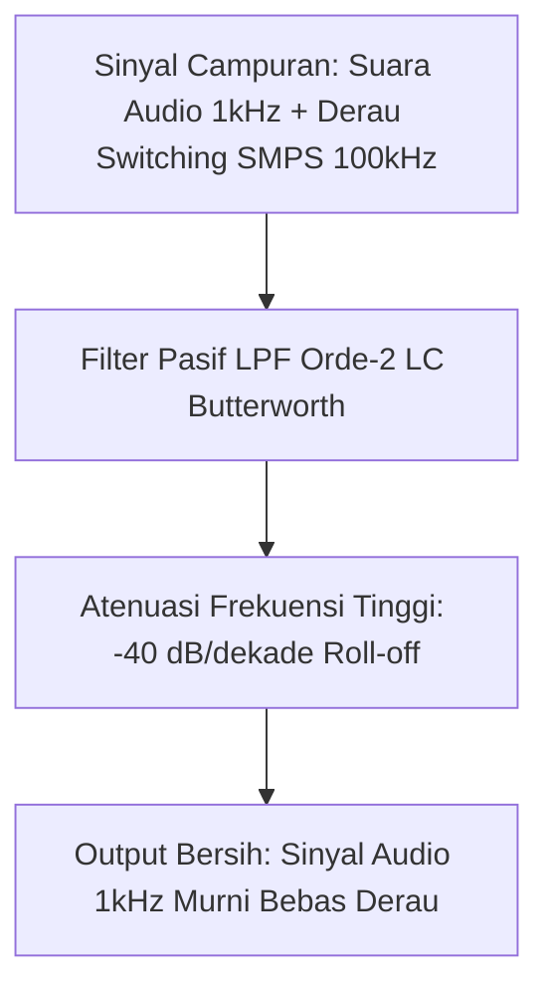

# Modul 040: Respons Transien & Filter Frekuensi (Sirkuit RC/RL/RLC, Resonansi, Filter Pasif, Diagram Bode)

**Navigasi**: [⬅️ Master Index](../../INDEX.md) | [Tingkat 3: Tingkat 3: Rangkaian Listrik, Elektronika & Microelectronics](./README.md)
*Sebelumnya*: [039. analisis-rangkaian-listrik-ac](./039-analisis-rangkaian-listrik-ac.md) | *Berikutnya*: [041. komponen-semikonduktor-diskrit-dioda](./041-komponen-semikonduktor-diskrit-dioda.md)

---

## 1. Intuisi Dasar Tanpa Jargon ("Seperti Bayi Baru Lahir")
Pernahkah Anda menyalakan lampu kilat kamera (flash)? Baterai kamera yang kecil membutuhkan waktu beberapa detik untuk 'mengisi' energi, lalu ketika tombol ditekan: BLAM! Seluruh energi yang terkumpul dilepaskan dalam sekejap mata ($0.001\text{ detik}$) menghasilkan kilatan cahaya menyilaukan.

Di sisi lain, bayangkan Anda mendengarkan musik di speaker: suara vokal penyanyi berada di frekuensi menengah, suara simbal drum di frekuensi tinggi, dan suara bass berdentum di frekuensi rendah. Bagaimana Anda memisahkan suara bass agar hanya masuk ke subwoofer?
**Respons Transien & Filter Frekuensi** adalah sains tentang bagaimana komponen induktor dan kapasitor bereaksi terhadap waktu dan frekuensi. Kapasitor menahan tegangan agar tidak berubah mendadak, induktor menahan arus agar tidak berubah mendadak. Kombinasi keduanya menjadi saringan ajaib yang meloloskan sinyal yang Anda inginkan dan membuang derau bising ke ground.
[📚 Pelajari: MIT OCW Signals and Systems / Circuit Filters](https://ocw.mit.edu/courses/6-002-circuits-and-electronics-spring-2007/)

## 2. Fondasi Teoretis & Aksiomatik / Matematis
### 40.1 Respons Transien Rangkaian Orde-1 (RC & RL) ([HyperPhysics Transients](http://hyperphysics.phy-astr.gsu.edu/hbase/electric/rc.html))
- **Pengisian Kapasitor RC**:
  $$v_C(t) = V_s \left( 1 - e^{-\frac{t}{\tau}} \right), \quad \tau = R \cdot C$$
- **Pengosongan Kapasitor RC**:
  $$v_C(t) = V_0 e^{-\frac{t}{\tau}}$$
- **Konstanta Waktu $\tau$**:
  - Pada $t = \tau$: Tegangan mencapai $63.2\%$ dari nilai akhir.
  - Pada $t = 5\tau$: Tegangan mencapai $99.3\%$ (dianggap telah mencapai kondisi tunak *steady-state*).
- **Rangkaian Induktif RL**: $\tau = \frac{L}{R}$.

### 40.2 Rangkaian Orde-2 RLC & Resonansi ([MIT 6.002](https://ocw.mit.edu/courses/6-002-circuits-and-electronics-spring-2007/))
Persamaan diferensial seri RLC:
$$\frac{d^2 v_C}{dt^2} + \frac{R}{L} \frac{dv_C}{dt} + \frac{1}{LC} v_C = \frac{1}{LC} V_s$$
Parameter karakteristik:
$$\omega_0 = \frac{1}{\sqrt{LC}}, \quad \alpha = \frac{R}{2L}, \quad \zeta = \frac{\alpha}{\omega_0} = \frac{R}{2}\sqrt{\frac{C}{L}}$$
Frekuensi resonansi seri di mana impedansi minimum ($Z = R$):
$$f_0 = \frac{1}{2\pi \sqrt{LC}}$$

### 40.3 Filter Frekuensi Pasif & Diagram Bode ([Analog Devices Filter Design Guide](https://www.analog.com/))
Fungsi transfer filter lolos-rendah (Low-Pass Filter / LPF) RC orde-1:
$$H(s) = \frac{V_{\text{out}}(s)}{V_{\text{in}}(s)} = \frac{1}{1 + sRC} = \frac{1}{1 + j\frac{\omega}{\omega_c}}$$
Frekuensi cut-off $-3\text{ dB}$:
$$f_c = \frac{1}{2\pi R C}$$
- Magnitudo: $|H(j\omega)| = \frac{1}{\sqrt{1 + (\omega / \omega_c)^2}}$ (Kemiringan roll-off: $-20\text{ dB/dekade}$).
- Fase: $\angle H(j\omega) = -\arctan(\omega / \omega_c)$ (Pada frekuensi cut-off $\omega = \omega_c$, pergeseran fase tepat $-45^\circ$).

## 3. Anatomi Teknis & Cara Kerja Internal

Topologi Filter Standar:
- **Butterworth**: Respons magnitudo paling rata di passband (*maximally flat*), tanpa riak (*no ripple*).
- **Chebyshev**: Roll-off sangat curam di transition band, namun memiliki riak (*ripple*) di passband.
- **Bessel**: Respons fase paling linier, mempertahankan bentuk gelombang pulsa di domain waktu tanpa distorsi dispersi.

## 4. Implementasi Praktis & Kode / Simulasi Riil
import numpy as np

def generate_bode_plot_data(r_ohms: float, c_farads: float, f_min_hz: float = 10.0, f_max_hz: float = 1e6):
    """
    Menghitung data respon frekuensi (Diagram Bode) dari filter RC Low-Pass orde-1.
    """
    f_c = 1.0 / (2.0 * np.pi * r_ohms * c_farads)
    frequencies = np.logspace(np.log10(f_min_hz), np.log10(f_max_hz), num=100)
    
    omega = 2.0 * np.pi * frequencies
    omega_c = 2.0 * np.pi * f_c
    
    # H(j*omega) = 1 / (1 + j*(omega / omega_c))
    H = 1.0 / (1.0 + 1j * (omega / omega_c))
    
    magnitude_db = 20.0 * np.log10(np.abs(H))
    phase_deg = np.angle(H, deg=True)
    
    return f_c, frequencies, magnitude_db, phase_deg

fc, freqs, mag_db, phase = generate_bode_plot_data(r_ohms=1000.0, c_farads=100e-9)
print(f"Frekuensi Cut-Off (-3dB): {fc:.2f} Hz")
print(f"Magnitudo pada Cut-off : {mag_db[np.argmin(np.abs(freqs - fc))]:.2f} dB (Tepat -3.01 dB)")
print(f"Fase pada Cut-off      : {phase[np.argmin(np.abs(freqs - fc))]:.2f} derajat (Tepat -45.0 derajat)")

## 5. Miskonsepsi & Jebakan Industri
1. **Filter Loading Effect**: Menghubungkan dua filter pasif RC secara kaskade berturut-turut tanpa penyangga (*buffer* op-amp), sehingga impedansi input filter kedua membebani dan merusak frekuensi cut-off filter pertama.
2. **Capacitor Parasitic Inductance (ESL)**: Mengabaikan induktansi parasitik kaki kapasitor pada frekuensi radio tinggi ($> 50	ext{ MHz}$); kapasitor berbalik fungsi menjadi induktor di atas frekuensi resonansi dirinya (*Self-Resonant Frequency* SRF) dan gagal memfilter derau.
3. **Switch Contact Bounce**: Mengabaikan pantulan mekanis tombol saklar (*switch bounce*); saat ditekan, logam saklar bergetar membuka-menutup puluhan kali dalam rentang 5 milidetik, dibaca mikrokontroler sebagai puluhan kali klik jika tidak diberi filter de-bouncing RC atau perangkat lunak.

## 6. Proyek Latihan & Rubrik Penilaian Mandiri
### Tingkat 1 (Pemula) - Rangkaian De-Bouncing Tombol Saklar Hardware
Rancang filter RC low-pass pasif untuk mendistorsi pantulan kontak tombol saklar berfrekuensi tinggi ($10	ext{ kHz}$) dengan konstanta waktu $	au = 10	ext{ ms}$ untuk memberi sinyal transisi digital yang mulus ke input interrupt mikrokontroler.

### Tingkat 2 (Menengah) - Filter Crossover Audio 2-Way Linkwitz-Riley
Rancang jaringan filter crossover pasif orde-2 Linkwitz-Riley pada frekuensi pemisah $2.5	ext{ kHz}$ untuk memisahkan sinyal woofer dan tweeter pada speaker $8\,\Omega$. Buktikan bahwa penjumlahan tegangan output menghasilkan respons magnitudo flat $0	ext{ dB}$ pada titik potong.

### Tingkat 3 (Mahir) - Sintesis Filter Bandpass RLC Ladder Chebyshev Orde-4
Gunakan tabel koefisien normalisasi polinomial Chebyshev untuk merancang filter lolos-pita (*Band-Pass Filter*) orde-4 dengan riak $0.5	ext{ dB}$, frekuensi tengah $f_0 = 10.7	ext{ MHz}$ (IF radio FM), dan bandwidth $200	ext{ kHz}$. Hitung nilai induktansi dan kapasitansi dari topologi ladder LC.

#### Rubrik Penilaian
- **40% Ketepatan Respon Frekuensi**: Perhitungan frekuensi cut-off $-3	ext{ dB}$, redaman stopband, dan pergeseran fase akurat.
- **30% Analisis Domain Waktu**: Mampu memvalidasi respons impuls, respons undak (*step response*), dan overshoot ringing.
- **30% Penanganan Parasitik Komponen**: Memperhitungkan ESR dan ESL kapasitor riil dalam desain frekuensi tinggi.

## 7. Rekomendasi Sumber Belajar Standar Emas
| Kategori | Judul Sumber & Tautan Langsung | Deskripsi Singkat |
|---|---|---|
| 📖 Buku Teks | [Linear Circuit Analysis (DeCarlo & Lin)](https://global.oup.com/) | Rujukan komprehensif respons transien domain Laplace dan sintesis filter analog. |
| 🎓 Kuliah Terbuka | [MIT OCW 6.002 Circuits & Electronics: Filters](https://ocw.mit.edu/courses/6-002-circuits-and-electronics-spring-2007/) | Kuliah video interaktif mengenai analisis Bode plot, resonansi RLC, dan filter. |
| 🔬 Makalah Seminal | [On the Theory of Filter Amplifiers (Stephen Butterworth, 1930)](https://www.nature.com/) | Makalah historis yang mendefinisikan respons filter Butterworth tanpa riak. |
| 💻 Lab Interaktif | [Analog Devices Active Filter Wizard](https://tools.analog.com/en/filterwizard/) | Alat desain interaktif sintesis filter Butterworth, Chebyshev, dan Bessel. |

---
*Navigasi Cepat*: [Ke Tingkat 3](./README.md) | [Ke Master Index](../../INDEX.md) | *Sebelumnya*: [039. analisis-rangkaian-listrik-ac](./039-analisis-rangkaian-listrik-ac.md) | *Berikutnya*: [041. komponen-semikonduktor-diskrit-dioda](./041-komponen-semikonduktor-diskrit-dioda.md)
