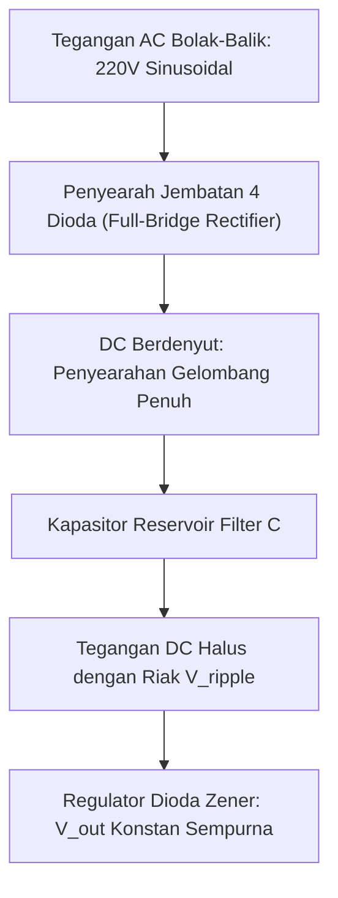

# Modul 041: Komponen Semikonduktor Diskrit: Dioda (Dioda Penyearah, Zener, Schottky, LED, Fotodioda)

**Navigasi**: [⬅️ Master Index](../../INDEX.md) | [Tingkat 3: Tingkat 3: Rangkaian Listrik, Elektronika & Microelectronics](./README.md)
*Sebelumnya*: [040. respons-transien-filter-frekuensi](./040-respons-transien-filter-frekuensi.md) | *Berikutnya*: [042. transistor-bjt](./042-transistor-bjt.md)

---

## 1. Intuisi Dasar Tanpa Jargon ("Seperti Bayi Baru Lahir")
Pernahkah Anda melihat pintu putar satu arah di stasiun kereta yang hanya bisa didorong maju ke depan dan mengunci mati jika didorong mundur?

Itulah **Dioda**: katup satu arah (*check valve*) di dunia listrik!
Arus listrik bisa mengalir dengan sangat mudah dari Anoda ke Katoda jika diberi dorongan tegangan positif ($> 0.7\text{ V}$), namun diblokir total jika tegangan berbalik arah.
Dioda bukan sekadar saklar penyearah arus: variasinya membuka dunia modern:
- **Dioda Zener**: Menjadi penstabil tegangan presisi saat dibias mundur tembus (*breakdown*).
- **Dioda Schottky**: Menggunakan kontak logam-semikonduktor dengan penurunan tegangan sangat rendah ($0.2\text{ V}$) dan pemulihan ultra-cepat untuk catu daya komputer.
- **LED (Light Emitting Diode)**: Mengubah elektron yang jatuh antar pita energi menjadi partikel cahaya foton warna-warni yang menerangi layar smartphone Anda.
- **Fotodioda**: Membalikkan proses: menangkap cahaya matahari atau sinyal remote TV dan mengubahnya menjadi arus listrik.
[📚 Pelajari: All About Circuits Diodes](https://www.allaboutcircuits.com/textbook/semiconductors/chpt-3/introduction-to-diodes-and-rectifiers/)

## 2. Fondasi Teoretis & Aksiomatik / Matematis
### 41.1 Persamaan Arus Dioda Shockley & Resistansi Dinamis ([HyperPhysics Diodes](http://hyperphysics.phy-astr.gsu.edu/hbase/solids/diodcon.html))
Persamaan arus dioda PN:
$$I_D = I_S \left( e^{\frac{V_D}{\eta V_T}} - 1 \right)$$
Di mana:
- $I_S$: Arus saturasi balik ($10^{-15} \text{ s/d } 10^{-12} \text{ A}$)
- $\eta$: Faktor idealitas ($\eta \approx 1$ untuk Schottky/Germanium, $\eta \approx 1.5 - 2$ untuk Silikon)
- $V_T = \frac{k_B T}{q} \approx 25.86 \text{ mV}$ pada suhu $300\text{ K}$

Resistansi dinamis sinyal kecil ($r_d$):
$$r_d = \left( \frac{dI_D}{dV_D} \right)^{-1} = \frac{\eta V_T}{I_D + I_S} \approx \frac{\eta V_T}{I_D}$$
Pada arus bias $I_D = 1\text{ mA}$ dan $\eta = 1$, resistansi dinamis hanya $r_d \approx 26 \, \Omega$.

### 41.2 Jenis-Jenis Dioda Khusus ([Sedra & Smith Microelectronic Circuits](https://global.oup.com/))
1. **Dioda Zener**: Dirancang beroperasi stabil pada wilayah breakdown tegangan balik $V_Z$. Koefisien suhu Zener $< 5\text{ V}$ bernilai negatif (efek Zener murni), sedangkan $> 5\text{ V}$ bernilai positif (efek Avalanche). Dioda pada $\approx 5.1\text{ V}$ memiliki koefisien suhu mendekati nol!
2. **Dioda Schottky**: Sambungan Logam-Semikonduktor (Penghalang Schottky) tanpa pembawa muatan minoritas.
   - Penurunan tegangan maju rendah: $V_F \approx 0.15 - 0.35 \text{ V}$.
   - Waktu pemulihan balik (*Reverse Recovery Time* $t_{rr}$) praktis nol ($< 100\text{ ps}$), sangat ideal untuk frekuensi tinggi MHz.
3. **Light Emitting Diode (LED)**: Semikonduktor Direct Bandgap (Gallium Arsenide / GaN). Energi foton yang dipancarkan:
   $$\lambda = \frac{h c}{E_g} \approx \frac{1240 \text{ eV}\cdot\text{nm}}{E_g}$$
4. **Fotodioda**: Bekerja dalam bias mundur; foton cahaya dengan energi $h\nu > E_g$ menciptakan pasangan elektron-hole di daerah deplesi, menghasilkan arus foto $I_{\text{photo}} = \mathcal{R} \cdot P_{\text{optik}}$ di mana $\mathcal{R}$ adalah responsivitas ($\text{A/W}$).

## 3. Anatomi Teknis & Cara Kerja Internal

Mekanisme Reverse Recovery Time ($t_{rr}$):
Ketika dioda PN yang sedang konduksi tiba-tiba dibias mundur, dioda tidak langsung mati! Pembawa muatan minoritas yang tersimpan di daerah deplesi harus dibersihkan terlebih dahulu, memicu lonjakan arus balik tajam yang dapat membakar transistor pensaklaran tanpa peredam snubber.

## 4. Implementasi Praktis & Kode / Simulasi Riil
import numpy as np

def calculate_rectifier_filter(v_in_rms: float, freq_hz: float, load_current_a: float, max_ripple_v: float) -> dict:
    """
    Menghitung ukuran kapasitor filter untuk penyearah gelombang penuh (Full-Wave Bridge).
    V_peak = V_rms * sqrt(2) - 2 * V_diode_drop
    V_ripple_pp = I_load / (2 * f * C)  =>  C = I_load / (2 * f * V_ripple_pp)
    """
    v_peak = v_in_rms * np.sqrt(2.0) - (2.0 * 0.7) # Drop 2 dioda silikon
    
    # Frekuensi riak penyearah gelombang penuh = 2 * freq_hz (100 Hz untuk PLN 50 Hz)
    f_ripple = 2.0 * freq_hz
    capacitance_farads = load_current_a / (f_ripple * max_ripple_v)
    
    v_dc_average = v_peak - (max_ripple_v / 2.0)
    
    return {
        "v_peak_dc": v_peak,
        "v_dc_average": v_dc_average,
        "capacitance_uf": capacitance_farads * 1e6
    }

res = calculate_rectifier_filter(v_in_rms=12.0, freq_hz=50.0, load_current_a=1.5, max_ripple_v=0.5)
print(f"Tegangan Puncak DC      : {res['v_peak_dc']:.2f} Volt")
print(f"Tegangan DC Rata-rata   : {res['v_dc_average']:.2f} Volt")
print(f"Kapasitor Filter Minimum: {res['capacitance_uf']:.1f} uF (Gunakan standar 3300 uF / 25V)")

## 5. Miskonsepsi & Jebakan Industri
1. **Thermal Runaway on Schottky Diodes**: Kebocoran arus balik (*reverse leakage current*) dioda Schottky meningkat eksponensial seiring naiknya suhu. Pada suhu tinggi ($> 125^\circ	ext{C}$), kebocoran ini memanaskan dioda lebih lanjut hingga terjadi kegagalan termal katastropik.
2. **Connecting LEDs in Parallel without Individual Resistors**: Memasang dua LED paralel dengan hanya satu resistor pembatas arus bersama. Karena toleransi tegangan maju $V_F$ sedikit berbeda, satu LED akan menyedot arus mayoritas dan terbakar duluan (*current hogging*).
3. **Peak Inverse Voltage (PIV) Violation**: Memilih dioda dengan rating tegangan PIV lebih rendah dari tegangan puncak balik sirkuit ($PIV_{	ext{bridge}} = V_m$, $PIV_{	ext{setengah gelombang}} = 2V_m$), menyebabkan dioda jebol breakdown dan meledak.

## 6. Proyek Latihan & Rubrik Penilaian Mandiri
### Tingkat 1 (Pemula) - Rangkaian Regulator Tegangan Dioda Zener
Rancang rangkaian regulator tegangan Zener $5.1	ext{ V}$ dari sumber tegangan DC yang berfluktuasi antara $9	ext{ V} \le V_{	ext{in}} \le 15	ext{ V}$ untuk menyuplai beban dengan arus $I_L = 20	ext{ mA}$. Hitung nilai resistor seri $R_S$ dan disipasi daya maksimum pada resistor dan dioda Zener.

### Tingkat 2 (Menengah) - Model SPICE Parameter Ekstraksi Dioda Shockley
Tulis skrip Python yang menerima tabel data pengukuran laboratorium arus-tegangan ($I_D$ vs $V_D$) dari dioda fisik nyata, melakukan *non-linear least squares curve fitting* untuk mengekstraksi nilai arus saturasi $I_S$, faktor idealitas $\eta$, dan resistansi parasitik seri $R_S$.

### Tingkat 3 (Mahir) - Rangkaian Pengganda Tegangan Cockcroft-Walton Multi-Tingkat
Analisis dan simulasikan rangkaian kaskade pengali tegangan Cockcroft-Walton 4-tingkat yang mengubah tegangan input AC $12	ext{ V RMS}$ menjadi output DC bertegangan tinggi $> 100	ext{ V}$. Hitung penurunan tegangan drop beban dan riak tegangan sebagai fungsi frekuensi switching dan nilai kapasitor.

#### Rubrik Penilaian
- **40% Ketepatan Teori Sambungan Semikonduktor**: Karakteristik kurva $I-V$, tegangan lutut (*knee voltage*), dan breakdown dimodelkan tepat.
- **30% Analisis Manajemen Termal**: Menghitung kenaikan suhu sambungan $T_j = T_a + P_d \cdot R_{	heta JA}$ agar tidak melebihi batas $150^\circ	ext{C}$.
- **30% Validitas Desain Penyearah**: Perhitungan PIV, arus lonjakan awal (*surge current* $I_{FSM}$), dan pemilihan kapasitor filter akurat.

## 7. Rekomendasi Sumber Belajar Standar Emas
| Kategori | Judul Sumber & Tautan Langsung | Deskripsi Singkat |
|---|---|---|
| 📖 Buku Teks | [Microelectronic Circuits (Sedra & Smith)](https://global.oup.com/) | Buku teks elektronika sirkuit analog dan peranti semikonduktor paling terkemuka. |
| 🎓 Kuliah Terbuka | [MIT OCW 6.002 Circuits and Electronics](https://ocw.mit.edu/courses/6-002-circuits-and-electronics-spring-2007/) | Analisis peranti non-linier, model sinyal besar vs kecil dioda, dan aplikasi penyearah. |
| 🔬 Makalah Seminal | [Zur Halbleitertheorie der Sperrschicht- und Spitzengleichrichter (Schottky, 1938)](https://doi.org/10.1007/BF01340360) | Penjelasan fisik Walter Schottky mengenai antarmuka logam-semikonduktor. |
| 💻 Lab Interaktif | [Falstad Diodes & Rectifiers Simulator](https://www.falstad.com/circuit/) | Eksplorasi interaktif penyearah setengah gelombang, jembatan penuh, dan zener. |

---
*Navigasi Cepat*: [Ke Tingkat 3](./README.md) | [Ke Master Index](../../INDEX.md) | *Sebelumnya*: [040. respons-transien-filter-frekuensi](./040-respons-transien-filter-frekuensi.md) | *Berikutnya*: [042. transistor-bjt](./042-transistor-bjt.md)
