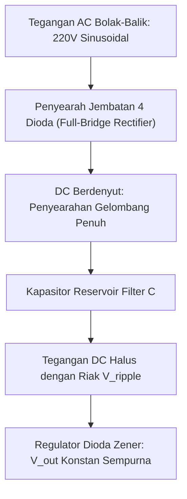

# Modul 041: Komponen Semikonduktor Diskrit: Dioda (Dioda Penyearah, Zener, Schottky, LED, Fotodioda)

**Navigasi**: [⬅️ Master Index](../../INDEX.md) | [Tingkat 3: Tingkat 3: Rangkaian Listrik, Elektronika & Microelectronics](./README.md)
*Sebelumnya*: [040. respons-transien-filter-frekuensi](./040-respons-transien-filter-frekuensi.md) | *Berikutnya*: [042. transistor-bjt](./042-transistor-bjt.md)

---

## 1. Intuisi Dasar Tanpa Jargon ("Seperti Bayi Baru Lahir")
### 1.1 Konsep Inti & Analogi Tanpa Jargon
Pernahkah Anda melihat pintu putar satu arah di stasiun kereta yang hanya bisa didorong maju ke depan dan mengunci mati jika didorong mundur?

### 1.2 Urgensi Rekayasa & Signifikansi Sistemik
Itulah **Dioda**: katup satu arah (*check valve*) di dunia listrik!
Arus listrik bisa mengalir dengan sangat mudah dari Anoda ke Katoda jika diberi dorongan tegangan positif ($> 0.7\text{ V}$), namun diblokir total jika tegangan berbalik arah.
Dioda bukan sekadar saklar penyearah arus: variasinya membuka dunia modern:
- **Dioda Zener**: Menjadi penstabil tegangan presisi saat dibias mundur tembus (*breakdown*).
- **Dioda Schottky**: Menggunakan kontak logam-semikonduktor dengan penurunan tegangan sangat rendah ($0.2\text{ V}$) dan pemulihan ultra-cepat untuk catu daya komputer.
- **LED (Light Emitting Diode)**: Mengubah elektron yang jatuh antar pita energi menjadi partikel cahaya foton warna-warni yang menerangi layar smartphone Anda.
- **Fotodioda**: Membalikkan proses: menangkap cahaya matahari atau sinyal remote TV dan mengubahnya menjadi arus listrik.
[📚 Pelajari: All About Circuits Diodes](https://www.allaboutcircuits.com/textbook/semiconductors/chpt-3/introduction-to-diodes-and-rectifiers/)

## 2. Fondasi Teoretis & Aksiomatik / Matematis
### 2.1 Kerangka Teori Aksiomatik & Formulasi Matematis
### 41.1 Persamaan Arus Dioda Shockley & Resistansi Dinamis ([HyperPhysics Diodes](http://hyperphysics.phy-astr.gsu.edu/hbase/solids/diodcon.html))
Persamaan arus dioda PN:
$$I_D = I_S \left( e^{\frac{V_D}{\eta V_T}} - 1 \right)$$
Di mana:
- $I_S$: Arus saturasi balik (\$10^{-15} \text{ s/d } 10^{-12} \text{ A}$)
- $\eta$: Faktor idealitas ($\eta \approx 1$ untuk Schottky/Germanium, $\eta \approx 1.5 - 2$ untuk Silikon)
- $V_T = \frac{k_B T}{q} \approx 25.86 \text{ mV}$ pada suhu \$300\text{ K}$

### 2.2 Penurunan Matematis Langkah-demi-Langkah
Resistansi dinamis sinyal kecil ($r_d$):
$$r_d = \left( \frac{dI_D}{dV_D} \right)^{-1} = \frac{\eta V_T}{I_D + I_S} \approx \frac{\eta V_T}{I_D}$$
Pada arus bias $I_D = 1\text{ mA}$ dan $\eta = 1$, resistansi dinamis hanya $r_d \approx 26 \, \Omega$.

### 41.2 Jenis-Jenis Dioda Khusus ([Sedra & Smith Microelectronic Circuits](https://global.oup.com/))
1. **Dioda Zener**: Dirancang beroperasi stabil pada wilayah breakdown tegangan balik $V_Z$. Koefisien suhu Zener $< 5\text{ V}$ bernilai negatif (efek Zener murni), sedangkan $> 5\text{ V}$ bernilai positif (efek Avalanche). Dioda pada $\approx 5.1\text{ V}$ memiliki koefisien suhu mendekati nol!
2. **Dioda Schottky**: Sambungan Logam-Semikonduktor (Penghalang Schottky) tanpa pembawa muatan minoritas.
   - Penurunan tegangan maju rendah: $V_F \approx 0.15 - 0.35 \text{ V}$.
   - Waktu pemulihan balik (*Reverse Recovery Time* $t_{rr}$) praktis nol ($< 100\text{ ps}$), sangat ideal untuk frekuensi tinggi MHz.
3. **Light Emitting Diode (LED)**: Semikonduktor Direct Bandgap (Gallium Arsenide / GaN). Energi foton yang dipancarkan:
   $$\lambda = \frac{h c}{E_g} \approx \frac{1240 \text{ eV}\cdot\text{nm}}{E_g}$$
4. **Fotodioda**: Bekerja dalam bias mundur; foton cahaya dengan energi $h\nu > E_g$ menciptakan pasangan elektron-hole di daerah deplesi, menghasilkan arus foto $I_{\text{photo}} = \mathcal{R} \cdot P_{\text{optik}}$ di mana $\mathcal{R}$ adalah responsivitas ($\text{A/W}$).

## 3. Anatomi Teknis & Cara Kerja Internal

Mekanisme Reverse Recovery Time ($t_{rr}$):
Ketika dioda PN yang sedang konduksi tiba-tiba dibias mundur, dioda tidak langsung mati! Pembawa muatan minoritas yang tersimpan di daerah deplesi harus dibersihkan terlebih dahulu, memicu lonjakan arus balik tajam yang dapat membakar transistor pensaklaran tanpa peredam snubber.

#### Tabel Penelusuran Waktu Pemulihan Balik Dioda ($t_{rr}$) & Fenomena Shoot-Through Konverter Daya
| Fase Switching ($t$) | Status Saklar MOSFET Atas | Arah Arus Dioda Flyback ($I_D$) | Muatan Tersimpan Basis ($Q_{rr}$) | Arus Bus DC ($I_{bus}$) | Status Disipasi Daya & Bahaya Ledakan |
|---|---|---|---|---|---|
| Konduksi Maju ($t < 0$) | OFF | Maju $+20.0\text{ A}$ (Arus induktor bebas) | Muatan difusi terakumulasi | $0.0\text{ A}$ | Normal; drop tegangan maju $V_F = 1.0\text{V}$ |
| Switch ON ($t = 0\text{ ns}$) | Mulai konduksi ON | Penurunan arus $\frac{di}{dt} = 500\text{ A}/\mu\text{s}$ | Muatan mulai tersapu keluar | $0.0\text{ A} \to 20.0\text{ A}$ | Tegangan balik mulai teraplikasi |
| Zero Crossing ($t = 40\text{ ns}$) | ON | Melintasi $0\text{ A}$ menuju arah negatif | $Q_{rr}$ masih belum habis tersapu | $20.0\text{ A}$ | Dioda belum memblokir tegangan! |
| Puncak Pemulihan ($t = 70\text{ ns}$) | ON Penuh (Resistansi $R_{DS(on)}$ rendah) | Terbalik mundur $I_{rr} = -35.0\text{ A}$ | Dioda bertindak sebagai hubungan singkat! | $55.0\text{ A}$ ($I_L + |I_{rr}|$) | Korsleting rel catu daya langsung ke tanah! |
| Pemulihan Selesai ($t = 120\text{ ns}$)| ON | Turun tajam ke $0\text{ A}$ | Muatan bersih; $V_D = -400\text{ V}$ | Normal $20.0\text{ A}$ | Lonjakan $V = L_{par} \frac{di_{rr}}{dt} > 600\text{V}$ meledakkan silikon |

## 4. Implementasi Praktis & Kode / Simulasi Riil
```python
import numpy as np

def calculate_rectifier_filter(v_in_rms: float, freq_hz: float, load_current_a: float, max_ripple_v: float) -> dict:
    """
    Menghitung ukuran kapasitor filter untuk penyearah gelombang penuh (Full-Wave Bridge).
    V_peak = V_rms * sqrt(2) - 2 * V_diode_drop
    V_ripple_pp = I_load / (2 * f * C)  =>  C = I_load / (2 * f * V_ripple_pp)
    """
    v_peak = v_in_rms * np.sqrt(2.0) - (2.0 * 0.7) # Drop 2 dioda silikon
    
    # Frekuensi riak penyearah gelombang penuh = 2 * freq_hz (100 Hz untuk PLN 50 Hz)
    f_ripple = 2.0 * freq_hz
    capacitance_farads = load_current_a / (f_ripple * max_ripple_v)
    
    v_dc_average = v_peak - (max_ripple_v / 2.0)
    
    return {
        "v_peak_dc": v_peak,
        "v_dc_average": v_dc_average,
        "capacitance_uf": capacitance_farads * 1e6
    }

res = calculate_rectifier_filter(v_in_rms=12.0, freq_hz=50.0, load_current_a=1.5, max_ripple_v=0.5)
print(f"Tegangan Puncak DC      : {res['v_peak_dc']:.2f} Volt")
print(f"Tegangan DC Rata-rata   : {res['v_dc_average']:.2f} Volt")
print(f"Kapasitor Filter Minimum: {res['capacitance_uf']:.1f} uF (Gunakan standar 3300 uF / 25V)")
```

## 5. Miskonsepsi & Jebakan Industri
1. **Thermal Runaway on Schottky Diodes**: Kebocoran arus balik (*reverse leakage current*) dioda Schottky meningkat eksponensial seiring naiknya suhu. Pada suhu tinggi ($> 125^\circ	ext{C}$), kebocoran ini memanaskan dioda lebih lanjut hingga terjadi kegagalan termal katastropik.
2. **Connecting LEDs in Parallel without Individual Resistors**: Memasang dua LED paralel dengan hanya satu resistor pembatas arus bersama. Karena toleransi tegangan maju $V_F$ sedikit berbeda, satu LED akan menyedot arus mayoritas dan terbakar duluan (*current hogging*).
3. **Peak Inverse Voltage (PIV) Violation**: Memilih dioda dengan rating tegangan PIV lebih rendah dari tegangan puncak balik sirkuit ($PIV_{	ext{bridge}} = V_m$, $PIV_{	ext{setengah gelombang}} = 2V_m$), menyebabkan dioda jebol breakdown dan meledak.

### Studi Kasus Kegagalan Nyata: Waktu Pemulihan Balik (Reverse Recovery trr) Meledakkan MOSFET Konverter Buck SMPS
- **Insiden Kegagalan Konverter Daya 400V**: Pada pengujian inverter catu daya telekomunikasi (SMPS 400V ke 48V berfrekuensi 100 kHz), insinyur mengganti dioda penyearah silikon yang rusak dengan dioda standar pemulihan standar 1N5408 ($t_{rr} \approx 2000\text{ ns}$). Saat catu daya dihidupkan, MOSFET switching meledak seketika dengan semburan percikan api dalam hitungan detik.
- **Akar Masalah Fisika Dioda PN & Muatan Tersimpan**: Ketika dioda sambungan PN mengalirkan arus maju, sejumlah besar pembawa muatan minoritas terinjeksi dan tersimpan di daerah basis netral (*stored minority carrier charge* $Q_{rr}$). Ketika tegangan balik diaplikasikan secara tiba-tiba oleh MOSFET yang menyala, dioda tidak dapat langsung memutus arus. Dioda harus menyapu bersih muatan pembawa minoritas terlebih dahulu selama durasi waktu pemulihan balik (*reverse recovery time* $t_{rr}$). Selama rentang waktu puluhan hingga ratusan nanodetik ini, dioda bertindak sebagai kawat konduktor murni dalam arah terbalik. Arus hubungan singkat masif (*shoot-through current*) mengalir langsung dari rel 400V melalui MOSFET atas dan dioda bawah secara bersamaan, memicu disipasi daya ribuan watt yang menghancurkan struktur kristal silikon MOSFET.

- **Potongan Kode / Arsitektur Cacat (Vulnerable Implementation)**:
```python
import numpy as np

def simulate_diode_reverse_recovery(trr_ns=300.0, di_dt_A_per_us=500.0, v_bus=400.0):
    # Parameter switching konverter daya
    I_forward = 20.0  # Arus maju sebelum pemadaman (A)
    di_dt = di_dt_A_per_us * 1e6  # A/s
    trr_s = trr_ns * 1e-9
    
    # Arus puncak pemulihan balik: Irr = sqrt(2 * Qrr * di/dt) ~ di/dt * ta
    # Dengan aproksimasi segitiga standar: trr = ta + tb
    ta = 0.6 * trr_s
    I_rr_peak = di_dt * ta
    
    # Total muatan pemulihan balik Qrr
    Q_rr = 0.5 * I_rr_peak * trr_s
    
    # Puncak arus yang harus dipikul MOSFET selama turn-on:
    I_mosfet_peak = I_forward + I_rr_peak
    
    # Energi rugi switching pemulihan balik per siklus: E_rr ~ 0.5 * V_bus * Irr * tb
    tb = 0.4 * trr_s
    E_rr_joules = 0.5 * v_bus * I_rr_peak * tb
    
    # Disipasi daya pada frekuensi switching 100 kHz
    f_sw = 100e3
    P_loss_rr_watts = E_rr_joules * f_sw
    
    catastrophic_power_failure = P_loss_rr_watts > 150.0 or I_mosfet_peak > 50.0
    
    return {
        "I_rr_peak_A": I_rr_peak,
        "Q_rr_uC": Q_rr * 1e6,
        "peak_mosfet_current_A": I_mosfet_peak,
        "reverse_recovery_loss_W": P_loss_rr_watts,
        "destruction_predicted": catastrophic_power_failure
    }

# Evaluasi dioda lambat standar (trr = 300ns) vs dioda Schottky SiC (trr ~ 10ns)
standard_diode = simulate_diode_reverse_recovery(trr_ns=300.0)
sic_schottky = simulate_diode_reverse_recovery(trr_ns=10.0)
# Dioda standar: Irr = 90A, Daya rugi = 432W (MOSFET MELEDAK!)
# Dioda SiC: Irr = 3A, Daya rugi = 0.48W (Sangat dingin & efisien)
```

- **Adopsi Semikonduktor Wide-Bandgap (SiC/GaN)**: Untuk konverter daya frekuensi tinggi tegangan tinggi, industri modern meninggalkan dioda sambungan silikon PN konvensional dan beralih ke dioda Schottky Silikon Karbida (SiC Schottky Barrier Diodes / SBD). Karena dioda Schottky adalah perangkat unipolar pembawa muatan mayoritas (*majority-carrier device*), muatan tersimpan minoritas $Q_{rr}$ bernilai praktis nol, mengeliminasi fenomena shoot-through sepenuhnya.

## 6. Proyek Latihan & Rubrik Penilaian Mandiri
### Tingkat 1 (Pemula) - Rangkaian Regulator Tegangan Dioda Zener
Rancang rangkaian regulator tegangan Zener $5.1	ext{ V}$ dari sumber tegangan DC yang berfluktuasi antara $9	ext{ V} \le V_{	ext{in}} \le 15	ext{ V}$ untuk menyuplai beban dengan arus $I_L = 20	ext{ mA}$. Hitung nilai resistor seri $R_S$ dan disipasi daya maksimum pada resistor dan dioda Zener.

### Tingkat 2 (Menengah) - Model SPICE Parameter Ekstraksi Dioda Shockley
Tulis skrip Python yang menerima tabel data pengukuran laboratorium arus-tegangan ($I_D$ vs $V_D$) dari dioda fisik nyata, melakukan *non-linear least squares curve fitting* untuk mengekstraksi nilai arus saturasi $I_S$, faktor idealitas $\eta$, dan resistansi parasitik seri $R_S$.

### Tingkat 3 (Mahir) - Rangkaian Pengganda Tegangan Cockcroft-Walton Multi-Tingkat
Analisis dan simulasikan rangkaian kaskade pengali tegangan Cockcroft-Walton 4-tingkat yang mengubah tegangan input AC \$12	ext{ V RMS}$ menjadi output DC bertegangan tinggi $> 100	ext{ V}$. Hitung penurunan tegangan drop beban dan riak tegangan sebagai fungsi frekuensi switching dan nilai kapasitor.

#### Rubrik Penilaian
- **40% Ketepatan Teori Sambungan Semikonduktor**: Karakteristik kurva $I-V$, tegangan lutut (*knee voltage*), dan breakdown dimodelkan tepat.
- **30% Analisis Manajemen Termal**: Menghitung kenaikan suhu sambungan $T_j = T_a + P_d \cdot R_{	heta JA}$ agar tidak melebihi batas \$150^\circ	ext{C}$.
- **30% Validitas Desain Penyearah**: Perhitungan PIV, arus lonjakan awal (*surge current* $I_{FSM}$), dan pemilihan kapasitor filter akurat.

### Tingkat 1: Dasar
- **Tugas**: Bangun model persamaan arus dioda Shockley non-linier $I = I_S \left( e^{\frac{V}{n V_T}} - 1 \right)$ termasuk resistansi seri internal ($R_s$) dan selesaikan titik kerja DC menggunakan metode iterasi Newton-Raphson.
- **Petunjuk Perancangan Arsitektur**:
  - $f(V_D) = I_S \left( e^{\frac{V_D}{n V_T}} - 1 \right) - \frac{V_{in} - V_D}{R_L} = 0$.
  - Hitung tegangan termal: $V_T = \frac{k_B T}{q} \approx 25.86\text{ mV}$ pada $300\text{ K}$.
- **Test Vector & Kasus Uji Ekstrem**:
  - *Tegangan Maju $V_{in} = 5.0\text{ V}, R_L = 1\text{ k}\Omega$*: Solusi tegangan dioda $V_D \approx 0.65\text{ V} - 0.72\text{ V}$.
  - *Bias Mundur $V_{in} = -10.0\text{ V}$*: Arus saturasi terbalik konvergen mendekati $-I_S$ ($10^{-14}\text{ A}$).
- **Rubrik Penilaian Mandiri**: 40% Solver Newton-Raphson Dioda Shockley Konvergen, 30% Perhitungan Tegangan Termal $V_T(T)$ Tepat, 30% Penanganan Bias Maju & Mundur.

### Tingkat 2: Menengah
- **Tugas**: Implementasikan model kapasitansi dioda dinamis sambungan PN yang memperhitungkan kapasitansi deplesi bias mundur (*junction capacitance*) $C_j(V) = \frac{C_{j0}}{(1 - V/V_0)^m}$ dan kapasitansi difusi bias maju (*diffusion capacitance*) $C_d(I) = \tau_T \frac{I}{n V_T}$.
- **Petunjuk Perancangan Arsitektur**:
  - Formulasikan transisi mulus antara rejim deplesi dan rejim difusi untuk mencegah singularitas saat $V \to V_0$.
  - Simulasikan tanggapan pengosongan muatan transien frekuensi tinggi.
- **Test Vector & Kasus Uji Ekstrem**:
  - *Bias Mundur Tinggi*: Kapasitansi mengecil asimptotik sesuai tebal ruang muatan ruang.
  - *Bias Maju Besar*: Kapasitansi difusi mendominasi sebanding dengan arus maju $I_F$.
- **Rubrik Penilaian Mandiri**: 40% Formulasi Model Kapasitansi Dinamis Bebas Singularitas, 30% Perhitungan Muatan Difusi $\tau_T$ Presisi, 30% Validasi Kurva $C-V$ Eksperimental.

### Tingkat 3: Mahir
- **Tugas**: Rancang simulator sirkuit jembatan penyearah gelombang penuh sinkron (Synchronous Rectification) berbasis MOSFET GaN terkontrol digital untuk menggantikan dioda pasif pada konverter LLC Resonant 1 MHz, termasuk deteksi zero-current-switching (ZCS) dan proteksi konduksi terbalik body-diode.
- **Petunjuk Perancangan Arsitektur**:
  - Modelkan komparator pengindera tegangan drain-source super cepat dengan threshold histeresis $-5\text{ mV}$ untuk mematikan gerbang sebelum arus berbalik negatif.
  - Hitung peningkatan efisiensi daya konverter dibanding penyearah dioda Schottky silikon.
- **Test Vector & Kasus Uji Ekstrem**:
  - *Transisi Arus Balik Zero-Crossing*: Matikan gerbang dalam waktu $\le 15\text{ ns}$ saat $I_{drain} \to 0$.
  - *Evaluasi Reduksi Rugi Disipasi*: Penurunan disipasi daya pada arus beban 40A mencapai $\ge 70\%$.
- **Rubrik Penilaian Mandiri**: 40% Kontrol Penginderaan ZCS Gate Driver Tepat, 30% Eliminasi Konduksi Body-Diode Parasitik, 30% Kalkulasi Peningkatan Efisiensi Daya LLC.

## 7. Rekomendasi Sumber Belajar Standar Emas
| Kategori | Judul Sumber & Tautan Langsung | Deskripsi Singkat |
|---|---|---|
| 📖 Buku Teks | [Microelectronic Circuits (Sedra & Smith)](https://global.oup.com/) | Buku teks elektronika sirkuit analog dan peranti semikonduktor paling terkemuka. |
| 🎓 Kuliah Terbuka | [MIT OCW 6.002 Circuits and Electronics](https://ocw.mit.edu/courses/6-002-circuits-and-electronics-spring-2007/) | Analisis peranti non-linier, model sinyal besar vs kecil dioda, dan aplikasi penyearah. |
| 🔬 Makalah Seminal | [Zur Halbleitertheorie der Sperrschicht- und Spitzengleichrichter (Schottky, 1938)](https://doi.org/10.1007/BF01340360) | Penjelasan fisik Walter Schottky mengenai antarmuka logam-semikonduktor. |
| 💻 Lab Interaktif | [Falstad Diodes & Rectifiers Simulator](https://www.falstad.com/circuit/) | Eksplorasi interaktif penyearah setengah gelombang, jembatan penuh, dan zener. |

---
*Navigasi Cepat*: [Ke Tingkat 3](./README.md) | [Ke Master Index](../../INDEX.md) | *Sebelumnya*: [040. respons-transien-filter-frekuensi](./040-respons-transien-filter-frekuensi.md) | *Berikutnya*: [042. transistor-bjt](./042-transistor-bjt.md)
