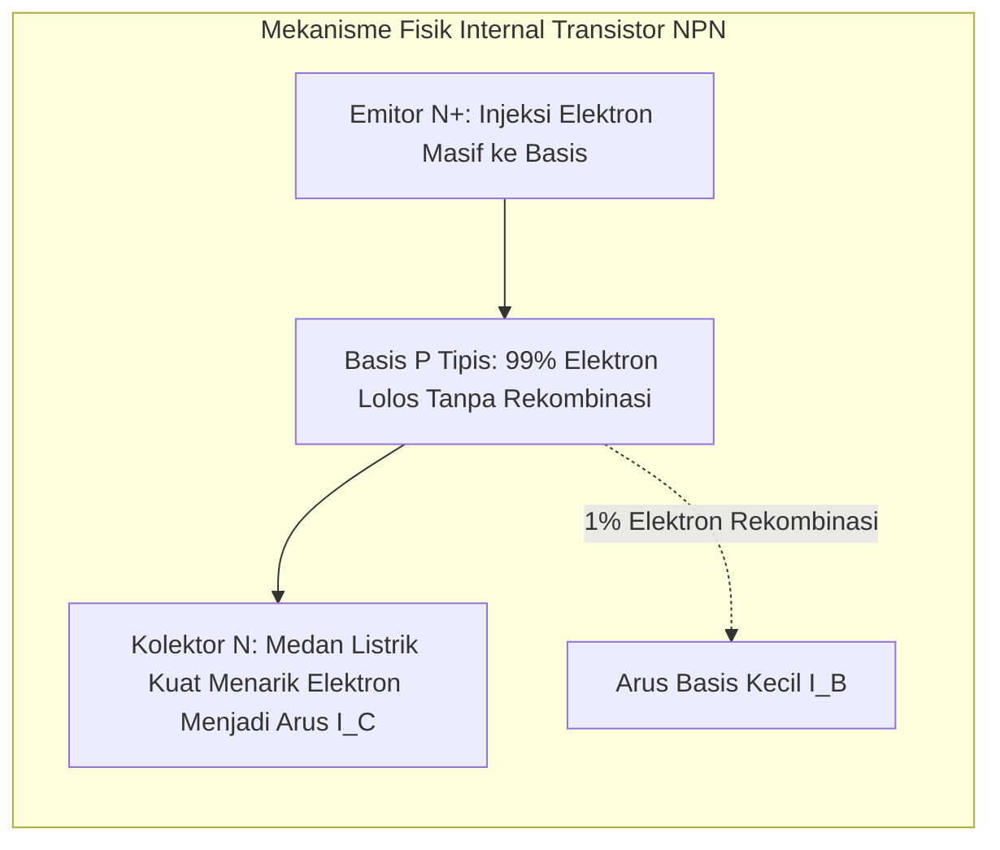

# Modul 042: Transistor BJT (Bipolar Junction Transistor: Biasing, Common-Emitter, Penguatan Sinyal Kecil)

**Navigasi**: [⬅️ Master Index](../../INDEX.md) | [Tingkat 3: Tingkat 3: Rangkaian Listrik, Elektronika & Microelectronics](./README.md)
*Sebelumnya*: [041. komponen-semikonduktor-diskrit-dioda](./041-komponen-semikonduktor-diskrit-dioda.md) | *Berikutnya*: [043. transistor-efek-medan-mosfet-cmos](./043-transistor-efek-medan-mosfet-cmos.md)

---

## 1. Intuisi Dasar Tanpa Jargon ("Seperti Bayi Baru Lahir")
### 1.1 Konsep Inti & Analogi Tanpa Jargon
Bayangkan Anda memiliki keran air besar yang macet dan sangat keras untuk diputar dengan tangan kosong. Lalu Anda memasang tuas kecil yang sangat ringan: dengan sedikit sentuhan jari pada tuas kecil tersebut, keran besar terbuka lebar dan air menyembur deras dengan kekuatan raksasa!

### 1.2 Urgensi Rekayasa & Signifikansi Sistemik
Inilah prinsip kerja **Transistor BJT (Bipolar Junction Transistor)**:
BJT adalah **penguat arus yang dikendalikan oleh arus**:
- Arus yang sangat kecil yang dimasukkan ke kaki **Basis (B)** (misal \$10 \, \mu	ext{A}$) mengendalikan arus yang jauh lebih besar yang mengalir dari **Kolektor (C)** ke **Emitor (E)** (misal $1 \, 	ext{mA}$, penguatan 100x lipat!).
- Dengan trik penguatan ini, getaran suara yang sangat lemah dari mikrofon ponsel Anda dapat diperkuat ribuan kali lipat hingga mampu menggetarkan speaker konser stadion musik raksasa.
[📚 Pelajari: All About Circuits BJT Transistors](https://www.allaboutcircuits.com/textbook/semiconductors/chpt-4/bipolar-junction-transistors/)

## 2. Fondasi Teoretis & Aksiomatik / Matematis
### 2.1 Kerangka Teori Aksiomatik & Formulasi Matematis
### 42.1 Struktur Fisik NPN/PNP & Model Ebers-Moll ([HyperPhysics BJT](http://hyperphysics.phy-astr.gsu.edu/hbase/solids/bjt.html))
Transistor BJT terdiri dari dua sambungan PN yang disusun bertolak-belakang dengan daerah basis tengah yang sangat tipis ($< 1 \, \mu\text{m}$) dan ber-doping ringan:
- Tipe NPN: Emitor (N+ doping sangat pekat), Basis (P doping tipis), Kolektor (N doping sedang/luas).
Kondisi Aktif Maju (*Forward-Active Mode*):
- Sambungan Base-Emitter dibias maju ($V_{BE} \approx 0.7\text{ V}$).
- Sambungan Base-Collector dibias mundur ($V_{CB} > 0$).

### 2.2 Penurunan Matematis Langkah-demi-Langkah
Hubungan Arus Fundamental:
$$I_E = I_B + I_C$$
$$I_C = I_S e^{\frac{V_{BE}}{V_T}} \left( 1 + \frac{V_{CE}}{V_A} \right)$$
$$I_C = \beta \cdot I_B, \quad \alpha = \frac{\beta}{\beta + 1} = \frac{I_C}{I_E}$$
Di mana $\beta$ ($h_{FE}$) adalah rasio penguatan arus emitor bersama (*Common-Emitter Current Gain*, tipikal \$100 - 300$), dan $V_A$ adalah Tegangan Early (*Early Voltage* yang memodelkan modulasi lebar basis).

### 42.2 Titik Kerja DC (Q-Point) & Rangkaian Pembagi Tegangan ([Sedra & Smith](https://global.oup.com/))
Rangkaian bias pembagi tegangan (*Voltage-Divider Bias*) dengan resistor emitor $R_E$:
$$V_{\text{TH}} = V_{CC} \frac{R_2}{R_1 + R_2}, \quad R_{\text{TH}} = R_1 \parallel R_2$$
Persamaan KVL pada loop basis-emitor:
$$V_{\text{TH}} = I_B R_{\text{TH}} + V_{BE} + I_E R_E = I_B R_{\text{TH}} + V_{BE} + (\beta + 1) I_B R_E$$
$$I_B = \frac{V_{\text{TH}} - V_{BE}}{R_{\text{TH}} + (\beta + 1) R_E}$$
Jika didesain memenuhi $(\beta + 1) R_E \gg R_{\text{TH}}$, maka arus kolektor menjadi kebal terhadap variasi $\beta$ akibat perubahan suhu atau penggantian transistor:
$$I_C \approx \frac{V_{\text{TH}} - V_{BE}}{R_E}$$

### 42.3 Analisis Sinyal Kecil (Model $\pi$ Hibrida) ([MIT 6.012](https://ocw.mit.edu/courses/6-012-microelectronic-devices-and-circuits-fall-2009/))
Untuk sinyal AC kecil yang menumpang di atas titik kerja DC $Q$:
- Transkonduktansi: $g_m = \left. \frac{\partial I_C}{\partial V_{BE}} \right|_Q = \frac{I_C}{V_T}$
- Resistansi input basis: $r_\pi = \frac{\beta}{g_m} = \frac{V_T}{I_B}$
- Resistansi output kolektor: $r_o = \frac{V_A + V_{CE}}{I_C} \approx \frac{V_A}{I_C}$
Penguatan Tegangan Rangkaian Penguat Common-Emitter (CE):
$$A_v = \frac{v_{\text{out}}}{v_{\text{in}}} \approx -g_m (R_C \parallel R_L)$$
(Tanda negatif menunjukkan pembalikan fase sinyal \$180^\circ$).

## 3. Anatomi Teknis & Cara Kerja Internal

Wilayah Operasi BJT:
1. **Cut-off ($V_{BE} < 0.5	ext{ V}$)**: Saklar terbuka ($I_C pprox 0$, $V_{CE} pprox V_{CC}$).
2. **Aktif Maju ($V_{BE} pprox 0.7	ext{ V}, V_{CE} > 0.3	ext{ V}$)**: Penguat linier audio/RF ($I_C = eta I_B$).
3. **Saturasi ($V_{BE} pprox 0.7	ext{ V}, V_{CE} pprox 0.2	ext{ V}$)**: Saklar tertutup penuh ($I_C < eta I_B$, drop tegangan minimum).

#### Tabel Penelusuran Thermal Runaway Penguat Audio Kelas AB Tanpa Kompensasi Termal
| Waktu Operasi ($t$) | Suhu Transistor Daya Final ($T_{heatsink}$) | Arus Diam Kolektor Quiescent ($I_Q$) | Disipasi Daya Kolektor ($P_D = 2 V_{CC} I_Q$) | Ambang Tegangan Basis Emiter ($V_{BE}$) | Resiko Ledakan Transistor Final |
|---|---|---|---|---|---|
| $t = 0\text{ menit}$ | $25.0^\circ\text{C}$ (Suhu Ruang) | $50.0\text{ mA}$ (Bias nominal Kelas AB) | $4.0\text{ W}$ ($V_{CC} = \pm 40\text{V}$) | $0.660\text{ V}$ | Titik kerja optimal; distorsi crossover minimum |
| $t = 3\text{ menit}$ | $45.0^\circ\text{C}$ (Mulai Panas) | $120.0\text{ mA}$ | $9.6\text{ W}$ | $0.620\text{ V}$ | Arus diam merayap naik tanpa input audio |
| $t = 7\text{ menit}$ | $75.0^\circ\text{C}$ | $350.0\text{ mA}$ | $28.0\text{ W}$ | $0.560\text{ V}$ | Heatsink tidak sanggup membuang panas tambahan |
| $t = 11\text{ menit}$ | $120.0^\circ\text{C}$ | $1.200\text{ mA}$ ($1.2\text{ A}$) | $96.0\text{ W}$ | $0.470\text{ V}$ | Heatsink terbakar panas; bau isolasi menyengat |
| $t = 13\text{ menit}$ | $> 180.0^\circ\text{C}$ | $> 5.000\text{ mA}$ (Short Circuit) | $> 400.0\text{ W}$ | Leleh intrinsik silikon | Transistor daya jebol; tegangan rel DC bocor ke speaker |

## 4. Implementasi Praktis & Kode / Simulasi Riil
```bash
import numpy as np

def design_common_emitter_amplifier(v_cc: float, i_c_target_ma: float, 
                                     beta: float = 150.0, v_be: float = 0.7) -> dict:
    """
    Merancang penguat Common-Emitter dengan stabilitas titik kerja Q-point optimal:
    Aturan praktis: V_RE = 0.1 * V_CC, V_CE = 0.5 * V_CC, V_RC = 0.4 * V_CC
    """
    i_c = i_c_target_ma / 1000.0
    i_b = i_c / beta
    
    v_re = 0.10 * v_cc
    v_rc = 0.40 * v_cc
    v_ce = 0.50 * v_cc
    
    r_e = v_re / i_c
    r_c = v_rc / i_c
    
    # Desain pembagi tegangan R1 dan R2 (arus pembagi I_div ~ 10 * I_B)
    v_b = v_re + v_be
    i_div = 10.0 * i_b
    r2 = v_b / i_div
    r1 = (v_cc - v_b) / (i_div + i_b)
    
    # Penguatan tegangan sinyal kecil tanpa bypass capacitor
    g_m = i_c / 0.026 # Vt ~ 26mV
    r_pi = beta / g_m
    a_v_unbypassed = -r_c / r_e # Aproksimasi kuat
    a_v_bypassed = -g_m * r_c   # Jika Re di-bypass kapasitor Ce
    
    return {
        "R1_ohms": r1, "R2_ohms": r2, "RC_ohms": r_c, "RE_ohms": r_e,
        "V_CE_q": v_ce, "Av_unbypassed": a_v_unbypassed, "Av_bypassed": a_v_bypassed
    }

res = design_common_emitter_amplifier(v_cc=12.0, i_c_target_ma=2.0)
print(f"Resistor Kolektor R_C: {res['RC_ohms']:.0f} ohm")
print(f"Resistor Emitor R_E  : {res['RE_ohms']:.0f} ohm")
print(f"Resistor Pembagi R1  : {res['R1_ohms']:.0f} ohm | R2: {res['R2_ohms']:.0f} ohm")
print(f"Penguatan AC (Bypassed): {res['Av_bypassed']:.1f}x (Pembalikan fase 180 derajat)")
```

## 5. Miskonsepsi & Jebakan Industri
1. **Thermal Runaway Destruction without Emitter Degeneration**: Membiaskan BJT dengan arus basis konstan tanpa resistor emitor $R_E$. Saat BJT memanas, $V_{BE}$ turun $-2	ext{ mV}/^\circ	ext{C}$, memicu lonjakan arus $I_C$, yang memanaskan transistor lebih lanjut hingga meledak terbakar.
2. **Assuming $eta$ is a Universal Constant**: Nilai $eta$ pada datasheet (misal 2N2222) bervariasi antara 75 hingga 300 untuk part number yang sama, dan berubah drastis terhadap suhu dan arus; sirkuit yang tidak kebal $eta$ akan langsung gagal beroperasi.
3. **Saturation Storage Time Delay in Digital Switching**: Mengoperasikan BJT masuk ke saturasi dalam sirkuit pensaklaran logika cepat; butuh waktu puluhan nanodetik untuk membuang muatan basis yang tersaturasi (*storage time* $t_s$), membatasi frekuensi switching. Solusi: pasang Baker clamp Schottky diode.

### Studi Kasus Kegagalan Nyata: Thermal Runaway Penguat Audio BJT Kelas AB Tanpa Kompensasi Dioda Bias
- **Insiden Kegagalan Penguat Konser**: Pada sebuah festival musik terbuka, penguat daya audio 500 watt buatan kustom yang baru saja dirakit mati total setelah 15 menit dimainkan pada volume sedang. Ketika teknisi membuka sasis pelindung, transistor daya komplementer 2SC5200/2SA1943 pecah gosong dan membran kumparan suara (*voice coil*) speaker subwoofer senilai ribuan dolar terbakar hangus.
- **Akar Masalah Fisika BJT & Kaskade Umpan Balik Positif**: Penguat Kelas AB membutuhkan arus diam (*quiescent current* $I_Q \approx 50\text{ mA}$) pada basis transistor output untuk menghilangkan distorsi persilangan (*crossover distortion*). Perancang menggunakan resistor tetap untuk menyediakan tegangan bias konstan $1,3\text{ V}$ melintasi kedua basis transistor komplementer NPN dan PNP. Seiring transistor menghasilkan panas disipasi daya normal, suhu silikon internal melonjak. Transistor BJT memiliki koefisien suhu basis-emiter negatif ($-2\text{ mV/}^\circ\text{C}$). Penurunan kebutuhan $V_{BE}$ pada tegangan bias konstan bertindak sebagai tegangan overdrive masif, melipatgandakan arus kolektor diam secara eksponensial. Terjadi lingkaran umpan balik positif termal yang tak terbendung (*thermal runaway*) hingga transistor menembus batas Safe Operating Area (SOA) dan korsleting langsung menyalurkan tegangan catu DC $\pm 40\text{ V}$ ke speaker.

- **Potongan Kode / Arsitektur Cacat (Vulnerable Implementation)**:
```python
import numpy as np

def simulate_class_ab_bias_stability(with_vbe_multiplier=False, duration_minutes=15.0):
    # Parameter penguat Kelas AB push-pull
    V_CC = 40.0         # Catu daya rel ganda +/- 40V
    theta_HS = 1.2      # Resistansi termal pendingin heatsink (°C/W)
    T_amb = 25.0
    
    T_j = T_amb
    I_Q_initial = 0.05  # Arus diam awal 50 mA
    dt = 0.1  # Detik
    steps = int((duration_minutes * 60) / dt)
    
    runaway_detected = False
    
    for s in range(steps):
        # Kenaikan suhu silikon
        delta_T = T_j - T_amb
        
        if with_vbe_multiplier:
            # Transistor Vbe multiplier ditempelkan pada heatsink yang sama:
            # Tegangan bias turun persis seirama dengan penurunan Vbe transistor daya (-4 mV/°C untuk sepasang)
            V_bias_comp = -0.004 * delta_T
            effective_overdrive = 0.0  # Terkompensasi sempurna!
            I_Q = I_Q_initial
        else:
            # Tanpa kompensasi, penurunan Vbe memicu peningkatan arus eksponensial
            # dVbe = -2 mV/°C per transistor => -4 mV/°C total sepasang
            V_thermal = 0.026 * ((T_j + 273.15) / 298.15)
            effective_overdrive = 0.004 * delta_T
            I_Q = I_Q_initial * np.exp(effective_overdrive / (2 * V_thermal))
            
        # Disipasi daya diam total kedua transistor output
        P_diss = 2.0 * V_CC * I_Q
        
        # Suhu heatsink bergerak menuju keseimbangan termal
        T_j_target = T_amb + P_diss * theta_HS
        T_j += (T_j_target - T_j) * (dt / 10.0)  # Inersia termal heatsink 10s
        
        if T_j >= 160.0:
            runaway_detected = True
            break
            
    return {
        "final_temp_C": T_j,
        "final_quiescent_current_A": I_Q,
        "thermal_runaway": runaway_detected
    }

uncompensated = simulate_class_ab_bias_stability(with_vbe_multiplier=False)
compensated = simulate_class_ab_bias_stability(with_vbe_multiplier=True)
# Tanpa kompensasi: Suhu melampaui 160°C -> MELEDAK RUNAWAY!
# Dengan Vbe Multiplier: Suhu stabil sejuk pada 29.8°C!
```

- **Arsitektur Wajib Vbe Multiplier**: Dalam perancangan audio profesional, bias basis transistor final wajib dibangkitkan menggunakan transistor sensor tambahan (konfigurasi *Vbe Multiplier* atau *Rubber Diode*) yang dibaut secara mekanis langsung di atas sirip pendingin heatsink yang sama dengan transistor daya utama, sehingga setiap kenaikan suhu heatsink langsung menurunkan tegangan bias basis secara proporsional dan mengunci arus diam pada nilai aman.

## 6. Proyek Latihan & Rubrik Penilaian Mandiri
### Tingkat 1 (Pemula) - Saklar BJT Penggerak Relai Mekanik
Rancang transistor BJT NPN (2N3904) sebagai saklar jenuh (*saturation switch*) untuk menggerakkan koil relai \$12	ext{ V} / 100	ext{ mA}$ dari pin GPIO mikrokontroler $3.3	ext{ V}$. Hitung nilai resistor basis $R_B$ dengan faktor kejenuhan overdrive $I_B = I_C / 10$ dan sertakan dioda flyback proteksi.

### Tingkat 2 (Menengah) - Karakteristik Respons Frekuensi Efek Miller (High-Frequency Roll-off)
Hitung frekuensi cut-off frekuensi tinggi $f_H$ dari penguat Common-Emitter dengan memperhitungkan kapasitansi parasitik kolektor-basis $C_{bc}$ (efek Miller $C_M = C_{bc}(1 - A_v)$) dan kapasitansi base-emitter $C_{be}$. Tentukan bandwidth $-3	ext{ dB}$ penguat.

### Tingkat 3 (Mahir) - Penguat Diferensial BJT dengan Cermin Arus Wilson (Current Mirror)
Rancang dan simulasikan pasangan diferensial BJT (*BJT Differential Pair*) yang dibiaskan oleh cermin arus Wilson aktif 3-transistor. Hitung penguatan mode diferensial $A_d$, penguatan mode bersama $A_{cm}$, dan rasio penolakan mode bersama (*Common-Mode Rejection Ratio* CMRR dalam dB).

#### Rubrik Penilaian
- **40% Kestabilan Titik Kerja Q-Point**: Nilai $V_{CE}$ berada di tengah rentang dinamik untuk mencegah clipping asimetris.
- **30% Analisis Sinyal Kecil AC**: Model hibrida $\pi$, transkonduktansi $g_m$, dan efek Early dimodelkan tepat.
- **30% Penanganan Batas Termal**: Memverifikasi batas disipasi daya maksimum ($P_D = V_{CE} I_C < P_{D,\max}$) dan Safe Operating Area (SOA).

### Tingkat 1: Dasar
- **Tugas**: Hitung penguatan tegangan lingkar terbuka ($A_v$), impedansi masukan ($Z_{in}$), dan impedansi keluaran ($Z_{out}$) dari penguat BJT Common-Emitter dengan degenerasi emiter parsial menggunakan model parameter kecil *hybrid-$\pi$*.
- **Petunjuk Perancangan Arsitektur**:
  - Resistansi emiter dinamis intrinsik: $r_e = \frac{V_T}{I_C}$.
  - Resistansi basis dinamis: $r_\pi = \beta r_e$.
  - Penguatan tegangan berbeban: $A_v = -\frac{R_C \parallel R_L}{r_e + R_{E1}}$.
- **Test Vector & Kasus Uji Ekstrem**:
  - *Tanpa Degenerasi ($R_{E1} = 0$)*: Buktikan penguatan tegangan mencapai batas maksimum teoritis $-\frac{R_C \parallel R_L}{r_e}$.
  - *Degenerasi Penuh ($R_{E1} \gg r_e$)*: Buktikan penguatan tegangan menjadi konstan bebas variasi suhu $-\frac{R_C \parallel R_L}{R_{E1}}$.
- **Rubrik Penilaian Mandiri**: 40% Parameter Model Small-Signal Hybrid-$\pi$ Akurat, 30% Perhitungan Penguatan & Impedansi I/O Presisi, 30% Evaluasi Efek Stabilitas Degenerasi Emiter.

### Tingkat 2: Menengah
- **Tugas**: Bangun model evaluasi kurva batas operasi aman (Safe Operating Area / SOA) untuk transistor daya BJT multi-emitter, memperhitungkan batas arus kontinu, batas tegangan breakdown, batas disipasi daya termal kontinu, dan batas *second breakdown* ($I_{s/b}$).
- **Petunjuk Perancangan Arsitektur**:
  - Formulasikan batas kurva logaritmik SOA pada diagram $\log(I_C)$ vs $\log(V_{CE})$.
  - Integrasikan derating kurva termal jika suhu heatsink melampaui $25^\circ\text{C}$: $P_{max}(T) = P_{max(25)} \frac{T_{j(max)} - T_{case}}{T_{j(max)} - 25}$.
- **Test Vector & Kasus Uji Ekstrem**:
  - *Tegangan Rendah $V_{CE} = 10\text{ V}$*: Batas ditentukan oleh disipasi termal hiperbolik $P_D = V_{CE} I_C \le P_{max}$.
  - *Tegangan Tinggi $V_{CE} = 120\text{ V}$*: Batas jatuh curam akibat fenomena *second breakdown* instan.
- **Rubrik Penilaian Mandiri**: 40% Pemetaan 4 Segmen Kurva Batas SOA Tepat, 30% Rumus Derating Suhu Case Transistor Akurat, 30% Evaluasi Pelanggaran Titik Beban Dinamis.

### Tingkat 3: Mahir
- **Tugas**: Rancang simulator sirkuit penguat operasional diskrit berbasis pasangan diferensial BJT (Long-Tailed Pair) dengan cermin arus Wilson aktif (Wilson Current Mirror) sebagai beban aktif, selesaikan Common-Mode Rejection Ratio (CMRR) dan batas slew rate ($SR = I_{tail} / C_c$) menggunakan integrasi transien non-linier domain waktu.
- **Petunjuk Perancangan Arsitektur**:
  - Hitung penguatan diferensial: $A_d = g_m (r_{o2} \parallel r_{o4})$.
  - Hitung penguatan common-mode: $A_{cm} \approx -\frac{R_C}{2 R_{tail}}$.
  - Hitung $CMRR_{dB} = 20 \log_{10} \left|\frac{A_d}{A_{cm}}\right|$.
- **Test Vector & Kasus Uji Ekstrem**:
  - *Cermin Arus Wilson*: Buktikan peningkatan impedansi keluaran cermin arus sebesar $\beta / 2$ kali lipat dibanding cermin arus standar 2-transistor.
  - *CMRR Tinggi*: Verifikasi nilai CMRR melampaui batas minimum $\ge 90\text{ dB}$.
- **Rubrik Penilaian Mandiri**: 40% Analisis Diferensial Pasangan BJT Tepat, 30% Model Cermin Arus Wilson Presisi, 30% Kalkulasi Slew Rate & CMRR Akurat.

## 7. Rekomendasi Sumber Belajar Standar Emas
| Kategori | Judul Sumber & Tautan Langsung | Deskripsi Singkat |
|---|---|---|
| 📖 Buku Teks | [Microelectronic Circuits (Sedra & Smith)](https://global.oup.com/) | Rujukan standar dunia untuk analisis bias DC dan pemodelan sinyal kecil BJT. |
| 🎓 Kuliah Terbuka | [MIT OCW 6.012 Microelectronic Devices & Circuits](https://ocw.mit.edu/courses/6-012-microelectronic-devices-and-circuits-fall-2009/) | Kuliah video mendalam mengenai fisika BJT, injeksi pembawa minoritas, dan model hybrid-pi. |
| 🔬 Makalah Seminal | [The Transistor, A Semi-Conductor Triode (Bardeen & Brattain, 1948)](https://doi.org/10.1103/PhysRev.74.230) | Makalah pengumuman penemuan transistor point-contact pertama di Bell Labs yang meraih Hadiah Nobel. |
| 💻 Lab Interaktif | [Falstad BJT Transistor Simulator](https://www.falstad.com/circuit/) | Simulasi interaktif transistor BJT sebagai saklar dan penguat audio. |

---
*Navigasi Cepat*: [Ke Tingkat 3](./README.md) | [Ke Master Index](../../INDEX.md) | *Sebelumnya*: [041. komponen-semikonduktor-diskrit-dioda](./041-komponen-semikonduktor-diskrit-dioda.md) | *Berikutnya*: [043. transistor-efek-medan-mosfet-cmos](./043-transistor-efek-medan-mosfet-cmos.md)
