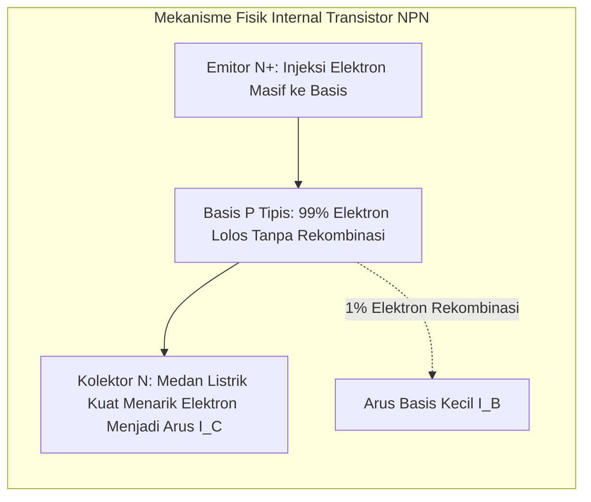

# Modul 042: Transistor BJT (Bipolar Junction Transistor: Biasing, Common-Emitter, Penguatan Sinyal Kecil)

**Navigasi**: [⬅️ Master Index](../../INDEX.md) | [Tingkat 3: Tingkat 3: Rangkaian Listrik, Elektronika & Microelectronics](./README.md)
*Sebelumnya*: [041. komponen-semikonduktor-diskrit-dioda](./041-komponen-semikonduktor-diskrit-dioda.md) | *Berikutnya*: [043. transistor-efek-medan-mosfet-cmos](./043-transistor-efek-medan-mosfet-cmos.md)

---

## 1. Intuisi Dasar Tanpa Jargon ("Seperti Bayi Baru Lahir")
Bayangkan Anda memiliki keran air besar yang macet dan sangat keras untuk diputar dengan tangan kosong. Lalu Anda memasang tuas kecil yang sangat ringan: dengan sedikit sentuhan jari pada tuas kecil tersebut, keran besar terbuka lebar dan air menyembur deras dengan kekuatan raksasa!

Inilah prinsip kerja **Transistor BJT (Bipolar Junction Transistor)**:
BJT adalah **penguat arus yang dikendalikan oleh arus**:
- Arus yang sangat kecil yang dimasukkan ke kaki **Basis (B)** (misal $10 \, \mu	ext{A}$) mengendalikan arus yang jauh lebih besar yang mengalir dari **Kolektor (C)** ke **Emitor (E)** (misal $1 \, 	ext{mA}$, penguatan 100x lipat!).
- Dengan trik penguatan ini, getaran suara yang sangat lemah dari mikrofon ponsel Anda dapat diperkuat ribuan kali lipat hingga mampu menggetarkan speaker konser stadion musik raksasa.
[📚 Pelajari: All About Circuits BJT Transistors](https://www.allaboutcircuits.com/textbook/semiconductors/chpt-4/bipolar-junction-transistors/)

## 2. Fondasi Teoretis & Aksiomatik / Matematis
### 42.1 Struktur Fisik NPN/PNP & Model Ebers-Moll ([HyperPhysics BJT](http://hyperphysics.phy-astr.gsu.edu/hbase/solids/bjt.html))
Transistor BJT terdiri dari dua sambungan PN yang disusun bertolak-belakang dengan daerah basis tengah yang sangat tipis ($< 1 \, \mu\text{m}$) dan ber-doping ringan:
- Tipe NPN: Emitor (N+ doping sangat pekat), Basis (P doping tipis), Kolektor (N doping sedang/luas).
Kondisi Aktif Maju (*Forward-Active Mode*):
- Sambungan Base-Emitter dibias maju ($V_{BE} \approx 0.7\text{ V}$).
- Sambungan Base-Collector dibias mundur ($V_{CB} > 0$).

Hubungan Arus Fundamental:
$$I_E = I_B + I_C$$
$$I_C = I_S e^{\frac{V_{BE}}{V_T}} \left( 1 + \frac{V_{CE}}{V_A} \right)$$
$$I_C = \beta \cdot I_B, \quad \alpha = \frac{\beta}{\beta + 1} = \frac{I_C}{I_E}$$
Di mana $\beta$ ($h_{FE}$) adalah rasio penguatan arus emitor bersama (*Common-Emitter Current Gain*, tipikal $100 - 300$), dan $V_A$ adalah Tegangan Early (*Early Voltage* yang memodelkan modulasi lebar basis).

### 42.2 Titik Kerja DC (Q-Point) & Rangkaian Pembagi Tegangan ([Sedra & Smith](https://global.oup.com/))
Rangkaian bias pembagi tegangan (*Voltage-Divider Bias*) dengan resistor emitor $R_E$:
$$V_{\text{TH}} = V_{CC} \frac{R_2}{R_1 + R_2}, \quad R_{\text{TH}} = R_1 \parallel R_2$$
Persamaan KVL pada loop basis-emitor:
$$V_{\text{TH}} = I_B R_{\text{TH}} + V_{BE} + I_E R_E = I_B R_{\text{TH}} + V_{BE} + (\beta + 1) I_B R_E$$
$$I_B = \frac{V_{\text{TH}} - V_{BE}}{R_{\text{TH}} + (\beta + 1) R_E}$$
Jika didesain memenuhi $(\beta + 1) R_E \gg R_{\text{TH}}$, maka arus kolektor menjadi kebal terhadap variasi $\beta$ akibat perubahan suhu atau penggantian transistor:
$$I_C \approx \frac{V_{\text{TH}} - V_{BE}}{R_E}$$

### 42.3 Analisis Sinyal Kecil (Model $\pi$ Hibrida) ([MIT 6.012](https://ocw.mit.edu/courses/6-012-microelectronic-devices-and-circuits-fall-2009/))
Untuk sinyal AC kecil yang menumpang di atas titik kerja DC $Q$:
- Transkonduktansi: $g_m = \left. \frac{\partial I_C}{\partial V_{BE}} \right|_Q = \frac{I_C}{V_T}$
- Resistansi input basis: $r_\pi = \frac{\beta}{g_m} = \frac{V_T}{I_B}$
- Resistansi output kolektor: $r_o = \frac{V_A + V_{CE}}{I_C} \approx \frac{V_A}{I_C}$
Penguatan Tegangan Rangkaian Penguat Common-Emitter (CE):
$$A_v = \frac{v_{\text{out}}}{v_{\text{in}}} \approx -g_m (R_C \parallel R_L)$$
(Tanda negatif menunjukkan pembalikan fase sinyal $180^\circ$).

## 3. Anatomi Teknis & Cara Kerja Internal

Wilayah Operasi BJT:
1. **Cut-off ($V_{BE} < 0.5	ext{ V}$)**: Saklar terbuka ($I_C pprox 0$, $V_{CE} pprox V_{CC}$).
2. **Aktif Maju ($V_{BE} pprox 0.7	ext{ V}, V_{CE} > 0.3	ext{ V}$)**: Penguat linier audio/RF ($I_C = eta I_B$).
3. **Saturasi ($V_{BE} pprox 0.7	ext{ V}, V_{CE} pprox 0.2	ext{ V}$)**: Saklar tertutup penuh ($I_C < eta I_B$, drop tegangan minimum).

## 4. Implementasi Praktis & Kode / Simulasi Riil
import numpy as np

def design_common_emitter_amplifier(v_cc: float, i_c_target_ma: float, 
                                     beta: float = 150.0, v_be: float = 0.7) -> dict:
    """
    Merancang penguat Common-Emitter dengan stabilitas titik kerja Q-point optimal:
    Aturan praktis: V_RE = 0.1 * V_CC, V_CE = 0.5 * V_CC, V_RC = 0.4 * V_CC
    """
    i_c = i_c_target_ma / 1000.0
    i_b = i_c / beta
    
    v_re = 0.10 * v_cc
    v_rc = 0.40 * v_cc
    v_ce = 0.50 * v_cc
    
    r_e = v_re / i_c
    r_c = v_rc / i_c
    
    # Desain pembagi tegangan R1 dan R2 (arus pembagi I_div ~ 10 * I_B)
    v_b = v_re + v_be
    i_div = 10.0 * i_b
    r2 = v_b / i_div
    r1 = (v_cc - v_b) / (i_div + i_b)
    
    # Penguatan tegangan sinyal kecil tanpa bypass capacitor
    g_m = i_c / 0.026 # Vt ~ 26mV
    r_pi = beta / g_m
    a_v_unbypassed = -r_c / r_e # Aproksimasi kuat
    a_v_bypassed = -g_m * r_c   # Jika Re di-bypass kapasitor Ce
    
    return {
        "R1_ohms": r1, "R2_ohms": r2, "RC_ohms": r_c, "RE_ohms": r_e,
        "V_CE_q": v_ce, "Av_unbypassed": a_v_unbypassed, "Av_bypassed": a_v_bypassed
    }

res = design_common_emitter_amplifier(v_cc=12.0, i_c_target_ma=2.0)
print(f"Resistor Kolektor R_C: {res['RC_ohms']:.0f} ohm")
print(f"Resistor Emitor R_E  : {res['RE_ohms']:.0f} ohm")
print(f"Resistor Pembagi R1  : {res['R1_ohms']:.0f} ohm | R2: {res['R2_ohms']:.0f} ohm")
print(f"Penguatan AC (Bypassed): {res['Av_bypassed']:.1f}x (Pembalikan fase 180 derajat)")

## 5. Miskonsepsi & Jebakan Industri
1. **Thermal Runaway Destruction without Emitter Degeneration**: Membiaskan BJT dengan arus basis konstan tanpa resistor emitor $R_E$. Saat BJT memanas, $V_{BE}$ turun $-2	ext{ mV}/^\circ	ext{C}$, memicu lonjakan arus $I_C$, yang memanaskan transistor lebih lanjut hingga meledak terbakar.
2. **Assuming $eta$ is a Universal Constant**: Nilai $eta$ pada datasheet (misal 2N2222) bervariasi antara 75 hingga 300 untuk part number yang sama, dan berubah drastis terhadap suhu dan arus; sirkuit yang tidak kebal $eta$ akan langsung gagal beroperasi.
3. **Saturation Storage Time Delay in Digital Switching**: Mengoperasikan BJT masuk ke saturasi dalam sirkuit pensaklaran logika cepat; butuh waktu puluhan nanodetik untuk membuang muatan basis yang tersaturasi (*storage time* $t_s$), membatasi frekuensi switching. Solusi: pasang Baker clamp Schottky diode.

## 6. Proyek Latihan & Rubrik Penilaian Mandiri
### Tingkat 1 (Pemula) - Saklar BJT Penggerak Relai Mekanik
Rancang transistor BJT NPN (2N3904) sebagai saklar jenuh (*saturation switch*) untuk menggerakkan koil relai $12	ext{ V} / 100	ext{ mA}$ dari pin GPIO mikrokontroler $3.3	ext{ V}$. Hitung nilai resistor basis $R_B$ dengan faktor kejenuhan overdrive $I_B = I_C / 10$ dan sertakan dioda flyback proteksi.

### Tingkat 2 (Menengah) - Karakteristik Respons Frekuensi Efek Miller (High-Frequency Roll-off)
Hitung frekuensi cut-off frekuensi tinggi $f_H$ dari penguat Common-Emitter dengan memperhitungkan kapasitansi parasitik kolektor-basis $C_{bc}$ (efek Miller $C_M = C_{bc}(1 - A_v)$) dan kapasitansi base-emitter $C_{be}$. Tentukan bandwidth $-3	ext{ dB}$ penguat.

### Tingkat 3 (Mahir) - Penguat Diferensial BJT dengan Cermin Arus Wilson (Current Mirror)
Rancang dan simulasikan pasangan diferensial BJT (*BJT Differential Pair*) yang dibiaskan oleh cermin arus Wilson aktif 3-transistor. Hitung penguatan mode diferensial $A_d$, penguatan mode bersama $A_{cm}$, dan rasio penolakan mode bersama (*Common-Mode Rejection Ratio* CMRR dalam dB).

#### Rubrik Penilaian
- **40% Kestabilan Titik Kerja Q-Point**: Nilai $V_{CE}$ berada di tengah rentang dinamik untuk mencegah clipping asimetris.
- **30% Analisis Sinyal Kecil AC**: Model hibrida $\pi$, transkonduktansi $g_m$, dan efek Early dimodelkan tepat.
- **30% Penanganan Batas Termal**: Memverifikasi batas disipasi daya maksimum ($P_D = V_{CE} I_C < P_{D,\max}$) dan Safe Operating Area (SOA).

## 7. Rekomendasi Sumber Belajar Standar Emas
| Kategori | Judul Sumber & Tautan Langsung | Deskripsi Singkat |
|---|---|---|
| 📖 Buku Teks | [Microelectronic Circuits (Sedra & Smith)](https://global.oup.com/) | Rujukan standar dunia untuk analisis bias DC dan pemodelan sinyal kecil BJT. |
| 🎓 Kuliah Terbuka | [MIT OCW 6.012 Microelectronic Devices & Circuits](https://ocw.mit.edu/courses/6-012-microelectronic-devices-and-circuits-fall-2009/) | Kuliah video mendalam mengenai fisika BJT, injeksi pembawa minoritas, dan model hybrid-pi. |
| 🔬 Makalah Seminal | [The Transistor, A Semi-Conductor Triode (Bardeen & Brattain, 1948)](https://doi.org/10.1103/PhysRev.74.230) | Makalah pengumuman penemuan transistor point-contact pertama di Bell Labs yang meraih Hadiah Nobel. |
| 💻 Lab Interaktif | [Falstad BJT Transistor Simulator](https://www.falstad.com/circuit/) | Simulasi interaktif transistor BJT sebagai saklar dan penguat audio. |

---
*Navigasi Cepat*: [Ke Tingkat 3](./README.md) | [Ke Master Index](../../INDEX.md) | *Sebelumnya*: [041. komponen-semikonduktor-diskrit-dioda](./041-komponen-semikonduktor-diskrit-dioda.md) | *Berikutnya*: [043. transistor-efek-medan-mosfet-cmos](./043-transistor-efek-medan-mosfet-cmos.md)
