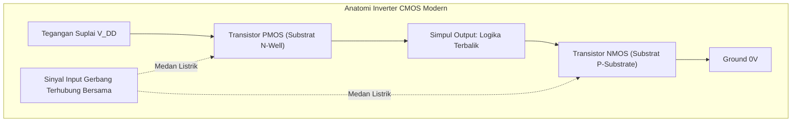

# Modul 043: Transistor Efek Medan: MOSFET & CMOS (Kanal-N/P, Tegangan Ambang Vth, Pasangan CMOS)

**Navigasi**: [⬅️ Master Index](../../INDEX.md) | [Tingkat 3: Tingkat 3: Rangkaian Listrik, Elektronika & Microelectronics](./README.md)
*Sebelumnya*: [042. transistor-bjt](./042-transistor-bjt.md) | *Berikutnya*: [044. elektronika-analog-penguat-operasional](./044-elektronika-analog-penguat-operasional.md)

---

## 1. Intuisi Dasar Tanpa Jargon ("Seperti Bayi Baru Lahir")
Jika transistor BJT dianalogikan seperti keran air mekanis yang membutuhkan dorongan arus fisik untuk membuka, maka **MOSFET (Metal-Oxide-Semiconductor Field-Effect Transistor)** dianalogikan seperti tombol sentuh ajaib tanpa gaya gesek:

Anda tidak perlu mengalirkan arus listrik sama sekali ke kaki kendalinya! Kaki kendali yang disebut **Gerbang (Gate)** terisolasi sempurna oleh lapisan kaca kaca kuarsa silikon dioksida ($SiO_2$) yang sangat tipis. Cukup dengan memberikan **Tegangan Listrik (Medan Listrik Statis)** pada Gate, Anda menciptakan saluran konduksi tak terlihat yang mengalirkan arus raksasa antara **Drain** dan **Source**.

Karena resistansi input Gate praktis tak hingga ($pprox 10^{14} \, \Omega$), MOSFET hampir tidak menyedot daya saat diam. Dan ketika kita memasangkan MOSFET Kanal-N dan Kanal-P secara berpasangan (**CMOS - Complementary MOS**), lahirlah teknologi terpenting dalam sejarah peradaban manusia: miliaran saklar mikroskopis yang menyusun seluruh prosesor Intel, AMD, Apple M-Series, dan GPU Nvidia di dunia saat ini.
[📚 Pelajari: All About Circuits MOSFETs](https://www.allaboutcircuits.com/textbook/semiconductors/chpt-2/field-effect-transistors/)

## 2. Fondasi Teoretis & Aksiomatik / Matematis
### 43.1 Struktur Fisik NMOS & Tegangan Ambang ($V_{TH}$) ([HyperPhysics MOSFET](http://hyperphysics.phy-astr.gsu.edu/hbase/solids/fet.html))
NMOS dibangun di atas substrat Silikon tipe-P dengan dua sumur difusi N+ pekat (Drain dan Source) yang dipisahkan oleh saluran berjarak $L$. Di atas saluran terdapat lapisan dielektrik oksida gerbang tipis ($t_{ox}$) dan elektroda logam/polisilikon (Gate). Kapasitansi oksida per satuan luas:
$$C_{ox} = \frac{\varepsilon_{ox}}{t_{ox}} = \frac{3.9 \varepsilon_0}{t_{ox}}$$
Tegangan Ambang (*Threshold Voltage* $V_{TH}$): Tegangan gerbang minimum yang dibutuhkan untuk membalikkan permukaan semikonduktor tipe-P di bawah oksida menjadi saluran inversi elektron tipe-N.

### 43.2 Wilayah Operasi Persamaan Arus Shockley MOSFET ([Sedra & Smith](https://global.oup.com/))
Parameter transkonduktansi proses: $k_n' = \mu_n C_{ox}$, faktor penguatan piranti: $k_n = k_n' \left(\frac{W}{L}\right)$.
1. **Cut-off ($V_{GS} < V_{TH}$)**:
   Tidak ada saluran inversi: $I_D \approx 0$ (arus sub-ambang bocor nano-ampere).
2. **Wilayah Linier / Trioda ($V_{GS} \ge V_{TH}$ dan $V_{DS} < V_{GS} - V_{TH}$)**:
   Saluran kontinu bertindak seperti resistor yang dikendalikan tegangan gerbang:
   $$I_D = k_n \left[ (V_{GS} - V_{TH}) V_{DS} - \frac{1}{2} V_{DS}^2 \right]$$
   Resistansi on-state ($R_{DS(\text{on})}$):
   $$R_{DS(\text{on})} \approx \frac{1}{k_n (V_{GS} - V_{TH})}$$
3. **Wilayah Saturasi / Aktif ($V_{GS} \ge V_{TH}$ dan $V_{DS} \ge V_{GS} - V_{TH}$)**:
   Saluran terjepit (*pinch-off*) di dekat Drain; arus mandiri terhadap $V_{DS}$:
   $$I_D = \frac{1}{2} k_n (V_{GS} - V_{TH})^2 (1 + \lambda V_{DS})$$
   Di mana $\lambda$ adalah parameter modulasi panjang saluran (*Channel-Length Modulation* analog dengan efek Early BJT).

### 43.3 Inverter Logika CMOS & Disipasi Daya ([Weste & Harris CMOS VLSI Design](https://www.pearson.com/))
Inverter CMOS menggabungkan PMOS pull-up ke $V_{DD}$ dan NMOS pull-down ke $GND$:
- Input = '0' ($0\text{ V}$): NMOS mati, PMOS nyala $\implies$ Output terhubung kuat ke $V_{DD}$ ('1').
- Input = '1' ($V_{DD}$): NMOS nyala, PMOS mati $\implies$ Output terhubung kuat ke $GND$ ('0').
Tidak pernah ada jalur arus langsung dari $V_{DD}$ ke $GND$ pada kondisi statis!

Disipasi Daya CMOS:
$$P_{\text{total}} = P_{\text{statis}} + P_{\text{dinamis}} = (I_{\text{leak}} \cdot V_{DD}) + (\alpha \cdot C_L \cdot V_{DD}^2 \cdot f)$$
Di mana $\alpha$ adalah rasio aktivitas pensaklaran, $C_L$ adalah kapasitansi beban, dan $f$ adalah frekuensi clock CPU. Penurunan $V_{DD}$ menghemat daya secara kuadratik ($V^2$)!

## 3. Anatomi Teknis & Cara Kerja Internal

Fenomena Parasitik Latch-Up:
Di dalam struktur CMOS terdapat struktur parasitik 4-lapis p-n-p-n (Thyristor / SCR terselubung) antara PMOS dan NMOS. Lonjakan tegangan transient dapat memicu konduksi tak terkendali SCR ini, menghubungkan $V_{DD}$ langsung ke ground dengan arus hubung singkat raksasa yang membakar chip secara permanen jika tidak dipasang cincin pelindung isolasi *guard rings*.

## 4. Implementasi Praktis & Kode / Simulasi Riil
import numpy as np

def calculate_cmos_power_dissipation(v_dd: float, clock_freq_ghz: float, 
                                     num_transistors: int, load_cap_per_gate_ff: float, 
                                     activity_factor: float = 0.1, i_leak_per_gate_na: float = 1.5) -> dict:
    """
    Menghitung konsumsi daya dinamis dan statis dari chip prosesor CMOS multi-inti.
    P_dyn = alpha * C_total * V_dd^2 * f
    P_stat = N * I_leak * V_dd
    """
    f_hz = clock_freq_ghz * 1e9
    c_gate_farad = load_cap_per_gate_ff * 1e-15
    c_total = num_transistors * c_gate_farad
    
    # Daya Dinamis Pensaklaran
    p_dynamic = activity_factor * c_total * (v_dd**2) * f_hz
    
    # Daya Statis Kebocoran Arus
    i_leak_total = num_transistors * (i_leak_per_gate_na * 1e-9)
    p_static = i_leak_total * v_dd
    
    p_total = p_dynamic + p_static
    
    return {
        "dynamic_power_watts": p_dynamic,
        "static_power_watts": p_static,
        "total_power_watts": p_total,
        "leakage_percentage": (p_static / p_total) * 100.0
    }

# Simulasi prosesor 5 miliar transistor, Vdd = 0.85V, Clock = 3.5 GHz
res = calculate_cmos_power_dissipation(v_dd=0.85, clock_freq_ghz=3.5, num_transistors=5_000_000_000, 
                                       load_cap_per_gate_ff=1.2, activity_factor=0.08)

print(f"Daya Dinamis CPU : {res['dynamic_power_watts']:.1f} Watt")
print(f"Daya Statis Bocor: {res['static_power_watts']:.1f} Watt ({res['leakage_percentage']:.1f}%)")
print(f"TDP Total Panas  : {res['total_power_watts']:.1f} Watt")

## 5. Miskonsepsi & Jebakan Industri
1. **Gate Floating Destruction**: Meninggalkan kaki Gate MOSFET tidak terhubung (*floating*). Karena impedansi inputnya sangat tinggi, muatan elektrostatik udara dapat mengisi kapasitansi gerbang secara acak, menyalakan transistor sebagian ke zona linier dan membakarnya seketika. Selalu pasang resistor pull-down ($10	ext{ k}\Omega$).
2. **Insufficient Gate Drive Voltage**: Menggunakan MOSFET daya standar (yang membutuhkan $V_{GS} = 10	ext{ V}$ untuk on penuh) langsung dari pin GPIO mikrokontroler $3.3	ext{ V}$. MOSFET hanya menyala separuh dengan $R_{DS(	ext{on})}$ tinggi, memicu pemanasan berlebih saat dilewati arus beban besar. Solusi: gunakan Logic-Level MOSFET ($V_{GS(	ext{th})} < 1.5	ext{ V}$).
3. **Miller Plateau Gate Charge Delay**: Mengabaikan kapasitansi gerbang-ke-drain ($C_{gd}$ / Miller charge $Q_{gd}$) saat menyalakan MOSFET pensaklaran daya tinggi. Pengemudi gerbang (*gate driver*) terjebak pada dataran Miller (*Miller plateau*) selama mikrodetik, menimbulkan kerugian switching yang sangat besar.

## 6. Proyek Latihan & Rubrik Penilaian Mandiri
### Tingkat 1 (Pemula) - Rangkaian Saklar Beban MOSFET Sisi Rendah (Low-Side Switch)
Rancang rangkaian saklar sisi rendah menggunakan N-Channel Logic-Level MOSFET (IRL540N) untuk mengendalikan strip LED $12	ext{ V} / 3	ext{ A}$ dari mikrokontroler $3.3	ext{ V}$ dengan sinyal PWM frekuensi $1	ext{ kHz}$. Hitung resistor pembatas arus gerbang $R_G$ dan resistor pull-down.

### Tingkat 2 (Menengah) - Kurva Karakteristik Transfer VTC Inverter CMOS
Hitung dan plot kurva karakteristik transfer tegangan (*Voltage Transfer Curve* / VTC) dari inverter CMOS dengan rasio lebar kanal $\left(rac{W}{L}
ight)_p = 2 \left(rac{W}{L}
ight)_n$ untuk mengkompensasi mobilitas hole yang lebih rendah dari elektron ($\mu_n pprox 2\mu_p$). Hitung margin derau (*Noise Margins* $NM_H$ dan $NM_L$).

### Tingkat 3 (Mahir) - Gerbang Transmisi CMOS & Rangkaian Sample-and-Hold
Rancang gerbang transmisi CMOS (*Transmission Gate* PMOS paralel NMOS) untuk sirkuit Sample-and-Hold analog 16-bit berkecepatan 10 MSPS. Analisis dan hilangkan fenomena *Charge Injection* ($\Delta V = rac{Q_{ch}}{C_H}$) dan *Clock Feedthrough* menggunakan teknik kompensasi transistor dummy.

#### Rubrik Penilaian
- **40% Ketepatan Model MOSFET**: Identifikasi wilayah trioda vs saturasi dan perhitungan $R_{DS(	ext{on})}$ akurat.
- **30% Analisis Dinamika Gerbang**: Menghitung arus puncak gate driver $I_G = Q_g / t_{sw}$ untuk switching cepat.
- **30% Validitas Desain Termal**: Memverifikasi disipasi daya total $P_{	ext{cond}} + P_{	ext{sw}}$ di bawah kapasitas pendingin heatsink.

## 7. Rekomendasi Sumber Belajar Standar Emas
| Kategori | Judul Sumber & Tautan Langsung | Deskripsi Singkat |
|---|---|---|
| 📖 Buku Teks | [CMOS VLSI Design: A Circuits and Systems Perspective (Weste & Harris)](https://www.pearson.com/) | Kitab rujukan arsitektur chip digital, tata letak CMOS, dan desain transistor silikon. |
| 🎓 Kuliah Terbuka | [MIT OCW 6.012 Microelectronic Devices and Circuits: MOSFETs](https://ocw.mit.edu/courses/6-012-microelectronic-devices-and-circuits-fall-2009/) | Penurunan komprehensif persamaan fisika saluran inversi gerbang dan kapasitansi oksida. |
| 🔬 Makalah Seminal | [Silicon-Silicon Dioxide Field Induced Surface Devices (Kahng & Atalla, 1960)](https://doi.org/10.1142/9789814503464_0076) | Penemuan bersejarah transistor MOSFET pertama di Bell Labs. |
| 💻 Lab Interaktif | [Falstad MOSFET Switching & CMOS Logic Simulator](https://www.falstad.com/circuit/) | Simulasi grafis interaktif aliran muatan pada gerbang logika CMOS. |

---
*Navigasi Cepat*: [Ke Tingkat 3](./README.md) | [Ke Master Index](../../INDEX.md) | *Sebelumnya*: [042. transistor-bjt](./042-transistor-bjt.md) | *Berikutnya*: [044. elektronika-analog-penguat-operasional](./044-elektronika-analog-penguat-operasional.md)
