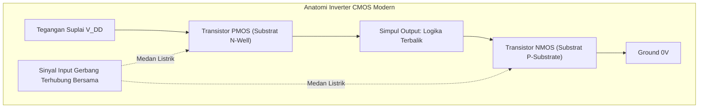

# Modul 043: Transistor Efek Medan: MOSFET & CMOS (Kanal-N/P, Tegangan Ambang Vth, Pasangan CMOS)

**Navigasi**: [⬅️ Master Index](../../INDEX.md) | [Tingkat 3: Tingkat 3: Rangkaian Listrik, Elektronika & Microelectronics](./README.md)
*Sebelumnya*: [042. transistor-bjt](./042-transistor-bjt.md) | *Berikutnya*: [044. elektronika-analog-penguat-operasional](./044-elektronika-analog-penguat-operasional.md)

---

## 1. Intuisi Dasar Tanpa Jargon ("Seperti Bayi Baru Lahir")
### 1.1 Konsep Inti & Analogi Tanpa Jargon
Jika transistor BJT dianalogikan seperti keran air mekanis yang membutuhkan dorongan arus fisik untuk membuka, maka **MOSFET (Metal-Oxide-Semiconductor Field-Effect Transistor)** dianalogikan seperti tombol sentuh ajaib tanpa gaya gesek:

### 1.2 Urgensi Rekayasa & Signifikansi Sistemik
Anda tidak perlu mengalirkan arus listrik sama sekali ke kaki kendalinya! Kaki kendali yang disebut **Gerbang (Gate)** terisolasi sempurna oleh lapisan kaca kaca kuarsa silikon dioksida ($SiO_2$) yang sangat tipis. Cukup dengan memberikan **Tegangan Listrik (Medan Listrik Statis)** pada Gate, Anda menciptakan saluran konduksi tak terlihat yang mengalirkan arus raksasa antara **Drain** dan **Source**.

Karena resistansi input Gate praktis tak hingga ($pprox 10^{14} \, \Omega$), MOSFET hampir tidak menyedot daya saat diam. Dan ketika kita memasangkan MOSFET Kanal-N dan Kanal-P secara berpasangan (**CMOS - Complementary MOS**), lahirlah teknologi terpenting dalam sejarah peradaban manusia: miliaran saklar mikroskopis yang menyusun seluruh prosesor Intel, AMD, Apple M-Series, dan GPU Nvidia di dunia saat ini.
[📚 Pelajari: All About Circuits MOSFETs](https://www.allaboutcircuits.com/textbook/semiconductors/chpt-2/field-effect-transistors/)

## 2. Fondasi Teoretis & Aksiomatik / Matematis
### 2.1 Kerangka Teori Aksiomatik & Formulasi Matematis
### 43.1 Struktur Fisik NMOS & Tegangan Ambang ($V_{TH}$) ([HyperPhysics MOSFET](http://hyperphysics.phy-astr.gsu.edu/hbase/solids/fet.html))
NMOS dibangun di atas substrat Silikon tipe-P dengan dua sumur difusi N+ pekat (Drain dan Source) yang dipisahkan oleh saluran berjarak $L$. Di atas saluran terdapat lapisan dielektrik oksida gerbang tipis ($t_{ox}$) dan elektroda logam/polisilikon (Gate). Kapasitansi oksida per satuan luas:
$$C_{ox} = \frac{\varepsilon_{ox}}{t_{ox}} = \frac{3.9 \varepsilon_0}{t_{ox}}$$
Tegangan Ambang (*Threshold Voltage* $V_{TH}$): Tegangan gerbang minimum yang dibutuhkan untuk membalikkan permukaan semikonduktor tipe-P di bawah oksida menjadi saluran inversi elektron tipe-N.

### 2.2 Penurunan Matematis Langkah-demi-Langkah
### 43.2 Wilayah Operasi Persamaan Arus Shockley MOSFET ([Sedra & Smith](https://global.oup.com/))
Parameter transkonduktansi proses: $k_n' = \mu_n C_{ox}$, faktor penguatan piranti: $k_n = k_n' \left(\frac{W}{L}\right)$.
1. **Cut-off ($V_{GS} < V_{TH}$)**:
   Tidak ada saluran inversi: $I_D \approx 0$ (arus sub-ambang bocor nano-ampere).
2. **Wilayah Linier / Trioda ($V_{GS} \ge V_{TH}$ dan $V_{DS} < V_{GS} - V_{TH}$)**:
   Saluran kontinu bertindak seperti resistor yang dikendalikan tegangan gerbang:
   $$I_D = k_n \left[ (V_{GS} - V_{TH}) V_{DS} - \frac{1}{2} V_{DS}^2 \right]$$
   Resistansi on-state ($R_{DS(\text{on})}$):
   $$R_{DS(\text{on})} \approx \frac{1}{k_n (V_{GS} - V_{TH})}$$
3. **Wilayah Saturasi / Aktif ($V_{GS} \ge V_{TH}$ dan $V_{DS} \ge V_{GS} - V_{TH}$)**:
   Saluran terjepit (*pinch-off*) di dekat Drain; arus mandiri terhadap $V_{DS}$:
   $$I_D = \frac{1}{2} k_n (V_{GS} - V_{TH})^2 (1 + \lambda V_{DS})$$
   Di mana $\lambda$ adalah parameter modulasi panjang saluran (*Channel-Length Modulation* analog dengan efek Early BJT).

### 43.3 Inverter Logika CMOS & Disipasi Daya ([Weste & Harris CMOS VLSI Design](https://www.pearson.com/))
Inverter CMOS menggabungkan PMOS pull-up ke $V_{DD}$ dan NMOS pull-down ke $GND$:
- Input = '0' ($0\text{ V}$): NMOS mati, PMOS nyala $\implies$ Output terhubung kuat ke $V_{DD}$ ('1').
- Input = '1' ($V_{DD}$): NMOS nyala, PMOS mati $\implies$ Output terhubung kuat ke $GND$ ('0').
Tidak pernah ada jalur arus langsung dari $V_{DD}$ ke $GND$ pada kondisi statis!

Disipasi Daya CMOS:
$$P_{\text{total}} = P_{\text{statis}} + P_{\text{dinamis}} = (I_{\text{leak}} \cdot V_{DD}) + (\alpha \cdot C_L \cdot V_{DD}^2 \cdot f)$$
Di mana $\alpha$ adalah rasio aktivitas pensaklaran, $C_L$ adalah kapasitansi beban, dan $f$ adalah frekuensi clock CPU. Penurunan $V_{DD}$ menghemat daya secara kuadratik ($V^2$)!

## 3. Anatomi Teknis & Cara Kerja Internal

Fenomena Parasitik Latch-Up:
Di dalam struktur CMOS terdapat struktur parasitik 4-lapis p-n-p-n (Thyristor / SCR terselubung) antara PMOS dan NMOS. Lonjakan tegangan transient dapat memicu konduksi tak terkendali SCR ini, menghubungkan $V_{DD}$ langsung ke ground dengan arus hubung singkat raksasa yang membakar chip secara permanen jika tidak dipasang cincin pelindung isolasi *guard rings*.

#### Tabel Penelusuran Terjadinya CMOS Latch-Up Melalui Struktur Parasitik 4-Lapis PNPN (SCR)
| Peristiwa Transien ($t$) | Tegangan Pin I/O ($V_{pin}$) | Arus Injeksi Substrat ($I_{sub}$) | Transistor BJT Parasitik NPN ($Q_1$) | Transistor BJT Parasitik PNP ($Q_2$) | Status Jalur Daya Silikon ($V_{DD}$ ke GND) |
|---|---|---|---|---|---|
| Operasi Normal | $3.30\text{ V}$ (Di dalam rel daya) | $0.0\text{ mA}$ (Substrat terisolasi) | OFF ($V_{BE1} = 0.0\text{ V}$) | OFF ($V_{EB2} = 0.0\text{ V}$) | Arus statis CMOS mendekati nol (orde nanoampere) |
| Overshoot Transien | $+4.80\text{ V}$ (Lonjakan induktif kabel) | $+45.0\text{ mA}$ (Injeksi arus pembawa minoritas)| Sambungan P-Well terpicu maju | Substrat N-Well menyerap muatan | Dioda proteksi klem terlampaui |
| Umpan Balik Positif ($t = 2\text{ ns}$) | Sambungan maju parasitik | Arus mengalir melalui resistansi substrat | $Q_1$ ON: Kolektor menarik basis $Q_2$ ke Low | $Q_2$ ON: Kolektor menyuntik arus ke basis $Q_1$ | Loop regeneratif tertutup: $\beta_1 \cdot \beta_2 \ge 1.0$! |
| Latch-Up Terkunci ($t = 5\text{ ns}$) | Tegangan pin kembali ke 3.3V | Arus terus tersuplai dari rel $V_{DD}$ | Terkunci ON permanen | Terkunci ON permanen | Jalur hubungan singkat resistansi nol terbentuk! |
| Penghancuran Termal ($t = 50\text{ ms}$)| Drop tegangan rel anjlok ke $1.2\text{ V}$| Arus melebihi batas pengawatan | Densitas arus $> 10^6\text{ A/cm}^2$ | Jalur metalisasi meleleh | Jalur aluminium chip putus terbakar; IC rusak mati |

## 4. Implementasi Praktis & Kode / Simulasi Riil
```python
import numpy as np

def calculate_cmos_power_dissipation(v_dd: float, clock_freq_ghz: float, 
                                     num_transistors: int, load_cap_per_gate_ff: float, 
                                     activity_factor: float = 0.1, i_leak_per_gate_na: float = 1.5) -> dict:
    """
    Menghitung konsumsi daya dinamis dan statis dari chip prosesor CMOS multi-inti.
    P_dyn = alpha * C_total * V_dd^2 * f
    P_stat = N * I_leak * V_dd
    """
    f_hz = clock_freq_ghz * 1e9
    c_gate_farad = load_cap_per_gate_ff * 1e-15
    c_total = num_transistors * c_gate_farad
    
    # Daya Dinamis Pensaklaran
    p_dynamic = activity_factor * c_total * (v_dd**2) * f_hz
    
    # Daya Statis Kebocoran Arus
    i_leak_total = num_transistors * (i_leak_per_gate_na * 1e-9)
    p_static = i_leak_total * v_dd
    
    p_total = p_dynamic + p_static
    
    return {
        "dynamic_power_watts": p_dynamic,
        "static_power_watts": p_static,
        "total_power_watts": p_total,
        "leakage_percentage": (p_static / p_total) * 100.0
    }

# Simulasi prosesor 5 miliar transistor, Vdd = 0.85V, Clock = 3.5 GHz
res = calculate_cmos_power_dissipation(v_dd=0.85, clock_freq_ghz=3.5, num_transistors=5_000_000_000, 
                                       load_cap_per_gate_ff=1.2, activity_factor=0.08)

print(f"Daya Dinamis CPU : {res['dynamic_power_watts']:.1f} Watt")
print(f"Daya Statis Bocor: {res['static_power_watts']:.1f} Watt ({res['leakage_percentage']:.1f}%)")
print(f"TDP Total Panas  : {res['total_power_watts']:.1f} Watt")
```

## 5. Miskonsepsi & Jebakan Industri
1. **Gate Floating Destruction**: Meninggalkan kaki Gate MOSFET tidak terhubung (*floating*). Karena impedansi inputnya sangat tinggi, muatan elektrostatik udara dapat mengisi kapasitansi gerbang secara acak, menyalakan transistor sebagian ke zona linier dan membakarnya seketika. Selalu pasang resistor pull-down (\$10	ext{ k}\Omega$).
2. **Insufficient Gate Drive Voltage**: Menggunakan MOSFET daya standar (yang membutuhkan $V_{GS} = 10	ext{ V}$ untuk on penuh) langsung dari pin GPIO mikrokontroler $3.3	ext{ V}$. MOSFET hanya menyala separuh dengan $R_{DS(	ext{on})}$ tinggi, memicu pemanasan berlebih saat dilewati arus beban besar. Solusi: gunakan Logic-Level MOSFET ($V_{GS(	ext{th})} < 1.5	ext{ V}$).
3. **Miller Plateau Gate Charge Delay**: Mengabaikan kapasitansi gerbang-ke-drain ($C_{gd}$ / Miller charge $Q_{gd}$) saat menyalakan MOSFET pensaklaran daya tinggi. Pengemudi gerbang (*gate driver*) terjebak pada dataran Miller (*Miller plateau*) selama mikrodetik, menimbulkan kerugian switching yang sangat besar.

### Studi Kasus Kegagalan Nyata: Kerusakan Permanen CMOS Latch-Up Akibat Struktur Parasitik SCR (PNPN)
- **Insiden Kegagalan Mikrokontroler Industri**: Pada perakitan robot perakitan pabrik mobil, mikrokontroler CMOS berkecepatan tinggi sering rusak secara misterius saat motor servo dihidupkan. Sesaat setelah motor bergerak, chip prosesor menjadi sangat panas hingga melepuh saat disentuh, menguras arus catu daya 5V hingga batas trip catu daya regulator, dan tidak merespons sinyal reset eksternal.
- **Akar Masalah Fisika Silikon & Thyristor Parasitik**: Pada setiap struktur fabrikasi CMOS silikon standar massal (*bulk CMOS*), penempatan transistor PMOS di dalam N-Well bersebelahan dengan transistor NMOS di dalam P-Substrate secara tak terhindarkan membentuk dua transistor bipolar parasitik yang saling terhubung silang: transistor PNP vertikal dan transistor NPN lateral. Kedua transistor ini membentuk struktur 4-lapisan PNPN yang identik dengan Silicon Controlled Rectifier (SCR) / Thyristor. Ketika sebuah lonjakan tegangan transien pada pin I/O menginjeksi arus ke substrat, penurunan tegangan melintasi resistansi substrat ($I_{inj} R_{sub} > 0.7\text{ V}$) memicu salah satu transistor BJT aktif. Karena keluaran masing-masing transistor menggerakkan masukan basis transistor pasangannya, terbentuklah umpan balik regeneratif di mana produk penguatan melampaui satu ($\beta_1 \beta_2 \ge 1.0$). Struktur ini langsung terkunci (*latched*) dalam kondisi konduksi penuh, menghubung-singkatkan rel daya $V_{DD}$ langsung ke Ground dengan impedansi nol, membakar jalur logam chip dalam milidetik.

- **Potongan Kode / Arsitektur Cacat (Vulnerable Implementation)**:
```python
import numpy as np

def simulate_cmos_latchup_trigger(v_overshoot=4.8, v_dd=3.3, r_sub=20.0, r_well=30.0):
    # Parameter struktur parasitik BJT bulk CMOS
    # Q1: NPN lateral, Q2: PNP vertikal
    beta_npn = 8.0
    beta_pnp = 0.5
    loop_gain = beta_npn * beta_pnp  # Loop gain regeneratif = 4.0 (> 1.0)
    
    # Arus injeksi akibat overshoot tegangan melampaui rel daya
    v_forward_diode = 0.7
    v_excess = max(0.0, v_overshoot - (v_dd + v_forward_diode))
    r_diode_dynamic = 10.0
    i_injected = v_excess / r_diode_dynamic  # Arus injeksi pemicu (A)
    
    # Penurunan tegangan pada resistansi substrat P-Well
    v_be_npn = i_injected * r_sub
    
    # Kondisi pemicuan SCR:
    # 1. Tegangan bias maju sambungan Vbe > 0.7V
    # 2. Produk penguatan loop gain > 1.0
    # 3. Arus injeksi melebihi arus pemicu kritis I_trigger
    i_trigger_threshold = 0.7 / r_sub
    
    is_triggered = (i_injected >= i_trigger_threshold) and (loop_gain >= 1.0)
    
    if is_triggered:
        # Menghitung arus anjlok catu daya setelah latch-up terjadi
        v_holding = 1.2  # Tegangan holding tipikal SCR terpicu (V)
        r_short = 2.5    # Resistansi internal silikon terionisasi (Ohm)
        i_latchup_supply = (v_dd - v_holding) / r_short
        power_dissipation_W = v_holding * i_latchup_supply
    else:
        i_latchup_supply = 0.0001
        power_dissipation_W = 0.0003
        
    return {
        "injected_current_mA": i_injected * 1000.0,
        "trigger_threshold_mA": i_trigger_threshold * 1000.0,
        "is_latched": is_triggered,
        "latchup_short_current_A": i_latchup_supply,
        "destructive_power_W": power_dissipation_W
    }

report = simulate_cmos_latchup_trigger(v_overshoot=5.2)
# Injected 120 mA > Threshold 35 mA -> LATCH-UP TERKUNCI!
# Arus catu daya melonjak ke 0.84 A -> Chip MEMBARA RUSAK!
```

- **Mitigasi Tata Letak Silikon & Guard Rings**: Untuk mengimunisasi sirkuit terpadu terhadap latch-up, aturan desain layout IC modern mewajibkan pemasangan *guard rings* (cincin difusi $P^+$ pada substrat yang terhubung erat ke GND dan cincin difusi $N^+$ pada well yang terhubung ke $V_{DD}$) di sekeliling setiap transistor I/O untuk memangkas resistansi substrat $R_{sub} \to 0$ dan menurunkan produk penguatan $\beta_1 \beta_2 \ll 1$, atau mengadopsi teknologi isolasi oksida penuh *Silicon-on-Insulator* (SOI).

## 6. Proyek Latihan & Rubrik Penilaian Mandiri
### Tingkat 1 (Pemula) - Rangkaian Saklar Beban MOSFET Sisi Rendah (Low-Side Switch)
Rancang rangkaian saklar sisi rendah menggunakan N-Channel Logic-Level MOSFET (IRL540N) untuk mengendalikan strip LED \$12	ext{ V} / 3	ext{ A}$ dari mikrokontroler $3.3	ext{ V}$ dengan sinyal PWM frekuensi $1	ext{ kHz}$. Hitung resistor pembatas arus gerbang $R_G$ dan resistor pull-down.

### Tingkat 2 (Menengah) - Kurva Karakteristik Transfer VTC Inverter CMOS
Hitung dan plot kurva karakteristik transfer tegangan (*Voltage Transfer Curve* / VTC) dari inverter CMOS dengan rasio lebar kanal $\left(rac{W}{L}
ight)_p = 2 \left(rac{W}{L}
ight)_n$ untuk mengkompensasi mobilitas hole yang lebih rendah dari elektron ($\mu_n pprox 2\mu_p$). Hitung margin derau (*Noise Margins* $NM_H$ dan $NM_L$).

### Tingkat 3 (Mahir) - Gerbang Transmisi CMOS & Rangkaian Sample-and-Hold
Rancang gerbang transmisi CMOS (*Transmission Gate* PMOS paralel NMOS) untuk sirkuit Sample-and-Hold analog 16-bit berkecepatan 10 MSPS. Analisis dan hilangkan fenomena *Charge Injection* ($\Delta V = rac{Q_{ch}}{C_H}$) dan *Clock Feedthrough* menggunakan teknik kompensasi transistor dummy.

#### Rubrik Penilaian
- **40% Ketepatan Model MOSFET**: Identifikasi wilayah trioda vs saturasi dan perhitungan $R_{DS(	ext{on})}$ akurat.
- **30% Analisis Dinamika Gerbang**: Menghitung arus puncak gate driver $I_G = Q_g / t_{sw}$ untuk switching cepat.
- **30% Validitas Desain Termal**: Memverifikasi disipasi daya total $P_{	ext{cond}} + P_{	ext{sw}}$ di bawah kapasitas pendingin heatsink.

### Tingkat 1: Dasar
- **Tugas**: Bangun kalkulator parameter DC transistor MOSFET kanal-N tipe enhancement menggunakan model kuadratik Schichman-Hodges untuk menentukan rejim operasi (Cutoff, Triode/Linier, dan Saturasi) beserta arus drain $I_D$.
- **Petunjuk Perancangan Arsitektur**:
  - Triode: $I_D = \mu_n C_{ox} \frac{W}{L} \left[ (V_{GS} - V_{th}) V_{DS} - \frac{1}{2} V_{DS}^2 \right]$ untuk $V_{DS} < V_{GS} - V_{th}$.
  - Saturasi: $I_D = \frac{1}{2} \mu_n C_{ox} \frac{W}{L} (V_{GS} - V_{th})^2 (1 + \lambda V_{DS})$ untuk $V_{DS} \ge V_{GS} - V_{th}$.
- **Test Vector & Kasus Uji Ekstrem**:
  - *Cutoff*: $V_{GS} < V_{th}$; arus $I_D$ harus tepat bernilai $0.000\text{ A}$.
  - *Saturasi Tanpa Modulasi Panjang Saluran ($\lambda = 0$)*: Verifikasi bahwa arus $I_D$ independen terhadap variasi $V_{DS}$.
- **Rubrik Penilaian Mandiri**: 40% Evaluasi Rejim Operasi Triode/Saturasi Presisi, 30% Formulasi Kuadratik Schichman-Hodges Tepat, 30% Pemodelan Efek Modulasi Panjang Saluran $(\lambda)$.

### Tingkat 2: Menengah
- **Tugas**: Rancang model sirkuit inverter CMOS (NMOS + PMOS seimbang) untuk menghitung kurva karakteristik transfer tegangan (Voltage Transfer Characteristic / VTC), batas ambang tegangan switching ($V_M$), dan margin derau statis ($NM_H$ dan $NM_L$).
- **Petunjuk Perancangan Arsitektur**:
  - Tentukan titik $V_{IL}$ dan $V_{IH}$ di mana kemiringan kurva $\frac{dV_{out}}{dV_{in}} = -1.0$.
  - Hitung margin derau: $NM_L = V_{IL} - V_{OL}$ dan $NM_H = V_{OH} - V_{IH}$.
  - Buktikan bahwa perbandingan ukuran lebar gerbang seimbang $\frac{W_p}{W_n} \approx \frac{\mu_n}{\mu_p} \approx 2.5$ menghasilkan $V_M = V_{DD} / 2$.
- **Test Vector & Kasus Uji Ekstrem**:
  - *Inverter Simetris*: $V_{DD} = 3.3\text{ V}$; verifikasi $V_M = 1.650\text{ V} \pm 0.005\text{ V}$.
  - *Margin Derau*: Verifikasi bahwa $NM_L$ dan $NM_H$ keduanya bernilai positif dan $\ge 0.35 V_{DD}$.
- **Rubrik Penilaian Mandiri**: 40% Solver Titik Kerja Keseimbangan KCL CMOS VTC Tepat, 30% Penentuan Titik Gradien Kritis $d V_{out}/d V_{in} = -1$, 30% Kalkulasi Margin Derau Statis Sesuai Teori.

### Tingkat 3: Mahir
- **Tugas**: Implementasikan solver transien dinamis numerik untuk menganalisis energi disipasi daya switching inverter CMOS $E_{switch} = \alpha C_L V_{DD}^2 + Q_{short-circuit} V_{DD}$ dengan memperhitungkan waktu naik/turun sinyal masukan dan arus tembus serentak (*crowbar/short-circuit current*) saat kedua transistor aktif bersamaan.
- **Petunjuk Perancangan Arsitektur**:
  - Selesaikan persamaan diferensial non-linier pengisian kapasitansi beban: $C_L \frac{dV_{out}}{dt} = I_{D,P}(t) - I_{D,N}(t)$.
  - Integrasikan daya sesaat $p(t) = V_{DD} I_{supply}(t)$ sepanjang siklus switching lengkap.
- **Test Vector & Kasus Uji Ekstrem**:
  - *Waktu Transisi Sangat Cepat ($t_r \to 0$)*: Arus short-circuit mendekati nol; disipasi murni didominasi oleh $C_L V_{DD}^2$.
  - *Waktu Transisi Lambat ($t_r > 5\text{ ns}$)*: Arus crowbar melonjak tajam menyumbang $> 40\%$ total konsumsi energi per siklus.
- **Rubrik Penilaian Mandiri**: 40% Solver ODE Transien Pengisian Kapasitansi Akurat, 30% Integrasi Arus Hubung Singkat Crowbar Terpisah, 30% Validasi Hukum Penskalaan Daya Dinamis $C V^2 f$.

## 7. Rekomendasi Sumber Belajar Standar Emas
| Kategori | Judul Sumber & Tautan Langsung | Deskripsi Singkat |
|---|---|---|
| 📖 Buku Teks | [CMOS VLSI Design: A Circuits and Systems Perspective (Weste & Harris)](https://www.pearson.com/) | Kitab rujukan arsitektur chip digital, tata letak CMOS, dan desain transistor silikon. |
| 🎓 Kuliah Terbuka | [MIT OCW 6.012 Microelectronic Devices and Circuits: MOSFETs](https://ocw.mit.edu/courses/6-012-microelectronic-devices-and-circuits-fall-2009/) | Penurunan komprehensif persamaan fisika saluran inversi gerbang dan kapasitansi oksida. |
| 🔬 Makalah Seminal | [Silicon-Silicon Dioxide Field Induced Surface Devices (Kahng & Atalla, 1960)](https://doi.org/10.1142/9789814503464_0076) | Penemuan bersejarah transistor MOSFET pertama di Bell Labs. |
| 💻 Lab Interaktif | [Falstad MOSFET Switching & CMOS Logic Simulator](https://www.falstad.com/circuit/) | Simulasi grafis interaktif aliran muatan pada gerbang logika CMOS. |

---
*Navigasi Cepat*: [Ke Tingkat 3](./README.md) | [Ke Master Index](../../INDEX.md) | *Sebelumnya*: [042. transistor-bjt](./042-transistor-bjt.md) | *Berikutnya*: [044. elektronika-analog-penguat-operasional](./044-elektronika-analog-penguat-operasional.md)
