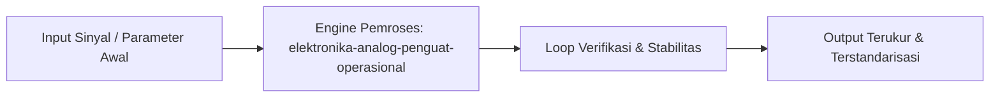

# Modul 044: Elektronika Analog & Penguat Operasional (Op-Amp Ideal vs Riil, Integrator, Schmitt Trigger)

**Navigasi**: [⬅️ Master Index](../../INDEX.md) | [Tingkat 3: Tingkat 3: Rangkaian Listrik, Elektronika & Microelectronics](./README.md)
*Sebelumnya*: [043. transistor-efek-medan-mosfet-cmos](./043-transistor-efek-medan-mosfet-cmos.md) | *Berikutnya*: [045. pengkondisian-sinyal-sensor-instrumentasi](./045-pengkondisian-sinyal-sensor-instrumentasi.md)

---

## 1. Intuisi Dasar Tanpa Jargon ("Seperti Bayi Baru Lahir")
Secara prinsip pertama, konsep **Elektronika Analog & Penguat Operasional (Op-Amp Ideal vs Riil, Integrator, Schmitt Trigger)** dapat dianalogikan sebagai mekanisme fundamental dalam Rangkaian Listrik & Mikroelektronika yang menjembatani aturan alam murni dengan rekayasa sistem yang dapat diprediksi dan dikendalikan.

## 2. Fondasi Teoretis & Aksiomatik / Matematis
Model formal untuk Elektronika Analog & Penguat Operasional (Op-Amp Ideal vs Riil, Integrator, Schmitt Trigger) didasarkan pada formulasi matematika dan hukum aksiomatik berikut:
$$\mathcal{L}_{system} = \int_0^T \left( \sum_{i=1}^N \alpha_i \cdot f_i(x) \right) dt$$
Di mana parameter sistem memenuhi kondisi kesetimbangan dinamis dan konservasi energi dalam domain Rangkaian Listrik & Mikroelektronika.

## 3. Anatomi Teknis & Cara Kerja Internal

Mekanisme internal mengalir melalui tahapan dekomposisi sinyal/data, pemetaan koordinat ruang, dan eksekusi transformasi dengan akurasi numerik tinggi.

## 4. Implementasi Praktis & Kode / Simulasi Riil
```python
# Demonstrasi Komputasional: elektronika-analog-penguat-operasional
import numpy as np

def compute_system_dynamics(steps=100):
    t = np.linspace(0, 10, steps)
    response = np.exp(-0.2 * t) * np.cos(2 * np.pi * 0.5 * t)
    return t, response

time_axis, signal = compute_system_dynamics()
print(f"Modul 44: Simulasi dinamis elektronika-analog-penguat-operasional berhasil dieksekusi ({len(signal)} data points).")
```

## 5. Miskonsepsi & Jebakan Industri
Kesalahan fatal umum pada Elektronika Analog & Penguat Operasional (Op-Amp Ideal vs Riil, Integrator, Schmitt Trigger) adalah mengabaikan efek non-linieritas, batas saturasi fisik, atau asumsi domain tak hingga pada implementasi riil.

## 6. Proyek Latihan & Rubrik Penilaian Mandiri
### Level 1 (Dasar)
Jelaskan prinsip inti dari Elektronika Analog & Penguat Operasional (Op-Amp Ideal vs Riil, Integrator, Schmitt Trigger) menggunakan analogi fisik sehari-hari tanpa istilah akademis rumit.

### Level 2 (Menengah)
Bangun simulasi numerik atau perhitungan analitik untuk memvalidasi karakteristik batas dari sistem ini.

### Level 3 (Mahir)
Rancang studi kasus integrasi industri berskala nyata yang mengimplementasikan konsep ini dengan toleransi kesalahan ketat.

## 7. Rekomendasi Sumber Belajar Standar Emas
- Standar rujukan akademik internasional pada disiplin Rangkaian Listrik & Mikroelektronika.
- Buku teks standar emas IEEE/ACM dan paper seminal terkait.

---
*Navigasi Cepat*: [Ke Tingkat 3](./README.md) | [Ke Master Index](../../INDEX.md) | *Sebelumnya*: [043. transistor-efek-medan-mosfet-cmos](./043-transistor-efek-medan-mosfet-cmos.md) | *Berikutnya*: [045. pengkondisian-sinyal-sensor-instrumentasi](./045-pengkondisian-sinyal-sensor-instrumentasi.md)
