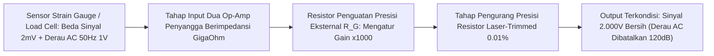

# Modul 045: Pengkondisian Sinyal Sensor & Instrumentasi (Jembatan Wheatstone, Instrumentation Amplifier)

**Navigasi**: [⬅️ Master Index](../../INDEX.md) | [Tingkat 3: Tingkat 3: Rangkaian Listrik, Elektronika & Microelectronics](./README.md)
*Sebelumnya*: [044. elektronika-analog-penguat-operasional](./044-elektronika-analog-penguat-operasional.md) | *Berikutnya*: [046. osilator-pembangkit-sinyal](./046-osilator-pembangkit-sinyal.md)

---

## 1. Intuisi Dasar Tanpa Jargon ("Seperti Bayi Baru Lahir")
### 1.1 Konsep Inti & Analogi Tanpa Jargon
Bayangkan sebuah sensor beban timbangan digital: ketika Anda meletakkan beban seberat 1 kilogram di atasnya, sensor regangan logam (strain gauge) hanya mengubah resistansinya sebesar \$0.001\%$ dan menghasilkan perubahan tegangan sekecil $0.000005\text{ Volt}$ ($5 \, \mu	ext{V}$)!

### 1.2 Urgensi Rekayasa & Signifikansi Sistemik
Jika Anda langsung menghubungkan kabel sensor ini ke mikrokontroler Anda, sinyal $5 \, \mu	ext{V}$ tersebut akan langsung tenggelam oleh derau gelombang radio, medan magnet kabel listrik AC PLN, dan kebisingan termal ruangan.
**Pengkondisian Sinyal Sensor & Instrumentasi** adalah seni menyaring jarum mikro di tengah tumpukan jerami derau: menggunakan rangkaian **Jembatan Wheatstone** untuk mengubah perubahan resistansi mikro menjadi beda tegangan simetris, dan **Instrumentation Amplifier (In-Amp)** dengan 3 Op-Amp terkalibrasi presisi tinggi untuk menolak tegangan derau bersama (common-mode noise) dan hanya memperkuat sinyal sensor asli hingga ribuan kali lipat dengan akurasi sempurna.
[📚 Pelajari: Analog Devices Instrumentation Amplifier Guide](https://www.analog.com/en/resources/analog-dialogue/articles/a-designers-guide-to-instrumentation-amps.html)

## 2. Fondasi Teoretis & Aksiomatik / Matematis
### 2.1 Kerangka Teori Aksiomatik & Formulasi Matematis
### 45.1 Jembatan Wheatstone & Analisis Sensitivitas Regangan ([HyperPhysics Wheatstone](http://hyperphysics.phy-astr.gsu.edu/hbase/electric/wheatstone.html))
Sirkuit jembatan dengan empat lengan resistor yang diberi eksitasi tegangan $V_{\text{EX}}$:
Beda tegangan keluaran diferensial antara dua titik tengah simpul:
$$V_{\text{out}} = V_A - V_B = V_{\text{EX}} \left( \frac{R_1}{R_1 + R_2} - \frac{R_4}{R_3 + R_4} \right)$$
Kondisi seimbang ($V_{\text{out}} = 0$):
$$\frac{R_1}{R_2} = \frac{R_4}{R_3}$$
Untuk sensor regangan (*Strain Gauge*) dengan faktor ukur $GF = \frac{\Delta R / R}{\epsilon}$:
- Topologi Jembatan Seperempat (Quarter-Bridge):
  $$V_{\text{out}} \approx \frac{V_{\text{EX}}}{4} \cdot GF \cdot \epsilon$$
- Topologi Jembatan Penuh (Full-Bridge - 4 sensor aktif saling berlawanan regangan tarik dan tekan):
  $$V_{\text{out}} = V_{\text{EX}} \cdot GF \cdot \epsilon$$
  Sensitivitas jembatan penuh meningkat 4x lipat dan secara otomatis mengkompensasi efek perubahan suhu lingkungan!

### 2.2 Penurunan Matematis Langkah-demi-Langkah
### 45.2 Arsitektur Tiga Op-Amp Instrumentation Amplifier (In-Amp) ([Texas Instruments In-Amp App Note](https://www.ti.com/lit/an/slyt226/slyt226.pdf))
Tiga Op-Amp tersusun dalam dua tahap:
- **Tahap Input (Penyangga Diferensial Dua Op-Amp $A_1, A_2$)**:
  Memberikan impedansi masukan sangat tinggi ($> 10^9 \, \Omega$) pada kedua terminal non-inverting. Resistor penguatan eksternal tunggal $R_G$ menetapkan penguatan diferensial:
  $$A_{d1} = 1 + \frac{2 R_1}{R_G}$$
  Penguatan mode bersama tahap input: $A_{cm1} = 1$ (tidak diperkuat!).
- **Tahap Output (Penguat Beda Op-Amp Tunggal $A_3$)**:
  $$V_{\text{out}} = \frac{R_3}{R_2} (V_2 - V_1) + V_{\text{REF}}$$
Penguatan Diferensial Total In-Amp:
$$A_v = \left( 1 + \frac{2 R_1}{R_G} \right) \frac{R_3}{R_2}$$

### 45.3 Common-Mode Rejection Ratio (CMRR) ([Analog Devices](https://www.analog.com/))
Kemampuan menolak derau yang muncul bersamaan di kedua kabel sensor (misal induksi AC 50 Hz):
$$\text{CMRR} = 20 \log_{10} \left( \frac{A_d}{|A_{cm}|} \right) \quad (\text{dB})$$
In-Amp monolitik modern (misal AD620 / INA128) memiliki laser-trimmed resistor internal dengan toleransi $0.01\%$, menghasilkan $\text{CMRR} > 120\text{ dB}$ (menolak derau bersama sejuta kali lipat lebih kuat dari sinyal diferensial!).

## 3. Anatomi Teknis & Cara Kerja Internal

Teknik Guard Shield Driving:
Kapasitansi kabel terlindung (*shielded cable*) yang tidak seimbang dapat merusak CMRR pada frekuensi tinggi. Solusi: mengalirkan tegangan mode bersama melalui penyangga (*shield driver*) ke pelindung kabel, meniadakan beda potensial dan melenyapkan arus bocor parasitik kabel.

#### Tabel Penelusuran Efek Seebeck Termokopel & Galat Kompensasi Sambungan Dingin (CJC)
| Titik Pengukuran Suhu | Suhu Aktual Fisik ($T$) | Tegangan Termoelektrik Relatif ($V_{th}$) | Koreksi Sensor Ambien PT100 ($T_{ref}$) | Estimasi Suhu Furnace Tanpa CJC | Galat Pembacaan Kontrol Furnace |
|---|---|---|---|---|---|
| Titik Panas Sensor ($T_{hot}$) | $1.200.0^\circ\text{C}$ (Peleburan Baja) | $48.838\text{ mV}$ (Termokopel Tipe K) | Ambien diabaikan ($0^\circ\text{C}$) | $1.200.0^\circ\text{C}$ (Jika CJC ideal) | Akurat jika terminal berada pada $0^\circ\text{C}$ es |
| Terminal Koneksi Lemari ($T_{cold}$)| Suhu ruang pabrik $48.5^\circ\text{C}$ | $-1.965\text{ mV}$ (Seebeck lawan) | Sensor CJC rusak terlepas ($0^\circ\text{C}$) | Sistem mengasumsikan terminal $0^\circ\text{C}$ | Beda tegangan terbaca anjlok ke $46.873\text{ mV}$ |
| Konversi Polinomial ADC | Tegangan neto masuk $46.873\text{ mV}$ | Polinomial NIST ITS-90 dieksekusi | CJC tidak ditambahkan | Terbaca: $1.151.5^\circ\text{C}$ | Defisit bacaan $-48.5^\circ\text{C}$ di layar HMI |
| Reaksi Kontroler PID | Setpoint tungku $1.200^\circ\text{C}$ | Kontroler melihat error $+48.5^\circ\text{C}$ | Katup gas bahan bakar dibuka lebar | Suhu fisik melesat ke $1.248.5^\circ\text{C}$ | Overheating melampaui batas batas leleh dinding tanur |
| Kerusakan Material Tanur | Suhu tembus $1.250^\circ\text{C}$ | Dinding refraktori bata silika rontok | Slag baja bocor ke lantai industri | Kerusakan jutaan dolar | Tanur peleburan baja mati darurat |

## 4. Implementasi Praktis & Kode / Simulasi Riil
```python
import numpy as np

def calculate_load_cell_instrumentation(excitation_v: float, rated_output_mv_v: float, 
                                         full_scale_kg: float, measured_weight_kg: float, 
                                         inamp_gain: float) -> dict:
    """
    Menghitung rantai pengkondisian sinyal load cell jembatan penuh ke input ADC.
    """
    # Tegangan output diferensial jembatan pada kapasitas penuh
    v_full_scale_mv = excitation_v * rated_output_mv_v
    
    # Tegangan sensor sesaat untuk berat terukur
    v_sensor_mv = v_full_scale_mv * (measured_weight_kg / full_scale_kg)
    
    # Penguatan oleh Instrumentation Amplifier
    v_inamp_out_v = (v_sensor_mv / 1000.0) * inamp_gain
    
    return {
        "bridge_excitation_v": excitation_v,
        "raw_sensor_signal_uv": v_sensor_mv * 1000.0,
        "amplified_signal_v": v_inamp_out_v
    }

# Load Cell Industri 2.0 mV/V, Eksitasi 5.0V, Kapasitas 10 kg, Beban 2.5 kg, Gain = 500x
res = calculate_load_cell_instrumentation(excitation_v=5.0, rated_output_mv_v=2.0, 
                                         full_scale_kg=10.0, measured_weight_kg=2.5, inamp_gain=500.0)

print(f"Tegangan Eksitasi Jembatan: {res['bridge_excitation_v']:.1f} V")
print(f"Sinyal Mentah Sensor       : {res['raw_sensor_signal_uv']:.1f} uV (Sangat rentan derau!)")
print(f"Sinyal Output Setelah In-Amp: {res['amplified_signal_v']:.3f} V (Siap dibaca ADC 0-5V)")
```

## 5. Miskonsepsi & Jebakan Industri
1. **Missing DC Return Path for Input Bias Currents**: Menghubungkan sensor berisolasi galvanik atau termokopel langsung ke input In-Amp tanpa resistor jalur pembuangan bias DC (\$100	ext{ k}\Omega$ ke ground). Arus bias masukan mengisi kapasitansi input hingga transistor input saturasi dan output macet di rail tegangan.
2. **Resistor Mismatch Degrading Discrete In-Amp CMRR**: Mencoba merakit Instrumentation Amplifier menggunakan op-amp umum dengan 4 buah resistor terpisah bertoleransi 1%; ketidakcocokan nilai resistor sebesar \$1\%$ langsung menghancurkan CMRR dari \$100	ext{ dB}$ menjadi hanya \$40	ext{ dB}$.
3. **Thermoelectric Seebeck Voltage Errors**: Menyambungkan kabel tembaga dengan pin komponen logam berbeda pada jalur sinyal mikrovolt; perbedaan suhu lokal $1^\circ	ext{C}$ antar titik solder menghasilkan tegangan termokopel parasitik hingga \$40 \, \mu	ext{V}$, melipatgandakan kesalahan kalibrasi nol.

### Studi Kasus Kegagalan Nyata: Kegagalan Kompensasi Sambungan Dingin (Cold-Junction Compensation) Termokopel Peleburan Baja
- **Insiden Kegagalan Tanur Baja Industri**: Pada fasilitas tanur induksi peleburan baja berkapasitas 50 ton, sistem pengendali suhu otomatis terus menginjeksi energi pemanas maksimum meskipun baja telah mencair sempurna. Akibatnya, dinding refraktori tanur runtuh akibat panas berlebih yang melampaui toleransi material, menyebabkan lelehan logam cair 1.300°C bocor ke lantai pabrik.
- **Akar Masalah Fisika Termoelektrik & Efek Seebeck**: Termokopel bekerja berdasarkan Efek Seebeck, di mana gradien temperatur sepanjang konduktor dua logam berbeda (misal Chromel dan Alumel untuk Tipe K) menghasilkan beda potensial listrik. Namun, termokopel secara fundamental hanya mengukur perbedaan suhu antara sambungan panas (*hot junction* di dalam tungku) dan sambungan dingin (*cold junction* di terminal blok sekrup modul pengkondisi sinyal): $V_{emf} = \int_{T_{cold}}^{T_{hot}} (S_A - S_B) dT$. Jika terminal blok instrumen berada pada suhu ruang $45^\circ\text{C}$ di dekat tanur, tegangan yang dibangkitkan akan berkurang sebesar tegangan Seebeck $45^\circ\text{C}$ ($1,8\text{ mV}$). Ketiadaan atau rusaknya sensor kompensasi sambungan dingin lokal (*Cold-Junction Compensation* / CJC seperti RTD PT100 atau IC LM35 pada terminal blok) menyebabkan sistem kendali mengira suhu tungku $45^\circ\text{C}$ lebih dingin dari aslinya, memicu kontroller PID menaikkan daya pemanas hingga tanur meleleh.

- **Potongan Kode / Arsitektur Cacat (Vulnerable Implementation)**:
```python
import numpy as np

def simulate_thermocouple_cjc_error(t_hot_actual_C=1200.0, t_terminal_ambient_C=48.5, cjc_sensor_failed=True):
    # Koefisien polinomial Seebeck NIST ITS-90 untuk Termokopel Tipe K (pendekatan rata-rata ~41 uV/°C)
    S_type_k = 41.27e-6  # V / °C
    
    # Tegangan fisik yang dibangkitkan sambungan termokopel:
    # V_terminal = S * (T_hot - T_cold)
    v_terminal_measured = S_type_k * (t_hot_actual_C - t_terminal_ambient_C)
    
    if cjc_sensor_failed:
        # Jika CJC rusak/terputus, firmware mengasumsikan T_cold = 0.0 °C
        t_cjc_measured = 0.0
    else:
        # Sensor suhu lokal (PT100/IC) mengukur suhu terminal blok dengan tepat
        t_cjc_measured = t_terminal_ambient_C
        
    # Perhitungan suhu furnace oleh firmware instrumen:
    # T_inferred = (V_terminal / S) + T_cjc
    t_furnace_inferred = (v_terminal_measured / S_type_k) + t_cjc_measured
    control_error = t_furnace_inferred - t_hot_actual_C
    
    furnace_overheat_target = t_hot_actual_C - control_error  # Reaksi kontroler memanaskan tanur lebih tinggi
    catastrophic_meltdown = furnace_overheat_target > 1240.0
    
    return {
        "v_terminal_mV": v_terminal_measured * 1000.0,
        "t_inferred_C": t_furnace_inferred,
        "temperature_reading_error_C": control_error,
        "actual_furnace_driven_to_C": furnace_overheat_target,
        "refractory_meltdown_risk": catastrophic_meltdown
    }

# Evaluasi kegagalan sensor CJC pada lingkungan pabrik 48.5°C
disaster = simulate_thermocouple_cjc_error(cjc_sensor_failed=True)
# Pembacaan suhu meleset -48.5°C -> Tanur dipanaskan ke 1248.5°C -> TANUR MELELEH!
```

- **Arsitektur Wajib Pengkondisi Sinyal Instrumentasi**: Seluruh antarmuka termokopel modern (seperti MAX31855 / AD8495) mengintegrasikan sensor suhu sambungan dingin presisi tinggi (*on-chip bandgap temperature sensor*) yang ditempatkan secara isotermal tepat berdampingan dengan terminal blok sekrup logam konduktor thermocouple untuk mengeliminasi galat gradien termal sambungan dingin secara otomatis.

## 6. Proyek Latihan & Rubrik Penilaian Mandiri
### Tingkat 1 (Pemula) - Rangkaian Sensor Suhu RTD PT100 3-Kawat
Rancang rangkaian jembatan Wheatstone untuk sensor suhu resistif platinum PT100 (\$100\,\Omega$ pada $0^\circ	ext{C}$, $lpha = 0.00385 /^\circ	ext{C}$) dengan konfigurasi 3-kawat. Buktikan secara matematis bagaimana kawat ketiga membatalkan resistansi kabel penghubung panjang.

### Tingkat 2 (Menengah) - Perhitungan Resistor Gain dan Simulasi CMRR In-Amp
Hitung nilai resistor $R_G$ untuk In-Amp monolitik AD620 agar menghasilkan penguatan tepat $A_v = 250	ext{x}$. Lakukan simulasi SPICE dengan menginjeksikan sinyal diferensial \$10	ext{ mV}$ (100 Hz) dan derau interferensi mode bersama $2	ext{ V}$ (50 Hz). Buktikan pelemahan derau AC pada keluaran.

### Tingkat 3 (Mahir) - Penguat Biosinyal EKG Medis Berdaya Rendah
Rancang rangkaian analog front-end (AFE) pembaca elektrokardiogram (EKG) jantung: input perlindungan defibrilasi, Instrumentation Amplifier gain tinggi, filter aktif lolos-pita $0.05	ext{ Hz} - 150	ext{ Hz}$, filter penolak takik (*notch filter*) 50 Hz, dan rangkaian penggerak kaki kanan (*Right-Leg Drive* RLD) aktif untuk membuang tegangan derau tubuh pasien.

#### Rubrik Penilaian
- **40% Kemampuan Penolakan Derau (CMRR)**: Menghitung pembatalan interferensi mode bersama secara tepat.
- **30% Kompensasi Offset & Drift**: Memperhitungkan tegangan offset masukan ($V_{os}$) dan koefisien pergeseran suhu ($\Delta V_{os} / \Delta T$).
- **30% Keamanan & Isolasi Pasien**: Memenuhi standar kebocoran arus medis IEC 60601 ($< 10 \, \mu	ext{A}$).

### Tingkat 1: Dasar
- **Tugas**: Bangun fungsi konversi linierisasi polinomial standar NIST ITS-90 untuk Termokopel Tipe K yang mengubah tegangan milivolt ke derajat Celcius dan sebaliknya, termasuk kompensasi sambungan dingin analitis.
- **Petunjuk Perancangan Arsitektur**:
  - Terapkan koefisien polinomial orde-9 NIST: $T = \sum_{i=0}^9 d_i V^i$.
  - Tambahkan tegangan kompensasi sambungan dingin: $V_{comp} = V_{measured} + V_{NIST}(T_{ref})$.
- **Test Vector & Kasus Uji Ekstrem**:
  - *Tegangan $0.000\text{ mV}$*: Suhu harus tepat $0.00^\circ\text{C}$ saat $T_{ref} = 0^\circ\text{C}$.
  - *Titik Didih Air $100.00^\circ\text{C}$*: Tegangan teoritis harus $4.096\text{ mV} \pm 0.005\text{ mV}$.
- **Rubrik Penilaian Mandiri**: 40% Evaluasi Polinomial NIST ITS-90 Presisi, 30% Formulasi Koreksi Tegangan Sambungan Dingin Tepat, 30% Validasi Titik Acuan Standar Metrologi.

### Tingkat 2: Menengah
- **Tugas**: Implementasikan solver jembatan Wheatstone non-linier terkopel dengan penguat instrumentasi 3-Op-Amp (In-Amp) untuk sensor RTD PT100 (Hukum Callendar-Van Dusen) yang mengkompensasi resistansi kabel 3-kawat (*3-wire lead resistance compensation*).
- **Petunjuk Perancangan Arsitektur**:
  - Model RTD Callendar-Van Dusen: $R(T) = R_0 (1 + A T + B T^2)$ untuk $T > 0^\circ\text{C}$.
  - Buktikan bahwa topologi 3-kawat mengurangkan resistansi kabel $R_{wire}$ dari kedua cabang diferensial secara simetris, menghasilkan tegangan diferensial bebas galat panjang kabel.
- **Test Vector & Kasus Uji Ekstrem**:
  - *Resistansi Kabel Panjang*: Injeksi $R_{wire} = 10\ \Omega$ pada ketiga kawat; verifikasi error estimasi suhu RTD tetap $\le 0.05^\circ\text{C}$.
  - *Kabel Asimetris (Rusak)*: Injeksi ketidakseimbangan $1\ \Omega$ pada satu kawat; hitung offset galat suhu yang dihasilkan.
- **Rubrik Penilaian Mandiri**: 40% Model Callendar-Van Dusen & Jembatan 3-Kawat Tepat, 30% Eliminasi Galat Common-Mode Resistansi Kabel, 30% Analisis Sensitivitas Ketidakseimbangan Kabel.

### Tingkat 3: Mahir
- **Tugas**: Rancang sistem akuisisi data analog presisi tinggi terintegrasi dengan filter anti-aliasing Butterworth diferensial aktif fully-differential amplifier (FDA), konverter ADC Delta-Sigma ($\Delta\Sigma$) 24-bit dengan pemotongan derau $1/f$ (*chopper stabilization / dynamic element matching*), dan evaluasi Effective Number of Bits (ENOB) serta Noise-Free Resolution di bawah derau termal Johnson-Nyquist $v_n = \sqrt{4 k_B T R \Delta f}$.
- **Petunjuk Perancangan Arsitektur**:
  - Selesaikan modulasi chopper switching frekuensi tinggi untuk menggeser derau flicker $1/f$ ke luar pita ukur.
  - Hitung densitas spektral derau total input ($nV/\sqrt{Hz}$) dan integrasikan di seluruh bandwidth akuisisi $10\text{ Hz}$.
- **Test Vector & Kasus Uji Ekstrem**:
  - *Resolusi Bebas Derau*: Buktikan sistem mencapai $ENOB \ge 21.5\text{ bit}$ pada laju data 10 SPS.
  - *Imunitas Derau Jala-Jala 50/60 Hz*: Filter digital Sinc4 harus memberikan redaman penolakan $\ge 100\text{ dB}$ pada frekuensi 50 Hz dan 60 Hz.
- **Rubrik Penilaian Mandiri**: 40% Pemodelan Derau Termal & Chopper Stabilization Tepat, 30% Perhitungan ENOB & Signal-to-Noise Ratio (SNR) Presisi, 30% Verifikasi Filter Notch Digital Sinc4 untuk Penolakan 50/60 Hz.

## 7. Rekomendasi Sumber Belajar Standar Emas
| Kategori | Judul Sumber & Tautan Langsung | Deskripsi Singkat |
|---|---|---|
| 📖 Buku Teks | [A Designer's Guide to Instrumentation Amplifiers (Analog Devices)](https://www.analog.com/en/resources/analog-dialogue/articles/a-designers-guide-to-instrumentation-amps.html) | Kitab panduan terlengkap perancangan In-Amp presisi tinggi. |
| 🎓 Kuliah Terbuka | [MIT OCW 6.071J Introduction to Electronics, Signals, and Measurement](https://ocw.mit.edu/courses/6-071j-introduction-to-electronics-signals-and-measurement-spring-2006/) | Kuliah instrumentasi sensor, jembatan Wheatstone, dan akuisisi data. |
| 🔬 Makalah Seminal | [An Improved Instrumentation Amplifier (Brokaw, 1974)](https://doi.org/10.1109/JSSC.1974.1050529) | Arsitektur sirkuit perintis Paul Brokaw yang melahirkan IC instrumentasi monolitik modern. |
| 💻 Lab Interaktif | [TI Precision Labs: Instrumentation Amplifiers](https://www.ti.com/video/series/precision-labs/ti-precision-labs-instrumentation-amplifiers.html) | Seri video dan lab simulasi komprehensif dari Texas Instruments. |

---
*Navigasi Cepat*: [Ke Tingkat 3](./README.md) | [Ke Master Index](../../INDEX.md) | *Sebelumnya*: [044. elektronika-analog-penguat-operasional](./044-elektronika-analog-penguat-operasional.md) | *Berikutnya*: [046. osilator-pembangkit-sinyal](./046-osilator-pembangkit-sinyal.md)
