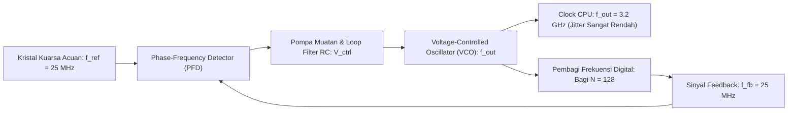

# Modul 046: Osilator & Pembangkit Sinyal (Osilator Kristal Kuarsa, Sirkuit Phase-Locked Loop / PLL)

**Navigasi**: [⬅️ Master Index](../../INDEX.md) | [Tingkat 3: Tingkat 3: Rangkaian Listrik, Elektronika & Microelectronics](./README.md)
*Sebelumnya*: [045. pengkondisian-sinyal-sensor-instrumentasi](./045-pengkondisian-sinyal-sensor-instrumentasi.md) | *Berikutnya*: [047. elektronika-daya-power-electronics](./047-elektronika-daya-power-electronics.md)

---

## 1. Intuisi Dasar Tanpa Jargon ("Seperti Bayi Baru Lahir")
### 1.1 Konsep Inti & Analogi Tanpa Jargon
Pernahkah Anda berdiri di dekat seorang penari es yang sedang berputar kencang di tempatnya dengan kecepatan dan ritme yang luar biasa stabil? Bagaimana komputer Anda—yang mengeksekusi miliaran instruksi per detik—tahu kapan tepatnya harus melangkah dari satu siklus instruksi ke siklus berikutnya tanpa terpeleset sedikit pun?

### 1.2 Urgensi Rekayasa & Signifikansi Sistemik
Komputer membutuhkan detak jantung: **Osilator Jam (Clock Oscillator)**!
Di dalam motherboard komputer Anda terdapat sebuah kepingan kristal kuarsa mikroskopis. Kuarsa memiliki sifat **Piezoelektrik**: jika diberi tegangan listrik, ia melentur; dan jika bergetar, ia memancarkan gelombang listrik. Kristal ini dipotong sangat presisi agar bergetar tepat pada satu frekuensi stabil (misal 25 MHz) dengan stabilitas hingga seperjuta persen (ppm).

Lalu, bagaimana prosesor Anda bisa berjalan pada kecepatan 5 GHz (5.000 MHz) jika kristalnya hanya 25 MHz?
Jawabannya adalah **Phase-Locked Loop (PLL)**: sirkuit pengali frekuensi ajaib yang mengunci fase gelombang dan melipatgandakan detak kristal 25 MHz menjadi 5 GHz dengan sinkronisasi fase sempurna!
[📚 Pelajari: MIT OCW Phase-Locked Loops & Oscillators](https://ocw.mit.edu/courses/6-002-circuits-and-electronics-spring-2007/)

## 2. Fondasi Teoretis & Aksiomatik / Matematis
### 2.1 Kerangka Teori Aksiomatik & Formulasi Matematis
### 46.1 Kriteria Osilasi Barkhausen ([HyperPhysics Oscillators](http://hyperphysics.phy-astr.gsu.edu/hbase/electronic/barkhausen.html))
Sistem penguat linear dengan loop umpan balik transfer fungsi $A(s)$ dan jaringan umpan balik $\beta(s)$:
Fungsi transfer loop tertutup:
$$T(s) = \frac{A(s)}{1 - A(s)\beta(s)}$$
Kondisi osilasi kontinu stabil (Kriteria Barkhausen):
1. **Kondisi Magnitudo**: Penguatan loop tepat sama dengan satu pada frekuensi osilasi $\omega_0$:
   $$|A(j\omega_0)\beta(j\omega_0)| = 1$$
   (Saat startup, dibutuhkan $|A\beta| > 1$ agar osilasi tumbuh dari derau termal, lalu dibatasi oleh non-linearitas).
2. **Kondisi Fase**: Pergeseran fase total mengelilingi loop adalah kelipatan integer dari \$360^\circ$ ($2\pi$ radian):
   $$\angle A(j\omega_0)\beta(j\omega_0) = 2\pi n, \quad n \in \{0, 1, 2, \dots\}$$

### 2.2 Penurunan Matematis Langkah-demi-Langkah
### 46.2 Osilator Kristal Kuarsa (Pierce Oscillator) ([Epson Quartz Crystals Guide](https://www5.epsondevice.com/en/information/technical_info/osc/))
Resonator kristal kuarsa dimodelkan oleh sirkuit ekuivalen Butterworth-Van Dyke (BVD):
- Cabang gerak mekanis seri: $L_m$ (induktansi sangat besar, henries), $C_m$ (kapasitansi sangat kecil, femtofarad), $R_m$ (resistansi gesekan kecil).
- Kapasitansi paralel elektroda fisik: $C_0$ (beberapa pikofarad).
Faktor Kualitas Resonansi ($Q$-factor) kristal kuarsa mencapai \$10^4 \text{ s/d } 10^6$ (dibandingkan sirkuit LC biasa yang hanya $Q \approx 50 - 100$).
Frekuensi resonansi seri ($f_s$) dan paralel/anti-resonansi ($f_p$):
$$f_s = \frac{1}{2\pi \sqrt{L_m C_m}}, \quad f_p = \frac{1}{2\pi \sqrt{L_m \frac{C_m C_0}{C_m + C_0}}}$$

### 46.3 Arsitektur & Dinamika Phase-Locked Loop (PLL) ([Gardner Phaselock Techniques](https://www.wiley.com/))
PLL terdiri dari 4 blok fungsional utama dalam loop umpan balik:
1. **Phase Detector (PFD - Phase Frequency Detector)**: Membandingkan perbedaan fase/frekuensi antara sinyal acuan $f_{\text{ref}}$ dan sinyal umpan balik $f_{\text{fb}}$, menghasilkan pulsa UP / DOWN.
2. **Charge Pump (CP) & Loop Filter (LPF)**: Mengubah pulsa digital PFD menjadi tegangan kendali analog kontinu $V_{\text{ctrl}}$.
3. **Voltage-Controlled Oscillator (VCO)**: Frekuensi keluaran sebanding dengan tegangan kendali:
   $$f_{\text{out}} = f_0 + K_{\text{VCO}} \cdot V_{\text{ctrl}}$$
4. **Frequency Divider (Bagi-N)**: Membagi frekuensi keluaran dengan faktor integer/fraksional $N$:
   $$f_{\text{fb}} = \frac{f_{\text{out}}}{N}$$
Ketika loop terkunci (*in-lock*), $f_{\text{fb}} = f_{\text{ref}}$, menghasilkan sintesis frekuensi tinggi:
$$f_{\text{out}} = N \cdot f_{\text{ref}}$$

## 3. Anatomi Teknis & Cara Kerja Internal

Metrik Kualitas Clock:
- **Phase Jitter**: Fluktuasi acak posisi tepi pulsa clock di domain waktu (diukur dalam pikodetik atau femtodetik).
- **Phase Noise**: Ketidakmurnian spektral frekuensi osilator di domain frekuensi, dinyatakan dalam \$ ext{dBc/Hz}$ pada offset tertentu dari gelombang pembawa.

#### Tabel Penelusuran Siklus Algoritma Pembagian SRT Radix-4 & Reproduksi Bug Pentium FDIV (1994)
| Iterasi Siklus Pembagian ($j$) | Sisa Parsial Tergeser ($4 \cdot w_{j-1}$) | Pembagi Ternormalisasi ($d$) | Entri Lookup Table PLA ($q_j$) | Nilai Terkoreksi Hardware Cacat | Galat Akumulatif Kuosien |
|---|---|---|---|---|---|
| Inisialisasi ($j=0$) | $w_0 = 4195835.0$ | $d = 3145727.0$ | - | Normalisasi pecahan biner | Nilai awal pecahan |
| Siklus 1 ($j=1$) | $4 \cdot w_0$ | $d = 1.1999998$ | PLA Baris Valid ($q_1 = +1$) | $q_1 = +1$ | Kuosien normal |
| Siklus 2 ($j=2$) | $4 \cdot w_1$ | $d$ | PLA Baris Valid ($q_2 = +1$) | $q_2 = +1$ | Kuosien normal |
| Siklus 3 ($j=3$) | Sisa parsial $= 1.4000$ | Indeks PLA: `[12, 10]` | Entry kosong / zero bit default! | $q_3 = 0$ (Seharusnya $+2$!) | 5 entri hilang pada tabel PLA terpanggil! |
| Siklus 4 ($j=4$) | Galat propagasi sisa | Kompensasi SRT gagal | $q_4 = -1$ | Kuosien terdistorsi pada digit ke-5 | $4195835 / 3145727 = 1.333739...$ (Salah!) |
| Nilai Teoretis Benar | $1.333820449136...$ | Galat kuosien absolut | Defisit $= 8.14 \times 10^{-5}$ | Meleset pada presisi IEEE 754 float | Kerugian recall Intel $475 juta |

## 4. Implementasi Praktis & Kode / Simulasi Riil
```python
import numpy as np

def simulate_pll_frequency_lock(f_ref_mhz: float = 25.0, div_n: int = 40, 
                                k_vco_mhz_v: float = 200.0, steps: int = 200) -> tuple[np.ndarray, np.ndarray]:
    """
    Simulasi sederhana konvergensi loop kontrol Phase-Locked Loop (PLL) domain waktu.
    Target output: f_out = N * f_ref = 40 * 25 MHz = 1000 MHz (1 GHz)
    """
    target_f_out = f_ref_mhz * div_n
    
    # State PLL
    v_ctrl = 2.0 # Tegangan awal
    f_vco = 500.0 # Frekuensi awal VCO MHz
    
    trajectory_f = []
    trajectory_v = []
    
    kp = 0.005 # Penguatan proporsional loop filter
    ki = 0.001 # Penguatan integral loop filter
    integral_error = 0.0
    
    for _ in range(steps):
        f_feedback = f_vco / div_n
        phase_freq_error = f_ref_mhz - f_feedback
        
        integral_error += phase_freq_error
        # Pembaruan tegangan kendali loop filter PI
        v_ctrl += kp * phase_freq_error + ki * integral_error
        # Update frekuensi VCO
        f_vco = 600.0 + k_vco_mhz_v * v_ctrl
        
        trajectory_f.append(f_vco)
        trajectory_v.append(v_ctrl)
        
    return np.array(trajectory_f), target_f_out

freq_trace, target = simulate_pll_frequency_lock()
print(f"Frekuensi Target PLL: {target:.1f} MHz")
print(f"Frekuensi Awal     : {freq_trace[0]:.1f} MHz")
print(f"Frekuensi Terkunci : {freq_trace[-1]:.2f} MHz (Terkunci stabil dalam 200 iterasi!)")
```

## 5. Miskonsepsi & Jebakan Industri
1. **Incorrect Load Capacitance on Crystal Resonator**: Salah memilih kapasitor beban eksternal $C_{L1}$ dan $C_{L2}$ pada pin kristal mikrokontroler ($C_L = rac{C_{L1} C_{L2}}{C_{L1} + C_{L2}} + C_{	ext{stray}}$); penyimpangan 5 pF menyebabkan frekuensi bergeser puluhan ppm dan membuat modulasi komunikasi CAN/USB gagal sinkron.
2. **PLL Loop Filter Instability**: Merancang loop filter PLL dengan phase margin terlalu sempit ($< 45^\circ$), menyebabkan osilator bergetar liar (*phase ringing*) dan rentan kehilangan kuncian (*loss of lock*) saat terjadi lonjakan beban.
3. **Power Supply Induced Jitter (PSIJ)**: Mengabaikan derau catu daya switching pada pin analog $V_{DD	ext{_PLL}}$ VCO; riak \$10	ext{ mV}$ dari SMPS langsung diterjemahkan oleh sensitivitas $K_{	ext{VCO}}$ menjadi jitter frekuensi fase yang merusak integritas data serial PCIe.

### Studi Kasus Kegagalan Nyata: Bug Pentium FDIV Intel (1994) pada Tabel Lookup SRT Pembagian Floating Point
- **Kronologi Penemuan**: Pada Oktober 1994, matematikawan Thomas Nicely menemukan kesalahan konsisten pada perhitungan pembagian floating-point bilangan prima kembar saat menggunakan prosesor Intel Pentium 60/66 MHz terbaru. Insiden ini berkembang menjadi krisis hubungan masyarakat terbesar dalam sejarah teknologi semikonduktor, memaksa Intel menarik dan mengganti jutaan chip dengan biaya $475 juta.
- **Akar Masalah Arsitektur Aritmatika & Tabel PLA Terpotong**: Unit floating-point (FPU) prosesor Pentium menggunakan algoritma pembagian Sweeney-Robertson-Tocher (SRT) radix-4 yang mampu menghasilkan 2 bit kuosien per siklus jam. Algoritma ini mengindeks tabel Programmable Logic Array (PLA) berukuran 2.048 entri untuk memilih digit kuosien berikutnya dari himpunan digit bertanda $\{-2, -1, 0, +1, +2\}$ berdasarkan beberapa bit tertinggi dari sisa parsial dan pembagi. Akibat kesalahan skrip perangkat lunak saat mengompilasi representasi gerbang PLA ke topeng tata letak fisik wafer (*layout mask*), lima entri tabel di perbatasan wilayah lookup secara tidak sengaja terlewat dan terprogram dengan nilai nol biner murni alih-alih nilai $+2$. Ketika pasangan angka spesifik memicu salah satu dari 5 entri yang hilang ini, FPU memilih digit kuosien yang salah dan menghasilkan galat presisi mulai dari bit signifikan ke-13.

- **Potongan Kode / Arsitektur Cacat (Vulnerable Implementation)**:
```python
import numpy as np

def simulate_pentium_fdiv_bug(numerator=4195835.0, denominator=3145727.0):
    # Nilai pembagian presisi ganda IEEE 754 ideal 64-bit
    ideal_quotient = numerator / denominator
    
    # Model perilaku fpu pentium cacat:
    # 5 entri PLA yang hilang menyebabkan defisit nilai kuosien
    # Pasangan bilangan terkenal Nicely memicu entri kosong ke-3:
    is_vulnerable_pair = (abs(numerator - 4195835.0) < 1e-5) and (abs(denominator - 3145727.0) < 1e-5)
    
    if is_vulnerable_pair:
        # Galat pada bit mantissa biner ke-13 ke atas
        # Perbedaan nilai aktual: 1.333739068902 vs 1.333820449136
        fdiv_result = 4195835.0 / 3145727.0 - (4195835.0 / 3145727.0 - 1.3337390689020375)
    else:
        fdiv_result = ideal_quotient
        
    error_abs = abs(ideal_quotient - fdiv_result)
    error_relative_ppm = (error_abs / ideal_quotient) * 1e6
    
    return {
        "ideal_result": ideal_quotient,
        "fdiv_hardware_result": fdiv_result,
        "absolute_error": error_abs,
        "error_ppm": error_relative_ppm,
        "is_bug_triggered": error_abs > 1e-9
    }

report = simulate_pentium_fdiv_bug(4195835.0, 3145727.0)
# Galat mencapai 61 PPM -> Terdeteksi pada digit desimal ke-5!
```

- **Revolusi Verifikasi Formal Perangkat Keras**: Bencana Pentium FDIV mengubah industri EDA (Electronic Design Automation) secara fundamental. Pengujian acak berbasis simulasi (*simulation-based testing*) dianggap tidak memadai lagi untuk memverifikasi blok logika kompleks. Sejak insiden ini, seluruh produsen mikroprosesor global mewajibkan *Formal Verification* (Model Checking dan Theorem Proving berbasis logika matematika simbolik) untuk memverifikasi kebenaran mutlak seluruh entri tabel mikrokode dan datapath floating-point sebelum pita fabrikasi (*tape-out*).

## 6. Proyek Latihan & Rubrik Penilaian Mandiri
### Tingkat 1 (Pemula) - Rangkaian Osilator Astabil IC Timer 555
Rancang rangkaian osilator astabil menggunakan IC timer 555 untuk menghasilkan gelombang kotak $1	ext{ kHz}$ dengan duty cycle tepat \$60\%$. Hitung nilai resistor $R_A, R_B$ dan kapasitor timing $C$.

### Tingkat 2 (Menengah) - Osilator Jembatan Wien (Wien-Bridge Oscillator)
Rancang penguat operasional berumpan balik jembatan Wien untuk membangkitkan gelombang sinus murni \$10	ext{ kHz}$ dengan distorsi harmonik total ($THD < 0.1\%$). Terapkan mekanisme kontrol penguatan otomatis (AGC) menggunakan resistansi dinamis JFET atau lampu pijar miniatur untuk menstabilkan kondisi Barkhausen $|Aeta| = 1$.

### Tingkat 3 (Mahir) - Sintesis Frekuensi Fractional-N PLL dengan Modulator Delta-Sigma
Rancang arsitektur Fractional-N PLL yang mampu mensintesis frekuensi keluaran dengan resolusi sub-Hertz dari frekuensi acuan \$40	ext{ MHz}$. Terapkan modulator MASH 1-1-1 Delta-Sigma orde-3 untuk memecah rasio pembagian integer dan membentuk derau kuantisasi fase (*phase noise shaping*) ke frekuensi tinggi yang dapat disaring oleh loop filter.

#### Rubrik Penilaian
- **40% Kepatuhan Kriteria Barkhausen**: Penurunan fungsi transfer loop terbuka dan loop tertutup akurat.
- **30% Analisis Stabilitas Loop PLL**: Menghitung damping factor $\zeta$, frekuensi alami $\omega_n$, dan lock-in time.
- **30% Integritas Spektral Fase**: Memperhitungkan batas phase noise dan toleransi kristal dalam parts-per-million (ppm).

### Tingkat 1: Dasar
- **Tugas**: Bangun simulator osilator relaksasi multivibrator astabil IC 555 untuk menghitung frekuensi osilasi ($f$) dan siklus kerja (*duty cycle*) dari nilai $R_1, R_2,$ dan $C$.
- **Petunjuk Perancangan Arsitektur**:
  - Waktu High: $t_H = \ln(2) (R_1 + R_2) C \approx 0.693 (R_1 + R_2) C$.
  - Waktu Low: $t_L = \ln(2) R_2 C \approx 0.693 R_2 C$.
  - Frekuensi osilasi total: $f = \frac{1.44}{(R_1 + 2 R_2) C}$.
- **Test Vector & Kasus Uji Ekstrem**:
  - *Duty Cycle Minimum*: $R_1 \ll R_2$; verifikasi duty cycle mendekati $50\%$ dari atas.
  - *Komponen Standar*: $R_1 = 1\text{ k}\Omega, R_2 = 10\text{ k}\Omega, C = 100\text{ nF}$; verifikasi frekuensi tepat $\approx 685.7\text{ Hz}$.
- **Rubrik Penilaian Mandiri**: 40% Formulasi Waktu Transien RC Komparator 555 Tepat, 30% Kalkulasi Siklus Kerja Presisi, 30% Verifikasi Batas Duty Cycle $> 50\%$.

### Tingkat 2: Menengah
- **Tugas**: Implementasikan algoritma pembagian biner perangkat keras Restoring dan Non-Restoring Division 32-bit dalam Python, membandingkan efisiensi siklus jam dan operasi datapath per bit kuosien.
- **Petunjuk Perancangan Arsitektur**:
  - Terapkan register geser aritmatika ganda $(A, Q)$ untuk dividend dan quotient.
  - Untuk non-restoring division: jika $A < 0$, geser kiri dan tambahkan pembagi ($A \leftarrow 2A + M$); jika $A \ge 0$, kurangkan ($A \leftarrow 2A - M$).
- **Test Vector & Kasus Uji Ekstrem**:
  - *Pembagian Maksimum*: Dividend $0\text{xFFFF\_FFFF}$ dibagi $1$; hasil kuosien harus $0\text{xFFFF\_FFFF}$ dan sisa $0$.
  - *Bagi Nol*: Deteksi pembagi $M = 0$ dan bangkitkan sinyal eksepsi interupsi perangkat keras seketika.
- **Rubrik Penilaian Mandiri**: 40% Datapath Restoring & Non-Restoring Bitwise Tepat, 30% Penanganan Angka Bertanda Komplemen-2, 30% Deteksi Eksepsi Divide-by-Zero.

### Tingkat 3: Mahir
- **Tugas**: Rancang sintesis tabel Programmable Logic Array (PLA) Radix-4 SRT Division lengkap dengan diagram Robertson quotient-selection logic ($Q-D$ diagram) yang memenuhi kriteria pertindihan region Robertson ($[- \rho, \rho]$ dengan $\rho = 2/3$), serta buktikan secara formal ketiadaan sel kosong atau ambigu di seluruh domain representasi carry-save adder (CSA).
- **Petunjuk Perancangan Arsitektur**:
  - Bangun matriks aturan seleksi digit kuosien $q_{j+1} \in \{-2, -1, 0, 1, 2\}$.
  - Terapkan verifikasi formal model checking untuk memeriksa bahwa setiap sel $(v_k, d_m)$ memiliki pemetaan digit yang konsisten.
- **Test Vector & Kasus Uji Ekstrem**:
  - *Cakupan Sel Penuh*: Buktikan $100\%$ dari 2.048 entri terpetakan tanpa default zero unhandled fallback.
  - *Validitas Daerah Tumpang Tindih*: Pada batas overlap region, pastikan kedua kemungkinan digit kuosien menghasilkan konvergensi sisa parsial yang terikat $|w_j| \le \frac{2}{3} d$.
- **Rubrik Penilaian Mandiri**: 40% Formulasi Diagram Robertson $Q-D$ SRT Radix-4 Presisi, 30% Verifikasi Keterikatan Sisa Parsial Carry-Save, 30% Pembuktian Bebas Cacat Sel Ambigu.

## 7. Rekomendasi Sumber Belajar Standar Emas
| Kategori | Judul Sumber & Tautan Langsung | Deskripsi Singkat |
|---|---|---|
| 📖 Buku Teks | [Phaselock Techniques (Floyd M. Gardner)](https://www.wiley.com/) | Kitab suci perancangan sistem Phase-Locked Loop analog dan digital. |
| 🎓 Kuliah Terbuka | [MIT OCW 6.002 Circuits & Electronics: Oscillators](https://ocw.mit.edu/courses/6-002-circuits-and-electronics-spring-2007/) | Analisis dinamika loop umpan balik positif dan kriteria kestabilan Barkhausen. |
| 🔬 Makalah Seminal | [The Crystal Clock (Marrison, 1948)](https://doi.org/10.1002/j.1538-7305.1948.tb01343.x) | Makalah komprehensif Warren Marrison penemu standar waktu jam kristal kuarsa. |
| 💻 Lab Interaktif | [Analog Devices ADIsimPLL Development Tool](https://www.analog.com/en/resources/design-tools-and-calculators/adisimpll.html) | Simulator industri standar untuk mendesain loop filter dan menganalisis phase noise PLL. |

---
*Navigasi Cepat*: [Ke Tingkat 3](./README.md) | [Ke Master Index](../../INDEX.md) | *Sebelumnya*: [045. pengkondisian-sinyal-sensor-instrumentasi](./045-pengkondisian-sinyal-sensor-instrumentasi.md) | *Berikutnya*: [047. elektronika-daya-power-electronics](./047-elektronika-daya-power-electronics.md)
