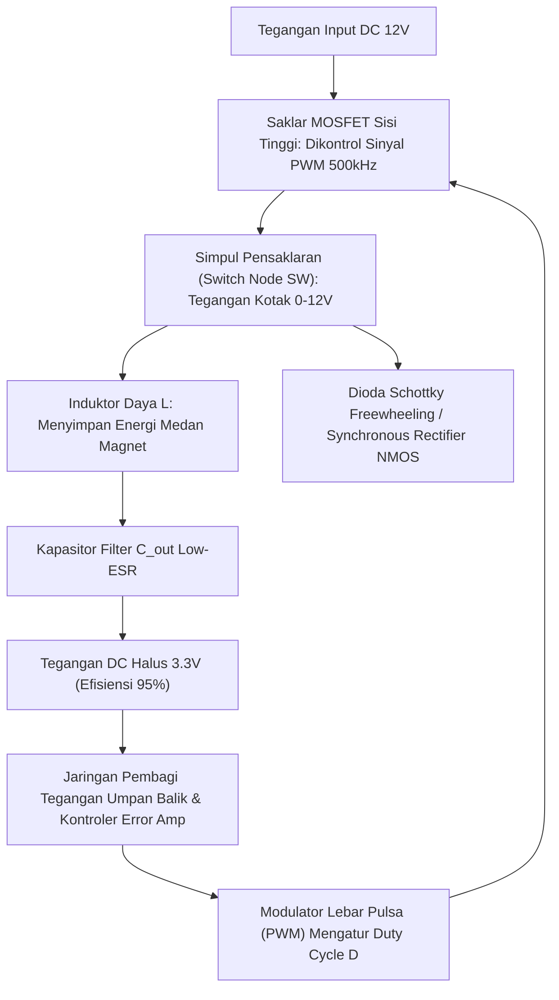

# Modul 047: Elektronika Daya / Power Electronics (Regulator LDO, Switching Buck/Boost/SMPS, H-Bridge, BMS)

**Navigasi**: [⬅️ Master Index](../../INDEX.md) | [Tingkat 3: Tingkat 3: Rangkaian Listrik, Elektronika & Microelectronics](./README.md)
*Sebelumnya*: [046. osilator-pembangkit-sinyal](./046-osilator-pembangkit-sinyal.md) | *Berikutnya*: [048. konversi-sinyal-adc-dac](./048-konversi-sinyal-adc-dac.md)

---

## 1. Intuisi Dasar Tanpa Jargon ("Seperti Bayi Baru Lahir")
### 1.1 Konsep Inti & Analogi Tanpa Jargon
Bayangkan Anda memiliki aki truk 24 Volt, tetapi Anda ingin menyalakan lampu LED kecil yang hanya butuh tegangan 3 Volt pada arus 2 Ampere.

### 1.2 Urgensi Rekayasa & Signifikansi Sistemik
Jika Anda menggunakan metode lama (Regulator Linier LDO / Resistor pembagi):
Tegangan sisa sebesar \$21\text{ Volt}$ akan 'dibuang' menjadi panas murni. Daya yang terbuang sia-sia: \$21\text{ V} 	imes 2\text{ A} = 42\text{ Watt}$ panas mendidih, sementara lampu LED hanya menyerap $6\text{ Watt}$ ($3\text{ V} 	imes 2\text{ A}$). Efisiensi sistem Anda mengenaskan: hanya \$12.5\%$! Anda membakar aki Anda sendiri!

Sebaliknya, **Elektronika Daya & Switching Power Supply (SMPS)** menggunakan trik jenius:
Daripada menahan tegangan seperti keran yang disumbat, kita menyalakan dan mematikan saklar transistor (MOSFET) ribuan hingga jutaan kali per detik (\$100\text{ kHz} - 2\text{ MHz}$), lalu menyerap energinya lewat ember induktor dan kapasitor. Karena transistor bekerja sebagai saklar (hanya hidup penuh atau mati penuh, di mana disipasi daya $V 	imes I pprox 0$), efisiensinya melesat hingga **$92\% - 98\%$**!
Dari charger laptop USB-C GaN seukuran kotak korek api hingga inverter mobil listrik Tesla bertenaga 500 tenaga kuda, elektronika daya adalah pengendali energi dunia.
[📚 Pelajari: MIT OCW Power Electronics](https://ocw.mit.edu/courses/6-334-power-electronics-spring-2007/)

## 2. Fondasi Teoretis & Aksiomatik / Matematis
### 2.1 Kerangka Teori Aksiomatik & Formulasi Matematis
### 47.1 Topologi Dasar Konverter Switching DC-DC ([Erickson Fundamentals of Power Electronics](https://link.springer.com/book/10.1007/978-3-030-43889-0))
Prinsip Keseimbangan Volt-Detik Induktor (*Volt-Second Balance*) dalam kondisi tunak:
$$\int_0^{T_s} v_L(t) dt = 0$$
Prinsip Keseimbangan Muatan Kapasitor (*Capacitor Charge Balance*):
$$\int_0^{T_s} i_C(t) dt = 0$$
Di mana $D = \frac{t_{\text{on}}}{T_s}$ adalah Siklus Kerja (*Duty Cycle* $0 \le D \le 1$).

### 2.2 Penurunan Matematis Langkah-demi-Langkah
1. **Konverter Penurun Tegangan (Buck Converter)**:
   $$V_{\text{out}} = D \cdot V_{\text{in}}$$
2. **Konverter Penaik Tegangan (Boost Converter)**:
   $$V_{\text{out}} = \frac{V_{\text{in}}}{1 - D}$$
3. **Konverter Buck-Boost (Inverting)**:
   $$V_{\text{out}} = -\frac{D}{1 - D} V_{\text{in}}$$

### 47.2 Perhitungan Induktansi Kritis & Riak Arus (CCM vs DCM) ([Texas Instruments Power Topologies](https://www.ti.com/lit/an/slva477b/slva477b.pdf))
Mode Konduksi Kontinu (*Continuous Conduction Mode* CCM) mensyaratkan arus induktor tidak pernah menyentuh nol:
Riak arus induktor puncak-ke-puncak ($\Delta I_L$):
$$\Delta I_L = \frac{V_{\text{in}} - V_{\text{out}}}{L} D T_s = \frac{V_{\text{out}} (1 - D)}{L f_{sw}}$$
Aturan praktis desain: tetapkan rasio riak $\Delta I_L = 0.3 \times I_{\text{out}}$.
Induktansi minimum untuk mempertahankan mode CCM:
$$L_{\min} = \frac{(1 - D) R_L}{2 f_{sw}}$$
Riak tegangan keluaran kapasitor:
$$\Delta V_{\text{out}} = \Delta I_L \left( \text{ESR} + \frac{1}{8 f_{sw} C_{\text{out}}} \right)$$

### 47.3 Rangkaian Jembatan-H (H-Bridge) & Penggerak Motor PWM ([All About Circuits H-Bridge](https://www.allaboutcircuits.com/technical-articles/how-to-drive-an-h-bridge-motor-driver/))
Empat saklar MOSFET disusun dalam topologi H:
- Maju: Saklar Kiri-Atas (High-Side A) dan Kanan-Bawah (Low-Side B) aktif.
- Mundur: Saklar Kanan-Atas (High-Side B) dan Kiri-Atas (Low-Side A) aktif.
- **Dead-Time Insertion**: Memberikan jeda waktu senggang wajib (\$50 - 500\text{ ns}$) di antara transisi saklar atas dan bawah pada kaki yang sama untuk mencegah fenomena bencana *Shoot-Through* (hubung singkat langsung rail catu daya ke tanah).

## 3. Anatomi Teknis & Cara Kerja Internal

Keunggulan Semikonduktor Wide Bandgap (GaN & SiC):
Transistor Gallium Nitride (GaN) dan Silicon Carbide (SiC) memiliki kecepatan switching \$10	ext{x}$ lebih cepat dan $R_{DS(	ext{on})}$ jauh lebih kecil dari silikon, memungkinkan frekuensi pensaklaran melonjak hingga $> 2	ext{ MHz}$ sehingga ukuran fisik induktor dan kapasitor menyusut $5	ext{x}$ lebih kecil.

#### Tabel Penelusuran Transisi Gate Half-Bridge & Kerusakan Shoot-Through Akibat Defisit Dead-Time
| Waktu Transien ($t$) | Sinyal Gerbang Atas ($V_{GS\_High}$) | Status Kanal Konduksi MOSFET Atas | Sinyal Gerbang Bawah ($V_{GS\_Low}$) | Status Kanal Konduksi MOSFET Bawah | Arus Bus Catu Daya DC ($I_{DC\_bus}$) |
|---|---|---|---|---|---|
| $t = 0.0\text{ ns}$ | HIGH ($12.0\text{ V}$) | ON Penuh (Konduksi $25\text{ A}$) | LOW ($0.0\text{ V}$) | OFF Terisolasi | $25.0\text{ A}$ (Arus beban normal) |
| $t = 100.0\text{ ns}$ | Dimatikan: $12\text{V} \to 0\text{V}$ | Kanal meluruh lambat ($t_{fall} = 180\text{ns}$) | LOW ($0.0\text{ V}$) | OFF | $25.0\text{ A}$ (Masa transisi mematikan) |
| $t = 150.0\text{ ns}$ (Dead-Time Cacat)| $V_{GS} = 4.2\text{ V}$ (Masih di atas $V_{th}$!) | MASIH KONDUKSI! | Dinyalakan prematur ($12.0\text{ V}$) | KANAL MULAI MEMBUKA! | KEDUA TRANSISTOR KONDUKSI SERENTAK! |
| $t = 180.0\text{ ns}$ (Puncak Korsleting)| Konduksi bersamaan | Resistansi jembatan $\approx 0.05\ \Omega$ | Konduksi bersamaan | Resistansi jembatan $\approx 0.05\ \Omega$ | Arus lonjakan tembus tembak $I_{peak} = 8.000\text{ A}$! |
| $t = 220.0\text{ ns}$ (Ledakan Silikon) | Kemasan plastik meledak | Jalur metallisasi menguap | Kemasan plastik meledak | Jalur metallisasi menguap | Bus tegangan anjlok; pemutus sirkuit meledak |

## 4. Implementasi Praktis & Kode / Simulasi Riil
```python
def design_buck_converter(v_in: float, v_out: float, i_out_max: float, 
                           f_sw_hz: float, ripple_ratio: float = 0.3) -> dict:
    """
    Menghitung komponen pasif induktor L dan kapasitor C untuk Buck Converter mode CCM.
    """
    duty_cycle = v_out / v_in
    delta_i_l = ripple_ratio * i_out_max
    
    # Induktansi L: Delta_I_L = (V_in - V_out) * D / (f_sw * L)
    l_henry = ((v_in - v_out) * duty_cycle) / (f_sw_hz * delta_i_l)
    
    # Kapasitansi C_out untuk riak tegangan 1%
    delta_v_out = 0.01 * v_out
    # Delta_V = Delta_I_L / (8 * f_sw * C)
    c_farads = delta_i_l / (8.0 * f_sw_hz * delta_v_out)
    
    return {
        "duty_cycle": duty_cycle,
        "inductor_uh": l_henry * 1e6,
        "ripple_current_a": delta_i_l,
        "capacitor_uf": c_farads * 1e6,
        "peak_inductor_current_a": i_out_max + (delta_i_l / 2.0)
    }

res = design_buck_converter(v_in=12.0, v_out=3.3, i_out_max=3.0, f_sw_hz=500e3)
print(f"Duty Cycle Pensaklaran : {res['duty_cycle']*100:.1f}%")
print(f"Induktansi Dibutuhkan  : {res['inductor_uh']:.2f} uH")
print(f"Arus Puncak Induktor   : {res['peak_inductor_current_a']:.2f} A (Pilih saturasi rating > 4.5A)")
print(f"Kapasitor Output Min   : {res['capacitor_uf']:.1f} uF (Gunakan keramik X7R multi-layer)")
```

## 5. Miskonsepsi & Jebakan Industri
1. **Inductor Magnetic Saturation Disaster**: Memilih induktor daya hanya berdasarkan rating arus termal rata-rata, mengabaikan rating arus saturasi $I_{	ext{sat}}$. Saat arus puncak melampaui $I_{	ext{sat}}$, permeabilitas inti ferit runtuh seketika, induktansi anjlok hingga \$90\%$, dan arus meledak menghancurkan transistor switching.
2. **Shoot-Through Cross-Conduction in H-Bridge**: Menyalakan MOSFET sisi atas dan sisi bawah secara simultan tanpa jeda dead-time yang cukup, menyebabkan catu daya terhubung singkat langsung ke tanah selama beberapa puluh nanodetik yang meledakkan MOSFET dengan suara ledakan keras.
3. **Noisy High-di/dt Hot Loop PCB Layout**: Mengabaikan loop arus pensaklaran frekuensi tinggi (jalur kapasitor input - MOSFET - dioda penyearah); induktansi parasitik jalur PCB yang lebar menghasilkan derau dering tegangan tinggi (*ringing voltage spike*) dan interferensi elektromagnetik EMI yang melumpuhkan mikrokontroler.

### Studi Kasus Kegagalan Nyata: Bencana Shoot-Through pada Half-Bridge Konverter Daya Akibat Dead-Time Kurang Memadai
- **Insiden Kegagalan Inverter Motor Kendaraan Listrik**: Pada prototipe inverter kontroler motor traksi kendaraan listrik 400V 100 kW, insinyur perangkat lunak firmware memperbarui register mikrokontroler untuk mempercepat respons PWM. Sesaat setelah pedal gas diinjak, modul daya silikon IPM (Intelligent Power Module) seharga puluhan juta rupiah meledak dengan suara tembakan senapan, menghancurkan pelat tembaga busbar dan merusak mikrokontroler.
- **Akar Masalah Elektronika Daya & Waktu Tunda Transisi (Dead-Time)**: Pada topologi jembatan setengah (*half-bridge*), transistor sisi tinggi (High-Side) dan transistor sisi rendah (Low-Side) terhubung langsung melintasi rel tegangan tinggi bus DC 400V. Karena kapasitansi gerbang parasitik ($C_{iss}, C_{gd}$) dan waktu tunda pemadaman semikonduktor (*turn-off delay* $t_{d(off)}$ dan *fall time* $t_f$) selalu lebih lambat daripada waktu penyalaan (*turn-on delay*), saklar yang dimatikan membutuhkan waktu ratusan nanodetik untuk benar-benar memutus arus. Firmware hanya mengalokasikan waktu mati (*dead-time*) sebesar $50\text{ ns}$, padahal transistor membutuhkan waktu $180\text{ ns}$ untuk padam penuh. Akibatnya, kedua transistor berada pada kondisi ON bersamaan selama $130\text{ ns}$, menciptakan hubungan singkat impedansi nol langsung melintasi kapasitor bus DC 400V. Arus tembus tembak (*shoot-through current*) ribuan ampere mengalir dalam sekejap, melampaui batas energi silikon dan memicu ledakan plasma termal.

- **Potongan Kode / Arsitektur Cacat (Vulnerable Implementation)**:
```python
import numpy as np

def simulate_half_bridge_deadtime(deadtime_ns=50.0, v_bus=400.0, c_bus_uf=1000.0):
    # Parameter switching MOSFET daya SiC/IGBT
    t_turn_off_delay = 80.0   # ns
    t_fall_time = 120.0        # ns
    t_total_turn_off = t_turn_off_delay + t_fall_time  # Butuh 200 ns untuk mati penuh!
    
    t_turn_on_delay = 30.0    # ns
    t_rise_time = 40.0         # ns
    
    # Waktu overlap konduksi serempak kedua switch:
    # Overlap terjadi jika High-Side belum mati saat Low-Side sudah mulai konduksi
    t_low_starts_conduction = deadtime_ns + t_turn_on_delay
    
    overlap_duration_ns = max(0.0, t_total_turn_off - t_low_starts_conduction)
    
    r_loop_stray = 0.05  # Resistansi loop tembaga parasitik (Ohm)
    
    if overlap_duration_ns > 0:
        # Terjadi arus shoot-through dahsyat
        i_shoot_through_peak = v_bus / r_loop_stray
        # Energi disipasi destruktif dalam joule
        energy_loss_joules = v_bus * i_shoot_through_peak * (overlap_duration_ns * 1e-9)
        power_module_explodes = energy_loss_joules > 5.0  # Batas energi bonding wire silikon
    else:
        i_shoot_through_peak = 0.0
        energy_loss_joules = 0.0
        power_module_explodes = False
        
    return {
        "deadtime_set_ns": deadtime_ns,
        "conduction_overlap_ns": overlap_duration_ns,
        "shoot_through_peak_current_A": i_shoot_through_peak,
        "destructive_energy_J": energy_loss_joules,
        "is_catastrophic_failure": power_module_explodes
    }

# Evaluasi dead-time pendek 50ns vs dead-time aman 250ns
disaster = simulate_half_bridge_deadtime(deadtime_ns=50.0)
safe = simulate_half_bridge_deadtime(deadtime_ns=250.0)
# Dead-time 50ns: Overlap = 120ns, Arus = 8.000 A, Energi = 38.4 J -> MELEDAK KATASTROPIK!
# Dead-time 250ns: Overlap = 0ns, Bebas shoot-through 100%!
```

- **Perlindungan Keras Perangkat Keras (Hardware Interlock)**: Driver gerbang modern (seperti TI UCC21520 / ADI ADuM4223) mengintegrasikan logika interlock perangkat keras anti-shoot-through di dalam chip driver itu sendiri. Logika ini menolak sinyal kontrol apapun yang mencoba mengaktifkan kedua gerbang secara bersamaan, serta memiliki sirkuit pembuat dead-time analog internal otomatis yang tidak dapat ditimpa oleh kesalahan perangkat lunak firmware.

## 6. Proyek Latihan & Rubrik Penilaian Mandiri
### Tingkat 1 (Pemula) - Efisiensi Regulator Linier LDO vs Buck Converter
Tulis fungsi Python yang membandingkan disipasi daya panas dan efisiensi konversi daya antara regulator linier LDO (LM1117-3.3) dan konverter switching Buck (LM2596) untuk menurunkan tegangan input $V_{	ext{in}} = 12	ext{ V}$ ke $V_{	ext{out}} = 3.3	ext{ V}$ pada arus beban $I_L \in [0.1	ext{ A}, 2.0	ext{ A}]$. Plot kurva perbandingan efisiensinya.

### Tingkat 2 (Menengah) - Perancangan Konverter Boost Penaik Tegangan Baterai
Rancang rangkaian konverter Boost untuk menaikkan tegangan sel baterai tunggal Li-Ion ($3.0	ext{ V} - 4.2	ext{ V}$) menjadi keluaran USB stabil $5.0	ext{ V}$ pada arus beban maksimum $2.0	ext{ A}$ dengan frekuensi switching $1.2	ext{ MHz}$. Hitung nilai induktansi daya, arus ripple, dan pilih MOSFET daya dengan $R_{DS(	ext{on})}$ yang optimal.

### Tingkat 3 (Mahir) - Pengontrol Motor Brushless DC (BLDC) Tiga Fasa dengan PWM Ruang Vektor (SVPWM)
Rancang topologi inverter jembatan-3 fasa (6 MOSFET daya) untuk menggerakkan motor BLDC/PMSM. Turunkan algoritma Space Vector PWM (SVPWM) untuk menghasilkan tegangan sinus 3-fasa dengan utilisasi bus DC \$15\%$ lebih tinggi dibandingkan modulasi SPWM sinus biasa, lengkap dengan deteksi arus shunt fase dan proteksi hardware overcurrent.

#### Rubrik Penilaian
- **40% Kepatuhan Keseimbangan Volt-Detik**: Analisis siklus kerja dan batas CCM/DCM dirumuskan tepat.
- **30% Manajemen Rugi-Rugi Daya**: Memisahkan rugi konduksi ($I^2 R_{DS(	ext{on})}$) dan rugi pensaklaran ($V I f_{sw} t_{sw}$).
- **30% Keandalan & Proteksi Sirkuit**: Menyertakan penyisipan dead-time hardware dan penanganan lonjakan arus balik induktif.

### Tingkat 1: Dasar
- **Tugas**: Bangun kalkulator siklus kerja dan nilai komponen pasif ($L$ dan $C$) untuk konverter DC-DC Buck sinkron mode konduksi kontinu (Continuous Conduction Mode / CCM) berdasarkan batas riak arus induktor $\Delta I_L$ dan riak tegangan keluaran $\Delta V_{out}$.
- **Petunjuk Perancangan Arsitektur**:
  - Siklus kerja CCM: $D = \frac{V_{out}}{V_{in}}$.
  - Induktansi minimum: $L = \frac{V_{out} (1 - D)}{\Delta I_L \cdot f_{sw}}$.
  - Kapasitansi minimum: $C = \frac{\Delta I_L}{8 f_{sw} \Delta V_{out}}$.
- **Test Vector & Kasus Uji Ekstrem**:
  - *Spesifikasi Standar*: $V_{in} = 12\text{ V}, V_{out} = 3.3\text{ V}, f_{sw} = 200\text{ kHz}, I_{out} = 5\text{ A}$; target $\Delta I_L = 30\% I_{out}$ dan $\Delta V_{out} = 1\% V_{out}$. Hitung $L$ dalam $\mu\text{H}$ dan $C$ dalam $\mu\text{F}$.
  - *Batas Arus Kritis Discontinuous Mode (DCM)*: Identifikasi arus beban ambang di mana konverter beralih ke mode DCM.
- **Rubrik Penilaian Mandiri**: 40% Formula Konversi Buck CCM Presisi, 30% Perhitungan Dimensi $L$ dan $C$ Sesuai Batas Riak, 30% Analisis Batas Transisi CCM/DCM.

### Tingkat 2: Menengah
- **Tugas**: Implementasikan simulator perancangan kompensasi kendali umpan balik loop tegangan tipe II / tipe III (Type III Voltage-Mode Compensation Network) untuk konverter Buck menggunakan penempatan kutub-nol kompensator K-factor, menghitung fungsi alih loop terbuka $T(s) = G_{vd}(s) H(s) G_c(s)$ dan menjamin margin fasa $\ge 50^\circ$ serta margin gain $\ge 10\text{ dB}$.
- **Petunjuk Perancangan Arsitektur**:
  - Tentukan frekuensi crossover target $f_c \approx f_{sw} / 10$.
  - Batalkan kutub ganda LC konverter $f_0 = \frac{1}{2\pi \sqrt{LC}}$ menggunakan sepasang nol kompensator Tipe III.
  - Tempatkan kutub kompensator pada ESR-zero kapasitor dan setengah frekuensi switching.
- **Test Vector & Kasus Uji Ekstrem**:
  - *Kompensasi Ideal*: Buktikan kurva magnitude Bode memotong $0\text{ dB}$ dengan kemiringan tepat $-20\text{ dB/dekade}$.
  - *Uji Langkah Beban Transien*: Injeksi perubahan beban $10\% \to 90\%$; buktikan drop tegangan transien $\le 5\%$ dan pulih dalam waktu $< 50\,\mu\text{s}$.
- **Rubrik Penilaian Mandiri**: 40% Sintesis Kompensator Tipe III K-Factor Presisi, 30% Analisis Stabilitas Margin Fasa & Gain Bode, 30% Verifikasi Respons Transien Undershoot/Overshoot.

### Tingkat 3: Mahir
- **Tugas**: Rancang simulator konverter resonan frekuensi tinggi LLC Resonant Half-Bridge berbasis First Harmonic Approximation (FHA), turunkan kurva penguatan tegangan DC $M(f_n, Q, L_n)$ terhadap frekuensi ternormalisasi $f_n = f_s / f_r$, dan identifikasi batas wilayah operasi Zero-Voltage Switching (ZVS) sisi primer vs Zero-Current Switching (ZCS) sisi sekunder untuk mengeliminasi rugi penyalaan MOSFET.
- **Petunjuk Perancangan Arsitektur**:
  - Fungsi transfer penguatan FHA: $M(f_n, Q, L_n) = \left| \frac{L_n f_n^2}{[(L_n + 1) f_n^2 - 1] + j [f_n (f_n^2 - 1) Q L_n]} \right|$.
  - Evaluasi batas induktif ZVS di mana arus magnetisasi mencukupi untuk melepaskan muatan kapasitansi output transistor $C_{oss}$ selama dead-time.
- **Test Vector & Kasus Uji Ekstrem**:
  - *Titik Resonansi Seri ($f_n = 1.0$)*: Penguatan harus tepat $M = 1.000$ independen terhadap variasi beban $Q$.
  - *Batas Terlarang Wilayah Kapasitif ZCS*: Deteksi pelanggaran batas ZVS saat frekuensi turun di bawah frekuensi puncak; bangkitkan peringatan kegagalan hard-switching.
- **Rubrik Penilaian Mandiri**: 40% Formulasi Analisis Harmonisa Pertama (FHA) LLC Tepat, 30% Pemetaan Wilayah Pengoperasian ZVS yang Aman, 30% Kalkulasi Kebutuhan Arus Magnetisasi Pengosongan $C_{oss}$.

## 7. Rekomendasi Sumber Belajar Standar Emas
| Kategori | Judul Sumber & Tautan Langsung | Deskripsi Singkat |
|---|---|---|
| 📖 Buku Teks | [Fundamentals of Power Electronics (Erickson & Maksimovic)](https://link.springer.com/book/10.1007/978-3-030-43889-0) | Kitab rujukan standar dunia untuk analisis dan desain catu daya switching modern. |
| 🎓 Kuliah Terbuka | [MIT OCW 6.334 Power Electronics](https://ocw.mit.edu/courses/6-334-power-electronics-spring-2007/) | Kuliah video mendalam mengenai topologi switching, magnetik daya, dan kontrol loop umpan balik. |
| 🔬 Makalah Seminal | [A Unified Approach to Modeling Switching Converter Power Stages (Middlebrook & Ćuk, 1976)](https://doi.org/10.1109/PESC.1976.7072895) | Makalah monumental yang memperkenalkan metode pemodelan rata-rata ruang keadaan (State-Space Averaging). |
| 💻 Lab Interaktif | [TI WEBENCH Power Designer](https://www.ti.com/design-resources/design-tools-simulation/webench-power-designer.html) | Platform simulasi cloud otomatis untuk mengoptimalkan efisiensi dan ukuran komponen SMPS. |

---
*Navigasi Cepat*: [Ke Tingkat 3](./README.md) | [Ke Master Index](../../INDEX.md) | *Sebelumnya*: [046. osilator-pembangkit-sinyal](./046-osilator-pembangkit-sinyal.md) | *Berikutnya*: [048. konversi-sinyal-adc-dac](./048-konversi-sinyal-adc-dac.md)
