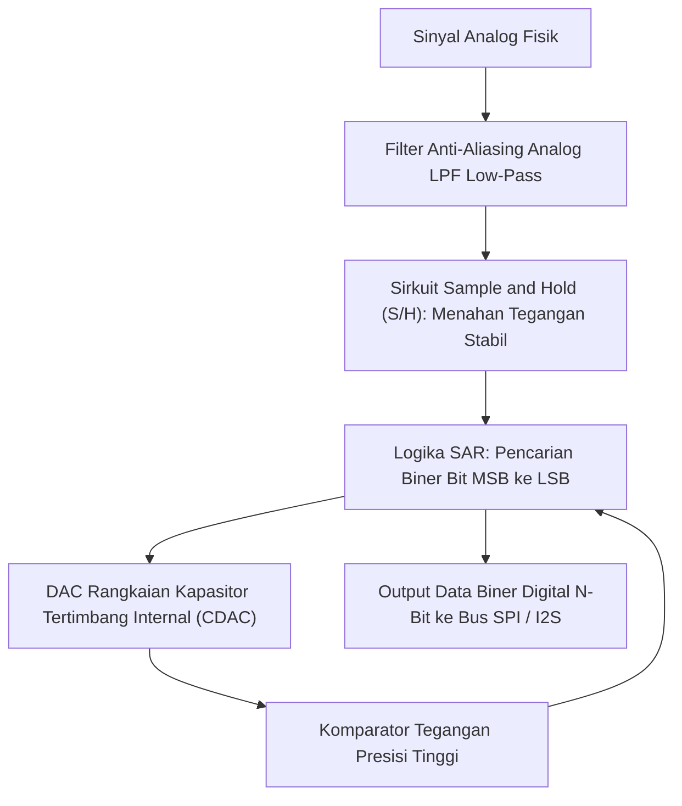

# Modul 048: Konversi Sinyal: ADC & DAC (Sampling Nyquist-Shannon, Flash/SAR/Sigma-Delta ADC, R-2R DAC)

**Navigasi**: [⬅️ Master Index](../../INDEX.md) | [Tingkat 3: Tingkat 3: Rangkaian Listrik, Elektronika & Microelectronics](./README.md)
*Sebelumnya*: [047. elektronika-daya-power-electronics](./047-elektronika-daya-power-electronics.md) | *Berikutnya*: [049. instrumentasi-alat-ukur-lab](./049-instrumentasi-alat-ukur-lab.md)

---

## 1. Intuisi Dasar Tanpa Jargon ("Seperti Bayi Baru Lahir")
Dunia fisik nyata kita bersifat **Analog**: suara kicau burung, suhu udara siang hari, dan terang cahaya matahari berubah secara mulus tanpa jeda (kontinu). Tetapi komputer kita bersifat **Digital**: ia adalah mesin kalkulator biner yang hanya mengenal angka diskrit berhingga (`0` dan `1`).

Bagaimana mikrofon ponsel Anda mengubah gelombang suara udara menjadi file MP3? Dan bagaimana speaker Anda mengubah file MP3 kembali menjadi suara fisik yang Anda dengar?
Di sinilah peran sang penerjemah agung:
- **ADC (Analog-to-Digital Converter)**: Memotret tegangan analog puluhan ribu kali per detik (Sampling) dan membualatkannya menjadi angka biner (Quantization).
- **DAC (Digital-to-Analog Converter)**: Membangun kembali kurva tegangan analog yang mulus dari deretan angka biner komputer.
Teorema Nyquist-Shannon membuktikan keajaiban matematika: jika Anda memotret gelombang setidaknya 2x lebih cepat dari frekuensi tertingginya, Anda bisa merekonstruksi gelombang asli tersebut **100% sempurna tanpa kehilangan informasi sedikit pun!**
[📚 Pelajari: All About Circuits ADC Principles](https://www.allaboutcircuits.com/textbook/digital/chpt-13/analog-to-digital-conversion/)

## 2. Fondasi Teoretis & Aksiomatik / Matematis
### 48.1 Teorema Sampling Nyquist-Shannon & Fenomena Aliasing ([Oppenheim Discrete-Time Signal Processing](https://www.pearson.com/))
Suatu sinyal kontinu waktu $x(t)$ yang memiliki batas bandwidth frekuensi maksimum $f_{\max}$ (bandlimited) dapat direkonstruksi secara sempurna dari sampel diskritnya jika laju sampling $f_s$ memenuhi Kriteria Nyquist:
$$f_s > 2 f_{\max}$$
Jika $f_s < 2 f_{\max}$, frekuensi tinggi akan melipat kembali (*fold over*) ke domain frekuensi rendah sebagai frekuensi palsu yang merusak sinyal (**Aliasing**):
$$f_{\text{alias}} = |f_{\text{in}} - k \cdot f_s|$$
Filter Anti-Aliasing analog low-pass wajib dipasang sebelum input ADC untuk memotong frekuensi di atas $f_s / 2$.

### 48.2 Kuantisasi, Resolusi Bit & Derau Kuantisasi (SNR Ideal) ([Analog Devices Data Conversion Handbook](https://www.analog.com/))
ADC dengan resolusi $N$-bit membagi rentang tegangan penuh (*Full-Scale Range* FSR) menjadi $2^N$ tingkat kode diskrit:
Ukuran satu LSB (Least Significant Bit):
$$\Delta = \text{LSB} = \frac{V_{\text{ref}}}{2^N}$$
Galat kuantisasi terdistribusi seragam antara $[-\Delta / 2, +\Delta / 2]$ dengan daya derau:
$$\sigma_q^2 = \frac{\Delta^2}{12}$$
Rasio Sinyal terhadap Derau Kuantisasi Teoritis Maksimum (SNR ideal sinyal sinus penuh):
$$\text{SNR}_{\max} = 6.02 \cdot N + 1.76 \quad (\text{dB})$$
Setiap penambahan 1 bit resolusi meningkatkan kualitas audio sebesar $\approx 6\text{ dB}$ (daya derau berkurang separuhnya!).

### 48.3 Topologi Arsitektur ADC Utama ([Texas Instruments ADC Architectures](https://www.ti.com/lit/an/sbaa446/sbaa446.pdf))
1. **Flash ADC**: Menggunakan $2^N - 1$ komparator tegangan paralel dan pembagi resistif. Kecepatan ultra-tinggi ($> 1\text{ GSPS}$), namun konsumsi daya dan area silikon membengkak eksponensial (terbatas pada resolusi $6 - 8\text{ bit}$).
2. **Successive Approximation Register (SAR) ADC**: Menggunakan pencarian biner (*binary search*) dengan DAC internal dan satu komparator tunggal selama $N$ siklus clock. Arsitektur paling serbaguna industri ($8 - 18\text{ bit}$, hingga beberapa MSPS).
3. **Sigma-Delta ($\Sigma\Delta$) ADC**: Menggunakan oversampling rasio tinggi ($OSR = f_s / 2f_B \gg 1$) dan pembentukan derau (*Noise Shaping*) dengan integrator loop umpan balik, mendorong derau kuantisasi ke frekuensi ultrasonik yang kemudian dibuang oleh filter digital. Resolusi ultra-tinggi ($24\text{ s/d } 32\text{ bit}$) untuk audio audiophile dan timbangan presisi.

## 3. Anatomi Teknis & Cara Kerja Internal

Mekanisme Rangkaian Tangga Resistor R-2R DAC:
Hanya menggunakan dua nilai resistor ($R$ dan $2R$). Setiap simpul tangga membagi arus menjadi separuh ($I/2$), menjumlahkan kontribusi bit biner secara berbobot langsung ke summing node op-amp tanpa memerlukan rasio nilai resistor presisi tinggi yang rumit diproduksi.

## 4. Implementasi Praktis & Kode / Simulasi Riil
import numpy as np

def simulate_adc_quantization(signal_freq_hz: float, sample_rate_hz: float, 
                              resolution_bits: int, v_ref: float = 3.3, duration: float = 0.005) -> dict:
    """
    Simulasi proses sampling waktu dan kuantisasi tegangan ADC.
    """
    t = np.arange(0, duration, 1.0 / sample_rate_hz)
    # Sinyal masukan sinus analog murni amplitude penuh
    v_analog = (v_ref / 2.0) + (v_ref / 2.0) * 0.95 * np.sin(2.0 * np.pi * signal_freq_hz * t)
    
    # Kuantisasi ke tingkat diskrit N-bit
    num_levels = 2**resolution_bits
    lsb_step = v_ref / num_levels
    
    digital_codes = np.floor(v_analog / lsb_step).astype(int)
    digital_codes = np.clip(digital_codes, 0, num_levels - 1)
    
    # Rekonstruksi tegangan terkuantisasi
    v_quantized = digital_codes * lsb_step
    quantization_error = v_quantized - v_analog
    
    # Hitung SNR terukur
    signal_power = np.mean((v_analog - np.mean(v_analog))**2)
    noise_power = np.mean(quantization_error**2)
    measured_snr_db = 10.0 * np.log10(signal_power / noise_power)
    
    return {
        "lsb_mv": lsb_step * 1000.0,
        "measured_snr_db": measured_snr_db,
        "theoretical_snr_db": 6.02 * resolution_bits + 1.76
    }

res = simulate_adc_quantization(signal_freq_hz=440.0, sample_rate_hz=48000.0, resolution_bits=12)
print(f"Resolusi 12-Bit LSB Step : {res['lsb_mv']:.3f} mV")
print(f"SNR Kuantisasi Terukur  : {res['measured_snr_db']:.2f} dB")
print(f"SNR Teoretis Maksimum   : {res['theoretical_snr_db']:.2f} dB")

## 5. Miskonsepsi & Jebakan Industri
1. **Sampling above Nyquist without Anti-Aliasing Filter**: Mengabaikan filter low-pass sebelum ADC; derau frekuensi tinggi (seperti frekuensi switching SMPS 500 kHz) akan terlipat masuk tepat ke pita sinyal audio 5 kHz dan tidak akan pernah bisa dihilangkan oleh filter digital perangkat lunak mana pun.
2. **Noisy Voltage Reference ($V_{	ext{ref}}$)**: Menggunakan rail suplai digital mikrokontroler $3.3	ext{ V}$ yang berderau langsung sebagai tegangan referensi ADC. Setiap riak $10	ext{ mV}$ pada power supply langsung merusak akurasi bacaan konversi analog hingga 4-5 bit terendah.
3. **Missing Dithering in High-Resolution Audio ADC**: Mengkuantisasi sinyal beramplitudo sangat kecil ($< 1	ext{ LSB}$) tanpa menambahkan derau acak terkontrol (*Dither*); menghasilkan distorsi harmonik kuantisasi nonlinier kasar yang sangat mengganggu telinga manusia.

## 6. Proyek Latihan & Rubrik Penilaian Mandiri
### Tingkat 1 (Pemula) - Rangkaian DAC Tangga R-2R 4-Bit Sederhana
Rancang jaringan tangga resistor R-2R ($R = 10	ext{ k}\Omega, 2R = 20	ext{ k}\Omega$) 4-bit menggunakan pin output digital mikrokontroler $5	ext{ V}$. Hitung tegangan keluaran analog untuk setiap kode biner dari `0000` hingga `1111` dan verifikasi kemonotonan kurva tangganya.

### Tingkat 2 (Menengah) - Simulasi Spektrum FFT Efek Aliasing ADC
Tulis skrip Python yang mensimulasikan sampling ADC berkecepatan $f_s = 10	ext{ kHz}$. Masukkan sinyal sinus frekuensi input $f_{	ext{in}} = 8	ext{ kHz}$ (melanggar Nyquist karena $f_{	ext{in}} > f_s / 2$). Lakukan transformasi Fourier FFT dan buktikan kemunculan nada bayangan palsu aliasing pada frekuensi tepat $2	ext{ kHz}$.

### Tingkat 3 (Mahir) - Pemodelan Modulator Delta-Sigma Orde-1 dengan Noise Shaping
Implementasikan simulasi domain waktu modulator $\Sigma\Delta$ orde-1 (integrator, kuantisator 1-bit komparator, DAC 1-bit umpan balik) dengan laju oversampling $OSR = 64$. Hitung spektrum daya derau menggunakan FFT dan buktikan penurunan derau kuantisasi pada pita dasar sebesar $+9	ext{ dB}$ per penggandaan laju oversampling.

#### Rubrik Penilaian
- **40% Kepatuhan Teori Nyquist-Shannon**: Pemilihan laju sampling dan desain filter rekonstruksi akurat.
- **30% Analisis Metrik Dinamis ADC**: Mampu menghitung Effective Number of Bits (ENOB), THD, dan SINAD dari data spektral FFT.
- **30% Integritas Kuantisasi Monoton**: Memastikan tidak ada kode hilang (*no missing codes*) dan Differential Non-Linearity ($DNL < 1	ext{ LSB}$).

## 7. Rekomendasi Sumber Belajar Standar Emas
| Kategori | Judul Sumber & Tautan Langsung | Deskripsi Singkat |
|---|---|---|
| 📖 Buku Teks | [Data Conversion Handbook (Walt Kester / Analog Devices)](https://www.analog.com/en/resources/technical-books/data-conversion-handbook.html) | Ensiklopedia industri terlengkap arsitektur ADC, DAC, sampling, dan layout sirkuit. |
| 🎓 Kuliah Terbuka | [MIT OCW 6.003 Signals and Systems: Sampling](https://ocw.mit.edu/courses/6-003-signals-and-systems-fall-2011/) | Penurunan matematis formal transformasi Fourier domain waktu diskrit dan sampling. |
| 🔬 Makalah Seminal | [Communication in the Presence of Noise (Claude Shannon, 1949)](https://doi.org/10.1109/JRPROC.1949.232969) | Makalah perintis yang memformulasikan Teorema Sampling modern. |
| 💻 Lab Interaktif | [Analog Devices Virtual Eval Tool](https://eval.analog.com/) | Lab interaktif evaluasi spektrum kebisingan dan kinerja dinamis ADC industri. |

---
*Navigasi Cepat*: [Ke Tingkat 3](./README.md) | [Ke Master Index](../../INDEX.md) | *Sebelumnya*: [047. elektronika-daya-power-electronics](./047-elektronika-daya-power-electronics.md) | *Berikutnya*: [049. instrumentasi-alat-ukur-lab](./049-instrumentasi-alat-ukur-lab.md)
