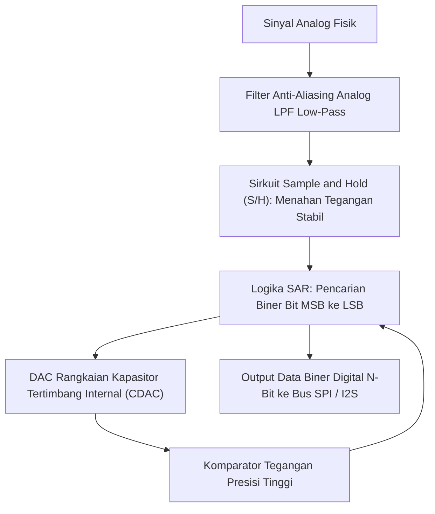

# Modul 048: Konversi Sinyal: ADC & DAC (Sampling Nyquist-Shannon, Flash/SAR/Sigma-Delta ADC, R-2R DAC)

**Navigasi**: [⬅️ Master Index](../../INDEX.md) | [Tingkat 3: Tingkat 3: Rangkaian Listrik, Elektronika & Microelectronics](./README.md)
*Sebelumnya*: [047. elektronika-daya-power-electronics](./047-elektronika-daya-power-electronics.md) | *Berikutnya*: [049. instrumentasi-alat-ukur-lab](./049-instrumentasi-alat-ukur-lab.md)

---

## 1. Intuisi Dasar Tanpa Jargon ("Seperti Bayi Baru Lahir")
### 1.1 Konsep Inti & Analogi Tanpa Jargon
Dunia fisik nyata kita bersifat **Analog**: suara kicau burung, suhu udara siang hari, dan terang cahaya matahari berubah secara mulus tanpa jeda (kontinu). Tetapi komputer kita bersifat **Digital**: ia adalah mesin kalkulator biner yang hanya mengenal angka diskrit berhingga (`0` dan `1`).

### 1.2 Urgensi Rekayasa & Signifikansi Sistemik
Bagaimana mikrofon ponsel Anda mengubah gelombang suara udara menjadi file MP3? Dan bagaimana speaker Anda mengubah file MP3 kembali menjadi suara fisik yang Anda dengar?
Di sinilah peran sang penerjemah agung:
- **ADC (Analog-to-Digital Converter)**: Memotret tegangan analog puluhan ribu kali per detik (Sampling) dan membualatkannya menjadi angka biner (Quantization).
- **DAC (Digital-to-Analog Converter)**: Membangun kembali kurva tegangan analog yang mulus dari deretan angka biner komputer.
Teorema Nyquist-Shannon membuktikan keajaiban matematika: jika Anda memotret gelombang setidaknya 2x lebih cepat dari frekuensi tertingginya, Anda bisa merekonstruksi gelombang asli tersebut **100% sempurna tanpa kehilangan informasi sedikit pun!**
[📚 Pelajari: All About Circuits ADC Principles](https://www.allaboutcircuits.com/textbook/digital/chpt-13/analog-to-digital-conversion/)

## 2. Fondasi Teoretis & Aksiomatik / Matematis
### 2.1 Kerangka Teori Aksiomatik & Formulasi Matematis
### 48.1 Teorema Sampling Nyquist-Shannon & Fenomena Aliasing ([Oppenheim Discrete-Time Signal Processing](https://www.pearson.com/))
Suatu sinyal kontinu waktu $x(t)$ yang memiliki batas bandwidth frekuensi maksimum $f_{\max}$ (bandlimited) dapat direkonstruksi secara sempurna dari sampel diskritnya jika laju sampling $f_s$ memenuhi Kriteria Nyquist:
$$f_s > 2 f_{\max}$$
Jika $f_s < 2 f_{\max}$, frekuensi tinggi akan melipat kembali (*fold over*) ke domain frekuensi rendah sebagai frekuensi palsu yang merusak sinyal (**Aliasing**):
$$f_{\text{alias}} = |f_{\text{in}} - k \cdot f_s|$$
Filter Anti-Aliasing analog low-pass wajib dipasang sebelum input ADC untuk memotong frekuensi di atas $f_s / 2$.

### 2.2 Penurunan Matematis Langkah-demi-Langkah
### 48.2 Kuantisasi, Resolusi Bit & Derau Kuantisasi (SNR Ideal) ([Analog Devices Data Conversion Handbook](https://www.analog.com/))
ADC dengan resolusi $N$-bit membagi rentang tegangan penuh (*Full-Scale Range* FSR) menjadi $2^N$ tingkat kode diskrit:
Ukuran satu LSB (Least Significant Bit):
$$\Delta = \text{LSB} = \frac{V_{\text{ref}}}{2^N}$$
Galat kuantisasi terdistribusi seragam antara $[-\Delta / 2, +\Delta / 2]$ dengan daya derau:
$$\sigma_q^2 = \frac{\Delta^2}{12}$$
Rasio Sinyal terhadap Derau Kuantisasi Teoritis Maksimum (SNR ideal sinyal sinus penuh):
$$\text{SNR}_{\max} = 6.02 \cdot N + 1.76 \quad (\text{dB})$$
Setiap penambahan 1 bit resolusi meningkatkan kualitas audio sebesar $\approx 6\text{ dB}$ (daya derau berkurang separuhnya!).

### 48.3 Topologi Arsitektur ADC Utama ([Texas Instruments ADC Architectures](https://www.ti.com/lit/an/sbaa446/sbaa446.pdf))
1. **Flash ADC**: Menggunakan $2^N - 1$ komparator tegangan paralel dan pembagi resistif. Kecepatan ultra-tinggi ($> 1\text{ GSPS}$), namun konsumsi daya dan area silikon membengkak eksponensial (terbatas pada resolusi $6 - 8\text{ bit}$).
2. **Successive Approximation Register (SAR) ADC**: Menggunakan pencarian biner (*binary search*) dengan DAC internal dan satu komparator tunggal selama $N$ siklus clock. Arsitektur paling serbaguna industri ($8 - 18\text{ bit}$, hingga beberapa MSPS).
3. **Sigma-Delta ($\Sigma\Delta$) ADC**: Menggunakan oversampling rasio tinggi ($OSR = f_s / 2f_B \gg 1$) dan pembentukan derau (*Noise Shaping*) dengan integrator loop umpan balik, mendorong derau kuantisasi ke frekuensi ultrasonik yang kemudian dibuang oleh filter digital. Resolusi ultra-tinggi (\$24\text{ s/d } 32\text{ bit}$) untuk audio audiophile dan timbangan presisi.

## 3. Anatomi Teknis & Cara Kerja Internal

Mekanisme Rangkaian Tangga Resistor R-2R DAC:
Hanya menggunakan dua nilai resistor ($R$ dan $2R$). Setiap simpul tangga membagi arus menjadi separuh ($I/2$), menjumlahkan kontribusi bit biner secara berbobot langsung ke summing node op-amp tanpa memerlukan rasio nilai resistor presisi tinggi yang rumit diproduksi.

#### Tabel Penelusuran Siklus Konversi SAR ADC 12-Bit & Fenomena Missing Codes Akibat Ketidakcocokan CDAC
| Siklus Jam ADC ($k$) | Bit Uji Suksesif ($B_k$) | Bobot Kapasitor Ideal ($C_k$) | Kapasitor Terfabrikasi Bermasalah ($C_k + \Delta C$) | Tegangan DAC Internal ($V_{dac}$) | Keputusan Komparator & Galat DNL |
|---|---|---|---|---|---|
| Inisialisasi | Sampel Tegangan Masukan | Input $V_{in} = 2.048\text{ V}$ | Kapasitor tersampel | $V_{dac} = 0.000\text{ V}$ | Komparator di-reset |
| Siklus 1 ($k=11$, MSB) | Uji $B_{11} = 1$ | $2048\text{ C}$ ($V_{ref}/2 = 2.048\text{ V}$) | $2020\text{ C}$ (Defisit -28C akibat etsa) | $2.020\text{ V}$ | $V_{in} > V_{dac} \implies B_{11} = 1$ (Disimpan) |
| Siklus 2 ($k=10$) | Uji $B_{10} = 1$ | $1024\text{ C}$ | $1035\text{ C}$ (Kelebihan +11C) | $3.055\text{ V}$ | $V_{in} < V_{dac} \implies B_{10} = 0$ (Dibuang) |
| Siklus 3 ($k=9$) | Uji $B_9 = 1$ | $512\text{ C}$ | $512\text{ C}$ | $2.532\text{ V}$ | $V_{in} < V_{dac} \implies B_9 = 0$ (Dibuang) |
| Siklus 12 (LSB Selesai) | Kode Digital Dihasilkan | Kode Ideal: `2048` (`0x800`) | Kode Aktual Terbaca: `2055` (`0x807`) | Output melompati 7 kode biner | Terjadi Missing Code! ($DNL < -1.0\text{ LSB}$) |
| Verifikasi Monotonisitas | Tegangan input dinaikkan perlahan | Transisi kode digital | Tangga konversi melonjak tajam | Turun sesaat saat input naik! | Karakteristik non-monotonik merusak loop PID |

## 4. Implementasi Praktis & Kode / Simulasi Riil
```python
import numpy as np

def simulate_adc_quantization(signal_freq_hz: float, sample_rate_hz: float, 
                              resolution_bits: int, v_ref: float = 3.3, duration: float = 0.005) -> dict:
    """
    Simulasi proses sampling waktu dan kuantisasi tegangan ADC.
    """
    t = np.arange(0, duration, 1.0 / sample_rate_hz)
    # Sinyal masukan sinus analog murni amplitude penuh
    v_analog = (v_ref / 2.0) + (v_ref / 2.0) * 0.95 * np.sin(2.0 * np.pi * signal_freq_hz * t)
    
    # Kuantisasi ke tingkat diskrit N-bit
    num_levels = 2**resolution_bits
    lsb_step = v_ref / num_levels
    
    digital_codes = np.floor(v_analog / lsb_step).astype(int)
    digital_codes = np.clip(digital_codes, 0, num_levels - 1)
    
    # Rekonstruksi tegangan terkuantisasi
    v_quantized = digital_codes * lsb_step
    quantization_error = v_quantized - v_analog
    
    # Hitung SNR terukur
    signal_power = np.mean((v_analog - np.mean(v_analog))**2)
    noise_power = np.mean(quantization_error**2)
    measured_snr_db = 10.0 * np.log10(signal_power / noise_power)
    
    return {
        "lsb_mv": lsb_step * 1000.0,
        "measured_snr_db": measured_snr_db,
        "theoretical_snr_db": 6.02 * resolution_bits + 1.76
    }

res = simulate_adc_quantization(signal_freq_hz=440.0, sample_rate_hz=48000.0, resolution_bits=12)
print(f"Resolusi 12-Bit LSB Step : {res['lsb_mv']:.3f} mV")
print(f"SNR Kuantisasi Terukur  : {res['measured_snr_db']:.2f} dB")
print(f"SNR Teoretis Maksimum   : {res['theoretical_snr_db']:.2f} dB")
```

## 5. Miskonsepsi & Jebakan Industri
1. **Sampling above Nyquist without Anti-Aliasing Filter**: Mengabaikan filter low-pass sebelum ADC; derau frekuensi tinggi (seperti frekuensi switching SMPS 500 kHz) akan terlipat masuk tepat ke pita sinyal audio 5 kHz dan tidak akan pernah bisa dihilangkan oleh filter digital perangkat lunak mana pun.
2. **Noisy Voltage Reference ($V_{	ext{ref}}$)**: Menggunakan rail suplai digital mikrokontroler $3.3	ext{ V}$ yang berderau langsung sebagai tegangan referensi ADC. Setiap riak \$10	ext{ mV}$ pada power supply langsung merusak akurasi bacaan konversi analog hingga 4-5 bit terendah.
3. **Missing Dithering in High-Resolution Audio ADC**: Mengkuantisasi sinyal beramplitudo sangat kecil ($< 1	ext{ LSB}$) tanpa menambahkan derau acak terkontrol (*Dither*); menghasilkan distorsi harmonik kuantisasi nonlinier kasar yang sangat mengganggu telinga manusia.

### Studi Kasus Kegagalan Nyata: Missing Codes & Non-Monotonisitas pada SAR ADC Akibat Mismatch Kapasitor CDAC
- **Insiden Kegagalan Kendali Posisi Presisi CNC**: Pada mesin perkakas CNC presisi ultra-tinggi berskala sub-mikron, motor servo linier tiba-tiba mengalami osilasi ketukan keras (*chatter vibration*) pada posisi tertentu. Analisis perangkat lunak menunjukkan loop kontrol PID mengalami pembagian diferensial tak terhingga saat poros melewati titik koordinat spesifik.
- **Akar Masalah Instrumentasi Konverter Data & Mismatch Bobot Biner**: Konverter analog-ke-digital Successive Approximation Register (SAR ADC) menggunakan susunan kapasitor berbobot biner (Capacitive DAC / CDAC). Dalam arsitektur ini, kapasitor MSB ($C_{11}$) harus memiliki nilai kapasitansi yang persis sama dengan jumlah seluruh kapasitor di bawahnya ditambah satu unit ($C_{MSB} = \sum_{i=0}^{10} C_i + C_0$). Akibat variasi proses litografi etsa wafer silikon, kapasitor MSB mengalami defisit mikroskopis sebesar $-1,5\%$. Ketika tegangan masukan analog naik melintasi titik tengah rentang ($V_{ref}/2$), transisi dari kode `0111_1111_1111` ke `1000_0000_0000` mengalami lompatan balik negatif di mana tegangan analog DAC turun alih-alih naik. Akibatnya, Differential Non-Linearity (DNL) anjlok di bawah $-1,0\text{ LSB}$. Beberapa kode biner output terlewatkan sepenuhnya (*missing codes*) dan kurva transfer menjadi tidak monotonik (*non-monotonic*). Kontroler PID mendeteksi pembalikan arah gerak semu, menghasilkan lonjakan turunan $\frac{de}{dt}$ liar yang menggetarkan motor.

- **Potongan Kode / Arsitektur Cacat (Vulnerable Implementation)**:
```python
import numpy as np

def simulate_sar_adc_cdac_mismatch(resolution_bits=12, msb_error_percent=-1.5):
    # Kapasitor ideal berbobot biner: 2^0, 2^1, ..., 2^(N-1)
    weights_ideal = 2.0 ** np.arange(resolution_bits)
    weights_actual = np.copy(weights_ideal)
    
    # Injeksi mismatch etsa pada kapasitor MSB tertinggi
    weights_actual[-1] *= (1.0 + msb_error_percent / 100.0)
    
    # Hitung seluruh titik transisi tegangan analog DAC untuk semua 2^N kode
    codes = np.arange(2 ** resolution_bits)
    # Konversi kode biner ke representasi bit matrix
    bit_matrix = ((codes[:, None] & (1 << np.arange(resolution_bits))) > 0).astype(float)
    
    v_actual = np.dot(bit_matrix, weights_actual) / np.sum(weights_actual)
    
    # Hitung Differential Non-Linearity (DNL): DNL[i] = (V[i+1] - V[i]) / V_LSB - 1
    v_lsb_ideal = 1.0 / (2 ** resolution_bits)
    step_sizes = np.diff(v_actual) / v_lsb_ideal
    dnl = step_sizes - 1.0
    
    min_dnl = np.min(dnl)
    # ADC dijamin monotonik dan bebas missing code HANYA JIKA DNL > -1.0 LSB
    has_missing_codes = min_dnl <= -1.0
    is_non_monotonic = np.any(step_sizes < 0.0)
    
    return {
        "min_DNL_LSB": min_dnl,
        "max_DNL_LSB": np.max(dnl),
        "missing_codes_detected": has_missing_codes,
        "is_non_monotonic": is_non_monotonic
    }

report = simulate_sar_adc_cdac_mismatch(12, -1.5)
# Min DNL = -1.35 LSB (Lebih buruk dari -1.0 LSB!)
# MISSING CODES & NON-MONOTONIK DETECTED!
```

- **Teknik Kalibrasi Digital On-Chip**: ADC presisi modern (16-bit hingga 18-bit) memecahkan keterbatasan litografi ini menggunakan struktur tata letak *common-centroid* untuk membatalkan gradien termal/oksida, serta mengintegrasikan mikrokontroler kalibrasi kalibrasi internal (*on-chip digital foreground/background calibration*) yang mengukur kesalahan rasio setiap kapasitor saat booting dan menyimpan bobot biner sejati ke dalam register lookup untuk mengoreksi hasil digital secara real-time.

## 6. Proyek Latihan & Rubrik Penilaian Mandiri
### Tingkat 1 (Pemula) - Rangkaian DAC Tangga R-2R 4-Bit Sederhana
Rancang jaringan tangga resistor R-2R ($R = 10	ext{ k}\Omega, 2R = 20	ext{ k}\Omega$) 4-bit menggunakan pin output digital mikrokontroler $5	ext{ V}$. Hitung tegangan keluaran analog untuk setiap kode biner dari `0000` hingga `1111` dan verifikasi kemonotonan kurva tangganya.

### Tingkat 2 (Menengah) - Simulasi Spektrum FFT Efek Aliasing ADC
Tulis skrip Python yang mensimulasikan sampling ADC berkecepatan $f_s = 10	ext{ kHz}$. Masukkan sinyal sinus frekuensi input $f_{	ext{in}} = 8	ext{ kHz}$ (melanggar Nyquist karena $f_{	ext{in}} > f_s / 2$). Lakukan transformasi Fourier FFT dan buktikan kemunculan nada bayangan palsu aliasing pada frekuensi tepat $2	ext{ kHz}$.

### Tingkat 3 (Mahir) - Pemodelan Modulator Delta-Sigma Orde-1 dengan Noise Shaping
Implementasikan simulasi domain waktu modulator $\Sigma\Delta$ orde-1 (integrator, kuantisator 1-bit komparator, DAC 1-bit umpan balik) dengan laju oversampling $OSR = 64$. Hitung spektrum daya derau menggunakan FFT dan buktikan penurunan derau kuantisasi pada pita dasar sebesar $+9	ext{ dB}$ per penggandaan laju oversampling.

#### Rubrik Penilaian
- **40% Kepatuhan Teori Nyquist-Shannon**: Pemilihan laju sampling dan desain filter rekonstruksi akurat.
- **30% Analisis Metrik Dinamis ADC**: Mampu menghitung Effective Number of Bits (ENOB), THD, dan SINAD dari data spektral FFT.
- **30% Integritas Kuantisasi Monoton**: Memastikan tidak ada kode hilang (*no missing codes*) dan Differential Non-Linearity ($DNL < 1	ext{ LSB}$).

### Tingkat 1: Dasar
- **Tugas**: Bangun fungsi penganalisis Integral Non-Linearity (INL) dan Differential Non-Linearity (DNL) dari vektor tegangan transisi kode ADC yang diberikan, serta tentukan apakah konverter memenuhi kriteria monotonik ($DNL > -1\text{ LSB}$).
- **Petunjuk Perancangan Arsitektur**:
  - $DNL_k = \frac{V_{k+1} - V_k}{V_{LSB(avg)}} - 1$.
  - $INL_k = \sum_{i=1}^k DNL_i = \frac{V_k - V_{ideal,k}}{V_{LSB(avg)}}$.
- **Test Vector & Kasus Uji Ekstrem**:
  - *ADC Ideal Sempurna*: Vektor kode linier murni; verifikasi $DNL_k = 0.000\text{ LSB}$ dan $INL_k = 0.000\text{ LSB}$ di seluruh rentang.
  - *Missing Code*: Jika $V_{k+1} = V_k$; verifikasi $DNL_k = -1.000\text{ LSB}$ dan identifikasi kode yang hilang.
- **Rubrik Penilaian Mandiri**: 40% Formula DNL dan INL Standar IEEE 1241 Presisi, 30% Deteksi Missing Code & Ambang Monotonisitas, 30% Kalkulasi Tegangan LSB Rata-Rata Best-Fit.

### Tingkat 2: Menengah
- **Tugas**: Implementasikan simulator konversi bertahap Successive Approximation Register (SAR) 16-bit lengkap dengan perulangan bit (*bit-cycling logic*), memodelkan derau termal komparator Gaussian, tegangan offset masukan, dan penyelesaian tegangan referensi dinamis (*reference settling error*).
- **Petunjuk Perancangan Arsitektur**:
  - Simulasikan penentuan setiap bit dari MSB ke LSB: $D_k = 1$ jika $V_{in} + V_{noise} > V_{dac} + V_{offset}$.
  - Modelkan penurunan tegangan referensi selama transisi switching kapasitor arus tinggi.
- **Test Vector & Kasus Uji Ekstrem**:
  - *Derau Komparator Tinggi*: Injeksi derau $\sigma = 2\text{ LSB}$; hitung penyebaran histogram transisi kode (Gaussian noise spreading).
  - *Resolusi Efektif*: Hitung Signal-to-Noise and Distortion Ratio (SINAD) dan tentukan ENOB dari analisis spektral FFT.
- **Rubrik Penilaian Mandiri**: 40% Algoritma Bit-Cycling SAR ADC Bitwise Tepat, 30% Pemodelan Derau Komparator & Settling Referensi, 30% Perhitungan Metrik Spektral SINAD & ENOB.

### Tingkat 3: Mahir
- **Tugas**: Rancang model konverter Delta-Sigma ($\Delta\Sigma$) orde-2 waktu diskret (Discrete-Time 2nd-Order Modulator) dengan quantizer 1-bit dan umpan balik pembentukan derau (*noise shaping*), implementasikan filter decimator digital Sinc3, serta buktikan pergeseran derau kuantisasi ke frekuensi tinggi dengan rasio oversampling (OSR) tinggi.
- **Petunjuk Perancangan Arsitektur**:
  - Persamaan selisih modulator:
    $X_1[n] = X_1[n-1] + U[n-1] - Y[n-1]$,
    $X_2[n] = X_2[n-1] + X_1[n-1] - Y[n-1]$,
    $Y[n] = \text{sign}(X_2[n])$.
  - Respons fungsi pembentukan derau: $NTF(z) = (1 - z^{-1})^2$.
- **Test Vector & Kasus Uji Ekstrem**:
  - *Penskalaan OSR*: Buktikan setiap penggandaan OSR menaikkan SNR sebesar $15\text{ dB}$ ($2.5\text{ bit}$).
  - *Kestabilan Integrator*: Batasi input di bawah rentang saturasi aman ($|U| \le 0.8$) untuk mencegah instabilitas modulator.
- **Rubrik Penilaian Mandiri**: 40% Formulasi Modulator Delta-Sigma Orde 2 Tepat, 30% Filter Desimasi Sinc3 Digital Presisi, 30% Pembuktian Pengurangan Derau Kuantisasi Melalui FFT Peta Spektral.

## 7. Rekomendasi Sumber Belajar Standar Emas
| Kategori | Judul Sumber & Tautan Langsung | Deskripsi Singkat |
|---|---|---|
| 📖 Buku Teks | [Data Conversion Handbook (Walt Kester / Analog Devices)](https://www.analog.com/en/resources/technical-books/data-conversion-handbook.html) | Ensiklopedia industri terlengkap arsitektur ADC, DAC, sampling, dan layout sirkuit. |
| 🎓 Kuliah Terbuka | [MIT OCW 6.003 Signals and Systems: Sampling](https://ocw.mit.edu/courses/6-003-signals-and-systems-fall-2011/) | Penurunan matematis formal transformasi Fourier domain waktu diskrit dan sampling. |
| 🔬 Makalah Seminal | [Communication in the Presence of Noise (Claude Shannon, 1949)](https://doi.org/10.1109/JRPROC.1949.232969) | Makalah perintis yang memformulasikan Teorema Sampling modern. |
| 💻 Lab Interaktif | [Analog Devices Virtual Eval Tool](https://eval.analog.com/) | Lab interaktif evaluasi spektrum kebisingan dan kinerja dinamis ADC industri. |

---
*Navigasi Cepat*: [Ke Tingkat 3](./README.md) | [Ke Master Index](../../INDEX.md) | *Sebelumnya*: [047. elektronika-daya-power-electronics](./047-elektronika-daya-power-electronics.md) | *Berikutnya*: [049. instrumentasi-alat-ukur-lab](./049-instrumentasi-alat-ukur-lab.md)
