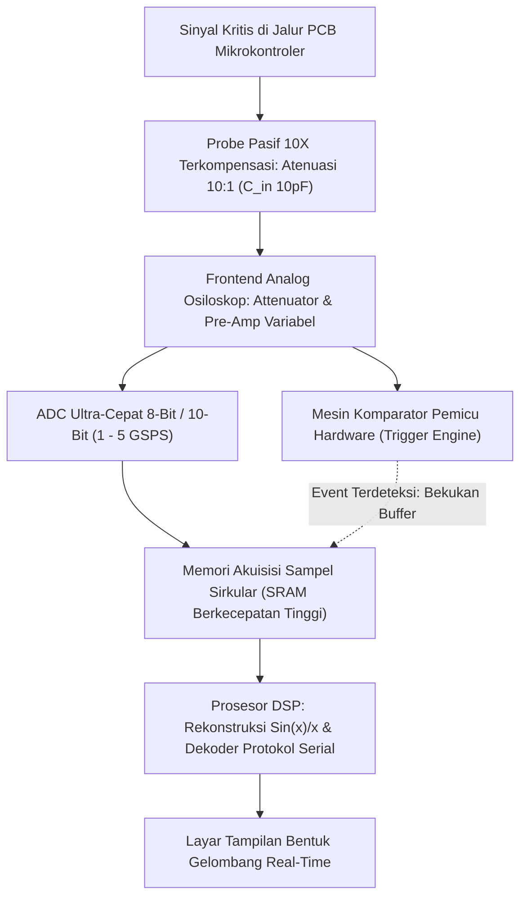

# Modul 049: Instrumentasi Alat Ukur Lab (Multimeter, Bench PSU, Generator Sinyal, Osiloskop Digital, Logic Analyzer)

**Navigasi**: [⬅️ Master Index](../../INDEX.md) | [Tingkat 3: Tingkat 3: Rangkaian Listrik, Elektronika & Microelectronics](./README.md)
*Sebelumnya*: [048. konversi-sinyal-adc-dac](./048-konversi-sinyal-adc-dac.md) | *Berikutnya*: [050. desain-sirkuit-terpadu-vlsi-asic](./050-desain-sirkuit-terpadu-vlsi-asic.md)

---

## 1. Intuisi Dasar Tanpa Jargon ("Seperti Bayi Baru Lahir")
Bayangkan seorang dokter yang memeriksa pasien: ia tidak bisa melihat organ dalam tubuh pasien dengan mata telanjang, sehingga ia membutuhkan stetoskop, sinar-X, dan alat pemindai USG.

Dalam dunia elektronika, elektron yang mengalir di dalam kabel berukuran sub-atomik dan bergerak mendekati kecepatan cahaya: kita tidak bisa melihat, mendengar, atau merasakannya secara langsung. Jika sirkuit Anda mati atau menghasilkan data yang salah, bagaimana Anda tahu bagian mana yang rusak?
Anda membutuhkan **Mata Elektronik**:
- **Digital Multimeter (DMM)**: Stetoskop dasar pengukur tegangan DC/AC, arus, dan resistansi kabel.
- **Bench Power Supply**: Jantung buatan yang memberikan suplai daya dengan batasan arus aman (*current limiting*) agar komponen uji tidak terbakar.
- **Function Generator**: Pita suara buatan yang menyuntikkan gelombang sinus, kotak, atau denyut uji ke dalam sirkuit.
- **Digital Storage Oscilloscope (DSO)**: Mesin pemindai tercanggih yang menggambar grafik tegangan terhadap waktu nanodetik, memungkinkan Anda melihat setiap kedipan pulsa listrik di dalam sirkuit secara langsung!
- **Logic Analyzer**: Kamera pengintai digital yang merekam puluhan jalur data biner sekaligus untuk mendekode protokol komunikasi komputer (SPI, I2C, UART).
[📚 Pelajari: Keysight Oscilloscope Fundamentals](https://www.keysight.com/us/en/assets/7018-06714/application-notes/5989-8064.pdf)

## 2. Fondasi Teoretis & Aksiomatik / Matematis
### 49.1 Efek Pembebanan Multimeter & Pengukuran 4-Kawat Kelvin ([Keysight DMM Guide](https://www.keysight.com/))
- **Efek Pembebanan Voltmeter**: Voltmeter ideal memiliki resistansi input tak hingga ($R_{\text{in}} = \infty$). DMM riil memiliki resistansi internal $10\text{ M}\Omega$. Jika mengukur pembagi tegangan berimpedansi tinggi ($1\text{ M}\Omega$), pembacaan tegangan drop hingga $\approx 5\%$ akibat arus yang tersedot ke instrumen.
- **Metode 4-Kawat Kelvin (*4-Wire Sense*)**: Digunakan untuk mengukur resistansi sangat kecil ($< 1\,\Omega$) dengan akurasi mikro-ohm:
  - Dua kawat luar mengalirkan arus konstan uji $I_{\text{source}}$.
  - Dua kawat dalam mengukur tegangan jatuh $V_{\text{sense}}$ dengan voltmeter berimpedansi tinggi.
  Resistansi kabel probe tidak dilewati arus ukur, sehingga pengaruh resistansi kabel tereliminasi total ($R = V_{\text{sense}} / I_{\text{source}}$)!

### 49.2 Bandwidth Osiloskop, Laju Sampling & Efek Pembagi Probe 10x ([Tektronix Scope Basics](https://www.tektronix.com/en/documents/primer/oscilloscope-basics))
- **Aturan Praktis Bandwidth 5x**: Untuk mengamati gelombang kotak digital frekuensi $f_{\text{clock}}$ dengan integritas bentuk gelombang baik (mempertahankan hingga harmonik ke-5):
  $$\text{Bandwidth}_{\text{scope}} \ge 5 \times f_{\text{clock}}$$
- **Waktu Naik (*Rise Time*)**: Hubungan antara bandwidth instrumen dan rise time pulsa tercepat yang dapat diukur:
  $$t_r \approx \frac{0.35}{\text{Bandwidth}}$$
- **Probe 10x Terkompensasi**:
  - Probe 1x: Kapasitansi kabel tinggi ($\approx 100\text{ pF}$), membebani rangkaian frekuensi tinggi.
  - Probe 10x: Menambahkan resistor $9\text{ M}\Omega$ paralel dengan kapasitor trimmer di ujung probe. Meningkatkan resistansi input menjadi $10\text{ M}\Omega$ dan memotong kapasitansi menjadi $\approx 10\text{ pF}$ (sinyal diatenuasi 10x lipat).
  Kondisi kompensasi probe sempurna: $R_{\text{probe}} C_{\text{probe}} = R_{\text{scope}} C_{\text{scope}}$.

### 49.3 Pemicu Osiloskop (Triggering) & Logic Analyzer Decoding ([Saleae Logic Guide](https://support.saleae.com/))
- **Edge Triggering**: Menstabilkan tampilan layar dengan memulai sweep horizontal hanya saat tegangan melintasi ambang level $V_{\text{trig}}$ pada lereng positif (*rising edge*) atau negatif (*falling edge*).
- **Advanced Triggering**: Pulse-width trigger, runt pulse trigger, I2C/SPI pattern trigger untuk menangkap glitch acak langka.
- **Logic Analyzer vs Osiloskop**:
  - Osiloskop: Resolusi vertikal tegangan tinggi (8-12 bit ADC), bandwidth analog sangat tinggi, namun saluran terbatas (2-4 channel).
  - Logic Analyzer: Komparator biner 1-bit per saluran (hanya High/Low), memori sampel raksasa, saluran banyak (8-32 channel), dilengkapi penganalisis protokol perangkat lunak terintegrasi.

## 3. Anatomi Teknis & Cara Kerja Internal

Mekanisme Kompensasi Probe Osiloskop:
Sebelum digunakan, probe 10x wajib dikalibrasikan pada terminal uji sinyal kotak $1	ext{ kHz}$ instrumen: putar sekrup kapasitor trimmer hingga sudut gelombang kotak di layar siku sempurna (tidak membundar akibat *under-compensated* dan tidak lancip menembus akibat *over-compensated*).

## 4. Implementasi Praktis & Kode / Simulasi Riil
import numpy as np

def calculate_scope_measurement_error(signal_rise_time_ns: float, scope_bandwidth_mhz: float) -> dict:
    """
    Menghitung kesalahan pengukuran waktu naik (rise time) yang disebabkan oleh keterbatasan bandwidth osiloskop.
    t_measured = sqrt(t_signal^2 + t_scope^2)
    t_scope = 0.35 / BW
    """
    bw_hz = scope_bandwidth_mhz * 1e6
    t_scope_ns = (0.35 / bw_hz) * 1e9
    
    # Waktu naik yang terlihat di layar osiloskop
    t_measured_ns = np.sqrt(signal_rise_time_ns**2 + t_scope_ns**2)
    error_pct = ((t_measured_ns - signal_rise_time_ns) / signal_rise_time_ns) * 100.0
    
    return {
        "scope_rise_time_ns": t_scope_ns,
        "measured_rise_time_ns": t_measured_ns,
        "measurement_error_pct": error_pct
    }

# Mengukur pulsa clock cepat (tr = 1.0 ns) dengan osiloskop standar 100 MHz
res_100m = calculate_scope_measurement_error(signal_rise_time_ns=1.0, scope_bandwidth_mhz=100.0)
# Mengukur dengan osiloskop profesional 500 MHz
res_500m = calculate_scope_measurement_error(signal_rise_time_ns=1.0, scope_bandwidth_mhz=500.0)

print(f"Osiloskop 100 MHz: Rise Time Layar = {res_100m['measured_rise_time_ns']:.2f} ns (Galat: {res_100m['measurement_error_pct']:.1f}% - Rusak total!)")
print(f"Osiloskop 500 MHz: Rise Time Layar = {res_500m['measured_rise_time_ns']:.2f} ns (Galat: {res_500m['measurement_error_pct']:.1f}% - Akurat!)")

## 5. Miskonsepsi & Jebakan Industri
1. **Connecting Oscilloscope Ground Lead to Non-Isolated High Voltage**: Ground buaya probe osiloskop terhubung langsung ke ground sasis pelindung dan kabel tanah PLN (*Mains Earth*). Menjepitkan buaya ground ke jalur tegangan tinggi catu daya tanpa transformator isolasi menciptakan ledakan hubung singkat langsung ke instalasi listrik gedung.
2. **Long Ground Lead Inductance Ringing**: Menggunakan kabel buaya ground probe sepanjang 15 cm untuk mengukur sinyal digital berkecepatan tinggi ($> 50	ext{ MHz}$). Induktansi kawat ground membentuk sirkuit RLC parasitik yang memunculkan dering palsu (*false ringing*) di layar osiloskop. Gunakan adaptor pegas ground pendek (*ground spring*).
3. **Bench PSU Overcurrent Latch Destruction**: Menyalakan catu daya meja tanpa mengatur batas arus (*current limit*) terlebih dahulu; jika terjadi kesalahan solder jalur terbalik pada sirkuit prototipe, catu daya akan menyemburkan arus maksimum hingga jalur tembaga PCB hangus terbakar.

## 6. Proyek Latihan & Rubrik Penilaian Mandiri
### Tingkat 1 (Pemula) - Pengukuran Hambatan Shunt Arus Sangat Kecil
Gunakan Digital Multimeter dalam mode tegangan DC mikrovolt untuk mengukur penurunan tegangan melintasi resistor shunt presisi $0.05\,\Omega$ guna menentukan konsumsi arus mode tidur (*sleep mode*) mikrokontroler sebesar $50 \, \mu	ext{A}$. Hitung ketidakpastian pengukurannya.

### Tingkat 2 (Menengah) - Kalibrasi Kompensasi Probe Osiloskop Pasif
Lakukan kalibrasi probe 10x pada generator gelombang kotak kalibrasi $1	ext{ kHz}$. Tulis laporan visual mengenai dampak under-compensation (respons frekuensi tinggi terpotong) dan over-compensation (pembesaran overshoot artifisial) terhadap pengukuran waktu naik pulsa digital.

### Tingkat 3 (Mahir) - Dekoding Protokol Bus SPI Menggunakan Logic Analyzer
Rekam pertukaran data komunikasi SPI quad-wire (MOSI, MISO, SCK, CS) berkecepatan $20	ext{ MHz}$ antara mikrokontroler dan chip flash memory menggunakan Logic Analyzer. Konfigurasikan pemicu trigger pada kondisi falling edge CS, ekstrak paket instruksi heksadesimal baca-tulis, dan identifikasi keberadaan pelanggaran waktu setup/hold (*timing violations*).

#### Rubrik Penilaian
- **40% Keselamatan Operasi Lab**: Prosedur grounding osiloskop dan batas arus catu daya dipatuhi secara ketat.
- **30% Integritas Pengukuran Sinyal**: Menghindari efek pembebanan kapasitif probe dan induktansi loop ground.
- **30% Ketepatan Analisis Instrumen**: Mampu memvalidasi batas bandwidth Nyquist dan kedalaman memori instrumen.

## 7. Rekomendasi Sumber Belajar Standar Emas
| Kategori | Judul Sumber & Tautan Langsung | Deskripsi Singkat |
|---|---|---|
| 📖 Buku Teks | [Oscilloscope Fundamentals (Keysight Technologies)](https://www.keysight.com/us/en/assets/7018-06714/application-notes/5989-8064.pdf) | Buku panduan komprehensif teori sampling, trigger, dan arsitektur osiloskop digital. |
| 🎓 Kuliah Terbuka | [MIT OCW 6.071J Introduction to Electronics & Measurement](https://ocw.mit.edu/courses/6-071j-introduction-to-electronics-signals-and-measurement-spring-2006/) | Praktikum laboratorium instrumen alat ukur, sensor, dan osiloskop. |
| 🔬 Makalah Seminal | [The Digital Storage Oscilloscope (Tektronix Primer)](https://www.tektronix.com/en/documents/primer/oscilloscope-basics) | Dokumen acuan industri evolusi osiloskop tabung CRT analog menuju arsitektur DSO digital. |
| 💻 Lab Interaktif | [Virtual Oscilloscope Simulator Online](https://www.virtual-oscilloscope.com/) | Simulator interaktif panel instrumen osiloskop dua kanal berbasis web. |

---
*Navigasi Cepat*: [Ke Tingkat 3](./README.md) | [Ke Master Index](../../INDEX.md) | *Sebelumnya*: [048. konversi-sinyal-adc-dac](./048-konversi-sinyal-adc-dac.md) | *Berikutnya*: [050. desain-sirkuit-terpadu-vlsi-asic](./050-desain-sirkuit-terpadu-vlsi-asic.md)
