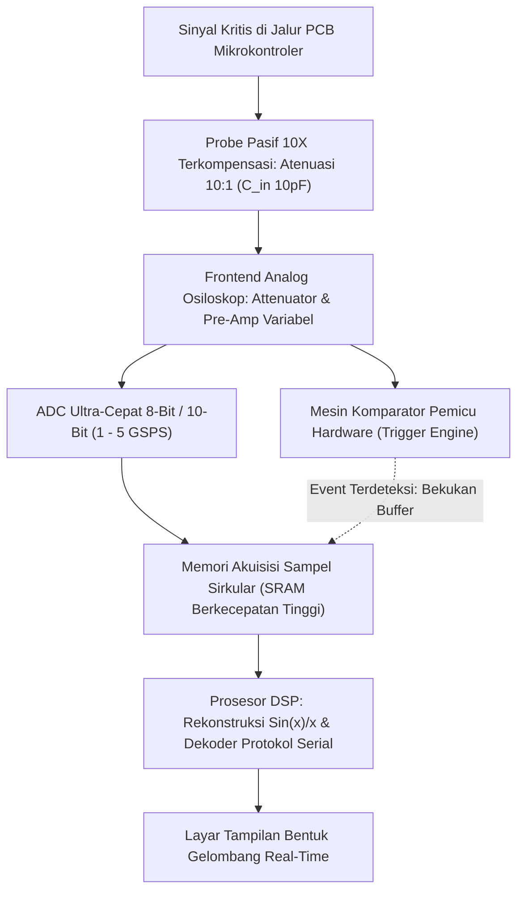

# Modul 049: Instrumentasi Alat Ukur Lab (Multimeter, Bench PSU, Generator Sinyal, Osiloskop Digital, Logic Analyzer)

**Navigasi**: [⬅️ Master Index](../../INDEX.md) | [Tingkat 3: Tingkat 3: Rangkaian Listrik, Elektronika & Microelectronics](./README.md)
*Sebelumnya*: [048. konversi-sinyal-adc-dac](./048-konversi-sinyal-adc-dac.md) | *Berikutnya*: [050. desain-sirkuit-terpadu-vlsi-asic](./050-desain-sirkuit-terpadu-vlsi-asic.md)

---

## 1. Intuisi Dasar Tanpa Jargon ("Seperti Bayi Baru Lahir")
### 1.1 Konsep Inti & Analogi Tanpa Jargon
Bayangkan seorang dokter yang memeriksa pasien: ia tidak bisa melihat organ dalam tubuh pasien dengan mata telanjang, sehingga ia membutuhkan stetoskop, sinar-X, dan alat pemindai USG.

### 1.2 Urgensi Rekayasa & Signifikansi Sistemik
Dalam dunia elektronika, elektron yang mengalir di dalam kabel berukuran sub-atomik dan bergerak mendekati kecepatan cahaya: kita tidak bisa melihat, mendengar, atau merasakannya secara langsung. Jika sirkuit Anda mati atau menghasilkan data yang salah, bagaimana Anda tahu bagian mana yang rusak?
Anda membutuhkan **Mata Elektronik**:
- **Digital Multimeter (DMM)**: Stetoskop dasar pengukur tegangan DC/AC, arus, dan resistansi kabel.
- **Bench Power Supply**: Jantung buatan yang memberikan suplai daya dengan batasan arus aman (*current limiting*) agar komponen uji tidak terbakar.
- **Function Generator**: Pita suara buatan yang menyuntikkan gelombang sinus, kotak, atau denyut uji ke dalam sirkuit.
- **Digital Storage Oscilloscope (DSO)**: Mesin pemindai tercanggih yang menggambar grafik tegangan terhadap waktu nanodetik, memungkinkan Anda melihat setiap kedipan pulsa listrik di dalam sirkuit secara langsung!
- **Logic Analyzer**: Kamera pengintai digital yang merekam puluhan jalur data biner sekaligus untuk mendekode protokol komunikasi komputer (SPI, I2C, UART).
[📚 Pelajari: Keysight Oscilloscope Fundamentals](https://www.keysight.com/us/en/assets/7018-06714/application-notes/5989-8064.pdf)

## 2. Fondasi Teoretis & Aksiomatik / Matematis
### 2.1 Kerangka Teori Aksiomatik & Formulasi Matematis
### 49.1 Efek Pembebanan Multimeter & Pengukuran 4-Kawat Kelvin ([Keysight DMM Guide](https://www.keysight.com/))
- **Efek Pembebanan Voltmeter**: Voltmeter ideal memiliki resistansi input tak hingga ($R_{\text{in}} = \infty$). DMM riil memiliki resistansi internal \$10\text{ M}\Omega$. Jika mengukur pembagi tegangan berimpedansi tinggi ($1\text{ M}\Omega$), pembacaan tegangan drop hingga $\approx 5\%$ akibat arus yang tersedot ke instrumen.
- **Metode 4-Kawat Kelvin (*4-Wire Sense*)**: Digunakan untuk mengukur resistansi sangat kecil ($< 1\,\Omega$) dengan akurasi mikro-ohm:
  - Dua kawat luar mengalirkan arus konstan uji $I_{\text{source}}$.
  - Dua kawat dalam mengukur tegangan jatuh $V_{\text{sense}}$ dengan voltmeter berimpedansi tinggi.
  Resistansi kabel probe tidak dilewati arus ukur, sehingga pengaruh resistansi kabel tereliminasi total ($R = V_{\text{sense}} / I_{\text{source}}$)!

### 2.2 Penurunan Matematis Langkah-demi-Langkah
### 49.2 Bandwidth Osiloskop, Laju Sampling & Efek Pembagi Probe 10x ([Tektronix Scope Basics](https://www.tektronix.com/en/documents/primer/oscilloscope-basics))
- **Aturan Praktis Bandwidth 5x**: Untuk mengamati gelombang kotak digital frekuensi $f_{\text{clock}}$ dengan integritas bentuk gelombang baik (mempertahankan hingga harmonik ke-5):
  $$\text{Bandwidth}_{\text{scope}} \ge 5 \times f_{\text{clock}}$$
- **Waktu Naik (*Rise Time*)**: Hubungan antara bandwidth instrumen dan rise time pulsa tercepat yang dapat diukur:
  $$t_r \approx \frac{0.35}{\text{Bandwidth}}$$
- **Probe 10x Terkompensasi**:
  - Probe 1x: Kapasitansi kabel tinggi ($\approx 100\text{ pF}$), membebani rangkaian frekuensi tinggi.
  - Probe 10x: Menambahkan resistor $9\text{ M}\Omega$ paralel dengan kapasitor trimmer di ujung probe. Meningkatkan resistansi input menjadi \$10\text{ M}\Omega$ dan memotong kapasitansi menjadi $\approx 10\text{ pF}$ (sinyal diatenuasi 10x lipat).
  Kondisi kompensasi probe sempurna: $R_{\text{probe}} C_{\text{probe}} = R_{\text{scope}} C_{\text{scope}}$.

### 49.3 Pemicu Osiloskop (Triggering) & Logic Analyzer Decoding ([Saleae Logic Guide](https://support.saleae.com/))
- **Edge Triggering**: Menstabilkan tampilan layar dengan memulai sweep horizontal hanya saat tegangan melintasi ambang level $V_{\text{trig}}$ pada lereng positif (*rising edge*) atau negatif (*falling edge*).
- **Advanced Triggering**: Pulse-width trigger, runt pulse trigger, I2C/SPI pattern trigger untuk menangkap glitch acak langka.
- **Logic Analyzer vs Osiloskop**:
  - Osiloskop: Resolusi vertikal tegangan tinggi (8-12 bit ADC), bandwidth analog sangat tinggi, namun saluran terbatas (2-4 channel).
  - Logic Analyzer: Komparator biner 1-bit per saluran (hanya High/Low), memori sampel raksasa, saluran banyak (8-32 channel), dilengkapi penganalisis protokol perangkat lunak terintegrasi.

## 3. Anatomi Teknis & Cara Kerja Internal

Mekanisme Kompensasi Probe Osiloskop:
Sebelum digunakan, probe 10x wajib dikalibrasikan pada terminal uji sinyal kotak $1	ext{ kHz}$ instrumen: putar sekrup kapasitor trimmer hingga sudut gelombang kotak di layar siku sempurna (tidak membundar akibat *under-compensated* dan tidak lancip menembus akibat *over-compensated*).

#### Tabel Penelusuran Hubungan Singkat Klip Ground Osiloskop ke Jala-Jala Listrik Non-Terisolasi (Mains Short)
| Titik Pemasangan Klip Buaya | Potensial Relatif Titik Ukur | Jalur Fisik Kabel Ground Osiloskop | Status Tegangan Sasis Instrumen | Arus Hubung Singkat Melalui Ground | Dampak Fisik pada Alat & Keselamatan Lab |
|---|---|---|---|---|---|
| Titik A (Netral Terhubung) | $0.0\text{ V}$ (Relatif tanah) | Kawat tanah PE (Protective Earth) | Terbumikan aman ($0\text{ V}$) | $0.0\text{ A}$ (Arus bocor kecil) | Pengukuran tampak normal |
| Titik B (Kaki Negatif Rectifier)| Titik mengambang $-155.0\text{ V}$ DC! | Terhubung langsung ke sasis logam | Dipaksa menyamakan beda potensial | Loop ground menghubungkan $-155\text{V}$ ke tanah! | Potensial bahaya maut pada sasis! |
| Kontak Klip Terhubung | Lonjakan beda potensial $155.0\text{ V}$ | Kabel ground probe resistansi $0.1\ \Omega$ | Ground instalasi gedung (PE) | Arus lonjakan seketika $I = 155 / 0.1 = 1.550\text{ A}$! | Kawat klip probe menguap meleleh |
| Pembentukan Busur Plasma | Pelepasan energi impuls kilat | Mengalir melalui motherboard osiloskop | PCB ground plane meledak terbakar | BNC ground terminal meleleh | Osiloskop mati permanen; teknisi tersentak |
| Pemutus MCB Trip | Korsleting jala-jala listrik AC | Pemutus sirkuit laboratorium trip | Listrik satu gedung padam | Bahaya kejut listrik fatal terhindar | Laboratorium gelap; instrumen hangus |

## 4. Implementasi Praktis & Kode / Simulasi Riil
```python
import numpy as np

def calculate_scope_measurement_error(signal_rise_time_ns: float, scope_bandwidth_mhz: float) -> dict:
    """
    Menghitung kesalahan pengukuran waktu naik (rise time) yang disebabkan oleh keterbatasan bandwidth osiloskop.
    t_measured = sqrt(t_signal^2 + t_scope^2)
    t_scope = 0.35 / BW
    """
    bw_hz = scope_bandwidth_mhz * 1e6
    t_scope_ns = (0.35 / bw_hz) * 1e9
    
    # Waktu naik yang terlihat di layar osiloskop
    t_measured_ns = np.sqrt(signal_rise_time_ns**2 + t_scope_ns**2)
    error_pct = ((t_measured_ns - signal_rise_time_ns) / signal_rise_time_ns) * 100.0
    
    return {
        "scope_rise_time_ns": t_scope_ns,
        "measured_rise_time_ns": t_measured_ns,
        "measurement_error_pct": error_pct
    }

# Mengukur pulsa clock cepat (tr = 1.0 ns) dengan osiloskop standar 100 MHz
res_100m = calculate_scope_measurement_error(signal_rise_time_ns=1.0, scope_bandwidth_mhz=100.0)
# Mengukur dengan osiloskop profesional 500 MHz
res_500m = calculate_scope_measurement_error(signal_rise_time_ns=1.0, scope_bandwidth_mhz=500.0)

print(f"Osiloskop 100 MHz: Rise Time Layar = {res_100m['measured_rise_time_ns']:.2f} ns (Galat: {res_100m['measurement_error_pct']:.1f}% - Rusak total!)")
print(f"Osiloskop 500 MHz: Rise Time Layar = {res_500m['measured_rise_time_ns']:.2f} ns (Galat: {res_500m['measurement_error_pct']:.1f}% - Akurat!)")
```

## 5. Miskonsepsi & Jebakan Industri
1. **Connecting Oscilloscope Ground Lead to Non-Isolated High Voltage**: Ground buaya probe osiloskop terhubung langsung ke ground sasis pelindung dan kabel tanah PLN (*Mains Earth*). Menjepitkan buaya ground ke jalur tegangan tinggi catu daya tanpa transformator isolasi menciptakan ledakan hubung singkat langsung ke instalasi listrik gedung.
2. **Long Ground Lead Inductance Ringing**: Menggunakan kabel buaya ground probe sepanjang 15 cm untuk mengukur sinyal digital berkecepatan tinggi ($> 50	ext{ MHz}$). Induktansi kawat ground membentuk sirkuit RLC parasitik yang memunculkan dering palsu (*false ringing*) di layar osiloskop. Gunakan adaptor pegas ground pendek (*ground spring*).
3. **Bench PSU Overcurrent Latch Destruction**: Menyalakan catu daya meja tanpa mengatur batas arus (*current limit*) terlebih dahulu; jika terjadi kesalahan solder jalur terbalik pada sirkuit prototipe, catu daya akan menyemburkan arus maksimum hingga jalur tembaga PCB hangus terbakar.

### Studi Kasus Kegagalan Nyata: Penjepit Ground Osiloskop Meledak Akibat Mengukur Rangkaian Non-Terisolasi (Mains Short)
- **Insiden Bahaya Keselamatan Laboratorium**: Seorang mahasiswa teknik elektronika baru sedang menguji modul catu daya switching non-isolated tanpa transformator isolasi. Saat ia menghubungkan klip buaya ground probe osiloskop standar ke rel negatif penyearah jembatan dioda, sebuah ledakan busur listrik kilat memekakkan telinga menyembur dari ujung probe. Kawat ground klip probe menguap seketika, konektor BNC osiloskop gosong meleleh, dan pemutus sirkuit utama gedung trip memadamkan listrik satu lantai.
- **Akar Masalah Keselamatan Listrik & Sirkuit Tertutup Pentanahan**: Demi alasan keselamatan operator dari bahaya kejut listrik mematikan, standar keselamatan IEC 61010 mewajibkan sasis logam luar dan selubung luar konektor BNC osiloskop meja standar dihubungkan secara fisik langsung ke kabel pentanahan instalasi gedung (*Protective Earth* / PE) melalui kabel steker 3-pin. Klip buaya hitam probe osiloskop terhubung langsung ke ground BNC ini tanpa hambatan ($R \approx 0,1\ \Omega$). Di sisi lain, pada konverter daya yang terhubung langsung ke jala-jala listrik tanpa transformator isolasi, titik "negatif" penyearah jembatan tidak berada pada potensial tanah, melainkan berayun bolak-balik ratusan volt relatif terhadap tanah bumi. Menjepitkan klip buaya ground ke titik ini secara efektif menciptakan hubungan singkat langsung antara jalur jala-jala listrik bertegangan tinggi ke kawat tanah bumi, mengalirkan arus hubung singkat ribuan ampere yang meledakkan kawat probe.

- **Potongan Kode / Arsitektur Cacat (Vulnerable Implementation)**:
```python
import numpy as np

def simulate_oscilloscope_ground_clip_fault(mains_vrms=230.0, probe_ground_lead_r=0.1, use_isolation_transformer=False):
    # Tegangan puncak jala-jala AC: V_peak = V_rms * sqrt(2)
    v_peak = mains_vrms * np.sqrt(2)
    
    if use_isolation_transformer:
        # Transformator isolasi 1:1 memutuskan ikatan fisik galvanik ke Protective Earth (PE)
        # Rangkaian menjadi mengambang (floating circuit)
        i_fault_short = 0.0
        p_dissipated_probe_W = 0.0
        catastrophic_arc_flash = False
    else:
        # Tanpa isolasi, klip buaya menghubungkan rel tegangan rectifer langsung ke PE Ground
        # Loop resistansi sangat kecil: kabel probe + kabel instalasi gedung ~ 0.2 Ohm
        r_total_loop = probe_ground_lead_r + 0.1
        i_fault_short = v_peak / r_total_loop
        p_dissipated_probe_W = (i_fault_short ** 2) * probe_ground_lead_r
        # Daya di atas 5000 W menguapkan kawat tembaga seketika memicu busur plasma
        catastrophic_arc_flash = p_dissipated_probe_W > 5000.0
        
    return {
        "mains_peak_voltage_V": v_peak,
        "short_circuit_current_A": i_fault_short,
        "probe_power_burst_W": p_dissipated_probe_W,
        "is_arc_flash_explosion": catastrophic_arc_flash
    }

# Evaluasi tanpa transformator isolasi vs dengan transformator isolasi 1:1
deadly = simulate_oscilloscope_ground_clip_fault(use_isolation_transformer=False)
safe = simulate_oscilloscope_ground_clip_fault(use_isolation_transformer=True)
# Tanpa isolasi: Arus = 1.626 A, Daya = 264.492 Watt -> LEDAKAN BUSUR PLASMA!
# Dengan transformator isolasi: Arus = 0 A -> 100% AMAN!
```

- **Prosedur Baku Keselamatan Instrumentasi**: Memutus pin ground steker osiloskop (*floating the scope*) adalah pelanggaran keselamatan maut yang dilarang keras oleh OSHA, karena membuat seluruh sasis logam instrumen bermuatan tegangan mematikan. Dua solusi aman yang sah menurut standar: 1) Menggunakan probe diferensial tegangan tinggi terisolasi (*High-Voltage Differential Probe*); 2) Memberi daya pada unit yang diuji (DUT) melalui transformator isolasi 1:1 (*Galvanic Isolation Transformer*).

## 6. Proyek Latihan & Rubrik Penilaian Mandiri
### Tingkat 1 (Pemula) - Pengukuran Hambatan Shunt Arus Sangat Kecil
Gunakan Digital Multimeter dalam mode tegangan DC mikrovolt untuk mengukur penurunan tegangan melintasi resistor shunt presisi $0.05\,\Omega$ guna menentukan konsumsi arus mode tidur (*sleep mode*) mikrokontroler sebesar \$50 \, \mu	ext{A}$. Hitung ketidakpastian pengukurannya.

### Tingkat 2 (Menengah) - Kalibrasi Kompensasi Probe Osiloskop Pasif
Lakukan kalibrasi probe 10x pada generator gelombang kotak kalibrasi $1	ext{ kHz}$. Tulis laporan visual mengenai dampak under-compensation (respons frekuensi tinggi terpotong) dan over-compensation (pembesaran overshoot artifisial) terhadap pengukuran waktu naik pulsa digital.

### Tingkat 3 (Mahir) - Dekoding Protokol Bus SPI Menggunakan Logic Analyzer
Rekam pertukaran data komunikasi SPI quad-wire (MOSI, MISO, SCK, CS) berkecepatan \$20	ext{ MHz}$ antara mikrokontroler dan chip flash memory menggunakan Logic Analyzer. Konfigurasikan pemicu trigger pada kondisi falling edge CS, ekstrak paket instruksi heksadesimal baca-tulis, dan identifikasi keberadaan pelanggaran waktu setup/hold (*timing violations*).

#### Rubrik Penilaian
- **40% Keselamatan Operasi Lab**: Prosedur grounding osiloskop dan batas arus catu daya dipatuhi secara ketat.
- **30% Integritas Pengukuran Sinyal**: Menghindari efek pembebanan kapasitif probe dan induktansi loop ground.
- **30% Ketepatan Analisis Instrumen**: Mampu memvalidasi batas bandwidth Nyquist dan kedalaman memori instrumen.

### Tingkat 1: Dasar
- **Tugas**: Bangun kalkulator efek pembebanan probe osiloskop pasif 1X vs 10X pada rangkaian pembagi tegangan impedansi tinggi untuk menghitung persentase galat atenuasi tegangan dan pergeseran frekuensi cut-off -3dB.
- **Petunjuk Perancangan Arsitektur**:
  - Model probe 1X: $R_{p1} = 1\text{ M}\Omega$, $C_{p1} = 100\text{ pF}$.
  - Model probe 10X: $R_{p10} = 10\text{ M}\Omega$, $C_{p10} = 10\text{ pF}$.
  - Hitung impedansi paralel total $Z_{probe} = R_p \parallel \frac{1}{j\omega C_p}$ dan tentukan pembagian tegangan dengan resistansi sumber Thevenin $R_{th}$.
- **Test Vector & Kasus Uji Ekstrem**:
  - *Sinyal DC Sumber $R_{th} = 100\text{ k}\Omega$*: Probe 1X menyebabkan drop tegangan terbaca sebesar $\approx 9.1\%$, sedangkan probe 10X hanya $\approx 0.99\%$.
  - *Sinyal Frekuensi Tinggi $10\text{ MHz}$*: Beban kapasitif $100\text{ pF}$ pada probe 1X menurunkan impedansi masukan ke hanya $159\ \Omega$ (mengacaukan sirkuit yang diuji).
- **Rubrik Penilaian Mandiri**: 40% Model Rangkaian Ekuivalen Probe Pasif Presisi, 30% Perhitungan Efek Pembebanan Resistif DC & Kapasitif AC, 30% Analisis Perbandingan Atenuasi 1X vs 10X.

### Tingkat 2: Menengah
- **Tugas**: Implementasikan simulator kompensasi kapasitor trimmer probe osiloskop 10X ($C_{comp}$) untuk meratakan respons frekuensi pembagi tegangan frekuensi tinggi (Kondisi Jembatan Seimbang $R_1 C_1 = R_2 C_2$), menganalisis bentuk gelombang uji kalibrasi gelombang kotak 1 kHz pada ketiga kondisi: kurang terkompensasi (*under-compensated*), terkompensasi sempurna, dan lebih terkompensasi (*over-compensated*).
- **Petunjuk Perancangan Arsitektur**:
  - Turunkan fungsi transfer rasio tegangan probe: $\frac{V_{out}(s)}{V_{in}(s)} = \frac{R_2}{R_1 + R_2} \left[ \frac{1 + s R_1 C_1}{1 + s (R_1 \parallel R_2)(C_1 + C_2)} \right]$.
  - Tentukan nilai kapasitor variabel $C_1$ yang membuat fungsi alih independen dari frekuensi ($s$).
- **Test Vector & Kasus Uji Ekstrem**:
  - *Kompensasi Sempurna*: Sudut gelombang kotak tegak lurus sempurna tanpa undershoot atau overshoot.
  - *Under-Compensated ($C_1$ terlalu kecil)*: Sisi depan gelombang kotak membulat tumpul (redaman frekuensi tinggi).
  - *Over-Compensated ($C_1$ terlalu besar)*: Muncul lonjakan spike tajam di setiap transisi tepi gelombang kotak.
- **Rubrik Penilaian Mandiri**: 40% Fungsi Alih Jembatan Kapasitif Terkompensasi Tepat, 30% Simulasi Transien Domain Waktu Gelombang Kotak, 30% Visualisasi & Analisis Tiga Kondisi Kompensasi.

### Tingkat 3: Mahir
- **Tugas**: Rancang sistem instrumen pengukur impedansi vector LCR Meter berbasis metode Auto-Balancing Bridge dengan detektor fasa sinkron fase ganda (Dual-Phase Lock-in Amplifier) terdiskritisasi, selesaikan resistansi seri ekuivalen ($ESR$), induktansi ($L$), kapasitansi ($C$), dan faktor disipasi ($\tan\delta$) komponen pada rentang frekuensi $100\text{ Hz} - 1\text{ MHz}$ dengan kompensasi open/short fixture residual impedance.
- **Petunjuk Perancangan Arsitektur**:
  - Modelkan jembatan pengimbang otomatis menggunakan Op-Amp transimpedansi untuk mempertahankan titik nol virtual (*virtual ground*).
  - Ekstraksi komponen in-phase ($I$) dan quadrature ($Q$) melalui perkalian perkalian referensi $\sin(\omega t)$ dan $\cos(\omega t)$ terintegrasi filter digital.
  - Terapkan kalibrasi dekomposisi matriks kompensasi fixture Open-Short-Load 3-titik.
- **Test Vector & Kasus Uji Ekstrem**:
  - *Kapasitor Elektrolit ESR Rendah*: Ukur $C = 100\,\mu\text{F}$ dengan $ESR = 25\text{ m}\Omega$ pada $100\text{ kHz}$; presisi ukur $\le 2\%$.
  - *Induktor RF Inti Ferit*: Verifikasi identifikasi frekuensi resonansi diri (Self-Resonant Frequency / SRF) di mana impedansi beralih dari induktif ke kapasitif.
- **Rubrik Penilaian Mandiri**: 40% Arsitektur Auto-Balancing Bridge & Demodulasi Lock-In Presisi, 30% Kalibrasi Kompensasi Fixture Open/Short Tepat, 30% Perhitungan ESR & Faktor Kualitas $Q$ Akurat.

## 7. Rekomendasi Sumber Belajar Standar Emas
| Kategori | Judul Sumber & Tautan Langsung | Deskripsi Singkat |
|---|---|---|
| 📖 Buku Teks | [Oscilloscope Fundamentals (Keysight Technologies)](https://www.keysight.com/us/en/assets/7018-06714/application-notes/5989-8064.pdf) | Buku panduan komprehensif teori sampling, trigger, dan arsitektur osiloskop digital. |
| 🎓 Kuliah Terbuka | [MIT OCW 6.071J Introduction to Electronics & Measurement](https://ocw.mit.edu/courses/6-071j-introduction-to-electronics-signals-and-measurement-spring-2006/) | Praktikum laboratorium instrumen alat ukur, sensor, dan osiloskop. |
| 🔬 Makalah Seminal | [The Digital Storage Oscilloscope (Tektronix Primer)](https://www.tektronix.com/en/documents/primer/oscilloscope-basics) | Dokumen acuan industri evolusi osiloskop tabung CRT analog menuju arsitektur DSO digital. |
| 💻 Lab Interaktif | [Virtual Oscilloscope Simulator Online](https://www.virtual-oscilloscope.com/) | Simulator interaktif panel instrumen osiloskop dua kanal berbasis web. |

---
*Navigasi Cepat*: [Ke Tingkat 3](./README.md) | [Ke Master Index](../../INDEX.md) | *Sebelumnya*: [048. konversi-sinyal-adc-dac](./048-konversi-sinyal-adc-dac.md) | *Berikutnya*: [050. desain-sirkuit-terpadu-vlsi-asic](./050-desain-sirkuit-terpadu-vlsi-asic.md)
