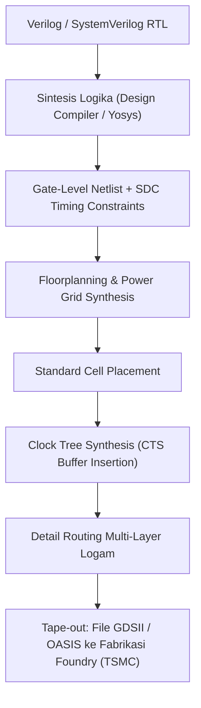

# Modul 050: Desain Sirkuit Terpadu (VLSI / ASIC Design: Standard Cells, Fabrikasi Wafer, FinFET, DRC/LVS, STA)

**Navigasi**: [⬅️ Master Index](../../INDEX.md) | [Tingkat 3: Tingkat 3: Rangkaian Listrik, Elektronika & Microelectronics](./README.md)
*Sebelumnya*: [049. instrumentasi-alat-ukur-lab](./049-instrumentasi-alat-ukur-lab.md) | *Berikutnya*: [051. desain-sirkuit-cetak-multi-layer-pcb](./051-desain-sirkuit-cetak-multi-layer-pcb.md)

---

## 1. Intuisi Dasar Tanpa Jargon ("Seperti Bayi Baru Lahir")
### 1.1 Konsep Inti & Analogi Tanpa Jargon
Bagaimana sebuah chip prosesor seukuran kuku jari manusia bisa memuat 20 miliar transistor yang terhubung dengan sempurna tanpa ada satu pun kabel silang yang salah sambung? Jika manusia menggambarnya satu per satu dengan tangan, butuh waktu 10.000 tahun!

### 1.2 Urgensi Rekayasa & Signifikansi Sistemik
**Desain Sirkuit Terpadu (VLSI / ASIC Design)** adalah rekayasa otomasi desain elektronik (EDA). Insinyur tidak menggambar transistor; mereka menulis logika sirkuit dalam bahasa kode (seperti Verilog/SystemVerilog). Software kompiler silikon (Synthesis Tools) kemudian menerjemahkan kode tersebut menjadi perpustakaan sel logika mikroskopis (*Standard Cells*), memposisikan dan merutekan kabel-kabel tembaga setebal nanometer, lalu memeriksanya dengan Static Timing Analysis (STA) untuk menjamin setiap denyut clock prosesor tepat waktu dalam hitungan pikodetik!

## 2. Fondasi Teoretis & Aksiomatik / Matematis
### 2.1 Kerangka Teori Aksiomatik & Formulasi Matematis
### 1. Alur Desain VLSI Modern (ASIC Design Flow)
1. **Spesifikasi Arsitektur**: Algoritma & microarchitecture description.
2. **RTL Design**: Verilog / VHDL / SystemVerilog & Testbench verification.
3. **Sintesis Logika**: Menerjemahkan RTL menjadi netlist tingkat gerbang (*gate-level netlist*) menggunakan perpustakaan sel standar (*Standard Cell Library* .lib).
4. **Physical Design (P&R: Place & Route)**:
   - Floorplanning & Power Mesh (VDD/VSS distribution).
   - Placement sel standar.
   - Clock Tree Synthesis (CTS): Menyeimbangkan clock skew di seluruh chip.
   - Routing: Pengkabelan multi-layer logam (Metal 1 s/d Metal 15).
5. **Physical Verification**:
   - **DRC (Design Rule Checking)**: Memastikan lebar kabel dan spasi memenuhi batas optik litografi pabrik fabrikasi (TSMC/Intel/Samsung).
   - **LVS (Layout Versus Schematic)**: Memverifikasi transistor pada layout identik 100% dengan skematik netlist.
[📚 Pelajari: Berkeley EECS 251A Introduction to Digital Design and Integrated Circuits](https://inst.eecs.berkeley.edu/~eecs251a/)

### 2.2 Penurunan Matematis Langkah-demi-Langkah
### 2. Static Timing Analysis (STA) & Penutupan Waktu
- **Setup Time ($t_{setup}$)**: Data input harus stabil sebelum tepi clock aktif tiba:
  $$t_{clk-to-q} + t_{comb\_max} + t_{setup} \le T_{clock} + t_{skew} \implies \text{Setup Slack } \ge 0$$
  Pelanggaran setup time diatasi dengan menurunkan frekuensi clock.
- **Hold Time ($t_{hold}$)**: Data input harus tetap stabil setelah tepi clock aktif berlalu:
  $$t_{clk-to-q} + t_{comb\_min} \ge t_{hold} + t_{skew} \implies \text{Hold Slack } \ge 0$$
  **CRITICAL**: Pelanggaran hold time adalah cacat silikon fatal yang TIDAK BISA diperbaiki dengan menurunkan clock; chip mati permanen!

## 3. Anatomi Teknis & Cara Kerja Internal


#### Tabel Penelusuran Analisis Timing Statis (STA) Hold-Time Violation & Kegagalan Silikon ASIC
| Tahap Penundaan / Jalur Logika | Waktu Penundaan Nominal ($t$) | Variasi Proses Terburuk (Fast Corner) | Batas Hold-Time Flip-Flop ($t_{hold}$) | Selisih Waktu Tiba Data vs Clock | Status Pelanggaran Timing |
|---|---|---|---|---|---|
| Clock Skew Antar Flip-Flop ($\Delta t_{skew}$)| $0.15\text{ ns}$ | $0.28\text{ ns}$ (Jalur clock FF2 lebih lambat)| - | Clock tiba di FF2 terlambat $0.28\text{ ns}$ | Buffer tree clock tidak seimbang |
| Clock-to-Q Flip-Flop 1 ($t_{c-q}$) | $0.20\text{ ns}$ | $0.12\text{ ns}$ (Transistor switching cepat) | - | Data keluar dari FF1 | Jalur data mulai merambat |
| Logika Kombinasional Minimum ($t_{comb}$)| $0.05\text{ ns}$ (Jalur kabel langsung/inverter)| $0.03\text{ ns}$ | - | Data baru tiba di pin D FF2 | Total waktu tiba: $t_{c-q} + t_{comb} = 0.15\text{ ns}$ |
| Kebutuhan Hold Time FF2 ($t_{hold}$) | $0.10\text{ ns}$ | $0.10\text{ ns}$ | $0.10\text{ ns}$ | Data lama wajib stabil selama $t_{hold}$ | Syarat: $t_{data\_arrive} \ge \Delta t_{skew} + t_{hold}$ |
| Perhitungan Hold Slack | $0.15 - (0.28 + 0.10) = -0.23\text{ ns}$| NEGATIF! (Pelanggaran masif) | Nilai slack $< 0$ | Data baru menimpa data lama saat clock aktif | Data salah tersampel permanen! |
| Mitigasi Jam CPU Diperlambat | Turunkan frekuensi clock dari 1GHz ke 100MHz | Perioda clock $T_{clk}$ memanjang | Nilai hold slack TETAP SAMA! | Hold slack tidak bergantung pada perioda jam! | Seluruh wafer bernilai $2 juta RUSAK TOTAL |

## 4. Implementasi Praktis & Kode / Simulasi Riil
```python
def check_static_timing_analysis(t_clk_period, t_clk_to_q, t_comb_max, t_comb_min, t_setup, t_hold, t_skew):
    """
    Simulasi sederhana mesin Static Timing Analysis (STA) untuk Setup dan Hold Slack.
    Waktu dalam satuan pikodetik (ps).
    """
    # Setup Check (Batas Maksimum Lintasan Data)
    required_setup = t_clk_period + t_skew - t_setup
    arrival_setup = t_clk_to_q + t_comb_max
    setup_slack = required_setup - arrival_setup
    
    # Hold Check (Batas Minimum Lintasan Data)
    required_hold = t_hold + t_skew
    arrival_hold = t_clk_to_q + t_comb_min
    hold_slack = arrival_hold - required_hold
    
    return {
        "setup_slack_ps": setup_slack,
        "hold_slack_ps": hold_slack,
        "is_timing_met": (setup_slack >= 0) and (hold_slack >= 0),
        "status": "PASS (Timing Closed)" if (setup_slack >= 0 and hold_slack >= 0) else "VIOLATION!"
    }

# Contoh Kasus STA pada Frekuensi Clock 1 GHz (T_clk = 1000 ps)
sta = check_static_timing_analysis(
    t_clk_period=1000.0,
    t_clk_to_q=120.0,
    t_comb_max=650.0,
    t_comb_min=180.0,
    t_setup=80.0,
    t_hold=50.0,
    t_skew=30.0
)
print("Hasil Verifikasi Static Timing Analysis (STA):")
for k, v in sta.items():
    print(f" - {k}: {v}")
```

## 5. Miskonsepsi & Jebakan Industri
1. **Clock Skew Negatif yang Membunuh Hold Time**: Jika clock tiba di register tujuan lebih lambat daripada register sumber ($t_{skew} > 0$), data baru dapat melaju terlalu cepat dan menimpa data lama sebelum sempat dibaca (*Hold Time Violation*). Solusi: Buffer delay sengaja disisipkan ke jalur data cepat.

### Studi Kasus Kegagalan Nyata: Kegagalan Hold-Time Silicon ASIC Chip Menghancurkan Seluruh Batch Wafer Fabrikasi
- **Bencana Tape-Out Semikonduktor**: Sebuah perusahaan rintisan chip kecerdasan buatan (AI) mengirimkan desain ASIC akselerator 16nm pertama mereka ke pabrik pengecoran semikonduktor (fab) dengan biaya masking dan wafer awal sebesar $3,5 juta. Ketika chip prototipe pertama tiba di laboratorium uji, chip tersebut sama sekali tidak dapat berfungsi, bahkan saat frekuensi clock diturunkan hingga kecepatan kura-kura 10 MHz. Seluruh batch wafer terpaksa dibuang menjadi sampah silikon, mengancam kelangsungan hidup perusahaan.
- **Akar Masalah Static Timing Analysis (STA) & Pelanggaran Hold-Time**: Tidak seperti pelanggaran waktu setup (*setup time violation*) yang selalu dapat diselamatkan dengan cara memperlambat frekuensi clock operasi ($T_{clk} \ge t_{setup} + t_{comb} + t_{c-q} + t_{skew}$), pelanggaran waktu tahan (*hold time violation*) secara matematis bersifat independen dari periode clock: $t_{c-q} + t_{comb,min} \ge t_{skew} + t_{hold}$. Insinyur timing hanya memverifikasi timing closure pada *Slow Corner* (kondisi suhu tinggi tegangan rendah) untuk mengecek setup time, namun mengabaikan verifikasi ketat pada *Fast Corner* (suhu sangat dingin, tegangan tinggi, silikon cepat). Pada fast corner, logika kombinasional jalur pendek merambat sangat cepat ($150\text{ ps}$), sementara variasi manufaktur jaringan clock tree menyebabkan clock pada flip-flop penerima terlambat tiba sebesar $280\text{ ps}$ (*positive clock skew*). Akibatnya, data baru dari siklus sekarang menabrak dan menimpa data lama sebelum sempat disimpan dengan aman. Begitu silikon dicetak, cacat ini permanen dan tidak dapat diperbaiki oleh firmware atau perlambatan jam.

- **Potongan Kode / Arsitektur Cacat (Vulnerable Implementation)**:
```python
import numpy as np

def evaluate_asic_timing_closure(t_comb_min_ps=150.0, t_cq_min_ps=120.0, t_skew_ps=280.0, t_hold_ps=100.0):
    # Persamaan Hold Slack:
    # Hold Slack = (t_cq_min + t_comb_min) - (t_skew + t_hold)
    data_arrival_time = t_cq_min_ps + t_comb_min_ps
    data_required_time = t_skew_ps + t_hold_ps
    
    hold_slack_ps = data_arrival_time - data_required_time
    
    # Apakah dapat diperbaiki dengan menurunkan frekuensi jam?
    # Periode jam T_clk sama sekali tidak ada dalam persamaan hold slack!
    is_silicon_bricked = hold_slack_ps < 0.0
    
    # Berapa banyak delay buffer yang harus disisipkan secara fisik pada layout mask:
    buffer_delay_ps = 50.0  # Penundaan per sel buffer standar
    buffers_needed = int(np.ceil(-hold_slack_ps / buffer_delay_ps)) if is_silicon_bricked else 0
    
    return {
        "data_arrival_ps": data_arrival_time,
        "data_required_ps": data_required_time,
        "hold_slack_ps": hold_slack_ps,
        "timing_violation": is_silicon_bricked,
        "fixable_by_clock_frequency_reduction": False,
        "hold_fix_buffers_required": buffers_needed
    }

report = evaluate_asic_timing_closure(t_comb_min_ps=150.0, t_cq_min_ps=120.0, t_skew_ps=280.0, t_hold_ps=100.0)
# Hold Slack = -110 ps (VIOLATION NEGATIF!)
# Fatal: Fixable by clock reduction = FALSE -> WAFER BRICKED!
```

- **Prosedur Baku Sign-Off Fisik Tape-Out**: Dalam metodologi EDA modern, tool static timing analysis (seperti Synopsys PrimeTime atau Cadence Tempus) diwajibkan melakukan *Multi-Corner Multi-Mode (MCMM) Sign-off*. Tool secara otomatis menyisipkan deretan sel penyangga penunda (*delay buffers*) pada seluruh jalur cepat (*short paths*) yang memiliki hold slack negatif sebelum menghasilkan file GDSII final ke pabrik fabrikasi.

## 6. Proyek Latihan & Rubrik Penilaian Mandiri
### Level 1 (Dasar)
Jelaskan perbedaan mendasar antara ASIC (Application-Specific Integrated Circuit) dan FPGA dalam hal biaya awal (NRE), efisiensi daya, dan fleksibilitas pembaruan sirkuit.

### Level 2 (Menengah)
Tulis skrip konstrain waktu (Synopsys Design Constraints - SDC) untuk mendefinisikan clock 250 MHz, clock uncertainty 100 ps, dan input delay 2 ns.

### Level 3 (Mahir)
Gunakan toolchain open-source OpenLane / OpenROAD untuk mengeksekusi sintesis RTL murni hingga tahap layout GDSII untuk chip ALU 32-bit pada node teknologi SkyWater 130nm.

### Tingkat 1: Dasar
- **Tugas**: Bangun kalkulator Static Timing Analysis (STA) untuk jalur flip-flop ke flip-flop tunggal yang menghitung Setup Slack dan Hold Slack di bawah parameter $T_{clk}, t_{c-q}, t_{comb(max/min)}, t_{setup}, t_{hold},$ dan $t_{skew}$.
- **Petunjuk Perancangan Arsitektur**:
  - $Setup\_Slack = (T_{clk} + t_{skew}) - (t_{c-q,max} + t_{comb,max} + t_{setup})$.
  - $Hold\_Slack = (t_{c-q,min} + t_{comb,min}) - (t_{skew} + t_{hold})$.
  - Tentukan frekuensi clock maksimum operasional $f_{max} = \frac{1}{T_{clk,min}}$.
- **Test Vector & Kasus Uji Ekstrem**:
  - *Setup Violation*: Jika $T_{clk} = 1.0\text{ ns}$ menghasilkan setup slack $-0.2\text{ ns}$; buktikan bahwa menaikkan periode clock ke $1.2\text{ ns}$ memulihkan setup slack menjadi $0.0\text{ ns}$.
  - *Hold Violation*: Buktikan bahwa memvariasikan $T_{clk}$ dari $1\text{ ns}$ hingga $100\text{ ns}$ sama sekali tidak mengubah nilai hold slack.
- **Rubrik Penilaian Mandiri**: 40% Formulasi Setup & Hold Slack Tepat, 30% Kalkulasi Frekuensi Maksimum $f_{max}$ Presisi, 30% Pembuktian Independensi Hold Time Terhadap Frekuensi Clock.

### Tingkat 2: Menengah
- **Tugas**: Implementasikan algoritma perataan Clock Tree Synthesis (CTS) berbasis metode H-Tree dan Elmore Delay untuk meminimalkan clock skew antar seluruh leaf node flip-flop pada kisi penempatan 2D.
- **Petunjuk Perancangan Arsitektur**:
  - Modelkan penundaan kawat interkoneksi RC Elmore: $\tau = \sum R_k C_k$.
  - Konstruksikan topologi fraktal H-Tree simetris sehingga panjang kawat dari root clock generator ke setiap sink leaf tepat seimbang.
- **Test Vector & Kasus Uji Ekstrem**:
  - *Topologi H-Tree Simetris*: Buktikan clock skew teoritis bernilai $0.000\text{ ps}$ di bawah variasi kawat seragam.
  - *Injeksi Variasi Lebar Kawat 10%*: Hitung clock skew residual terburuk yang timbul dan evaluasi pengaruhnya terhadap timing slack.
- **Rubrik Penilaian Mandiri**: 40% Konstruksi Geometris H-Tree Fraktal Presisi, 30% Perhitungan Penundaan Elmore RC Interkoneksi, 30% Analisis Sensitivitas Variasi Manufaktur.

### Tingkat 3: Mahir
- **Tugas**: Rancang optimasi perbaikan hold-time violation otomatis (*Automated Hold Slack Buffer Insertion Engine*) untuk graf ketergantungan waktu ASIC berarah (Directed Acyclic Graph / DAG) dengan ribuan jalur register, minimalkan jumlah total buffer yang disisipkan tanpa menyebabkan setup time violation baru (*zero setup degradation constraint*).
- **Petunjuk Perancangan Arsitektur**:
  - Formulasikan sebagai masalah optimasi linier Integer Linear Programming (ILP) atau algoritma Greedy berbasis topological sort.
  - Periksa bahwa setiap penyisipan delay buffer pada edge $(u, v)$ menaikkan $Hold\_Slack(u, v)$ sembari mengurangi $Setup\_Slack(u, v)$.
- **Test Vector & Kasus Uji Ekstrem**:
  - *Jalur Kritis Bersama*: Identifikasi jalur yang memiliki hold violation parah namun setup slack sangat sempit; batasi penyisipan buffer agar setup slack tidak jatuh di bawah nol.
  - *Konvergensi Graf Penuh*: Seluruh hold slack negatif berhasil dihilangkan dengan pertambahan area silikon $\le 3\%$.
- **Rubrik Penilaian Mandiri**: 40% Solver Optimasi Graf DAG Timing Presisi, 30% Kepatuhan Ketat Konstrain Dualitas Setup-Hold, 30% Efisiensi Minimalisasi Area Tambahan Buffer.

## 7. Rekomendasi Sumber Belajar Standar Emas
- [Buku Standar: CMOS VLSI Design: A Circuits and Systems Perspective (4th ed.) - Neil H. E. Weste & David Money Harris (Addison-Wesley)](https://www.pearson.com/en-us/subject-catalog/p/cmos-vlsi-design-a-circuits-and-systems-perspective/P200000003299)
- [Buku STA Standar Industri: Static Timing Analysis for Nanometer Designs - J. Bhasker & Rakesh Chadha (Springer)](https://link.springer.com/book/10.1007/978-0-387-93820-2)
- [Toolchain Silikon Terbuka: OpenLane ASIC Flow Documentation (Efabless & SkyWater 130nm)](https://openlane.readthedocs.io/)

---
*Navigasi Cepat*: [Ke Tingkat 3](./README.md) | [Ke Master Index](../../INDEX.md) | *Sebelumnya*: [049. instrumentasi-alat-ukur-lab](./049-instrumentasi-alat-ukur-lab.md) | *Berikutnya*: [051. desain-sirkuit-cetak-multi-layer-pcb](./051-desain-sirkuit-cetak-multi-layer-pcb.md)
