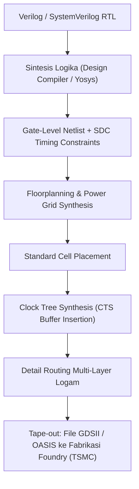

# Modul 050: Desain Sirkuit Terpadu (VLSI / ASIC Design: Standard Cells, Fabrikasi Wafer, FinFET, DRC/LVS, STA)

**Navigasi**: [⬅️ Master Index](../../INDEX.md) | [Tingkat 3: Tingkat 3: Rangkaian Listrik, Elektronika & Microelectronics](./README.md)
*Sebelumnya*: [049. instrumentasi-alat-ukur-lab](./049-instrumentasi-alat-ukur-lab.md) | *Berikutnya*: [051. desain-sirkuit-cetak-multi-layer-pcb](./051-desain-sirkuit-cetak-multi-layer-pcb.md)

---

## 1. Intuisi Dasar Tanpa Jargon ("Seperti Bayi Baru Lahir")
Bagaimana sebuah chip prosesor seukuran kuku jari manusia bisa memuat 20 miliar transistor yang terhubung dengan sempurna tanpa ada satu pun kabel silang yang salah sambung? Jika manusia menggambarnya satu per satu dengan tangan, butuh waktu 10.000 tahun!

**Desain Sirkuit Terpadu (VLSI / ASIC Design)** adalah rekayasa otomasi desain elektronik (EDA). Insinyur tidak menggambar transistor; mereka menulis logika sirkuit dalam bahasa kode (seperti Verilog/SystemVerilog). Software kompiler silikon (Synthesis Tools) kemudian menerjemahkan kode tersebut menjadi perpustakaan sel logika mikroskopis (*Standard Cells*), memposisikan dan merutekan kabel-kabel tembaga setebal nanometer, lalu memeriksanya dengan Static Timing Analysis (STA) untuk menjamin setiap denyut clock prosesor tepat waktu dalam hitungan pikodetik!

## 2. Fondasi Teoretis & Aksiomatik / Matematis
### 1. Alur Desain VLSI Modern (ASIC Design Flow)
1. **Spesifikasi Arsitektur**: Algoritma & microarchitecture description.
2. **RTL Design**: Verilog / VHDL / SystemVerilog & Testbench verification.
3. **Sintesis Logika**: Menerjemahkan RTL menjadi netlist tingkat gerbang (*gate-level netlist*) menggunakan perpustakaan sel standar (*Standard Cell Library* .lib).
4. **Physical Design (P&R: Place & Route)**:
   - Floorplanning & Power Mesh (VDD/VSS distribution).
   - Placement sel standar.
   - Clock Tree Synthesis (CTS): Menyeimbangkan clock skew di seluruh chip.
   - Routing: Pengkabelan multi-layer logam (Metal 1 s/d Metal 15).
5. **Physical Verification**:
   - **DRC (Design Rule Checking)**: Memastikan lebar kabel dan spasi memenuhi batas optik litografi pabrik fabrikasi (TSMC/Intel/Samsung).
   - **LVS (Layout Versus Schematic)**: Memverifikasi transistor pada layout identik 100% dengan skematik netlist.
[📚 Pelajari: Berkeley EECS 251A Introduction to Digital Design and Integrated Circuits](https://inst.eecs.berkeley.edu/~eecs251a/)

### 2. Static Timing Analysis (STA) & Penutupan Waktu
- **Setup Time ($t_{setup}$)**: Data input harus stabil sebelum tepi clock aktif tiba:
  $$t_{clk-to-q} + t_{comb\_max} + t_{setup} \le T_{clock} + t_{skew} \implies \text{Setup Slack } \ge 0$$
  Pelanggaran setup time diatasi dengan menurunkan frekuensi clock.
- **Hold Time ($t_{hold}$)**: Data input harus tetap stabil setelah tepi clock aktif berlalu:
  $$t_{clk-to-q} + t_{comb\_min} \ge t_{hold} + t_{skew} \implies \text{Hold Slack } \ge 0$$
  **CRITICAL**: Pelanggaran hold time adalah cacat silikon fatal yang TIDAK BISA diperbaiki dengan menurunkan clock; chip mati permanen!

## 3. Anatomi Teknis & Cara Kerja Internal


## 4. Implementasi Praktis & Kode / Simulasi Riil
```python
def check_static_timing_analysis(t_clk_period, t_clk_to_q, t_comb_max, t_comb_min, t_setup, t_hold, t_skew):
    """
    Simulasi sederhana mesin Static Timing Analysis (STA) untuk Setup dan Hold Slack.
    Waktu dalam satuan pikodetik (ps).
    """
    # Setup Check (Batas Maksimum Lintasan Data)
    required_setup = t_clk_period + t_skew - t_setup
    arrival_setup = t_clk_to_q + t_comb_max
    setup_slack = required_setup - arrival_setup
    
    # Hold Check (Batas Minimum Lintasan Data)
    required_hold = t_hold + t_skew
    arrival_hold = t_clk_to_q + t_comb_min
    hold_slack = arrival_hold - required_hold
    
    return {
        "setup_slack_ps": setup_slack,
        "hold_slack_ps": hold_slack,
        "is_timing_met": (setup_slack >= 0) and (hold_slack >= 0),
        "status": "PASS (Timing Closed)" if (setup_slack >= 0 and hold_slack >= 0) else "VIOLATION!"
    }

# Contoh Kasus STA pada Frekuensi Clock 1 GHz (T_clk = 1000 ps)
sta = check_static_timing_analysis(
    t_clk_period=1000.0,
    t_clk_to_q=120.0,
    t_comb_max=650.0,
    t_comb_min=180.0,
    t_setup=80.0,
    t_hold=50.0,
    t_skew=30.0
)
print("Hasil Verifikasi Static Timing Analysis (STA):")
for k, v in sta.items():
    print(f" - {k}: {v}")
```

## 5. Miskonsepsi & Jebakan Industri
1. **Clock Skew Negatif yang Membunuh Hold Time**: Jika clock tiba di register tujuan lebih lambat daripada register sumber ($t_{skew} > 0$), data baru dapat melaju terlalu cepat dan menimpa data lama sebelum sempat dibaca (*Hold Time Violation*). Solusi: Buffer delay sengaja disisipkan ke jalur data cepat.

## 6. Proyek Latihan & Rubrik Penilaian Mandiri
### Level 1 (Dasar)
Jelaskan perbedaan mendasar antara ASIC (Application-Specific Integrated Circuit) dan FPGA dalam hal biaya awal (NRE), efisiensi daya, dan fleksibilitas pembaruan sirkuit.

### Level 2 (Menengah)
Tulis skrip konstrain waktu (Synopsys Design Constraints - SDC) untuk mendefinisikan clock 250 MHz, clock uncertainty 100 ps, dan input delay 2 ns.

### Level 3 (Mahir)
Gunakan toolchain open-source OpenLane / OpenROAD untuk mengeksekusi sintesis RTL murni hingga tahap layout GDSII untuk chip ALU 32-bit pada node teknologi SkyWater 130nm.

## 7. Rekomendasi Sumber Belajar Standar Emas
- [Buku Standar: CMOS VLSI Design: A Circuits and Systems Perspective (4th ed.) - Neil H. E. Weste & David Money Harris (Addison-Wesley)](https://www.pearson.com/en-us/subject-catalog/p/cmos-vlsi-design-a-circuits-and-systems-perspective/P200000003299)
- [Buku STA Standar Industri: Static Timing Analysis for Nanometer Designs - J. Bhasker & Rakesh Chadha (Springer)](https://link.springer.com/book/10.1007/978-0-387-93820-2)
- [Toolchain Silikon Terbuka: OpenLane ASIC Flow Documentation (Efabless & SkyWater 130nm)](https://openlane.readthedocs.io/)

---
*Navigasi Cepat*: [Ke Tingkat 3](./README.md) | [Ke Master Index](../../INDEX.md) | *Sebelumnya*: [049. instrumentasi-alat-ukur-lab](./049-instrumentasi-alat-ukur-lab.md) | *Berikutnya*: [051. desain-sirkuit-cetak-multi-layer-pcb](./051-desain-sirkuit-cetak-multi-layer-pcb.md)
