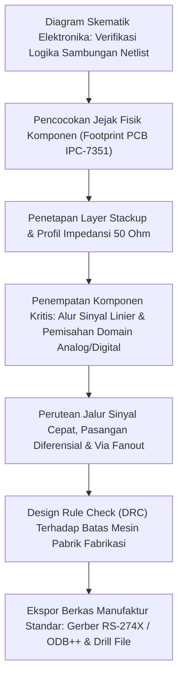

# Modul 051: Desain Sirkuit Cetak Multi-Layer (PCB Design: Skematik, Routing Diferensial, Ground Plane, DFM)

**Navigasi**: [⬅️ Master Index](../../INDEX.md) | [Tingkat 3: Tingkat 3: Rangkaian Listrik, Elektronika & Microelectronics](./README.md)
*Sebelumnya*: [050. desain-sirkuit-terpadu-vlsi-asic](./050-desain-sirkuit-terpadu-vlsi-asic.md) | *Berikutnya*: [052. integritas-sinyal-kompatibilitas-elektromagnetik](./052-integritas-sinyal-kompatibilitas-elektromagnetik.md)

---

## 1. Intuisi Dasar Tanpa Jargon ("Seperti Bayi Baru Lahir")
Pernahkah Anda membuka bagian dalam sebuah komputer laptop atau smartphone? Anda akan melihat papan tipis berwarna hijau atau hitam yang dipenuhi oleh ribuan garis-garis emas/tembaga berkilau yang menghubungkan ratusan komponen chip miniatur.

Itulah **Papan Sirkuit Cetak (Printed Circuit Board / PCB)**:
Pada sirkuit sederhana berkecepatan rendah, kabel tembaga hanyalah jalur pengalir listrik biasa. Namun ketika sinyal listrik berpindah pada kecepatan ratusan juta kali per detik, kawat tembaga tidak lagi bertindak sebagai kabel biasa: kawat tersebut berubah menjadi **Saluran Transmisi Gelombang Radio Elektromagnetik**!

Jika Anda tidak merancang jalurnya dengan benar, sinyal akan memantul bolak-balik di ujung kabel, saling bocor ke jalur tetangga (crosstalk), dan memancarkan radiasi gelombang liar yang merusak fungsi chip di sebelahnya. Merancang PCB multi-lapis adalah perpaduan antara seni tata letak geometris 3 dimensi dan hukum medan elektromagnetik frekuensi tinggi.
[📚 Pelajari: Altium PCB Design Guidelines](https://resources.altium.com/p/pcb-design-guidelines)

## 2. Fondasi Teoretis & Aksiomatik / Matematis
### 51.1 Tumpukan Lapisan (Layer Stackup) & Bidang Acuan (Ground Plane) ([Bogatin Signal and Power Integrity](https://www.pearson.com/))
PCB multi-lapis modern (4, 6, 8 lapis atau lebih) menggunakan material dielektrik FR-4 ($\varepsilon_r \approx 4.2 - 4.5$) dan tembaga laminasi ($1\text{ oz} \approx 35 \, \mu\text{m}$).
Aturan Emas Stackup 4-Lapis Standar:
- Lapisan 1 (Top Layer): Komponen & Sinyal Cepat
- Lapisan 2 (Inner Plane 1): **Solid Ground Plane (GND)** tak terputus
- Lapisan 3 (Inner Plane 2): **Solid Power Plane (VCC)**
- Lapisan 4 (Bottom Layer): Sinyal & Komponen Sekunder

Fungsi vital Ground Plane padat:
1. Menyediakan jalur arus balik (*Return Current Path*) dengan induktansi minimum langsung di bawah jalur sinyal.
2. Melindungi sirkuit dari radiasi interferensi gelombang elektromagnetik eksternal (efek pelindung Sangkar Faraday).

### 51.2 Garis Transmisi Microstrip & Stripline Terkendali ([IPC-2141 Design Guide](https://www.ipc.org/))
Pada frekuensi di mana waktu naik sinyal $t_r < 2 \times t_{\text{delay}}$ (panjang lintasan $\ell > \frac{v \cdot t_r}{6}$), jalur PCB harus diperlakukan sebagai saluran transmisi dengan impedansi terkendali ($Z_0$, standar industri: single-ended $50\,\Omega$, diferensial USB $90\,\Omega$, diferensial PCIe/HDMI $100\,\Omega$).
Rumus aproksimasi impedansi Microstrip permukaan:
$$Z_0 \approx \frac{87}{\sqrt{\varepsilon_r + 1.41}} \ln\left( \frac{5.98 H}{0.8 W + T} \right)$$
Di mana $W$ adalah lebar jalur trace, $H$ adalah ketebalan dielektrik ke ground plane, dan $T$ adalah tebal tembaga.

### 51.3 Pasangan Jalur Diferensial (Differential Pairs) & Design for Manufacturing (DFM) ([IPC-2221 Standard](https://www.ipc.org/))
Impedansi diferensial dua jalur berdekatan:
$$Z_{\text{diff}} \approx 2 Z_0 \left( 1 - 0.48 e^{-0.96 \frac{S}{H}} \right)$$
Aturan Pasangan Diferensial:
1. **Length Matching**: Panjang kedua jalur harus sama persis (toleransi skew $\Delta \ell < 0.15\text{ mm}$ untuk HDMI/PCIe) menggunakan pola kelokan ular (*meander tuning*).
2. **Coupling Konsisten**: Jarak celah pemisah antar jalur ($S$) harus konstan di sepanjang lintasan.

Design for Manufacturing (DFM) Toleransi Fabrikasi:
- Minimum Trace / Space: Standar murah $6/6\text{ mil}$ ($0.15\text{ mm}$), kapabilitas tinggi $3/3\text{ mil}$.
- Rasio Aspek Via Bor: Rasio tebal PCB terhadap diameter bor via maksimum $8:1$ s/d $10:1$ agar pelapisan kimia tembaga elektroplating di dinding lubang via merata.

## 3. Anatomi Teknis & Cara Kerja Internal

Jalur Arus Balik Frekuensi Tinggi:
Pada arus DC, arus balik memilih jalur dengan resistansi terendah (garis lurus terpendek). Namun pada frekuensi tinggi ($> 1	ext{ MHz}$), arus balik memilih jalur dengan **induktansi terendah**, yaitu mengalir tepat di bidang ground persis di bawah jalur tembaga sinyal. Jika ground plane di bawahnya terpotong oleh celah lubang (*split ground*), arus balik dipaksa memutar jauh, menciptakan antena loop raksasa yang memancarkan radiasi elektromagnetik liar.

## 4. Implementasi Praktis & Kode / Simulasi Riil
import numpy as np

def calculate_microstrip_trace_width(target_z0_ohms: float, dielectric_height_mil: float, 
                                     dielectric_er: float = 4.4, copper_thickness_oz: float = 1.0) -> float:
    """
    Menghitung lebar jalur microstrip W (mil) untuk mencapai impedansi karakteristik Z0 target.
    Menggunakan pencarian biner pada formula IPC-2141.
    """
    t_mil = copper_thickness_oz * 1.37 # 1 oz copper ~ 1.37 mil
    
    def compute_z0(w_mil):
        # Formula IPC-2141 microstrip
        denom = np.sqrt(dielectric_er + 1.41)
        term = (5.98 * dielectric_height_mil) / (0.8 * w_mil + t_mil)
        return (87.0 / denom) * np.log(max(term, 1.01))
    
    # Pencarian biner lebar jalur antara 1 mil hingga 100 mil
    low_w, high_w = 1.0, 100.0
    for _ in range(50):
        mid_w = (low_w + high_w) / 2.0
        z_curr = compute_z0(mid_w)
        if z_curr > target_z0_ohms:
            low_w = mid_w # Lebar harus lebih besar untuk menurunkan impedansi
        else:
            high_w = mid_w
            
    return mid_w

# Menghitung lebar jalur 50 ohm pada PCB 4-lapis FR-4 (ketebalan prepreg H = 4.5 mil, Er = 4.2)
trace_w = calculate_microstrip_trace_width(target_z0_ohms=50.0, dielectric_height_mil=4.5, dielectric_er=4.2)
print(f"Target Impedansi Karakteristik : 50.0 Ohm")
print(f"Lebar Jalur Trace yang Dibutuhkan: {trace_w:.2f} mil ({trace_w * 0.0254:.3f} mm)")

## 5. Miskonsepsi & Jebakan Industri
1. **Routing Traces Over a Split in the Ground Plane**: Menarik jalur sinyal berkecepatan tinggi melintasi celah terpotong pada bidang ground. Arus balik tidak bisa melompat celah tersebut dan harus memutar jauh, menciptakan lonjakan induktansi besar yang merusak integritas sinyal dan memicu kegagalan uji sertifikasi emisi FCC/CE.
2. **Acute Angle Traces (Acid Traps)**: Merutekan jalur tembaga dengan sudut lancip $< 90^\circ$; cairan kimia etsa asam terperangkap di sudut sempit saat proses manufaktur, mengikis tembaga secara berlebih hingga jalur putus tipis seiring waktu. Selalu gunakan sudut tumpul $45^\circ$ atau lengkungan kurva halus.
3. **Missing Decoupling Capacitor Proximity**: Meletakkan kapasitor bypass/decoupling jauh dari pin daya IC dengan jalur kawat panjang; induktansi parasitik jalur tembaga ($1	ext{ nH/mm}$) meniadakan fungsi kapasitor dalam meredam lonjakan arus pensaklaran chip.

## 6. Proyek Latihan & Rubrik Penilaian Mandiri
### Tingkat 1 (Pemula) - Desain Skematik & Layout Breakout Board USB-C
Gunakan software EDA open-source KiCad untuk merancang papan breakout USB-C 16-pin sederhana ke header 2.54mm: sertakan resistor pull-down $5.1	ext{ k}\Omega$ pada pin CC1/CC2, dioda proteksi ESD TVS, dan patuhi aturan jarak isolasi tegangan.

### Tingkat 2 (Menengah) - Layout Mikrokontroler ARM Cortex-M 4-Layer dengan Kristal Jam
Rancang layout PCB 4-lapis untuk mikrokontroler STM32 lengkap dengan regulator daya LDO, kapasitor decoupling multi-tier ($100	ext{ nF} + 4.7 \, \mu	ext{F}$), dan tata letak osilator kristal $16	ext{ MHz}$ yang dikelilingi oleh guard ring tanah tanpa ada jalur sinyal lain yang memotong di bawahnya.

### Tingkat 3 (Mahir) - Perutean Pasangan Diferensial DDR3/DDR4 High-Speed dengan Fly-by Topology
Rancang subsistem memori RAM DDR3 berkecepatan 800 MHz (1600 MT/s) antarmuka prosesor: rutekan bus alamat/perintah menggunakan topologi Fly-by dengan terminasi paralel VTT di ujung jalur, dan lakukan panjang matching kompensasi kelokan ular (*meander tuning*) pada bus data 8-bit (*byte lane*) dengan toleransi panjang $\Delta \ell < 0.2	ext{ mm}$.

#### Rubrik Penilaian
- **40% Integritas Jalur Arus Balik (Return Path)**: Bidang ground solid tak terputus langsung di bawah seluruh jalur sinyal cepat.
- **30% Kepatuhan Aturan Impedansi Terkendali**: Perhitungan dimensi microstrip dan toleransi celah diferensial konsisten.
- **30% Verifikasi Kesiapan Manufaktur (DFM)**: Bersih dari pelanggaran DRC (clearance, minimum drill, annular ring).

## 7. Rekomendasi Sumber Belajar Standar Emas
| Kategori | Judul Sumber & Tautan Langsung | Deskripsi Singkat |
|---|---|---|
| 📖 Buku Teks | [Signal and Power Integrity - Simplified (Eric Bogatin)](https://www.pearson.com/) | Kitab rujukan utama industri untuk fisika saluran transmisi, stackup PCB, dan ground plane. |
| 🎓 Kuliah Terbuka | [KiCad Like a Pro & PCB Engineering Tutorials](https://kicad.org/) | Panduan komprehensif alur kerja desain EDA skematik dan layout papan cetak. |
| 🔬 Makalah Seminal | [High-Speed Digital System Design (Hall, Hall, McCall, 2000)](https://www.wiley.com/) | Buku standar integrasi saluran transmisi, crosstalk, dan simulasi Spice PCB. |
| 💻 Lab Interaktif | [Saturn PCB Toolkit Calculator](https://saturnpcb.com/saturn-pcb-toolkit/) | Kalkulator standar industri untuk impedansi trace, kenaikan suhu arus via, dan crosstalk. |

---
*Navigasi Cepat*: [Ke Tingkat 3](./README.md) | [Ke Master Index](../../INDEX.md) | *Sebelumnya*: [050. desain-sirkuit-terpadu-vlsi-asic](./050-desain-sirkuit-terpadu-vlsi-asic.md) | *Berikutnya*: [052. integritas-sinyal-kompatibilitas-elektromagnetik](./052-integritas-sinyal-kompatibilitas-elektromagnetik.md)
