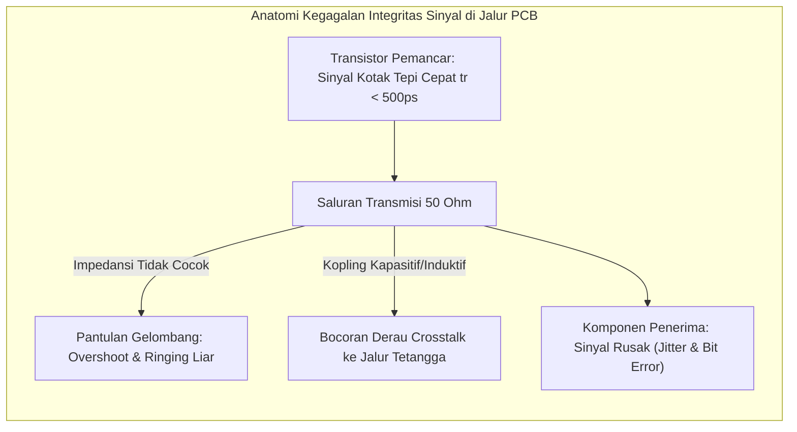

# Modul 052: Integritas Sinyal & Kompatibilitas Elektromagnetik (SI/PI, Crosstalk, Decoupling, Proteksi EMI/EMC)

**Navigasi**: [⬅️ Master Index](../../INDEX.md) | [Tingkat 3: Tingkat 3: Rangkaian Listrik, Elektronika & Microelectronics](./README.md)
*Sebelumnya*: [051. desain-sirkuit-cetak-multi-layer-pcb](./051-desain-sirkuit-cetak-multi-layer-pcb.md) | *Berikutnya*: [053. aljabar-boolean-gerbang-logika-digital](../04-logika-digital-arsitektur-komputer/053-aljabar-boolean-gerbang-logika-digital.md)

---

## 1. Intuisi Dasar Tanpa Jargon ("Seperti Bayi Baru Lahir")
### 1.1 Konsep Inti & Analogi Tanpa Jargon
Pernahkah Anda menyalakan blender atau pengering rambut di rumah, dan seketika layar televisi Anda bergaris-garis bintik salju atau radio FM Anda mengeluarkan suara kemeresek keras?

### 1.2 Urgensi Rekayasa & Signifikansi Sistemik
Itulah **Interferensi Elektromagnetik (EMI - Electromagnetic Interference)**:
Setiap kali arus listrik berubah secara mendadak dengan kecepatan tinggi, kawat penghantar tersebut bertindak sebagai **antena pemancar radio tanpa izin**!
Dalam perangkat elektronik modern berkecepatan gigahertz, sinyal data digital dapat memancarkan radiasi gelombang liar yang mengacaukan sirkuit tetangganya (**Crosstalk**), atau lonjakan tarikan arus miliaran transistor secara bersamaan dapat membuat tegangan suplai anjlok sesaat (**Power Droop / Ground Bounce**), memicu komputer crash dengan layar biru maut (BSOD).

Sains **Integritas Sinyal (SI), Integritas Daya (PI), dan Kompatibilitas Elektromagnetik (EMC)** adalah disiplin militer rekayasa untuk memastikan sinyal listrik tiba di tujuan dengan bentuk gelombang yang utuh, bersih, dan tidak memancarkan polusi elektromagnetik yang dilarang oleh hukum sertifikasi internasional (FCC/CE).
[📚 Pelajari: Eric Bogatin Signal Integrity Academy](https://www.bethesignal.com/)

## 2. Fondasi Teoretis & Aksiomatik / Matematis
### 2.1 Kerangka Teori Aksiomatik & Formulasi Matematis
### 52.1 Refleksi Sinyal, Koefisien Pantulan & Terminasi Jalur ([Bogatin SI](https://www.pearson.com/))
Ketika gelombang sinyal yang merambat di sepanjang saluran transmisi berimpedansi karakteristik $Z_0$ menabrak ujung beban berimpedansi $Z_L$, sebagian energi gelombang akan terpantul balik ke pemancar.
Koefisien Refleksi Tegangan ($\Gamma_L$):
$$\Gamma_L = \frac{V^-}{V^+} = \frac{Z_L - Z_0}{Z_L + Z_0}$$
- Jika $Z_L = Z_0$ (Impedansi Cocok / Matched): $\Gamma_L = 0 \implies$ **Nol Refleksi** (seluruh energi diserap sempurna oleh beban!).
- Jika $Z_L = \infty$ (Beban Sirkuit Terbuka): $\Gamma_L = +1 \implies$ Tegangan berlipat ganda ($V_{\text{total}} = 2 V^+$), memicu lonjakan overshooting berbahaya.
- Jika $Z_L = 0$ (Beban Hubung Singkat ke Ground): $\Gamma_L = -1 \implies$ Tegangan jatuh ke nol dengan pembalikan fase.

### 2.2 Penurunan Matematis Langkah-demi-Langkah
Metode Terminasi Jalur Standar:
1. **Terminasi Seri di Sumber (Source Series Termination)**: Memasang resistor $R_S = Z_0 - R_{\text{driver}}$ tepat di output pemancar, membatalkan pantulan balik dari beban sirkuit terbuka.
2. **Terminasi Paralel di Beban (Load Parallel Termination)**: Memasang resistor $R_L = Z_0$ ke ground atau rail tegangan acuan $VTT$.

### 52.2 Crosstalk Kapasitif & Induktif (NEXT dan FEXT) ([Hall High-Speed Digital System Design](https://www.wiley.com/))
Kopling medan elektromagnetik parasitik antara dua jalur trace paralel yang berdekatan:
- **Kapasitansi Timbal-Balik ($C_m$)**: Menyuntikkan arus derau kapasitif: $i = C_m \frac{dv}{dt}$.
- **Induktansi Timbal-Balik ($L_m$)**: Menyuntikkan tegangan derau induktif: $v = L_m \frac{di}{dt}$.
Kategori Crosstalk:
- **Near-End Crosstalk (NEXT)**: Derau yang merambat mundur ke arah pemancar jalur korban.
- **Far-End Crosstalk (FEXT)**: Derau yang merambat maju bersama pulsa sinyal ke arah penerima jalur korban.
Aturan 3W: Jarak pemisah antar pusat jalur trace harus minimal 3x lebar jalur trace ($S \ge 2W$) untuk mereduksi crosstalk hingga di bawah \$70\%$.

### 52.3 Integritas Daya (PI), Jaringan Distribusi Daya (PDN) & Efek Ground Bounce ([Smith & Bogatin Principles of Power Integrity](https://www.pearson.com/))
Jaringan Distribusi Daya (PDN) harus menjaga impedansi target $Z_{\text{target}}$ dari frekuensi DC hingga frekuensi switching tertinggi:
$$Z_{\text{target}} = \frac{V_{DD} \times \text{Toleransi Riak} \%}{\Delta I_{\text{transient}}}$$
Contoh: Untuk inti prosesor $0.9\text{ V}$ dengan toleransi riak $3\%$ ($\Delta V = 27\text{ mV}$) dan lonjakan arus transient $\Delta I = 30\text{ A}$:
$$Z_{\text{target}} = \frac{0.027\text{ V}}{30\text{ A}} = 0.0009 \, \Omega = 0.9\text{ m}\Omega \quad (\text{Target sub-milliOhm!})$$

Ground Bounce / Simultaneous Switching Noise (SSN):
Terjadi ketika pulsa arus keluaran dari puluhan pin bus data berubah secara simultan melintasi induktansi parasitik pin ground chip ($L_{\text{package}}$):
$$V_{\text{bounce}} = N \cdot L_{\text{package}} \frac{di}{dt}$$
Lonjakan tegangan ground sesaat ini dapat memicu flip-flop digital membaca logika palsu.

## 3. Anatomi Teknis & Cara Kerja Internal

Analisis Diagram Mata (*Eye Diagram*):
Kualitas transmisi data digital kecepatan tinggi dievaluasi dengan menumpuk ribuan transisi bit acak pada layar osiloskop:
- **Tinggi Bukaan Mata (*Eye Height*)**: Mengukur margin derau tegangan (Noise Margin).
- **Lebar Bukaan Mata (*Eye Width*)**: Mengukur margin waktu terhadap jitter jam (Timing Jitter).
Jika mata menutup (*closed eye*), tingkat kesalahan bit (*Bit Error Rate* BER) melonjak dan link data terputus.

#### Tabel Penelusuran Ground Bounce & Lonjakan Derau Peralihan Serentak (SSN) pada Bus Paralel 64-Bit
| Siklus Jam Bus Data | Jumlah Jalur Data Beralih Serentak | Laju Perubahan Arus Kolektif ($\frac{dI}{dt}$) | Induktansi Parasitik Leadframe IC ($L_{pin}$) | Lonjakan Tegangan Ground Internal ($V_{bounce} = L \frac{dI}{dt}$) | Status Integritas Jalur Kendali Jam |
|---|---|---|---|---|---|
| Siklus 0 (Diam) | 0 jalur beralih | $0.0\text{ A/ns}$ | $3.5\text{ nH}$ (Kemasan QFP standar) | $0.00\text{ V}$ | Ground internal berada pada potensial PCB 0V |
| Siklus 1 (Pola Acak) | 8 jalur beralih High ke Low | $0.16\text{ A/ns}$ | $3.5\text{ nH}$ | $0.56\text{ V}$ | Margin derau logika Low berkurang sedikit |
| Siklus 2 (Data Kontras) | 32 jalur beralih High ke Low | $0.64\text{ A/ns}$ | $3.5\text{ nH}$ | $2.24\text{ V}$ | Mendekati ambang logika tegangan switching |
| Siklus 3 (Kasus Terburuk) | Seluruh 64 jalur beralih `0xFF..` ke `0x00..`| $1.28\text{ A/ns}$ ($1.28 \times 10^9\text{ A/s}$!) | $3.5\text{ nH}$ | $+4.48\text{ V}$ (Melampaui tegangan catu $V_{DD}$ 3.3V!)| Ground lokal silikon terangkat masif! |
| Dampak pada Pin Clock | Pin clock statis di-ground-kan | Mengambang bersama ground silikon | Tegangan pin clock melompat ke $+4.48\text{ V}$| Komparator penerima melihat pulsa clock palsu | False Clock Edge Triggered! FSM korup! |

## 4. Implementasi Praktis & Kode / Simulasi Riil
```python
import numpy as np

def calculate_pdn_target_impedance(v_core: float, ripple_pct: float, delta_i_transient_a: float) -> dict:
    """
    Menghitung target impedansi PDN maksimum dan kombinasi kapasitor decoupling multi-tier.
    """
    allowed_ripple_v = v_core * (ripple_pct / 100.0)
    z_target_ohms = allowed_ripple_v / delta_i_transient_a
    
    # Estimasi kapasitansi bulk minimum yang dibutuhkan untuk menahan transien beban selama t_resp = 2 us
    t_response_s = 2.0e-6
    c_bulk_min_farads = delta_i_transient_a * t_response_s / allowed_ripple_v
    
    return {
        "allowed_ripple_mv": allowed_ripple_v * 1000.0,
        "target_impedance_milliohms": z_target_ohms * 1000.0,
        "bulk_capacitance_uf": c_bulk_min_farads * 1e6
    }

# Inti FPGA berdaya tinggi: V_core = 1.0 V, Toleransi 3%, Lonjakan Arus 20 Ampere
res = calculate_pdn_target_impedance(v_core=1.0, ripple_pct=3.0, delta_i_transient_a=20.0)
print(f"Batas Riak Tegangan Diizinkan : {res['allowed_ripple_mv']:.1f} mV")
print(f"Target Impedansi PDN Maksimum  : {res['target_impedance_milliohms']:.2f} milliOhm")
print(f"Kapasitansi Bulk Minimum       : {res['bulk_capacitance_uf']:.1f} uF (Kombinasikan kapasitor Tantalum + Keramik)")
```

## 5. Miskonsepsi & Jebakan Industri
1. **Daisy-Chaining Decoupling Capacitors Through Traces**: Menghubungkan kapasitor decoupling ke pin IC melalui jalur trace tembaga panjang alih-alih meletakkannya tepat di samping bola BGA dengan via langsung ke bidang daya/tanah; induktansi parasitik via dan trace ($> 2	ext{ nH}$) merusak seluruh efektivitas decoupling pada frekuensi di atas \$50	ext{ MHz}$.
2. **Ignoring Stubs on High-Speed Busses**: Membuat cabang jalur (*stub*) panjang pada jalur sinyal clock atau data berkecepatan tinggi; ujung stub yang terbuka bertindak sebagai resonator antena pantulan yang memunculkan takik atenuasi tajam (*resonant notch filter*) yang melenyapkan sinyal data.
3. **Common-Mode Radiation from Cable Shields**: Menghubungkan pelindung kabel logam (*cable shield*) ke ground digital internal yang bising alih-alih ke ground sasis pelindung Faraday logam (*chassis ground*); derau switching chip memancar keluar melintasi kabel seperti antena cambuk, menggagalkan sertifikasi kepatuhan EMI EMC.

### Studi Kasus Kegagalan Nyata: Ground Bounce & Simultaneous Switching Noise (SSN) Mengunci Bus Paralel 64-Bit
- **Insiden Kegagalan Server Komputasi Kinerja Tinggi**: Pada prototipe kartu akselerator komputasi server dengan antarmuka memori bus data paralel lebar 64-bit yang beroperasi pada 200 MHz, sistem secara acak mengalami korupsi data memori dan hang total setiap kali memproses matriks citra biner berpola papan catur (*checkerboard pattern* `0xFFFF_FFFF_FFFF_FFFF` ke `0x0000_0000_0000_0000`).
- **Akar Masalah Integritas Sinyal & Induktansi Parasitik Kemasan IC**: Setiap kawat penghubung (*bonding wire*) dan pin kaki fisik kemasan sirkuit terpadu (khususnya kemasan leadframe seperti QFP/SOP) memiliki induktansi parasitik yang tak terhindarkan ($L_{pkg} \approx 2 - 5\text{ nH}$). Ketika seluruh 64 jalur bus data paralel beralih dari status logika HIGH ke LOW secara bersamaan dalam waktu 1 nanodetik, muatan kapasitansi saluran transmisi dari 64 jalur tersebut dilepaskan ke ground secara serempak. Arus pelepasan kumulatif menghasilkan laju perubahan arus raksasa $\frac{di}{dt} > 10^9\text{ A/s}$. Mengalir melalui induktansi pin ground kemasan, arus ini membangkitkan lonjakan tegangan transien induktif sebesar $V_{bounce} = L_{pkg} \sum \frac{di}{dt} \approx 4\text{ V}$. Akibatnya, potensial acuan ground internal chip silikon terangkat jauh di atas ground PCB eksternal. Pin sinyal lain yang seharusnya berada pada status logika LOW ikut terangkat naik melampaui ambang tegangan gerbang logika ($V_{IL} > 0.8\text{ V}$), memicu pulsa denyut palsu (*glitch pulse*) pada jalur sinyal write-enable/clock memori yang merusak register data internal.

- **Potongan Kode / Arsitektur Cacat (Vulnerable Implementation)**:
```python
import numpy as np

def simulate_ground_bounce_ssn(num_switching_bits=64, l_ground_pin_nh=3.5, c_load_pf=30.0, v_dd=3.3, t_fall_ns=0.8):
    # Parameter peralihan switching bus paralel
    l_pin_henry = l_ground_pin_nh * 1e-9
    c_load_farad = c_load_pf * 1e-12
    t_fall_s = t_fall_ns * 1e-9
    
    # Arus pelepasan kapasitansi per bit jalur data: I_bit ~ C * (dV / dt)
    i_per_bit = c_load_farad * (v_dd / t_fall_s)
    
    # Total arus pelepasan simultaneous switching
    i_total_discharge = num_switching_bits * i_per_bit
    
    # Laju perubahan arus kolektif di/dt
    di_dt_total = i_total_discharge / (t_fall_s / 2.0)
    
    # Lonjakan tegangan ground internal IC (Ground Bounce):
    # V_bounce = L_ground * (di_total / dt)
    v_ground_bounce = l_pin_henry * di_dt_total
    
    # Batas ambang logika TTL/CMOS standar:
    v_il_max = 0.8  # Tegangan maksimum agar sinyal tetap terbaca LOW
    is_false_glitch_triggered = v_ground_bounce > v_il_max
    
    return {
        "num_bits": num_switching_bits,
        "peak_discharge_current_A": i_total_discharge,
        "di_dt_A_per_ns": di_dt_total * 1e-9,
        "ground_bounce_voltage_V": v_ground_bounce,
        "glitch_trigger_danger": is_false_glitch_triggered
    }

# Evaluasi 8 bit beralih vs 64 bit beralih serempak pada kemasan induktansi 3.5 nH
normal_8bit = simulate_ground_bounce_ssn(num_switching_bits=8)
worstcase_64bit = simulate_ground_bounce_ssn(num_switching_bits=64)
# 8 bit: V_bounce = 0.43 V (Di bawah 0.8V -> Aman)
# 64 bit: V_bounce = 3.47 V (Melampaui 3.3V catu daya! -> GLITCH SAKLAR PALSU MERUSAK SISTEM!)
```

- **Evolusi Kemasan Semikonduktor (BGA & Flip-Chip)**: Tragedi ground bounce pada bus paralel mendorong industri beralih secara masif dari antarmuka paralel lebar berkecepatan rendah ke antarmuka serial diferensial kecepatan tinggi (*High-Speed SerDes* seperti PCIe, SATA, USB3) yang memiliki konsumsi arus konstan tanpa lonjakan switching. Selain itu, teknologi kemasan ditingkatkan dari kawat bonding leadframe ke *Ball Grid Array* (BGA) dan *Flip-Chip* yang memiliki bola solder mikro dengan induktansi parasitik ultra-rendah ($L < 0.1\text{ nH}$), dilengkapi dengan puluhan pasang pin daya/ground terdistribusi merata.

## 6. Proyek Latihan & Rubrik Penilaian Mandiri
### Tingkat 1 (Pemula) - Simulasi Diagram Kisi Pantulan Sinyal (Lattice Diagram)
Tulis skrip Python untuk menghitung pantulan gelombang langkah tegangan $V_{	ext{step}} = 3.3	ext{ V}$ pada saluran transmisi $Z_0 = 50\,\Omega$ dengan delay propagasi $t_d = 1	ext{ ns}$ yang dihubungkan ke sumber dengan resistansi dalam $R_S = 10\,\Omega$ dan beban terbuka $R_L = \infty$. Plot bentuk gelombang tangga tegangan di ujung beban terhadap waktu hingga mencapai kondisi tunak.

### Tingkat 2 (Menengah) - Analisis Diagram Mata (Eye Diagram) Jalur Serial PCIe
Bangun simulasi transmisi bit biner acak (PRBS-7) berkecepatan 2.5 Gbps melintasi saluran transmisi lossy dengan atenuasi dielektrik frekuensi tinggi ($\propto \sqrt{f}$ dan $\propto f$). Tumpuk bentuk gelombang setiap 2 unit interval (UI) untuk membentuk Eye Diagram dan ukur bukaan mata vertikal (mV) dan horizontal (ps).

### Tingkat 3 (Mahir) - Sintesis Impedansi Jaringan Distribusi Daya (PDN) Multi-Kapasitor
Rancang jaringan kapasitor decoupling PDN multi-dekade untuk papan prosesor FPGA agar impedansi berada di bawah batas target $Z_{	ext{target}} = 5	ext{ m}\Omega$ dari frekuensi \$100	ext{ kHz}$ hingga \$500	ext{ MHz}$. Gabungkan kapasitor bulk elektrolit (\$470 \, \mu	ext{F}$), kapasitor keramik MLCC (\$10 \, \mu	ext{F}, 100	ext{ nF}, 1	ext{ nF}$), dan perhitungkan ESR serta induktansi loop parasitik ESL masing-masing komponen untuk mengeliminasi puncak resonansi antiresonan parasitik (*anti-resonance impedance spikes*).

#### Rubrik Penilaian
- **40% Ketepatan Teori Saluran Transmisi**: Pemodelan koefisien refleksi $\Gamma$, delay propagasi, dan pencocokan impedansi akurat.
- **30% Analisis Spektral PDN**: Menghitung impedansi gabungan paralel resistansi, induktansi, dan kapasitansi frekuensi tinggi.
- **30% Kepatuhan Standar Regulasi EMC**: Menerapkan mitigasi emisi radiasi dan konduksi sesuai batas standar FCC Bagian 15 Kelas B.

### Tingkat 1: Dasar
- **Tugas**: Hitung kapasitansi decoupling frekuensi tinggi yang dibutuhkan untuk menekan riak tegangan catu daya (*Power Distribution Network* / PDN) di bawah batas toleransi $\Delta V_{ripple} = 5\% V_{DD}$ selama lonjakan arus switching transien mikrokontroler.
- **Petunjuk Perancangan Arsitektur**:
  - $C_{dec} = \frac{\Delta I \cdot \Delta t}{\Delta V_{max}}$.
  - Tentukan nilai ESR maksimum yang diizinkan untuk kapasitor decoupling keramik MLCC: $ESR_{max} = \frac{\Delta V_{max}}{\Delta I}$.
- **Test Vector & Kasus Uji Ekstrem**:
  - *Spesifikasi Catu Daya 3.3V*: Lonjakan arus transien $\Delta I = 2.0\text{ A}$ selama $\Delta t = 10\text{ ns}$; toleransi tegangan $\Delta V = 5\% \times 3.3\text{ V} = 0.165\text{ V}$. Hitung $C_{dec}$ dalam $\mu\text{F}$ dan $ESR_{max}$ dalam $\text{m}\Omega$.
  - *ESR Tinggi*: Jika kapasitor memiliki $ESR = 0.5\ \Omega$; buktikan bahwa drop tegangan instan $\Delta I \cdot ESR$ langsung melanggar batas toleransi sebelum muatan sempat mengalir.
- **Rubrik Penilaian Mandiri**: 40% Perhitungan Kapasitansi Decoupling Transien Tepat, 30% Kalkulasi Batas Toleransi ESR Maksimum, 30% Analisis Drop Tegangan Gabungan $RC$.

### Tingkat 2: Menengah
- **Tugas**: Implementasikan penganalisis profil impedansi target Power Distribution Network (PDN Target Impedance) $Z_{target} = \frac{V_{DD} \cdot \Delta V_{\%}}{I_{transient}}$ melintasi rentang frekuensi spektral dari DC hingga $1\text{ GHz}$, memodelkan susunan kapasitor paralel multi-dekade ($10\,\mu\text{F}, 100\text{ nF}, 1\text{ nF}$) lengkap dengan induktansi parasitik ESL dan resistansi seri ESR.
- **Petunjuk Perancangan Arsitektur**:
  - Modelkan impedansi setiap kapasitor: $Z_i(s) = ESR_i + s ESL_i + \frac{1}{s C_i}$.
  - Identifikasi puncak anti-resonansi paralel (*anti-resonance peak*) yang muncul di antara frekuensi resonansi diri (SRF) dua kapasitor berbeda nilai.
- **Test Vector & Kasus Uji Ekstrem**:
  - *Puncak Anti-Resonansi Berbahaya*: Deteksi lonjakan impedansi di mana $Z_{PDN}(f) > Z_{target}$; identifikasi frekuensi rentan kegagalan SSN.
  - *Optimasi Nilai Desain*: Buktikan bahwa menyebarkan nilai kapasitor secara geometris rapat menekan puncak anti-resonansi di bawah kurva target impedansi.
- **Rubrik Penilaian Mandiri**: 40% Pemodelan Impedansi RLC Jaringan Kapasitor Multi-Dekade Tepat, 30% Kalkulasi Target Impedance PDN Sesuai Standar Industri, 30% Deteksi & Mitigasi Puncak Anti-Resonansi Paralel.

### Tingkat 3: Mahir
- **Tugas**: Rancang simulator integritas daya 3D terdistribusi (Distributed PDN Cavity Plane Solver) berbasis Finite Difference Time Domain (FDTD) 2D untuk memetakan distribusi sebaran tegangan transien Simultaneous Switching Noise (SSN) pada bidang pasangan bidang daya-ground (*Power-Ground Plane Cavity*) berlubang via, selesaikan persebaran gelombang standing wave elektromagnetik planar dan optimasikan penempatan decoupling capacitor array.
- **Petunjuk Perancangan Arsitektur**:
  - Formulasikan persamaan gelombang 2D Helmholtz untuk bidang transmisi planar terkopel induktansi kontur.
  - Selesaikan matriks impedansi spasial $Z(x, y)$ dan integrasikan arus switching pulsa waktu riil dari multi-port IC BGA.
- **Test Vector & Kasus Uji Ekstrem**:
  - *Resonansi Rongga Bidang (Cavity Resonance)*: Identifikasi mode eigen resonansi rongga PCB dimensi $10\text{ cm} \times 10\text{ cm}$.
  - *Penempatan Kapasitor Optimal*: Pasang kapasitor decoupling tepat di dekat pin daya IC; buktikan penekanan amplitudo standing wave $\ge 80\%$ dibanding kapasitor yang diletakkan jauh di pinggir papan.
- **Rubrik Penilaian Mandiri**: 40% Solver Beda Hingga Persamaan Gelombang Rongga Planar Tepat, 30% Pemodelan Multi-Port Eksitasi BGA Transien, 30% Verifikasi Efektivitas Spasial Penempatan Array MLCC.

## 7. Rekomendasi Sumber Belajar Standar Emas
| Kategori | Judul Sumber & Tautan Langsung | Deskripsi Singkat |
|---|---|---|
| 📖 Buku Teks | [Signal and Power Integrity - Simplified (Eric Bogatin)](https://www.pearson.com/) | Buku teks paling diakui di dunia untuk rekayasa integritas sinyal dan daya PCB. |
| 🎓 Kuliah Terbuka | [MIT OCW 6.014 Electrodynamics & Transmission Lines](https://ocw.mit.edu/courses/6-014-electrodynamics-fall-2005/) | Penurunan formal persamaan Telegrapher, saluran transmisi gelombang mikro, dan Smith Chart. |
| 🔬 Makalah Seminal | [Power Distribution Network Design Methodology (Smith et al., 1999)](https://doi.org/10.1109/EPEP.1999.814275) | Makalah perintis Larry Smith yang meletakkan dasar metodologi target impedansi PDN. |
| 💻 Lab Interaktif | [Ansys SIwave Simulation Software Suite](https://www.ansys.com/products/electronics/ansys-siwave) | Perangkat lunak simulasi elemen hingga elektromagnetik 3D untuk analisis SI/PI/EMC. |

---
*Navigasi Cepat*: [Ke Tingkat 3](./README.md) | [Ke Master Index](../../INDEX.md) | *Sebelumnya*: [051. desain-sirkuit-cetak-multi-layer-pcb](./051-desain-sirkuit-cetak-multi-layer-pcb.md) | *Berikutnya*: [053. aljabar-boolean-gerbang-logika-digital](../04-logika-digital-arsitektur-komputer/053-aljabar-boolean-gerbang-logika-digital.md)
