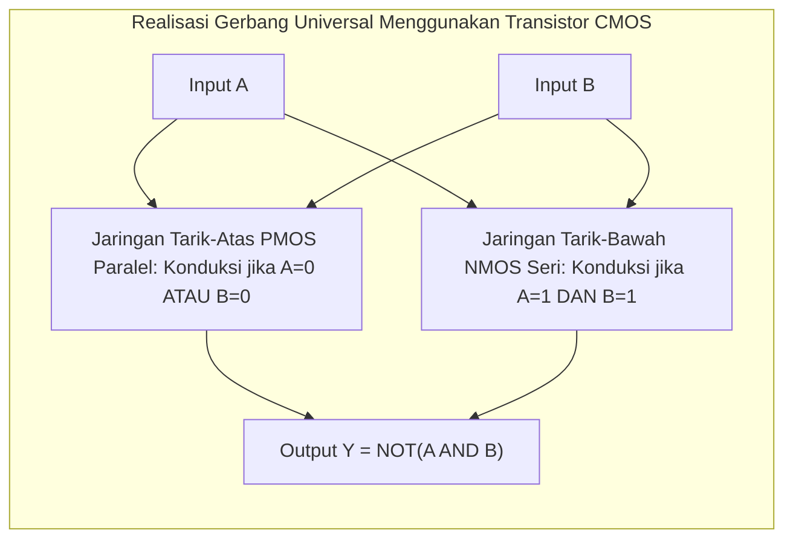

# Modul 053: Aljabar Boolean & Gerbang Logika Digital (Gerbang Primitif, De Morgan, K-Map, Quine-McCluskey)

**Navigasi**: [⬅️ Master Index](../../INDEX.md) | [Tingkat 4: Tingkat 4: Logika Digital, Computer Engineering & Arsitektur Komputer](./README.md)
*Sebelumnya*: [052. integritas-sinyal-kompatibilitas-elektromagnetik](../03-rangkaian-mikroelektronika/052-integritas-sinyal-kompatibilitas-elektromagnetik.md) | *Berikutnya*: [054. rangkaian-logika-kombinasional](./054-rangkaian-logika-kombinasional.md)

---

## 1. Intuisi Dasar Tanpa Jargon ("Seperti Bayi Baru Lahir")
### 1.1 Konsep Inti & Analogi Tanpa Jargon
Bayangkan sebuah saklar lampu tangga di rumah Anda: Anda bisa menyalakan lampu dari saklar bawah, lalu mematikan lampu dari saklar atas. Kedua saklar terhubung sedemikian rupa sehingga jika salah satu saklar dibalik posisinya, status lampu akan berganti.

### 1.2 Urgensi Rekayasa & Signifikansi Sistemik
Di dalam komputer, saklar-saklar ini adalah **Gerbang Logika (Logic Gates)**:
- Gerbang **AND**: Lampu hanya menyala jika saklar A DAN saklar B ditutup bersamaan.
- Gerbang **OR**: Lampu menyala jika saklar A ATAU saklar B ditutup.
- Gerbang **NOT**: Pembalik keadaan (jika input 1, output 0; jika input 0, output 1).
- Gerbang **XOR**: Lampu menyala jika salah satu saklar aktif, tetapi MATI jika keduanya aktif bersamaan.

Pada tahun 1854, matematikawan George Boole menciptakan sistem aljabar matematika yang hanya menggunakan dua angka: **Benar (1)** dan **Salah (0)**. Hampir 100 tahun kemudian, Claude Shannon membuktikan bahwa seluruh pemikiran logis aljabar Boolean ini dapat diwujudkan secara fisik menggunakan saklar transistor listrik, melahirkan era komputer digital.
[📚 Pelajari: MIT OCW 6.004 Computation Structures - Digital Abstraction](https://ocw.mit.edu/courses/6-004-computation-structures-spring-2017/)

## 2. Fondasi Teoretis & Aksiomatik / Matematis
### 2.1 Kerangka Teori Aksiomatik & Formulasi Matematis
### 53.1 Aksioma Aljabar Boolean Huntington ([Wolfram MathWorld Boolean Algebra](https://mathworld.wolfram.com/BooleanAlgebra.html))
Aljabar Boolean $\langle \mathcal{B}, +, \cdot, ', 0, 1 \rangle$ memenuhi aksioma formal:
1. **Identitas**: $a + 0 = a$ dan $a \cdot 1 = a$
2. **Komutatif**: $a + b = b + a$ dan $a \cdot b = b \cdot a$
3. **Distributif**: $a \cdot (b + c) = (a \cdot b) + (a \cdot c)$ dan $a + (b \cdot c) = (a + b) \cdot (a + c)$
4. **Komplemen**: $a + a' = 1$ dan $a \cdot a' = 0$

### 2.2 Penurunan Matematis Langkah-demi-Langkah
Teorema De Morgan Universal:
$$(a + b)' = a' \cdot b'$$
$$(a \cdot b)' = a' + b'$$
Implikasi: Gerbang **NAND** dan **NOR** adalah gerbang universal (*universal gates*); sembarang fungsi logika di alam semesta dapat dibangun murni hanya menggunakan susunan gerbang NAND saja!

### 53.2 Penyederhanaan Peta Karnaugh (K-Map) ([All About Circuits K-Maps](https://www.allaboutcircuits.com/textbook/digital/chpt-8/karnaugh-mapping/))
Peta Karnaugh menyusun sel-sel tabel kebenaran dalam kisi 2D menggunakan **Kode Gray** (di mana hanya satu bit yang berubah antar sel yang bersebelahan: `00, 01, 11, 10`):
- Sel-sel bernilai '1' dikelompokkan ke dalam blok persegi panjang berukuran pangkat dua ($1, 2, 4, 8, 16$ sel).
- Mengeliminasi variabel yang komplemennya muncul dalam kelompok yang sama ($A B + A B' = A(B + B') = A$).
- Menghasilkan representasi Sum-of-Products (SOP) minimal (*Minimal SOP*).

### 53.3 Algoritma Tabular Quine-McCluskey ([Stanford CS103](https://web.stanford.edu/class/cs103/))
Untuk fungsi logika dengan variabel banyak ($N > 6$) di mana K-Map visual manusia gagal:
1. Kelompokkan minterm berdasarkan jumlah angka '1' (Hamming weight).
2. Gabungkan pasangan minterm yang berbeda tepat 1 bit untuk membentuk *Prime Implicants*.
3. Selesaikan *Prime Implicant Chart* menggunakan metode penutup himpunan minimum (*Minimum Set Cover*) Petrick untuk menemukan implementasi gerbang termurah mutlak.

## 3. Anatomi Teknis & Cara Kerja Internal

Metrik Perambatan Gerbang (*Propagation Delay*):
- $t_{pLH}$: Waktu tunda output dari Low ke High (\$50\%$ level tegangan).
- $t_{pHL}$: Waktu tunda output dari High ke Low.
- Delay rata-rata: $t_{pd} = rac{t_{pLH} + t_{pHL}}{2}$ (tipikal $5 - 20	ext{ ps}$ pada node semikonduktor 5nm).

#### Tabel Penelusuran Glitch Bahaya Logika Statis (Static-1 Hazard) & Reset Asinkron Palsu
| Waktu Simulasi ($t$) | Transisi Vektor Input ($A, B, C$) | Output Gerbang AND 1 ($A \cdot B$) | Output Gerbang Inverter NOT ($\bar{B}$) | Output Gerbang AND 2 ($\bar{B} \cdot C$) | Sinyal Reset Gerbang OR ($Y = AB + \bar{B}C$) |
|---|---|---|---|---|---|
| $t = 0.0\text{ ns}$ | $A=1, B=1, C=1$ | $1 \cdot 1 = 1$ | $0$ (Terhambat delay gate) | $0 \cdot 1 = 0$ | $Y = 1 + 0 = 1$ (Sinyal Reset stabil HIGH) |
| $t = 1.0\text{ ns}$ | Input $B$ beralih: $1 \to 0$ | $1 \cdot 0 = 0$ (Jatuh instan) | Output masih $0$ ($t_{pd,inv} = 2\text{ns}$) | $0 \cdot 1 = 0$ | $Y = 0 + 0 = 0$ (GLITCH STATIS-1 ANJLOK LOW!)|
| $t = 2.0\text{ ns}$ | Delay perambatan inverter | $0$ | Output masih transisi | $0$ | Pulsa sempit glitch $0$ selebar $2\text{ ns}$ tercipta |
| $t = 3.0\text{ ns}$ | Inverter selesai berbalik | $0$ | Menjadi $1$ | $1 \cdot 1 = 1$ | $Y = 0 + 1 = 1$ (Kembali pulih ke HIGH) |
| Efek pada Flip-Flop | Pin Reset Active-Low terpicu | Glitch pulsa $2\text{ ns}$ melintasi ambang | Reset asinkron terpicu tanpa perintah! | Register status sistem kembali ke $0$ | Kontroler komunikasi satelit reboot mendadak |

## 4. Implementasi Praktis & Kode / Simulasi Riil
```python
def simplify_boolean_quine_mccluskey(minterms: list[int], num_vars: int) -> list[str]:
    """
    Implementasi demonstrasi algoritma reduksi implikan Quine-McCluskey untuk fungsi Boolean.
    """
    def to_bin(val):
        return f"{val:0{num_vars}b}"
    
    # Kelompokkan berdasarkan bobot Hamming (jumlah bit 1)
    groups = {}
    for m in minterms:
        b = to_bin(m)
        ones = b.count('1')
        groups.setdefault(ones, []).append(b)
        
    prime_implicants = []
    # Langkah perbandingan eliminasi bit adjacent Gray code
    for ones_count in sorted(groups.keys()):
        if ones_count + 1 in groups:
            for term1 in groups[ones_count]:
                for term2 in groups[ones_count + 1]:
                    # Cek beda tepat 1 bit
                    diffs = [i for i in range(num_vars) if term1[i] != term2[i]]
                    if len(diffs) == 1:
                        idx = diffs[0]
                        combined = term1[:idx] + '-' + term1[idx+1:]
                        if combined not in prime_implicants:
                            prime_implicants.append(combined)
                            
    return prime_implicants if prime_implicants else [to_bin(m) for m in minterms]

# Sederhanakan fungsi f(A,B,C,D) dengan minterm [4, 5, 6, 7] -> A'B (mandiri terhadap C dan D)
simplified = simplify_boolean_quine_mccluskey(minterms=[4, 5, 6, 7], num_vars=4)
print(f"Minterm Input          : [4, 5, 6, 7]")
print(f"Hasil Reduksi Implikan : {simplified} (Pola '01--' merepresentasikan A'B)")
```

## 5. Miskonsepsi & Jebakan Industri
1. **Static Logic Hazards (Glitches)**: Transisi input pada K-Map yang melintasi batas antara dua kelompok prime implicant terpisah dapat memunculkan denyut glitch palsu sesaat ($1 	o 0 	o 1$) akibat perbedaan delay jalur fisik gerbang. Solusi: tambahkan prime implicant redundant yang menjembatani kedua kelompok (*hazard-free cover*).
2. **Assuming Logic Gates Have Zero Delay**: Mengabaikan delay perambatan ($t_{pd}$); jika output gerbang dimasukkan kembali ke inputnya sendiri melalui inverter ganjil tanpa clock sinkron, rangkaian akan berosilasi liar tak terkendali.
3. **Fan-Out Overloading**: Menghubungkan output dari satu gerbang logika ke terlalu banyak input gerbang lain melampaui rating batas fan-out ($N > 10$); kapasitansi input yang menumpuk memperlambat rise time hingga rangkaian gagal memenuhi syarat frekuensi clock.

### Studi Kasus Kegagalan Nyata: Glitch Bahaya Logika Statis (Static-1 Hazard) Memicu Reset Asinkron Palsu Sistem Komunikasi
- **Insiden Kegagalan Pengontrol Antariksa**: Pada modul kontroler telemetri satelit cuaca geostasioner, prosesor pengendali mengalami reboot spontan berulang setiap kali register status beralih status internal tertentu. Kegagalan acak ini terjadi tanpa ada perintah reset eksternal dari stasiun bumi.
- **Akar Masalah Aljabar Boolean & Keterlambatan Gerbang Fisik**: Fungsi logika yang disederhanakan murni menggunakan minimisasi Karnaugh Map (K-Map) minimal $Y = AB + \bar{B}C$ rentan terhadap bahaya statis-1 (*static-1 hazard*). Ketika $A=1$ dan $C=1$, output secara teoritis harus selalu bernilai 1 independen terhadap nilai $B$ ($Y = 1\cdot B + \bar{B}\cdot 1 = B + \bar{B} = 1$). Namun di dunia silikon fisik, sinyal $B$ yang mengalir ke gerbang NOT membutuhkan waktu tunda propagasi ($t_{pd} \approx 2\text{ ns}$) untuk berbalik nilai. Saat $B$ beralih dari 1 ke 0, gerbang AND pertama padam seketika sebelum gerbang AND kedua sempat menyala. Selama jeda 2 nanodetik tersebut, kedua input gerbang OR bernilai 0, memuntahkan denyut glitch sempit $1 \to 0 \to 1$. Karena output ini terhubung ke pin reset asinkron active-low flip-flop, glitch tersebut langsung meng-clear status prosesor seketika.

- **Potongan Kode / Arsitektur Cacat (Vulnerable Implementation)**:
```verilog
// Modul Verilog Demonstrasi Glitch Hazard vs Redundant Cover Mitigasi
module hazard_demonstration (
    input  wire A, B, C,
    output wire Y_vulnerable,
    output wire Y_hazard_free
);
    // Rangkaian rentan Static-1 Hazard (minimisasi minimalis K-Map):
    // Ketika A=1, C=1 dan B beralih 1->0, glitch 0 sesaat tercipta
    wire not_B;
    assign #2 not_B = ~B; // Simulasi keterlambatan gerbang inverter 2ns
    wire term1 = A & B;
    wire term2 = not_B & C;
    assign Y_vulnerable = term1 | term2;

    // Rangkaian Hazard-Free (Menambahkan term redundan konsensus AC):
    // Term redundan (A & C) menahan output tetap 1 saat B sedang bertransisi
    wire term_redundant = A & C;
    assign Y_hazard_free = term1 | term2 | term_redundant;
endmodule
```

- **Teorema Redundansi Konsensus Boolean**: Untuk mengeliminasi static-1 hazard, perancang dilarang menggunakan minimisasi ekspresi minimal K-Map telanjang. Setiap pasang *prime implicant* yang bertetangga pada K-Map wajib dihubungkan oleh prime implicant redundan penutup (*consensus term / hazard-free cover*, yaitu menyertakan $AC$ dalam $Y = AB + \bar{B}C + AC$) untuk menjamin bahwa saat variabel transisi berubah, term redundan mempertahankan logika 1 tanpa bergantung pada jalur inverter yang lambat.

## 6. Proyek Latihan & Rubrik Penilaian Mandiri
### Tingkat 1 (Pemula) - Rangkaian Detektor Kesalahan Paritas Ganjil
Rancang sirkuit generator bit paritas ganjil 4-bit ($A, B, C, D$) menggunakan gerbang XOR 2-masukan. Buktikan menggunakan tabel kebenaran bahwa output bernilai '1' jika dan hanya jika jumlah bit '1' pada masukan bernilai genap.

### Tingkat 2 (Menengah) - Desain Decoder Seven-Segment BCD
Tulis fungsi logika minimal SOP untuk segmen `a` dan `e` dari decoder tampilan 7-segmen yang menerima input BCD 4-bit ($0 - 9$) dengan kondisi *don't care* ($X$) untuk kombinasi terlarang (\$10 - 15$). Sederhanakan menggunakan K-Map 4-variabel.

### Tingkat 3 (Mahir) - Pemecah Logika Hazard-Free Quine-McCluskey Otomatis
Implementasikan algoritma lengkap Quine-McCluskey disertai penyelesai tabel Petrick dalam Python/Rust yang menerima sembarang daftar minterm dan don't-care, lalu secara otomatis membangkitkan persamaan Verilog synthesizable yang terbebas dari static-1 hazards.

#### Rubrik Penilaian
- **40% Ketepatan Reduksi Aljabar Boolean**: Hasil penyederhanaan terbukti minimal dan ekuivalen \$100\%$ terhadap tabel kebenaran.
- **30% Analisis Hazard & Glitch**: Mampu mengidentifikasi kondisi transisi yang memicu glitch dinamis/statis.
- **30% Kepatuhan Sintesis Gerbang**: Menggunakan gerbang universal NAND/NOR dengan fan-in terbatas $\le 4$.

### Tingkat 1: Dasar
- **Tugas**: Bangun fungsi penyederhana Karnaugh Map (K-Map) 4-variabel yang mengidentifikasi seluruh prime implicant dan menghasilkan fungsi Boolean Sum-of-Products (SOP) minimal.
- **Petunjuk Perancangan Arsitektur**:
  - Representasikan minterm dalam format biner dan kelompokkan berdasarkan jumlah bit 1 (metode Quine-McCluskey).
  - Tentukan prime implicant esensial yang mencakup minterm unik.
- **Test Vector & Kasus Uji Ekstrem**:
  - *Fungsi Paritas Ganjil (XOR 4-Input)*: K-Map papan catur murni; verifikasi tidak ada prime implicant yang dapat digabung (membutuhkan 8 term terpisah).
  - *Tautologi Penuh*: Minterm mencakup seluruh $0 \dots 15$; hasil penyederhanaan harus tepat bernilai konstanta $1$.
- **Rubrik Penilaian Mandiri**: 40% Algoritma Quine-McCluskey / K-Map Bitwise Presisi, 30% Identifikasi Prime Implicant Esensial Tepat, 30% Validasi Fungsi Tautologi & XOR Ekstrem.

### Tingkat 2: Menengah
- **Tugas**: Implementasikan penganalisis Static Hazard otomatis pada rangkaian gerbang bertingkat (multi-level gate network) yang mendeteksi pasangan transisi input yang memicu static-0 hazard atau static-1 hazard, dan secara otomatis menambahkan term redundan penutup.
- **Petunjuk Perancangan Arsitektur**:
  - Evaluasi transisi adjacent input dengan jarak Hamming tepat 1.
  - Periksa apakah transisi tersebut melintasi perbatasan dua kelompok prime implicant terpisah pada K-Map tanpa penutup redundan.
- **Test Vector & Kasus Uji Ekstrem**:
  - *Fungsi $F = AB + \bar{B}C$*: Deteksi static-1 hazard saat $A=1, C=1$ dan $B$ beralih; sintesiskan term penutup otomatis $AC$.
  - *Rangkaian Bebas Hazard*: Uji fungsi $F = AB + \bar{B}C + AC$; verifikasi laporan output 100% bebas glitch.
- **Rubrik Penilaian Mandiri**: 40% Deteksi Transisi K-Map Jarak Hamming 1 Tepat, 30% Algoritma Sintesis Term Penutup Konsensus Redundan, 30% Verifikasi Bebas Glitch Rangkaian Terkoreksi.

### Tingkat 3: Mahir
- **Tugas**: Rancang simulator timing akurat tingkat gerbang (Gate-Level Timing Simulator) berbasis antrean kejadian (*event-driven simulation engine*) dalam Python untuk mengevaluasi dinamika perambatan delay min/max (transport delay & inertial delay) dan mendeteksi penolakan pulsa runt (*runt pulse filtering*) pada flip-flop sinkron.
- **Petunjuk Perancangan Arsitektur**:
  - Terapkan model penundaan inersial: pulsa input yang durasinya lebih pendek dari keterlambatan gerbang ($t_{pulse} < t_{pd}$) harus ditolak dan tidak merambat ke output.
  - Selesaikan penjadwalan transisi sinyal menggunakan antrean prioritas waktu (*time-ordered priority queue*).
- **Test Vector & Kasus Uji Ekstrem**:
  - *Penolakan Pulsa Inersial*: Berikan pulsa sempit $0.5\text{ ns}$ pada gerbang dengan $t_{pd} = 1.0\text{ ns}$; verifikasi output gerbang tetap tidak berubah (pulsa tertolak).
  - *Transport Delay Murni*: Kawat transmisi panjang merambatkan pulsa tanpa atenuasi durasi waktu.
- **Rubrik Penilaian Mandiri**: 40% Event-Driven Simulation Engine Prioritas Antrean Presisi, 30% Implementasi Model Inertial vs Transport Delay Tepat, 30% Deteksi Runt Pulse & Pelanggaran Sinyal Gate-Level.

## 7. Rekomendasi Sumber Belajar Standar Emas
| Kategori | Judul Sumber & Tautan Langsung | Deskripsi Singkat |
|---|---|---|
| 📖 Buku Teks | [Digital Design: Principles and Practices (John F. Wakerly)](https://www.pearson.com/) | Buku standar rujukan internasional aljabar Boolean, K-Map, dan desain logika digital. |
| 🎓 Kuliah Terbuka | [MIT OCW 6.004 Computation Structures: Digital Logic](https://ocw.mit.edu/courses/6-004-computation-structures-spring-2017/) | Seri kuliah terkenal MIT yang membangun gerbang logika, decoder, dan ALU prosesor. |
| 🔬 Makalah Seminal | [A Symbolic Analysis of Relay and Switching Circuits (Shannon, 1938)](https://doi.org/10.1109/EE.1938.6431064) | Tesis Claude Shannon yang menyatukan aljabar Boole dengan elektronika pensaklaran. |
| 💻 Lab Interaktif | [3D Digital Logic Simulator (Logic Circuit)](https://www.logiccircuit.org/) | Simulator visual interaktif open-source untuk merancang dan menguji gerbang logika digital. |

---
*Navigasi Cepat*: [Ke Tingkat 4](./README.md) | [Ke Master Index](../../INDEX.md) | *Sebelumnya*: [052. integritas-sinyal-kompatibilitas-elektromagnetik](../03-rangkaian-mikroelektronika/052-integritas-sinyal-kompatibilitas-elektromagnetik.md) | *Berikutnya*: [054. rangkaian-logika-kombinasional](./054-rangkaian-logika-kombinasional.md)
