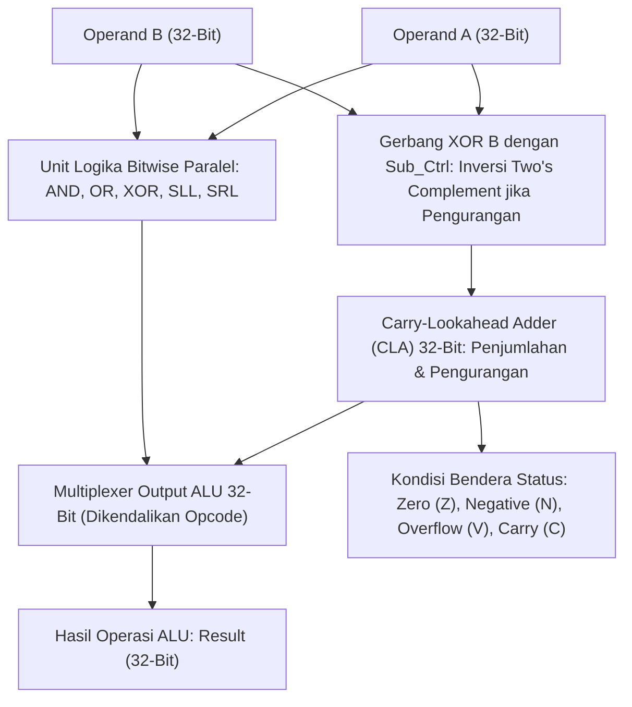

# Modul 054: Rangkaian Logika Kombinasional (Multiplexer, Decoder, Adder, Multiplier, Perancangan ALU)

**Navigasi**: [⬅️ Master Index](../../INDEX.md) | [Tingkat 4: Tingkat 4: Logika Digital, Computer Engineering & Arsitektur Komputer](./README.md)
*Sebelumnya*: [053. aljabar-boolean-gerbang-logika-digital](./053-aljabar-boolean-gerbang-logika-digital.md) | *Berikutnya*: [055. representasi-bilangan-komputer](./055-representasi-bilangan-komputer.md)

---

## 1. Intuisi Dasar Tanpa Jargon ("Seperti Bayi Baru Lahir")
### 1.1 Konsep Inti & Analogi Tanpa Jargon
Bayangkan sebuah kalkulator saku: Anda menekan angka 5, menekan tombol tambah ($+$), menekan angka 3, lalu menekan tombol sama dengan ($=$). Seketika di layar muncul angka 8! Bagaimana kumpulan jutaan transistor saklar bisa 'menghitung' penjumlahan matematika seperti otak manusia?

### 1.2 Urgensi Rekayasa & Signifikansi Sistemik
Di dalam prosesor terdapat modul yang disebut **ALU (Arithmetic Logic Unit)**:
ALU dibangun sepenuhnya dari **Rangkaian Logika Kombinasional**—sirkuit tanpa memori masa lalu di mana output saat ini murni merupakan hasil fungsi langsung dari input saat ini.
- **Multiplexer (MUX)**: Seperti saklar rel kereta api yang memilih satu dari banyak jalur data.
- **Decoder**: Menerjemahkan kode biner menjadi aktivasi satu jalur tunggal (seperti memilih alamat rumah).
- **Adder**: Merangkai gerbang XOR dan AND untuk menjumlahkan bit-bit angka beserta carry bawaannya, persis seperti penjumlahan susun ke bawah yang Anda pelajari di sekolah dasar.
[📚 Pelajari: Nand2Tetris Unit 2 - Boolean Arithmetic](https://www.nand2tetris.org/)

## 2. Fondasi Teoretis & Aksiomatik / Matematis
### 2.1 Kerangka Teori Aksiomatik & Formulasi Matematis
### 54.1 Penjumlah Biner: Half Adder, Full Adder & Ripple Carry Adder (RCA) ([Nand2Tetris](https://www.nand2tetris.org/))
- **Half Adder (HA)**: Menjumlahkan dua bit tunggal $A$ dan $B$:
  $$S = A \oplus B, \quad C = A \cdot B$$
- **Full Adder (FA)**: Menjumlahkan dua bit $A, B$ dan carry-in $C_{in}$:
  $$S = A \oplus B \oplus C_{in}$$
  $$C_{out} = (A \cdot B) + (C_{in} \cdot (A \oplus B))$$
- **Ripple Carry Adder (RCA) $N$-Bit**:
  Merangkai $N$ buah Full Adder secara beruntun. Kelemahan fatal: carry harus merambat serial dari bit terendah (LSB) ke bit tertinggi (MSB), menimbulkan latensi perambatan terburuk:
  $$t_{\text{delay}} = (N - 1) t_{\text{carry}} + t_{\text{sum}} = O(N)$$

### 2.2 Penurunan Matematis Langkah-demi-Langkah
### 54.2 Penjumlah Cepat Carry-Lookahead Adder (CLA) ([Hennessy & Patterson Computer Architecture](https://www.elsevier.com/))
Memecah perambatan serial dengan menghitung seluruh carry secara paralel waktu $O(\log N)$ menggunakan dua konsep:
- **Carry Generator ($G_i$)**: $G_i = A_i \cdot B_i$ (menghasilkan carry tak peduli input sebelumnya).
- **Carry Propagator ($P_i$)**: $P_i = A_i \oplus B_i$ (meneruskan carry jika ada carry masuk).
Rumus rekursif carry:
$$C_1 = G_0 + P_0 C_0$$
$$C_2 = G_1 + P_1 G_0 + P_1 P_0 C_0$$
$$C_3 = G_2 + P_2 G_1 + P_2 P_1 G_0 + P_2 P_1 P_0 C_0$$
$$C_4 = G_3 + P_3 G_2 + P_3 P_2 G_1 + P_3 P_2 P_0 C_0$$
Seluruh carry tingkat 4 dihitung dalam 2 tingkatan gerbang konstan!

### 54.3 Multiplexer, Demultiplexer & Desain Arsitektur ALU ([MIT 6.004](https://ocw.mit.edu/courses/6-004-computation-structures-spring-2017/))
- **Multiplexer $2^k \to 1$ (MUX)**: Memilih salah satu dari $2^k$ input data $D_i$ berdasarkan $k$ jalur seleksi $S$:
  $$Y = \sum_{i=0}^{2^k - 1} D_i \cdot m_i(S)$$
- **ALU 1-Bit Slice**: Menggabungkan unit logika (AND, OR, XOR, NOT) dan unit aritmatika (Adder dengan input B yang dapat dibalik via XOR untuk operasi pengurangan $A - B = A + B' + 1$). Output dipilih oleh MUX kendali kode operasi (Opcode).

## 3. Anatomi Teknis & Cara Kerja Internal

Deteksi Overflow Aritmatika ($V$ Flag):
Penjumlahan bertanda (*signed addition*) mengalami overflow jika dan hanya jika carry masuk ke bit tanda (MSB) berbeda dengan carry keluar dari bit tanda:
$$V = C_{N-1} \oplus C_N$$

#### Tabel Penelusuran Perambatan Carry Ripple Carry Adder (RCA) 32-Bit Menghambat Clock Prosesor
| Tahap Bit Adder ($k$) | Masukan Operand ($A_k, B_k$) | Operasi Bitwise ($P_k = A \oplus B, G_k = A \cdot B$) | Carry-In Masuk ($C_k$) | Waktu Tiba Sinyal Carry ($t_{arrive}$) | Status Keterlambatan Jalur Kritis |
|---|---|---|---|---|---|
| Bit 0 (LSB) | $A_0 = 1, B_0 = 1$ | $P_0 = 0, G_0 = 1$ (Carry dibangkitkan) | $C_0 = 0$ | $t = 0.10\text{ ns}$ | $C_1 = 1$ siap dirambatkan |
| Bit 1 | $A_1 = 1, B_1 = 0$ | $P_1 = 1$ (Carry dirambatkan) | $C_1 = 1$ | $t = 0.22\text{ ns}$ ($+0.12\text{ ns}$ per Full Adder) | $C_2 = 1$ diteruskan |
| Bit 15 (Tengah) | $A_{15} = 1, B_{15} = 0$ | $P_{15} = 1$ | $C_{15} = 1$ | $t = 1.90\text{ ns}$ | Rantai carry merambat lambat |
| Bit 31 (MSB Terakhir) | $A_{31} = 1, B_{31} = 0$ | $P_{31} = 1$ | $C_{31} = 1$ | $t = 3.82\text{ ns}$ ($32 \times 0.12\text{ ns}$ akumulasi) | Carry baru tiba di gerbang MSB! |
| Clock Siklus CPU | Frekuensi CPU $= 500\text{ MHz}$ | Periode Jam $T_{clk} = 2.00\text{ ns}$ | Waktu perambatan $3.82\text{ ns} > 2.00\text{ ns}$! | Register ALU men-sample nilai acak sampah | Penjumlahan ALU korup! CPU hang crash |

## 4. Implementasi Praktis & Kode / Simulasi Riil
```python
def simulate_4bit_cla_adder(a_val: int, b_val: int, c_in: int = 0) -> tuple[int, int, bool]:
    """
    Simulasi gerbang logika Carry-Lookahead Adder (CLA) 4-bit.
    """
    A = [(a_val >> i) & 1 for i in range(4)]
    B = [(b_val >> i) & 1 for i in range(4)]
    
    # 1. Generator dan Propagator
    G = [A[i] & B[i] for i in range(4)]
    P = [A[i] ^ B[i] for i in range(4)]
    
    # 2. Logika Paralel Lookahead Carry
    C = [0] * 5
    C[0] = c_in
    C[1] = G[0] | (P[0] & C[0])
    C[2] = G[1] | (P[1] & G[0]) | (P[1] & P[0] & C[0])
    C[3] = G[2] | (P[2] & G[1]) | (P[2] & P[1] & G[0]) | (P[2] & P[1] & P[0] & C[0])
    C[4] = G[3] | (P[3] & G[2]) | (P[3] & P[2] & G[1]) | (P[3] & P[2] & P[1] & G[0]) | (P[3] & P[2] & P[1] & P[0] & C[0])
    
    # 3. Sum bits
    S = [P[i] ^ C[i] for i in range(4)]
    sum_val = sum(S[i] << i for i in range(4))
    
    overflow = bool(C[3] ^ C[4]) # Deteksi signed overflow
    return sum_val, C[4], overflow

# Tambahkan 7 (0111) + 2 (0010) = 9 (1001) -> Signed Overflow (+7 + +2 = -7)
res_sum, c_out, v_flag = simulate_4bit_cla_adder(a_val=7, b_val=2)
print(f"Input: 7 + 2 | Hasil Biner: {res_sum} (Hex: {res_sum:X})")
print(f"Carry Out: {c_out} | Overflow Flag V: {v_flag} (Terjadi signed overflow!)")
```

## 5. Miskonsepsi & Jebakan Industri
1. **Unintentional Latch Generation in Hardware Code**: Menulis deskripsi MUX dalam Verilog/VHDL tanpa mencakup seluruh cabang `else` atau `default` pada pernyataan `case`; synthesizer mengasumsikan desainer ingin mempertahankan nilai lama, membangkitkan latch transparan tak diinginkan yang menghancurkan timing closure.
2. **Fan-In Limitation in Deep CLA Adders**: Mengembangkan persamaan CLA hingga 32 bit dalam 1 tingkat gerbang; menghasilkan gerbang AND/OR dengan fan-in 33 input yang tidak bisa direalisasikan secara fisik pada silikon. Solusi: gunakan hirarki bertingkat blok CLA 4-bit (*Block Carry Lookahead* BCLA).
3. **Carry-Chain Glitching in Ripple Adders**: Menggunakan output carry dari Ripple Carry Adder untuk memicu interrupt prosesor tanpa register penyinkron; saat bit carry merambat perlahan melewati deretan Full Adder, pin output berkedip puluhan kali (*glitching*).

### Studi Kasus Kegagalan Nyata: Keterlambatan Perambatan Bawaan Ripple Carry Adder (RCA) Menghambat Frekuensi Jam CPU
- **Insiden Kegagalan Overclocking Prosesor Awal**: Pada era awal mikroprosesor 32-bit eksperimental, insinyur mencoba menaikkan frekuensi kerja jam CPU dari 100 MHz ke 400 MHz. Unit eksekusi integer mulai menghasilkan kesalahan perhitungan matematika acak pada instruksi penjumlahan (`ADD`), di mana angka-angka besar yang menghasilkan perambatan carry panjang menghasilkan nilai keluaran yang sepenuhnya salah.
- **Akar Masalah Rangkaian Logika Kombinasional & Kompleksitas Linier RCA**: Penjumlahan biner 32-bit yang disusun menggunakan kaskade berantai Full Adder standar (Ripple Carry Adder / RCA) memiliki ketergantungan sekuensial yang ketat: setiap bit $k$ tidak dapat menghitung hasil bit jumlah $S_k$ atau carry keluar $C_{k+1}$ sebelum carry dari bit sebelumnya $C_k$ selesai dihitung dan tiba secara fisik. Keterlambatan perambatan total berskala linier $\mathcal{O}(N)$. Untuk penjumlah 32-bit dengan penundaan gerbang $120\text{ ps}$ per stage, carry membutuhkan waktu hampir $4\text{ ns}$ untuk merambat dari LSB ke MSB. Ketika periode jam CPU dipersingkat menjadi $2\text{ ns}$ (frekuensi 500 MHz), pulsa jam berikutnya tiba saat carry baru merambat sampai bit ke-16. Register ALU men-sample data yang belum selesai dihitung (*setup time violation* masif), merusak seluruh register dan instruksi percabangan program.

- **Potongan Kode / Arsitektur Cacat (Vulnerable Implementation)**:
```verilog
// Arsitektur Carry Lookahead Adder (CLA) 4-Bit Hirarkis: Kompleksitas O(log N)
module carry_lookahead_adder_4bit (
    input  wire [3:0] A, B,
    input  wire       Cin,
    output wire [3:0] Sum,
    output wire       Cout,
    output wire       P_group, G_group
);
    // 1. Bitwise Generate (G) dan Propagate (P) - dihitung paralel serentak dalam 1 gate delay
    wire [3:0] G = A & B;
    wire [3:0] P = A ^ B;

    // 2. Lookahead Carry Generator Logic - dihitung langsung dalam 2 gate delay tanpa riak berantai:
    wire C1 = G[0] | (P[0] & Cin);
    wire C2 = G[1] | (P[1] & G[0]) | (P[1] & P[0] & Cin);
    wire C3 = G[2] | (P[2] & G[1]) | (P[2] & P[1] & G[0]) | (P[2] & P[1] & P[0] & Cin);
    assign Cout = G[3] | (P[3] & G[2]) | (P[3] & P[2] & G[1]) | (P[3] & P[2] & P[1] & G[0]) | (P[3] & P[2] & P[1] & P[0] & Cin);

    // 3. Sum bits dihitung paralel: Sum = P ^ Carry
    assign Sum[0] = P[0] ^ Cin;
    assign Sum[1] = P[1] ^ C1;
    assign Sum[2] = P[2] ^ C2;
    assign Sum[3] = P[3] ^ C3;

    // Sinyal Propagate dan Generate untuk grup tingkat berikutnya
    assign P_group = &P;
    assign G_group = Cout; // Carry terhitung instan dalam O(1) waktu!
endmodule
```

- **Arsitektur Penjumlah Kecepatan Tinggi Modern**: Desain CPU modern sepenuhnya meninggalkan RCA dan mengadopsi arsitektur penjumlah logaritmik $\mathcal{O}(\log N)$ seperti Kogge-Stone Adder, Brent-Kung Adder, atau Han-Carlson Parallel Prefix Adder. Algoritma ini menggunakan struktur pohon prefiks paralel (*prefix tree*) untuk menghitung seluruh carry secara serentak dalam $\log_2(N)$ tahapan gerbang, memungkinkan operasi penambahan 64-bit diselesaikan dalam waktu kurang dari $200\text{ ps}$ pada prosesor multi-gigahertz.

## 6. Proyek Latihan & Rubrik Penilaian Mandiri
### Tingkat 1 (Pemula) - Rangkaian Komparator Besaran 4-Bit (Magnitude Comparator)
Rancang sirkuit logika kombinasional yang membandingkan dua bilangan biner 4-bit unsigned $A$ dan $B$, menghasilkan tiga output aktif: $A > B$, $A = B$, dan $A < B$. Turunkan persamaan logika minimal menggunakan gerbang XNOR dan AND.

### Tingkat 2 (Menengah) - Multiplexer Pohon 16-ke-1 Menggunakan MUX 4-ke-1
Rancang Multiplexer 16-ke-1 dengan menyusun 5 buah Multiplexer 4-ke-1 dalam topologi pohon dua tingkat. Buktikan pemetaan 4-bit jalur seleksi ($S_3, S_2, S_1, S_0$) dan hitung total delay perambatan kritis sirkuit.

### Tingkat 3 (Mahir) - Perancangan ALU 32-Bit RISC-V Lengkap dengan Shifter Barrel
Tulis modul synthesizable Verilog untuk ALU 32-bit yang mendukung seluruh instruksi R-Type dasar RISC-V RV32I: ADD, SUB, SLL, SLT, SLTU, XOR, SRL, SRA, OR, AND. Implementasikan unit pergeseran barrel (*Barrel Shifter*) 32-bit logaritmik 5-tingkat yang mampu melakukan pergeseran multi-bit dalam 1 siklus clock.

#### Rubrik Penilaian
- **40% Kebenaran Fungsional ALU**: Seluruh operasi logika, aritmatika, pergeseran, dan deteksi flag (Z, N, C, V) bekerja akurat.
- **30% Optimasi Jalur Kritis (Critical Path)**: Struktur penjumlah dan barrel shifter memiliki kedalaman gerbang logaritmik $O(\log N)$.
- **30% Ketiadaan Latch Parasitik**: Kode HDL bersih dari latch implisit dan lolos verifikasi linting Verilator.

### Tingkat 1: Dasar
- **Tugas**: Bangun modul struktural Verilog untuk Full Adder 1-bit dan rangkai menjadi Ripple Carry Adder (RCA) 8-bit, lalu buat testbench untuk memverifikasi penjumlahan seluruh vektor kasus uji.
- **Petunjuk Perancangan Arsitektur**:
  - Full Adder: $S = A \oplus B \oplus C_{in}$, $C_{out} = (A \cdot B) + (C_{in} \cdot (A \oplus B))$.
  - Hubungkan $C_{out}$ stage $k$ ke $C_{in}$ stage $k+1$.
- **Test Vector & Kasus Uji Ekstrem**:
  - *Kasus Perambatan Carry Terpanjang*: $A = 0\text{xFF}, B = 0\text{x01}$; verifikasi hasil $Sum = 0\text{x00}$ dan $C_{out} = 1$.
  - *Penjumlahan Nol*: $A = 0\text{x00}, B = 0\text{x00}, C_{in} = 0$; $Sum = 0, C_{out} = 0$.
- **Rubrik Penilaian Mandiri**: 40% Modul Full Adder & Instansiasi Berantai Verilog Tepat, 30% Testbench Menyeluruh untuk Kasus Worst-Case Carry, 30% Verifikasi Flag Overflow & Carry Out.

### Tingkat 2: Menengah
- **Tugas**: Implementasikan modul Carry Lookahead Adder (CLA) 16-bit hirarkis (terdiri dari 4 blok CLA 4-bit dan 1 unit Lookahead Carry Generator tingkat atas), bandingkan jumlah gerbang dan delay maksimum terhadap RCA 16-bit.
- **Petunjuk Perancangan Arsitektur**:
  - Hitung sinyal Propagate grup ($P_G$) dan Generate grup ($G_G$) pada setiap blok 4-bit.
  - Unit Lookahead tingkat atas menghitung carry masuk antar-blok $C_4, C_8, C_{12}, C_{16}$ dalam 2 keterlambatan gerbang.
- **Test Vector & Kasus Uji Ekstrem**:
  - *Pohon Perambatan Carry*: Verifikasi keterlambatan perambatan konstan bebas dari panjang rantai carry.
  - *Vektor Uji Komparatif*: Uji $A = 0\text{xAAAA}, B = 0\text{x5555}, C_{in} = 1$; hasil harus $Sum = 0\text{x0000}, C_{out} = 1$.
- **Rubrik Penilaian Mandiri**: 40% Arsitektur CLA Hirarkis 2-Tingkat Presisi, 30% Evaluasi Perbandingan Delay Gerbang CLA vs RCA, 30% Verifikasi Integritas Hasil Penjumlahan 16-Bit.

### Tingkat 3: Mahir
- **Tugas**: Rancang sintesis generator otomatis Kogge-Stone Parallel-Prefix Adder 64-bit dalam Python/Verilog yang mengonstruksikan graf perambatan prefiks pohon asiklik, meminimalkan fan-out beban logika dan memverifikasi fungsionalitas formal ekuivalensi matematis menggunakan Z3 Theorem Prover.
- **Petunjuk Perancangan Arsitektur**:
  - Terapkan operator prefiks biner asosiatif $\circ$: $(g, p) \circ (g', p') = (g + p \cdot g', p \cdot p')$.
  - Bangun $\log_2(64) = 6$ tahapan prefix tree dengan fan-out maksimum terikat $\le 2$ pada setiap node.
- **Test Vector & Kasus Uji Ekstrem**:
  - *Verifikasi Formal Z3*: Buktikan secara simbolik bahwa untuk setiap kemungkinan pasangan input 64-bit $(A, B)$, output adder Kogge-Stone identik dengan $A + B + C_{in}$.
  - *Evaluasi Keterlambatan Jalur Kritis*: Total keterlambatan gerbang tidak boleh melampaui $1 + 2 \times \log_2(N) = 13$ gerbang logika.
- **Rubrik Penilaian Mandiri**: 40% Generator Kogge-Stone Prefix Network Bitwise Presisi, 30% Pembuktian Formal Matematika dengan Z3 Solver, 30% Optimasi Fan-Out & Keterlambatan Gerbang Logaritmik.

## 7. Rekomendasi Sumber Belajar Standar Emas
| Kategori | Judul Sumber & Tautan Langsung | Deskripsi Singkat |
|---|---|---|
| 📖 Buku Teks | [Computer Organization and Design RISC-V Edition (Patterson & Hennessy)](https://www.elsevier.com/) | Buku standar universitas paling berpengaruh di dunia untuk desain ALU dan arsitektur prosesor. |
| 🎓 Kuliah Terbuka | [MIT OCW 6.004 Computation Structures: Arithmetic Logic Unit](https://ocw.mit.edu/courses/6-004-computation-structures-spring-2017/) | Praktikum perancangan sirkuit penjumlah, komparator, dan ALU 32-bit. |
| 🔬 Makalah Seminal | [A Suggestion for a Fast Multiplier (Wallace, 1964)](https://doi.org/10.1109/PGEC.1964.263830) | Penemuan pohon pengali cepat Wallace Tree multiplier yang digunakan di seluruh CPU modern. |
| 💻 Lab Interaktif | [Digital Logic Circuit Simulator (HNeemann / Digital)](https://github.com/hneemann/Digital) | Simulator sirkuit logika terbuka paling populer untuk merancang ALU dan CPU lengkap. |

---
*Navigasi Cepat*: [Ke Tingkat 4](./README.md) | [Ke Master Index](../../INDEX.md) | *Sebelumnya*: [053. aljabar-boolean-gerbang-logika-digital](./053-aljabar-boolean-gerbang-logika-digital.md) | *Berikutnya*: [055. representasi-bilangan-komputer](./055-representasi-bilangan-komputer.md)
