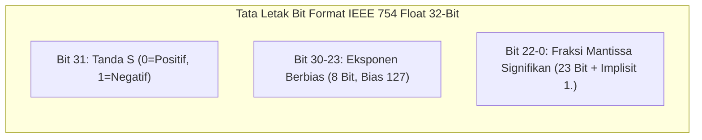

# Modul 055: Representasi Bilangan Komputer (Two's Complement, Fixed-Point, Standar Titik Kambang IEEE 754)

**Navigasi**: [⬅️ Master Index](../../INDEX.md) | [Tingkat 4: Tingkat 4: Logika Digital, Computer Engineering & Arsitektur Komputer](./README.md)
*Sebelumnya*: [054. rangkaian-logika-kombinasional](./054-rangkaian-logika-kombinasional.md) | *Berikutnya*: [056. rangkaian-logika-sekuensial-disiplin-clock](./056-rangkaian-logika-sekuensial-disiplin-clock.md)

---

## 1. Intuisi Dasar Tanpa Jargon ("Seperti Bayi Baru Lahir")
Pernahkah Anda bertanya bagaimana komputer menyimpan angka negatif seperti $-5$? Komputer tidak memiliki tinta untuk menggambar tanda minus ($-$). Komputer hanya memiliki bit `0` dan `1`.

Solusi pertama yang terpikirkan orang adalah: 'Gunakan bit paling kiri sebagai tanda minus'. Tetapi cara naif ini memiliki cacat mengerikan: angka nol akan memiliki dua representasi yang membingungkan: $+0$ dan $-0$, dan rangkaian penambah harus memeriksa tanda secara rumit!

Solusi jenius matematika yang digunakan oleh seluruh komputer di bumi adalah **Komplemen Dua (Two's Complement)**:
Bayangkan odometer (penunjuk kilometer) sepeda motor Anda yang sedang berada di angka `0000`. Jika Anda memutar roda sepeda motor mundur satu langkah, angkanya berputar menjadi `9999`!
Dalam biner 8-bit, jika Anda mengurangkan 1 dari `0000 0000`, angkanya berputar menjadi `1111 1111` ($255$). Dalam Two's Complement, `1111 1111` disepakati secara matematis bernilai **$-1$**!
Dengan trik ini, komputer **TIDAK MEMBUTUHKAN SIRKUIT PENGURANGAN**: operasi pengurangan $A - B$ dilakukan cukup dengan menambahkan $A + (-B)$ menggunakan sirkuit penambah biasa yang sama persis!
[📚 Pelajari: Khan Academy Two's Complement Representation](https://www.khanacademy.org/computing/computers-and-internet/xcae6f4a7ff015e7d:digital-information/xcae6f4a7ff015e7d:binary-numbers/a/twos-complement)

## 2. Fondasi Teoretis & Aksiomatik / Matematis
### 55.1 Matematika Komplemen Dua ($N$-Bit Two's Complement) ([Bryant & O'Hallaron CS:APP](https://csapp.cs.cmu.edu/))
Nilai bilangan bulat bertanda dari vektor bit $\mathbf{x} = [x_{w-1}, x_{w-2}, \dots, x_0]$:
$$B2T_w(\mathbf{x}) = -x_{w-1} \cdot 2^{w-1} + \sum_{i=0}^{w-2} x_i \cdot 2^i$$
Bit paling kiri ($x_{w-1}$) memiliki bobot negatif $-2^{w-1}$.
Rentang angka bertanda $w$-bit:
$$[-2^{w-1}, \, 2^{w-1} - 1]$$
Untuk 8-bit: $[-128, +127]$.
Operasi Negasi (Pembalikan Nilai $-x$):
$$-x = \sim x + 1 \quad (\text{Balik seluruh bit, lalu tambahkan 1})$$
Keunggulan mutlak: Representasi nol unik ($00000000_2$), dan $A - B \equiv A + (\sim B + 1)$.

### 55.2 Bilangan Titik Tetap (Fixed-Point Arithmetic Qm.n) ([ARM Cortex-M DSP Guide](https://developer.arm.com/))
Format $Q_{m.n}$: $m$ bit bilangan bulat dan $n$ bit pecahan.
Nilai riil:
$$X_{\text{real}} = \frac{X_{\text{integer}}}{2^n}$$
- Penjumlahan: $Z = X + Y$ (langsung dijumlahkan integer).
- Perkalian: $Z = \frac{X \cdot Y}{2^n}$ (hasil perkalian $2w$-bit harus digeser ke kanan sebanyak $n$ bit: `Z = (X * Y) >> n`).
Digunakan luas pada mikrokontroler murah tanpa Floating-Point Unit (FPU) hardware untuk audio DSP dan kontrol motor.

### 55.3 Standar Titik Kambang IEEE 754 ([IEEE 754 Standard](https://ieeexplore.ieee.org/document/8766229))
Format Tunggal 32-Bit (Float / Single Precision):
- 1 bit tanda ($S$)
- 8 bit eksponen berbias ($E$, bias $= 127$)
- 23 bit fraksi/mantissa ($M$, dengan bit tersembunyi implisit $1.M$)
Nilai riil ternormalisasi ($0 < E < 255$):
$$V = (-1)^S \times 2^{E - 127} \times \left( 1 + \sum_{i=1}^{23} b_{23-i} 2^{-i} \right)$$
Kasus Khusus IEEE 754:
1. **Zero**: $E = 0, M = 0$ ($+0.0$ dan $-0.0$).
2. **Subnormal / Denormalized**: $E = 0, M \neq 0 \implies V = (-1)^S \times 2^{-126} \times (0.M)$ (mencegah *underflow* mendadak).
3. **Infinity ($\pm \infty$)**: $E = 255, M = 0$ (misal hasil pembagian dengan nol $1.0 / 0.0$).
4. **NaN (Not a Number)**: $E = 255, M \neq 0$ (hasil operasi tak terdefinisi $\sqrt{-1}$ atau $0.0 / 0.0$).

## 3. Anatomi Teknis & Cara Kerja Internal

Anatomi Eksekusi Perkalian Titik Kambang di FPU:
1. XOR bit tanda: $S_R = S_A \oplus S_B$.
2. Jumlahkan eksponen dan kurangkan bias: $E_R = E_A + E_B - 127$.
3. Kalikan mantissa integer 24-bit: $M_{	ext{raw}} = (1.M_A) 	imes (1.M_B)$ (hasil 48-bit).
4. Normalisasi geser desimal jika terjadi luapan mantissa ($M_{	ext{raw}} \ge 2.0 \implies M_{	ext{raw}} \gg 1, E_R++$).
5. Pembulatan menurut mode IEEE (Round-to-Nearest-Even).

## 4. Implementasi Praktis & Kode / Simulasi Riil
import struct

def inspect_ieee754_float(number: float) -> dict:
    """
    Membongkar representasi bit biner internal bilangan floating point IEEE 754 32-bit.
    """
    # Bungkus float ke byte biner format IEEE 754 single precision (32-bit float)
    packed_bytes = struct.pack('>f', number)
    int_bits = struct.unpack('>I', packed_bytes)[0]
    
    bin_str = f"{int_bits:032b}"
    sign_bit = int(bin_str[0])
    exponent_bits = bin_str[1:9]
    mantissa_bits = bin_str[9:]
    
    exp_val = int(exponent_bits, 2)
    unbiased_exp = exp_val - 127
    
    return {
        "float_value": number,
        "binary_raw": f"{sign_bit} {exponent_bits} {mantissa_bits}",
        "sign": "+ (Positif)" if sign_bit == 0 else "- (Negatif)",
        "exponent_raw": exp_val,
        "unbiased_exponent": unbiased_exp,
        "mantissa_hex": f"0x{int(mantissa_bits, 2):X}"
    }

res = inspect_ieee754_float(-13.625)
print(f"Nilai Desimal   : {res['float_value']}")
print(f"Format Biner 32 : {res['binary_raw']}")
print(f"Tanda           : {res['sign']}")
print(f"Eksponen (Bias) : {res['exponent_raw']} (Unbiased: 2^{res['unbiased_exponent']})")
print(f"Fraksi Mantissa : {res['mantissa_hex']}")

## 5. Miskonsepsi & Jebakan Industri
1. **Signed Integer Overflow Undefined Behavior (UB)**: Dalam bahasa C/C++, overflow pada unsigned integer membungkus secara modular ($255 + 1 = 0$), namun overflow pada signed integer (Two's Complement) adalah *Undefined Behavior*; compiler GCC/Clang berhak mengoptimalkan dan menghapus kode pengecekan overflow Anda.
2. **Loss of Precision in Accumulators**: Menjumlahkan angka kecil ($0.0001$) jutaan kali ke variabel akumulator float32 yang sudah bernilai besar ($10000.0$); mantissa angka kecil tergeser melampaui 24 bit dan terpotong habis, menyebabkan penjumlahan berhenti bertambah (*swallowed addition*). Solusi: gunakan Kahan Summation Algorithm.
3. **Comparing Floats with Equality `==`**: Menguji kondisi `if (x == 0.3)` yang hampir selalu bernilai salah karena fraksi $0.3$ berulang tak hingga dalam biner ($0.0100110011..._2$). Selalu uji rentang toleransi: `if (abs(x - 0.3) < 1e-6)`.

## 6. Proyek Latihan & Rubrik Penilaian Mandiri
### Tingkat 1 (Pemula) - Konverter Two's Complement 8-Bit Interaktif
Tulis program Python yang menerima integer antara $-128$ hingga $+127$, mencetak representasi biner 8-bit Two's Complement-nya, dan melakukan negasi nilai menggunakan aturan bitwise NOT ditambah 1 (`~x + 1`).

### Tingkat 2 (Menengah) - Pustaka Perkalian Fixed-Point Q8.8
Implementasikan fungsi perkalian dan pembagian aritmatika titik tetap format Q8.8 (8-bit integer, 8-bit fraksi) dalam bahasa C atau Python. Buktikan bahwa operasi $\pi 	imes 2.5$ menghasilkan nilai akurat dengan galat kuantisasi $< 1/256 pprox 0.0039$.

### Tingkat 3 (Mahir) - Emulasi Perangkat Lunak Software FPU IEEE 754
Tulis modul emulasi operasi penambahan floating point 32-bit (`soft_float_add`) murni menggunakan operasi integer biner: dekonstruksi bit tanda, eksponen, dan mantissa; lakukan penyelarasan eksponen (*denormalization shift*), penambahan mantissa 24-bit dengan bit guard, round, dan sticky, serta lakukan normalisasi dan pembulatan Round-to-Nearest-Even.

#### Rubrik Penilaian
- **40% Ketepatan Matematika Representasi**: Perhitungan bit tanda negatif Two's Complement dan bias eksponen akurat.
- **30% Penanganan Angka Khusus IEEE 754**: Mendeteksi kondisi $\pm \infty$, NaN, dan bilangan subnormal secara tepat.
- **30% Integritas Pembulatan**: Menerapkan 4 mode pembulatan standar IEEE tanpa bias asimetris.

## 7. Rekomendasi Sumber Belajar Standar Emas
| Kategori | Judul Sumber & Tautan Langsung | Deskripsi Singkat |
|---|---|---|
| 📖 Buku Teks | [Computer Systems: A Programmer's Perspective (Bryant & O'Hallaron)](https://csapp.cs.cmu.edu/) | Kitab suci representasi bilangan biner, integer arithmetic, dan IEEE 754 untuk insinyur sistem. |
| 🎓 Kuliah Terbuka | [MIT OCW 6.004 Computation Structures: Number Systems](https://ocw.mit.edu/courses/6-004-computation-structures-spring-2017/) | Penjelasan visual Two's Complement, penambahan biner, dan format floating-point. |
| 🔬 Makalah Seminal | [An Interview with William Kahan (Father of IEEE 754)](https://amturing.acm.org/award_winners/kahan_1023746.cfm) | Wawancara sejarah pemenang Turing Award yang merancang standar IEEE 754. |
| 💻 Lab Interaktif | [Float Toy: IEEE 754 Visualization Tool](https://evanw.github.io/float-toy/) | Eksplorasi interaktif bit tanda, eksponen, dan fraksi secara real-time di web. |

---
*Navigasi Cepat*: [Ke Tingkat 4](./README.md) | [Ke Master Index](../../INDEX.md) | *Sebelumnya*: [054. rangkaian-logika-kombinasional](./054-rangkaian-logika-kombinasional.md) | *Berikutnya*: [056. rangkaian-logika-sekuensial-disiplin-clock](./056-rangkaian-logika-sekuensial-disiplin-clock.md)
