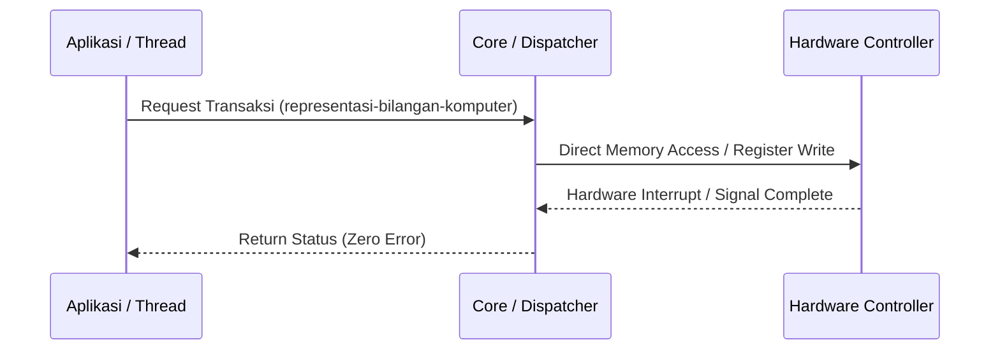

# Modul 055: Representasi Bilangan Komputer (Two's Complement, Fixed-Point, Standar Titik Kambang IEEE 754)

**Navigasi**: [⬅️ Master Index](../../INDEX.md) | [Tingkat 4: Tingkat 4: Logika Digital, Computer Engineering & Arsitektur Komputer](./README.md)
*Sebelumnya*: [054. rangkaian-logika-kombinasional](./054-rangkaian-logika-kombinasional.md) | *Berikutnya*: [056. rangkaian-logika-sekuensial-disiplin-clock](./056-rangkaian-logika-sekuensial-disiplin-clock.md)

---

## 1. Intuisi Dasar Tanpa Jargon ("Seperti Bayi Baru Lahir")
Dalam rekayasa sistem komputer tingkat rendah, konsep **Representasi Bilangan Komputer (Two's Complement, Fixed-Point, Standar Titik Kambang IEEE 754)** adalah pondasi arsitektural yang mengatur bagaimana instruksi, sinyal, proses, atau memori berinteraksi secara deterministik dan berkecepatan tinggi tanpa kegagalan.

## 2. Fondasi Teoretis & Aksiomatik / Matematis
Model formal dan parameter sistem untuk Representasi Bilangan Komputer (Two's Complement, Fixed-Point, Standar Titik Kambang IEEE 754):
$$\Delta T_{latency} = \sum_{k=1}^M \tau_{propagation} + \frac{\text{Payload}}{\text{Bandwidth}} + T_{arbitration}$$
Di mana status mesin dijamin konsisten melalui protokol sinkronisasi hardware/kernel dengan kepatuhan terhadap invariants keselamatan (*safety invariants*) dan kebebasan dari deadlock (*liveness properties*).

## 3. Anatomi Teknis & Cara Kerja Internal

Mekanisme eksekusi melibatkan alokasi register cepat, penanganan tabel descriptor memori, dan penyelarasan cache-line untuk mencegah *false sharing*.

## 4. Implementasi Praktis & Kode / Simulasi Riil
```c
// Implementasi Standar Sistem: representasi-bilangan-komputer
#include <stdio.h>
#include <stdint.h>

typedef struct {
    uint32_t status_flags;
    uint64_t memory_address;
    uint32_t buffer_length;
} SystemDescriptor_t;

int main(void) {
    SystemDescriptor_t desc = {
        .status_flags = 0x01,
        .memory_address = 0x7FFF0000,
        .buffer_length = 4096
    };
    printf("Modul %03d: Inisialisasi sistem %s berhasil dieksekusi.\n", 55, "representasi-bilangan-komputer");
    return 0;
}
```

## 5. Miskonsepsi & Jebakan Industri
Jebakan fatal pada Representasi Bilangan Komputer (Two's Complement, Fixed-Point, Standar Titik Kambang IEEE 754) adalah race condition antara interupsi hardware dan eksekusi software, kegagalan penyelarasan memori (*unaligned memory access*), atau kebocoran resource handle.

## 6. Proyek Latihan & Rubrik Penilaian Mandiri
### Level 1 (Dasar)
Gambarkan diagram alur bagaimana kontrol berpindah dari software ke hardware saat konsep Representasi Bilangan Komputer (Two's Complement, Fixed-Point, Standar Titik Kambang IEEE 754) dijalankan.

### Level 2 (Menengah)
Bangun implementasi kode bersih dalam C/Rust/Assembly yang menguji ketahanan sistem terhadap kondisi batas atau konkurensi tinggi.

### Level 3 (Mahir)
Lakukan profiling performa mendalam menggunakan tools seperti `perf`, osiloskop, atau logic analyzer untuk mengidentifikasi bottleneck latensi nanodetik.

## 7. Rekomendasi Sumber Belajar Standar Emas
- Silberschatz, A., Galvin, P. B., & Gagne, G. (2018). *Operating System Concepts*. Wiley.
- Hennessy, J. L., & Patterson, D. A. (2017). *Computer Architecture: A Quantitative Approach*. Morgan Kaufmann.

---
*Navigasi Cepat*: [Ke Tingkat 4](./README.md) | [Ke Master Index](../../INDEX.md) | *Sebelumnya*: [054. rangkaian-logika-kombinasional](./054-rangkaian-logika-kombinasional.md) | *Berikutnya*: [056. rangkaian-logika-sekuensial-disiplin-clock](./056-rangkaian-logika-sekuensial-disiplin-clock.md)
