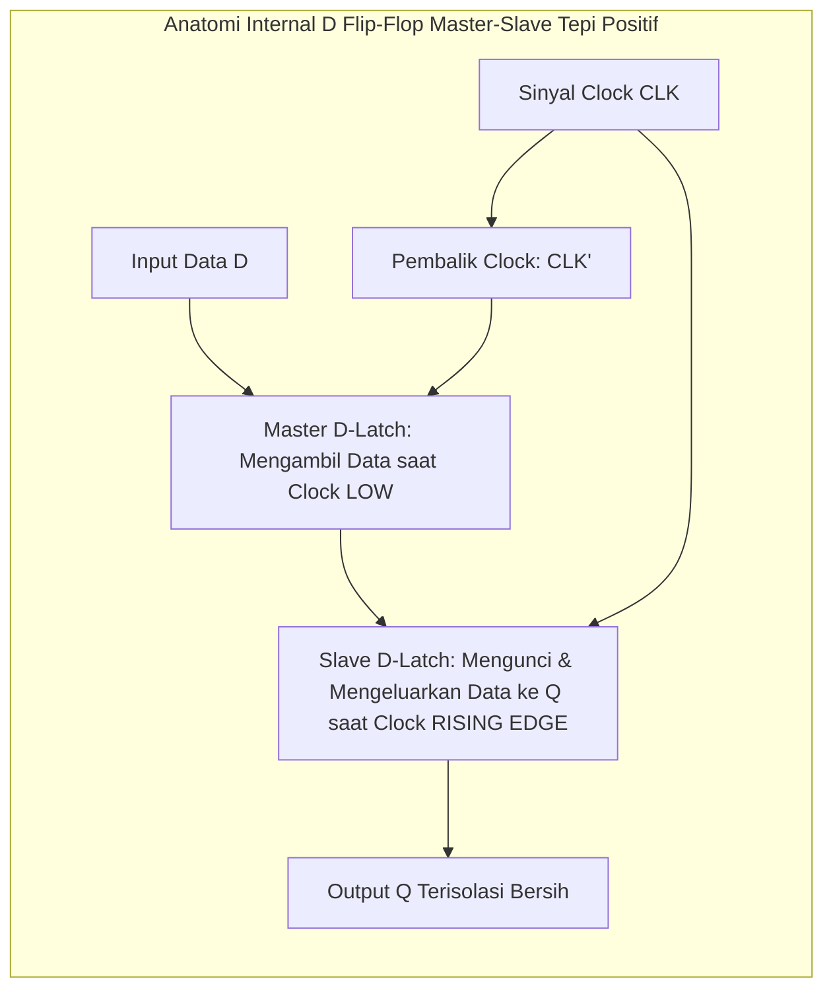

# Modul 056: Rangkaian Logika Sekuensial & Disiplin Clock (Flip-Flop, Register, Setup/Hold Time, Metastabilitas)

**Navigasi**: [⬅️ Master Index](../../INDEX.md) | [Tingkat 4: Tingkat 4: Logika Digital, Computer Engineering & Arsitektur Komputer](./README.md)
*Sebelumnya*: [055. representasi-bilangan-komputer](./055-representasi-bilangan-komputer.md) | *Berikutnya*: [057. mesin-keadaan-hingga-fsm](./057-mesin-keadaan-hingga-fsm.md)

---

## 1. Intuisi Dasar Tanpa Jargon ("Seperti Bayi Baru Lahir")
Bayangkan sebuah orkestra simfoni musik raksasa dengan 100 musisi. Jika setiap pemain biola dan terompet bermain sesuka hati mereka sendiri tanpa aba-aba, konser musik akan menjadi bencana kebisingan yang kacau balau!

Seorang **Dirigen (Conductor)** berdiri di depan, mengayunkan tongkat ritmenya dengan ketukan teratur: *Tik... Tok... Tik... Tok...* Tepat pada saat tongkat berayun ke bawah, seluruh musisi serentak memainkan nada berikutnya bersama-sama.

Di dalam komputer digital, Dirigen tersebut adalah **Sinyal Jam (Clock)**, dan para musisinya adalah **Flip-Flop**:
- Rangkaian kombinasional (seperti penjumlah ALU) membutuhkan waktu beberapa nanodetik agar arus listrik selesai merambat. Saat sinyal merambat, outputnya berkedip-kedip kacau (glitching).
- **Flip-Flop** bertindak seperti dinding penahan: ia mengunci data lama dan HANYA membuka pintu tepat pada tepi denyut clock (*rising edge*).
- Dengan **Disiplin Clock**, seluruh milyaran transistor di dalam chip prosesor Anda berpindah dari satu keadaan ke keadaan berikutnya secara serentak, tertib, dan bebas dari kekacauan waktu.
[📚 Pelajari: MIT OCW Sequential Logic & Clocking](https://ocw.mit.edu/courses/6-004-computation-structures-spring-2017/)

## 2. Fondasi Teoretis & Aksiomatik / Matematis
### 56.1 Elemen Penyimpan Memori: SR Latch, D Latch & D Flip-Flop Master-Slave ([Wakerly Digital Design](https://www.pearson.com/))
- **SR Latch (Set-Reset)**: Menggunakan dua gerbang NOR berumpan balik silang:
  $$Q = \overline{R + \overline{Q}}, \quad \overline{Q} = \overline{S + Q}$$
  Kondisi terlarang: $S = 1, R = 1$ (keduanya mencoba memaksa $Q = 0$ dan $\overline{Q} = 0$, memicu osilasi saat dilepas).
- **D Latch (Transparan)**: Memiliki input data $D$ dan enable $E$:
  - Jika $E = 1$: Output $Q$ mengikuti input $D$ secara langsung (*transparan*).
  - Jika $E = 0$: Output $Q$ membeku menahan nilai terakhir.
- **Edge-Triggered D Flip-Flop (Master-Slave)**: Menggabungkan dua D Latch berurutan dengan clock terbalik ($CLK$ dan $\overline{CLK}$):
  Data hanya berpindah tepat pada saat tepi transisi clock (*rising edge* $0 \to 1$) dan kebal terhadap perubahan input selama clock tinggi atau rendah.

### 56.2 Parameter Waktu Kritis: Setup Time, Hold Time & Clock Skew ([Rabaey Digital Integrated Circuits](https://www.pearson.com/))
Dua aturan mutlak disiplin clock digital:
1. **Waktu Setup ($t_{\text{setup}}$)**: Sinyal data $D$ harus sudah stabil sebelum tepi clock aktif tiba.
2. **Waktu Hold ($t_{\text{hold}}$)**: Sinyal data $D$ harus tetap stabil dan tidak boleh berubah selama interval tertentu setelah tepi clock aktif tiba.

Persamaan Batas Kecepatan Frekuensi Clock Maksimum (Setup Constraint):
$$T_{\text{clock}} \ge t_{\text{clk-to-q}} + t_{\text{comb\_max}} + t_{\text{setup}} - t_{\text{skew}}$$
$$f_{\max} = \frac{1}{T_{\text{clock, min}}}$$
Persamaan Batas Perlombaan Data (Hold Constraint - Mandiri terhadap Frekuensi Clock!):
$$t_{\text{clk-to-q}} + t_{\text{comb\_min}} \ge t_{\text{hold}} + t_{\text{skew}}$$
Jika terjadi pelanggaran hold time, chip cacat secara permanen dan tidak akan pernah bisa diperbaiki meski frekuensi clock diturunkan ke nol!

### 56.3 Fenomena Metastabilitas & Mean Time Between Failures (MTBF) ([Dally Digital Design](https://www.cambridge.org/))
Jika sinyal asinkron dari dunia luar melanggar waktu setup atau hold, tegangan internal gerbang flip-flop akan tersangkut tepat di antara level logika '0' dan '1' (titik kesetimbangan metastabil labil seperti bola yang seimbang di puncak bukit runcing):
Waktu resolusi peluruhan tegangan metastabil bersifat eksponensial:
$$P(t_{\text{resolve}} > t) = e^{-\frac{t}{\tau}}$$
Rata-Rata Waktu Antara Kegagalan Sistem (*Mean Time Between Failures* MTBF):
$$\text{MTBF} = \frac{e^{\frac{t_{\text{slack}}}{\tau}}}{f_{\text{clock}} \cdot f_{\text{data}} \cdot T_0}$$
Solusi industri: gunakan **Penyinkron Dua Tingkat (2-Stage Synchronizer Flip-Flop)** untuk seluruh sinyal input asinkron eksternal.

## 3. Anatomi Teknis & Cara Kerja Internal

Penyebab Clock Skew ($t_{	ext{skew}}$):
Perbedaan panjang jalur fisik kawat clock dari osilator pusat menuju register-register di ujung chip yang berbeda. Mitigasi: menggunakan struktur pohon jam seimbang (*H-Tree Clock Distribution Network*) dengan buffer penyeimbang delay terkalibrasi.

## 4. Implementasi Praktis & Kode / Simulasi Riil
def verify_digital_clock_timing(t_clk_to_q_ns: float, t_setup_ns: float, t_hold_ns: float, 
                                 t_comb_max_ns: float, t_comb_min_ns: float, 
                                 clock_freq_mhz: float, t_skew_ns: float = 0.05) -> dict:
    """
    Verifikasi Static Timing Analysis (STA) untuk batas Setup dan Hold jalur register-ke-register.
    """
    t_period_ns = (1.0 / (clock_freq_mhz * 1e6)) * 1e9
    
    # 1. Verifikasi Setup Time Slack
    # T_req = T_period + t_skew - t_setup
    # T_arr = t_clk_to_q + t_comb_max
    setup_slack = (t_period_ns + t_skew_ns - t_setup_ns) - (t_clk_to_q_ns + t_comb_max_ns)
    
    # 2. Verifikasi Hold Time Slack
    # T_arr_min = t_clk_to_q + t_comb_min
    # T_req_hold = t_hold + t_skew
    hold_slack = (t_clk_to_q_ns + t_comb_min_ns) - (t_hold_ns + t_skew_ns)
    
    is_setup_met = setup_slack >= 0.0
    is_hold_met = hold_slack >= 0.0
    
    max_achievable_freq_mhz = 1e3 / (t_clk_to_q_ns + t_comb_max_ns + t_setup_ns - t_skew_ns)
    
    return {
        "clock_period_ns": t_period_ns,
        "setup_slack_ns": setup_slack,
        "hold_slack_ns": hold_slack,
        "setup_timing_met": is_setup_met,
        "hold_timing_met": is_hold_met,
        "max_freq_mhz": max_achievable_freq_mhz
    }

res = verify_digital_clock_timing(t_clk_to_q_ns=0.15, t_setup_ns=0.10, t_hold_ns=0.08, 
                                  t_comb_max_ns=1.80, t_comb_min_ns=0.12, clock_freq_mhz=400.0)

print(f"Periode Clock 400 MHz : {res['clock_period_ns']:.2f} ns")
print(f"Setup Slack           : {res['setup_slack_ns']:+.3f} ns (Lolos: {res['setup_timing_met']})")
print(f"Hold Slack            : {res['hold_slack_ns']:+.3f} ns (Lolos: {res['hold_timing_met']})")
print(f"Frekuensi Maksimum CPU: {res['max_freq_mhz']:.1f} MHz")

## 5. Miskonsepsi & Jebakan Industri
1. **Sampling Asynchronous Inputs Directly without Synchronizers**: Membaca sinyal tombol fisik atau paket data serial langsung ke dalam mesin keadaan FSM tanpa melewati 2-stage synchronizer flip-flop; metastabilitas memicu FSM melompat ke keadaan tak terdefinisi (*illegal state lockup*).
2. **Gated Clocks without Glitch-Free Glitch Suppressors**: Mematikan clock rangkaian menggunakan gerbang AND biasa (`gated_clk = clk & enable`); setiap perubahan sinyal enable saat clock tinggi memunculkan pulsa runt sempit yang melanggar waktu setup/hold. Gunakan Integrated Clock Gating (ICG) cell standar.
3. **Hold Time Violations Fixed by Slowing Down Clock**: Mengira kegagalan timing hold dapat diatasi dengan menurunkan frekuensi clock prosesor; rumus hold $t_{cq} + t_{	ext{comb}} \ge t_{	ext{hold}}$ tidak memiliki variabel periode clock sama sekali—jika hold time gagal pada 1 GHz, rangkaian juga akan tetap gagal pada 1 Hz!

## 6. Proyek Latihan & Rubrik Penilaian Mandiri
### Tingkat 1 (Pemula) - Rancang Pencacah Biner Sinkron 4-Bit (Synchronous Counter)
Rancang pencacah biner sinkron 4-bit ($0 - 15$) menggunakan 4 buah D Flip-Flop dan gerbang logika kombinasional. Buktikan bahwa seluruh flip-flop dipicu oleh tepi clock yang sama secara simultan tanpa ripple delay bertingkat.

### Tingkat 2 (Menengah) - Perhitungan MTBF Penyinkron 2-Tingkat
Sebuah mikrokontroler berkecepatan clock $f_{	ext{clk}} = 100	ext{ MHz}$ menerima sinyal tombol asinkron dengan frekuensi aktivitas $f_{	ext{data}} = 10	ext{ Hz}$. Dengan parameter metastabilitas flip-flop $	au = 0.1	ext{ ns}$ dan $T_0 = 0.2	ext{ ns}$, hitung MTBF jika menggunakan 1 tingkat penyinkron vs 2 tingkat penyinkron.

### Tingkat 3 (Mahir) - Pemecah Masalah Clock Domain Crossing (CDC) dengan Asynchronous FIFO
Rancang arsitektur Asynchronous FIFO (First-In First-Out) untuk mentransfer data 32-bit antara dua domain clock independen yang tidak saling sinkron ($f_{	ext{write}} = 133	ext{ MHz}$, $f_{	ext{read}} = 100	ext{ MHz}$). Terapkan konversi pointer alamat biner ke Kode Gray (*Gray Code Pointer Conversion*) sebelum melewati 2-stage synchronizer guna mencegah metastabilitas pembacaan status Empty dan Full.

#### Rubrik Penilaian
- **40% Kepatuhan Batas Waktu Setup & Hold**: Seluruh perhitungan slack STA dirumuskan akurat dengan toleransi clock skew.
- **30% Keamanan Clock Domain Crossing (CDC)**: Tidak ada sinyal multi-bit biner yang disinkronkan secara langsung tanpa Gray coding.
- **30% Ketiadaan Glitch pada Distribusi Clock**: Menggunakan sel ICG baku tanpa gerbang logika diskrit pada jalur clock.

## 7. Rekomendasi Sumber Belajar Standar Emas
| Kategori | Judul Sumber & Tautan Langsung | Deskripsi Singkat |
|---|---|---|
| 📖 Buku Teks | [Digital Integrated Circuits: A Design Perspective (Jan M. Rabaey)](https://www.pearson.com/) | Analisis komprehensif elemen sekuensial, metastabilitas, dan distribusi clock. |
| 🎓 Kuliah Terbuka | [MIT OCW 6.004 Computation Structures: Sequential Logic](https://ocw.mit.edu/courses/6-004-computation-structures-spring-2017/) | Desain register D, aturan disiplin clock dinamis, dan analisis timing STA. |
| 🔬 Makalah Seminal | [Metastable States in Azimuthal Readout Circuits (Chaney & Molnar, 1973)](https://doi.org/10.1109/T-C.1973.223730) | Makalah historis penemuan eksperimental fenomena metastabilitas pada flip-flop silikon. |
| 💻 Lab Interaktif | [EDA Playground Online HDL Simulator](https://www.edaplayground.com/) | Platform browser interaktif untuk menulis, mensimulasikan, dan melihat timing waveform Verilog. |

---
*Navigasi Cepat*: [Ke Tingkat 4](./README.md) | [Ke Master Index](../../INDEX.md) | *Sebelumnya*: [055. representasi-bilangan-komputer](./055-representasi-bilangan-komputer.md) | *Berikutnya*: [057. mesin-keadaan-hingga-fsm](./057-mesin-keadaan-hingga-fsm.md)
