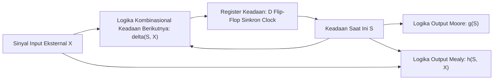

# Modul 057: Mesin Keadaan Hingga (Finite State Machines: Model Moore vs Mealy, Diagram Transisi Keadaan)

**Navigasi**: [⬅️ Master Index](../../INDEX.md) | [Tingkat 4: Tingkat 4: Logika Digital, Computer Engineering & Arsitektur Komputer](./README.md)
*Sebelumnya*: [056. rangkaian-logika-sekuensial-disiplin-clock](./056-rangkaian-logika-sekuensial-disiplin-clock.md) | *Berikutnya*: [058. hardware-description-languages-sintesis-rtl](./058-hardware-description-languages-sintesis-rtl.md)

---

## 1. Intuisi Dasar Tanpa Jargon ("Seperti Bayi Baru Lahir")
### 1.1 Konsep Inti & Analogi Tanpa Jargon
Bayangkan sebuah pintu putar otomatis di gerbang stasiun MRT:
- Keadaan awalnya adalah **Terkunci**.
- Jika Anda memasukkan koin atau menempelkan kartu (Input = Kartu), pintu berpindah ke keadaan **Terbuka**.
- Jika Anda mendorong palang pintu (Input = Dorong), pintu berputar dan kembali ke keadaan **Terkunci**.
- Jika saat Terkunci Anda mendorong palang tanpa kartu, pintu tetap Terkunci dan membunyikan alarm!

### 1.2 Urgensi Rekayasa & Signifikansi Sistemik
Pintu putar ini adalah contoh paling sempurna dari **Finite State Machine (FSM / Mesin Keadaan Hingga)**:
Sebuah mesin komputasi yang pada satu waktu HANYA bisa berada di salah satu dari sejumlah keadaan berhingga yang terdefinisi.
Seluruh logika kendali otomatis di dunia—mulai dari lampu lalu lintas jalan raya, mesin cuci cerdas, protokol komunikasi Bluetooth, hingga Unit Kendali (Control Unit) di dalam prosesor Intel yang mengatur siklus Fetch-Decode-Execute—dirancang menggunakan model FSM ini.
[📚 Pelajari: MIT OCW Finite State Machines](https://ocw.mit.edu/courses/6-004-computation-structures-spring-2017/)

## 2. Fondasi Teoretis & Aksiomatik / Matematis
### 2.1 Kerangka Teori Aksiomatik & Formulasi Matematis
### 57.1 Definisi Formal FSM & Otomata Hingga Deterministik (DFA) ([Sipser Theory of Computation](https://www.cengage.com/))
Mesin Keadaan Hingga didefinisikan secara matematis sebagai 5-tupel:
$$M = \langle S, \Sigma, \Lambda, \delta, \omega \rangle$$
Di mana:
- $S$: Himpunan berhingga keadaan (*states*) $\{s_0, s_1, \dots, s_{n-1}\}$.
- $\Sigma$: Alfabet input berhingga.
- $\Lambda$: Alfabet output berhingga.
- $\delta: S \times \Sigma \to S$: Fungsi transisi keadaan berikutnya (*Next-State Logic*).
- $\omega$: Fungsi output (*Output Logic*).

### 2.2 Penurunan Matematis Langkah-demi-Langkah
### 57.2 Model Moore vs Model Mealy ([Wakerly Digital Design](https://www.pearson.com/))
1. **Mesin Moore**:
   Output murni merupakan fungsi dari keadaan saat ini saja:
   $$\omega: S \to \Lambda \implies Y(t) = g(S(t))$$
   - Output sinkron sempurna terhadap clock, kebal terhadap glitch input.
   - Sering membutuhkan lebih banyak jumlah state.
2. **Mesin Mealy**:
   Output merupakan fungsi dari keadaan saat ini DAN input saat ini:
   $$\omega: S \times \Sigma \to \Lambda \implies Y(t) = h(S(t), X(t))$$
   - Respon output instan tanpa menunggu siklus clock berikutnya.
   - Rentan meneruskan glitch dari sinyal input langsung ke output.

### 57.3 Strategi Pengkodean Keadaan (State Encoding) ([Harris & Harris Digital Design and Computer Architecture](https://www.elsevier.com/))
Untuk FSM dengan $N$ keadaan:
- **Pengkodean Biner Minimal**: Menggunakan $k = \lceil \log_2 N \rceil$ flip-flop. Meminimalkan jumlah register memori (sangat ideal untuk ASIC silikon berharga mahal).
- **Pengkodean Gray**: Hanya 1 bit yang berubah pada transisi sekuensial normal, meminimalkan glitch dan disipasi daya pensaklaran dinamis.
- **Pengkodean One-Hot**: Menggunakan tepat $N$ flip-flop (setiap keadaan diwakili oleh 1 bit tunggal yang bernilai '1', misal `0001, 0010, 0100, 1000`). Logika transisi dan dekoding output menjadi sangat sederhana (hanya membutuhkan gerbang OR), sangat ideal untuk arsitektur FPGA yang kaya akan flip-flop.

## 3. Anatomi Teknis & Cara Kerja Internal

Tiga Blok Pembangun FSM Standar HDL (Three-Always Block Paradigm):
1. **Blok 1 (Sequential)**: Register flip-flop sinkron clock yang memperbarui `current_state <= next_state`.
2. **Blok 2 (Combinational)**: Blok evaluasi transisi `next_state` berdasarkan `current_state` dan `inputs`.
3. **Blok 3 (Combinational / Registered)**: Blok penetapan nilai sinyal keluaran `outputs`.

#### Tabel Penelusuran Kunci State Tak Terjangkau (Unreachable State Lockup) pada FSM One-Hot Lampu Lalu Lintas
| Siklus Jam ($Clk$) | Status State Legal FSM | Vektor Enkode One-Hot ($S_3 S_2 S_1 S_0$) | Radiasi Partikel Kosmik (Single Event Upset) | Vektor State Pascacorruption | Reaksi Logika Transisi State FSM |
|---|---|---|---|---|---|
| Siklus 0 | STATE_RED | `0001` (Bobot Hamming = 1) | Tidak ada | `0001` (Legal) | Transisi normal ke STATE_GREEN |
| Siklus 1 | STATE_GREEN | `0010` (Bobot Hamming = 1) | Tidak ada | `0010` (Legal) | Transisi normal ke STATE_YELLOW |
| Siklus 2 | STATE_YELLOW | `0100` (Bobot Hamming = 1) | Neutron kosmik membalik bit 3 ($0 \to 1$)| `1100` (ILLEGAL! Dua bit 1 bersamaan!)| State `1100` tidak didefinisikan dalam diagram! |
| Siklus 3 (Tanpa Default) | State tak dikenal `1100` | Logika `case` tidak menemukan kecocokan| Tidak ada cabang `default` pemulihan | State mempertahankan nilai `1100` | FSM TERKUNCI PERMANEN! Lampu mati membeku |
| Siklus 4 (Sistem Macet) | Terkunci selamanya | `1100` | Lampu lalu lintas tidak berganti siklus | Tetap macet di `1100` | Tabrakan di persimpangan jalan raya |
| Dengan Safe Recovery | State tak dikenal `1100` | Cabang `default` mendeteksi anomali | Eksekusi reset darurat otomatis | Mengatur ulang ke `0001` (RED aman) | FSM pulih mandiri dalam 1 siklus jam! |

## 4. Implementasi Praktis & Kode / Simulasi Riil
```python
class VendingMachineFSM:
    """
    Simulasi Mesin Keadaan Hingga (FSM Moore) Mesin Penjual Minuman Otomatis (Harga Rp 3.000).
    Koin diterima: Rp 1.000 (K1) dan Rp 2.000 (K2).
    Keadaan: S0 (Rp 0), S1 (Rp 1.000), S2 (Rp 2.000), S3 (Rp 3.000 - Dispense Minuman).
    """
    def __init__(self):
        self.state = "S0"
        
    def step(self, coin_inserted: int) -> tuple[str, bool]:
        # Logika Transisi Keadaan Berikutnya (Next-State Logic)
        if self.state == "S0":
            if coin_inserted == 1000: self.state = "S1"
            elif coin_inserted == 2000: self.state = "S2"
        elif self.state == "S1":
            if coin_inserted == 1000: self.state = "S2"
            elif coin_inserted == 2000: self.state = "S3"
        elif self.state == "S2":
            if coin_inserted in (1000, 2000): self.state = "S3"
        elif self.state == "S3":
            # Otomatis reset ke S0 setelah mengeluarkan minuman
            self.state = "S0"
            
        # Logika Output Moore (Hanya bergantung pada keadaan)
        dispense = (self.state == "S3")
        return self.state, dispense

fsm = VendingMachineFSM()
transactions = [1000, 2000, 0] # Masukkan 1rb, lalu 2rb
for i, coin in enumerate(transactions):
    st, out = fsm.step(coin)
    print(f"Langkah {i+1}: Masuk Rp {coin:4d} | State: {st} | Keluarkan Minuman: {out}")
```

## 5. Miskonsepsi & Jebakan Industri
1. **Combinational Loops in Mealy FSM**: Menghubungkan output Mealy dari FSM-A langsung ke input FSM-B, dan output Mealy FSM-B kembali ke input FSM-A tanpa pembatas register clock; menciptakan loop umpan balik kombinasional tak stabil yang memicu osilasi liar frekuensi tinggi.
2. **Missing Default State in One-Hot Encoding**: FSM One-Hot yang terdistorsi oleh lonjakan derau listrik partikel kosmik (*Single Event Upset* SEU) hingga bernilai `0000` atau `0011` (dua bit aktif bersamaan); jika tidak ada klausul penanganan `default: next_state = RESET`, FSM akan terkunci mati selamanya (*deadlock*).
3. **Glitches on Asynchronous Moore Outputs**: Mengira output Moore selalu bersih dari derau; jika fungsi output kombinasional memiliki jalur logika yang tidak seimbang, glitch sesaat dapat muncul di antara transisi state sebelum sinyal menetap. Solusi: rekatkan register flip-flop pada output (*Registered Output*).

### Studi Kasus Kegagalan Nyata: Pengontrol Lampu Lalu Lintas Terkunci Permanen pada State Tak Terjangkau (Unreachable State Lockup)
- **Insiden Kegagalan Pengendali Persimpangan Kota**: Di persimpangan jalan protokol metropolitan yang sibuk, unit pengontrol lampu lalu lintas digital mendadak membeku di tengah jam sibuk. Seluruh lampu indikator mati dan sistem berhenti merespons sensor kendaraan. Polisi lalu lintas terpaksa turun tangan mengatur manual di tengah kemacetan total.
- **Akar Masalah Mesin Keadaan Hingga (FSM) & Enkode One-Hot Tanpa Pemulihan**: Pengontrol dirancang menggunakan FSM dengan skema pengkodean One-Hot (4 state direpresentasikan oleh 4 bit register: `0001`, `0010`, `0100`, `1000`). Pada pengkodean 4-bit, terdapat $2^4 = 16$ kombinasi nilai biner, namun hanya 4 kombinasi yang merupakan status legal (jarak bobot Hamming = 1), sedangkan 12 kombinasi lainnya adalah *unreachable illegal states*. Akibat lonjakan derau listrik atau partikel radiasi kosmik (*Single Event Upset* / SEU), sebuah bit register mengalami *bitflip* dari `0100` menjadi `1100`. Di dalam kode HDL, perancang menulis struktur `case (state)` tanpa menambahkan klausul `default: state <= STATE_RESET;` karena menganggap secara matematis state ilegal tidak akan pernah tercapai. Kompilator sintesis mengoptimalkan logika transisi dengan mengabaikan 12 kombinasi ilegal tersebut. Begitu FSM terperosok ke dalam state `1100`, tidak ada persamaan transisi yang memindahkan register ke mana-mana, mengunci FSM dalam deadlock abadi yang hanya bisa dipulihkan dengan memutus daya secara fisik.

- **Potongan Kode / Arsitektur Cacat (Vulnerable Implementation)**:
```verilog
// Arsitektur Finite State Machine Aman (Safe FSM with Auto-Recovery)
module traffic_light_safe_fsm (
    input  wire clk,
    input  wire rst_n,
    input  wire timer_done,
    output reg [1:0] light_code // 00: Red, 01: Green, 10: Yellow
);
    // Definisi State One-Hot
    localparam [3:0] ST_RED    = 4'b0001,
                     ST_GREEN  = 4'b0010,
                     ST_YELLOW = 4'b0100,
                     ST_ALLRED = 4'b1000;

    (* syn_encoding = "safe, one-hot" *) // Atribut instruksi sintesis safe FSM
    reg [3:0] current_state, next_state;

    // Logika Transisi Kombinasional
    always @(*) begin
        case (current_state)
            ST_RED:    next_state = timer_done ? ST_GREEN  : ST_RED;
            ST_GREEN:  next_state = timer_done ? ST_YELLOW : ST_GREEN;
            ST_YELLOW: next_state = timer_done ? ST_ALLRED : ST_YELLOW;
            ST_ALLRED: next_state = timer_done ? ST_RED    : ST_ALLRED;
            
            // KLAUSUL WAJIB PEMULIHAN DARI STATE ILEGAL:
            default:   next_state = ST_RED; // Pemulihan otomatis ke state aman!
        endcase
    end

    always @(posedge clk or negedge rst_n) begin
        if (!rst_n) current_state <= ST_RED;
        else        current_state <= next_state;
    end
endmodule
```

- **Standar Desain FSM Kritis (IEC 61508 / ISO 26262)**: Pada perancangan sistem keselamatan kritis (otomotif, medis, kedirgantaraan), penulisan FSM mewajibkan dua aturan: 1) Klausul `default` wajib ada untuk menangani seluruh status sisa $2^N - M$; 2) Menambahkan logika pengecekan paritas atau deteksi bobot Hamming untuk mendeteksi *illegal state* dan secara proaktif membangkitkan sinyal peringatan kesalahan perangkat keras (*fault alarm*).

## 6. Proyek Latihan & Rubrik Penilaian Mandiri
### Tingkat 1 (Pemula) - Rancang FSM Detektor Urutan Biner '1011'
Gambarkan diagram transisi keadaan dan buat tabel keadaan untuk FSM Moore yang mendeteksi urutan pola bit serial '1011' pada aliran data masukan (dengan kemampuan deteksi tumpang tindih / *overlapping detection*).

### Tingkat 2 (Menengah) - Kontroler Lampu Lalu Lintas Simpang 4 Cerdas
Rancang FSM Moore lengkap untuk pengatur lampu lalu lintas perempatan jalan utama dan jalan cabang yang dilengkapi sensor kehadiran mobil: waktu hijau minimal 30 detik untuk jalan utama, transisi kuning 5 detik, dan perpindahan ke jalan cabang hanya jika sensor mendeteksi antrian kendaraan.

### Tingkat 3 (Mahir) - Pengontrol Protokol AXI4-Lite Slave FSM Synthesizable
Tulis modul synthesizable SystemVerilog FSM untuk kontroler memori antarmuka bus AXI4-Lite Slave: kelola handshaking 5 saluran independen (AR, R, AW, W, B) dengan penanganan valid-ready, pastikan tidak terjadi pelanggaran dead-cycle, dan buktikan ketiadaan deadlock formal menggunakan assertion SystemVerilog (`assert property`).

#### Rubrik Penilaian
- **40% Ketepatan Diagram & Tabel Transisi**: Pemetaan keadaan lengkap tanpa adanya kondisi masukan yang tidak terdefinisi.
- **30% Kepatuhan Paradigma HDL**: Memisahkan register state sinkron dengan logika transisi kombinasional secara bersih.
- **30% Keandalan Pemulihan Kesalahan (Safe FSM)**: Menyertakan penanganan state ilegal menuju keadaan reset aman.

### Tingkat 1: Dasar
- **Tugas**: Bangun Finite State Machine tipe Moore dalam Verilog untuk mendeteksi urutan biner 4-bit spesifik (`1011`) pada aliran bit masukan serial satu-bit (Sequence Detector).
- **Petunjuk Perancangan Arsitektur**:
  - Gunakan 5 status: `S_RESET`, `S_1`, `S_10`, `S_101`, `S_MATCH`.
  - Tangani kasus urutan bertindih (*overlapping sequence*, misal masukan `1011011` menghasilkan dua pulsa deteksi).
- **Test Vector & Kasus Uji Ekstrem**:
  - *Aliran Masukan Overlapping*: String `1011011011`; verifikasi bahwa sinyal deteksi $Y$ aktif tepat 3 kali.
  - *Urutan Palsu*: String `10101010`; sinyal deteksi $Y$ harus tetap bernilai 0 di seluruh siklus.
- **Rubrik Penilaian Mandiri**: 40% Diagram State & Logika Transisi Moore Tepat, 30% Penanganan Overlapping Sequence Benar, 30% Testbench Komprehensif dengan Verifikasi Otomatis.

### Tingkat 2: Menengah
- **Tugas**: Implementasikan mesin keadaan Mealy vs Moore untuk pengontrol antarmuka bus Serial Peripheral Interface (SPI) Slave Mode 0, bandingkan jumlah flip-flop yang dibutuhkan dan latensi keluaran sinyal kontrol.
- **Petunjuk Perancangan Arsitektur**:
  - Moore: Keluaran hanya bergantung pada state saat ini (keluaran terdaftar bersih, latensi 1 siklus).
  - Mealy: Keluaran bergantung pada state saat ini dan masukan saat ini (keluaran asinkron instan, rentan terhadap glitch masukan).
- **Test Vector & Kasus Uji Ekstrem**:
  - *Transmisi Byte 8-Bit*: Terapkan 8 siklus clock SCK; buktikan kedua mesin menggeser dan mengunci data secara identik.
  - *Glitch Masukan Mealy*: Injeksi derau transien pada pin masukan Mealy; buktikan munculnya glitch palsu pada sinyal keluaran Mealy yang tidak terjadi pada Moore.
- **Rubrik Penilaian Mandiri**: 40% Arsitektur Perbandingan Mealy vs Moore Presisi, 30% Analisis Latensi & Kerentanan Glitch Mealy, 30% Verifikasi Kepatuhan Protokol SPI Mode 0.

### Tingkat 3: Mahir
- **Tugas**: Rancang simulator FSM fault-injection otomatis dalam Python/Verilog yang menguji ketahanan FSM terhadap radiasi Single Event Upset (SEU) dengan menginjeksi bitflip acak pada setiap register state, mengklasifikasikan respons FSM (Pemulihan Mandiri Aman, Transisi Salah, atau Deadlock Tak Terjangkau), dan mengoptimalkan pengkodean state menggunakan Hamming Distance $\ge 3$ (SECDED Error Correcting Code).
- **Petunjuk Perancangan Arsitektur**:
  - Enkode state menggunakan kode linear Hamming $(7, 4)$ yang mampu mengoreksi 1 bitflip otomatis dan mendeteksi 2 bitflip.
  - Jika terjadi 1 bitflip, logika sindrom mengoreksi state kembali ke legal dalam siklus yang sama tanpa mengganggu operasi.
- **Test Vector & Kasus Uji Ekstrem**:
  - *Injeksi 1 Bitflip Acak*: FSM mengoreksi bitflip secara transparan; transisi state berikutnya tetap $100\%$ akurat.
  - *Injeksi 2 Bitflip*: FSM mendeteksi kesalahan ganda tak terpulihkan dan melompat ke state fail-safe darurat.
- **Rubrik Penilaian Mandiri**: 40% Arsitektur FSM Hamming SECDED Tepat, 30% Engine Injeksi SEU Acak Komprehensif, 30% Pembuktian Fungsionalitas Self-Healing Otomatis.

## 7. Rekomendasi Sumber Belajar Standar Emas
| Kategori | Judul Sumber & Tautan Langsung | Deskripsi Singkat |
|---|---|---|
| 📖 Buku Teks | [Introduction to the Theory of Computation (Michael Sipser)](https://www.cengage.com/) | Buku teks formal terkemuka mengenai teori otomata berhingga, ekspresi reguler, dan mesin Turing. |
| 🎓 Kuliah Terbuka | [MIT OCW 6.004 Computation Structures: Finite State Machines](https://ocw.mit.edu/courses/6-004-computation-structures-spring-2017/) | Metodologi komprehensif perancangan FSM Moore/Mealy dan sintesis gerbang logika. |
| 🔬 Makalah Seminal | [A Method for Synthesizing Sequential Circuits (Mealy, 1955)](https://doi.org/10.1002/j.1538-7305.1955.tb03788.x) | Makalah George H. Mealy yang pertama kali merumuskan model mesin keadaan sekuensial. |
| 💻 Lab Interaktif | [Finite State Machine Simulator (FSM Designer)](https://madebyevan.com/fsm/) | Alat grafis interaktif berbasis web untuk menggambar dan mengekspor diagram state FSM. |

---
*Navigasi Cepat*: [Ke Tingkat 4](./README.md) | [Ke Master Index](../../INDEX.md) | *Sebelumnya*: [056. rangkaian-logika-sekuensial-disiplin-clock](./056-rangkaian-logika-sekuensial-disiplin-clock.md) | *Berikutnya*: [058. hardware-description-languages-sintesis-rtl](./058-hardware-description-languages-sintesis-rtl.md)
