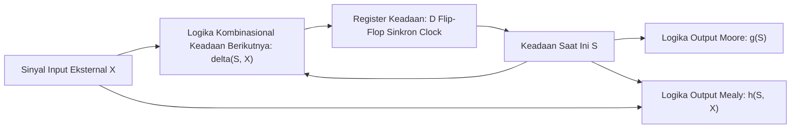

# Modul 057: Mesin Keadaan Hingga (Finite State Machines: Model Moore vs Mealy, Diagram Transisi Keadaan)

**Navigasi**: [⬅️ Master Index](../../INDEX.md) | [Tingkat 4: Tingkat 4: Logika Digital, Computer Engineering & Arsitektur Komputer](./README.md)
*Sebelumnya*: [056. rangkaian-logika-sekuensial-disiplin-clock](./056-rangkaian-logika-sekuensial-disiplin-clock.md) | *Berikutnya*: [058. hardware-description-languages-sintesis-rtl](./058-hardware-description-languages-sintesis-rtl.md)

---

## 1. Intuisi Dasar Tanpa Jargon ("Seperti Bayi Baru Lahir")
Bayangkan sebuah pintu putar otomatis di gerbang stasiun MRT:
- Keadaan awalnya adalah **Terkunci**.
- Jika Anda memasukkan koin atau menempelkan kartu (Input = Kartu), pintu berpindah ke keadaan **Terbuka**.
- Jika Anda mendorong palang pintu (Input = Dorong), pintu berputar dan kembali ke keadaan **Terkunci**.
- Jika saat Terkunci Anda mendorong palang tanpa kartu, pintu tetap Terkunci dan membunyikan alarm!

Pintu putar ini adalah contoh paling sempurna dari **Finite State Machine (FSM / Mesin Keadaan Hingga)**:
Sebuah mesin komputasi yang pada satu waktu HANYA bisa berada di salah satu dari sejumlah keadaan berhingga yang terdefinisi.
Seluruh logika kendali otomatis di dunia—mulai dari lampu lalu lintas jalan raya, mesin cuci cerdas, protokol komunikasi Bluetooth, hingga Unit Kendali (Control Unit) di dalam prosesor Intel yang mengatur siklus Fetch-Decode-Execute—dirancang menggunakan model FSM ini.
[📚 Pelajari: MIT OCW Finite State Machines](https://ocw.mit.edu/courses/6-004-computation-structures-spring-2017/)

## 2. Fondasi Teoretis & Aksiomatik / Matematis
### 57.1 Definisi Formal FSM & Otomata Hingga Deterministik (DFA) ([Sipser Theory of Computation](https://www.cengage.com/))
Mesin Keadaan Hingga didefinisikan secara matematis sebagai 5-tupel:
$$M = \langle S, \Sigma, \Lambda, \delta, \omega \rangle$$
Di mana:
- $S$: Himpunan berhingga keadaan (*states*) $\{s_0, s_1, \dots, s_{n-1}\}$.
- $\Sigma$: Alfabet input berhingga.
- $\Lambda$: Alfabet output berhingga.
- $\delta: S \times \Sigma \to S$: Fungsi transisi keadaan berikutnya (*Next-State Logic*).
- $\omega$: Fungsi output (*Output Logic*).

### 57.2 Model Moore vs Model Mealy ([Wakerly Digital Design](https://www.pearson.com/))
1. **Mesin Moore**:
   Output murni merupakan fungsi dari keadaan saat ini saja:
   $$\omega: S \to \Lambda \implies Y(t) = g(S(t))$$
   - Output sinkron sempurna terhadap clock, kebal terhadap glitch input.
   - Sering membutuhkan lebih banyak jumlah state.
2. **Mesin Mealy**:
   Output merupakan fungsi dari keadaan saat ini DAN input saat ini:
   $$\omega: S \times \Sigma \to \Lambda \implies Y(t) = h(S(t), X(t))$$
   - Respon output instan tanpa menunggu siklus clock berikutnya.
   - Rentan meneruskan glitch dari sinyal input langsung ke output.

### 57.3 Strategi Pengkodean Keadaan (State Encoding) ([Harris & Harris Digital Design and Computer Architecture](https://www.elsevier.com/))
Untuk FSM dengan $N$ keadaan:
- **Pengkodean Biner Minimal**: Menggunakan $k = \lceil \log_2 N \rceil$ flip-flop. Meminimalkan jumlah register memori (sangat ideal untuk ASIC silikon berharga mahal).
- **Pengkodean Gray**: Hanya 1 bit yang berubah pada transisi sekuensial normal, meminimalkan glitch dan disipasi daya pensaklaran dinamis.
- **Pengkodean One-Hot**: Menggunakan tepat $N$ flip-flop (setiap keadaan diwakili oleh 1 bit tunggal yang bernilai '1', misal `0001, 0010, 0100, 1000`). Logika transisi dan dekoding output menjadi sangat sederhana (hanya membutuhkan gerbang OR), sangat ideal untuk arsitektur FPGA yang kaya akan flip-flop.

## 3. Anatomi Teknis & Cara Kerja Internal

Tiga Blok Pembangun FSM Standar HDL (Three-Always Block Paradigm):
1. **Blok 1 (Sequential)**: Register flip-flop sinkron clock yang memperbarui `current_state <= next_state`.
2. **Blok 2 (Combinational)**: Blok evaluasi transisi `next_state` berdasarkan `current_state` dan `inputs`.
3. **Blok 3 (Combinational / Registered)**: Blok penetapan nilai sinyal keluaran `outputs`.

## 4. Implementasi Praktis & Kode / Simulasi Riil
class VendingMachineFSM:
    """
    Simulasi Mesin Keadaan Hingga (FSM Moore) Mesin Penjual Minuman Otomatis (Harga Rp 3.000).
    Koin diterima: Rp 1.000 (K1) dan Rp 2.000 (K2).
    Keadaan: S0 (Rp 0), S1 (Rp 1.000), S2 (Rp 2.000), S3 (Rp 3.000 - Dispense Minuman).
    """
    def __init__(self):
        self.state = "S0"
        
    def step(self, coin_inserted: int) -> tuple[str, bool]:
        # Logika Transisi Keadaan Berikutnya (Next-State Logic)
        if self.state == "S0":
            if coin_inserted == 1000: self.state = "S1"
            elif coin_inserted == 2000: self.state = "S2"
        elif self.state == "S1":
            if coin_inserted == 1000: self.state = "S2"
            elif coin_inserted == 2000: self.state = "S3"
        elif self.state == "S2":
            if coin_inserted in (1000, 2000): self.state = "S3"
        elif self.state == "S3":
            # Otomatis reset ke S0 setelah mengeluarkan minuman
            self.state = "S0"
            
        # Logika Output Moore (Hanya bergantung pada keadaan)
        dispense = (self.state == "S3")
        return self.state, dispense

fsm = VendingMachineFSM()
transactions = [1000, 2000, 0] # Masukkan 1rb, lalu 2rb
for i, coin in enumerate(transactions):
    st, out = fsm.step(coin)
    print(f"Langkah {i+1}: Masuk Rp {coin:4d} | State: {st} | Keluarkan Minuman: {out}")

## 5. Miskonsepsi & Jebakan Industri
1. **Combinational Loops in Mealy FSM**: Menghubungkan output Mealy dari FSM-A langsung ke input FSM-B, dan output Mealy FSM-B kembali ke input FSM-A tanpa pembatas register clock; menciptakan loop umpan balik kombinasional tak stabil yang memicu osilasi liar frekuensi tinggi.
2. **Missing Default State in One-Hot Encoding**: FSM One-Hot yang terdistorsi oleh lonjakan derau listrik partikel kosmik (*Single Event Upset* SEU) hingga bernilai `0000` atau `0011` (dua bit aktif bersamaan); jika tidak ada klausul penanganan `default: next_state = RESET`, FSM akan terkunci mati selamanya (*deadlock*).
3. **Glitches on Asynchronous Moore Outputs**: Mengira output Moore selalu bersih dari derau; jika fungsi output kombinasional memiliki jalur logika yang tidak seimbang, glitch sesaat dapat muncul di antara transisi state sebelum sinyal menetap. Solusi: rekatkan register flip-flop pada output (*Registered Output*).

## 6. Proyek Latihan & Rubrik Penilaian Mandiri
### Tingkat 1 (Pemula) - Rancang FSM Detektor Urutan Biner '1011'
Gambarkan diagram transisi keadaan dan buat tabel keadaan untuk FSM Moore yang mendeteksi urutan pola bit serial '1011' pada aliran data masukan (dengan kemampuan deteksi tumpang tindih / *overlapping detection*).

### Tingkat 2 (Menengah) - Kontroler Lampu Lalu Lintas Simpang 4 Cerdas
Rancang FSM Moore lengkap untuk pengatur lampu lalu lintas perempatan jalan utama dan jalan cabang yang dilengkapi sensor kehadiran mobil: waktu hijau minimal 30 detik untuk jalan utama, transisi kuning 5 detik, dan perpindahan ke jalan cabang hanya jika sensor mendeteksi antrian kendaraan.

### Tingkat 3 (Mahir) - Pengontrol Protokol AXI4-Lite Slave FSM Synthesizable
Tulis modul synthesizable SystemVerilog FSM untuk kontroler memori antarmuka bus AXI4-Lite Slave: kelola handshaking 5 saluran independen (AR, R, AW, W, B) dengan penanganan valid-ready, pastikan tidak terjadi pelanggaran dead-cycle, dan buktikan ketiadaan deadlock formal menggunakan assertion SystemVerilog (`assert property`).

#### Rubrik Penilaian
- **40% Ketepatan Diagram & Tabel Transisi**: Pemetaan keadaan lengkap tanpa adanya kondisi masukan yang tidak terdefinisi.
- **30% Kepatuhan Paradigma HDL**: Memisahkan register state sinkron dengan logika transisi kombinasional secara bersih.
- **30% Keandalan Pemulihan Kesalahan (Safe FSM)**: Menyertakan penanganan state ilegal menuju keadaan reset aman.

## 7. Rekomendasi Sumber Belajar Standar Emas
| Kategori | Judul Sumber & Tautan Langsung | Deskripsi Singkat |
|---|---|---|
| 📖 Buku Teks | [Introduction to the Theory of Computation (Michael Sipser)](https://www.cengage.com/) | Buku teks formal terkemuka mengenai teori otomata berhingga, ekspresi reguler, dan mesin Turing. |
| 🎓 Kuliah Terbuka | [MIT OCW 6.004 Computation Structures: Finite State Machines](https://ocw.mit.edu/courses/6-004-computation-structures-spring-2017/) | Metodologi komprehensif perancangan FSM Moore/Mealy dan sintesis gerbang logika. |
| 🔬 Makalah Seminal | [A Method for Synthesizing Sequential Circuits (Mealy, 1955)](https://doi.org/10.1002/j.1538-7305.1955.tb03788.x) | Makalah George H. Mealy yang pertama kali merumuskan model mesin keadaan sekuensial. |
| 💻 Lab Interaktif | [Finite State Machine Simulator (FSM Designer)](https://madebyevan.com/fsm/) | Alat grafis interaktif berbasis web untuk menggambar dan mengekspor diagram state FSM. |

---
*Navigasi Cepat*: [Ke Tingkat 4](./README.md) | [Ke Master Index](../../INDEX.md) | *Sebelumnya*: [056. rangkaian-logika-sekuensial-disiplin-clock](./056-rangkaian-logika-sekuensial-disiplin-clock.md) | *Berikutnya*: [058. hardware-description-languages-sintesis-rtl](./058-hardware-description-languages-sintesis-rtl.md)
