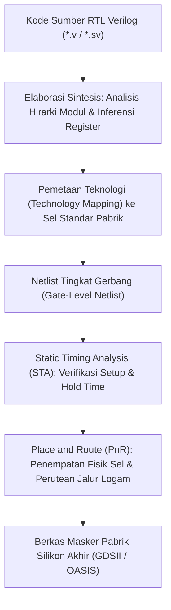

# Modul 058: Hardware Description Languages & Sintesis RTL (Verilog, SystemVerilog, VHDL, Testbench)

**Navigasi**: [⬅️ Master Index](../../INDEX.md) | [Tingkat 4: Tingkat 4: Logika Digital, Computer Engineering & Arsitektur Komputer](./README.md)
*Sebelumnya*: [057. mesin-keadaan-hingga-fsm](./057-mesin-keadaan-hingga-fsm.md) | *Berikutnya*: [059. teknologi-fpga](./059-teknologi-fpga.md)

---

## 1. Intuisi Dasar Tanpa Jargon ("Seperti Bayi Baru Lahir")
Pernahkah Anda membayangkan bagaimana insinyur mendesain chip prosesor modern yang memiliki **50 Miliar Transistor**? Apakah mereka menggambar garis kawat tembaga satu per satu di software grafis seperti orang menggambar rumah? Tentu saja mustahil! Manusia butuh 500 tahun untuk menyelesaikannya!

Insinyur tidak menggambar chip; insinyur **MENULIS KODE CHIP** menggunakan bahasa pemrograman khusus yang disebut **HDL (Hardware Description Language)** seperti **Verilog** atau **VHDL**:
Tetapi waspadalah! Verilog BUKAN bahasa pemrograman perangkat lunak seperti C atau Python:
- Di Python, baris 1 dieksekusi, lalu baris 2, lalu baris 3 (sekuensial lurus).
- Di Verilog, setiap baris kode yang Anda tulis merepresentasikan **perangkat keras fisik nyata (kabel dan gerbang silikon)** yang semuanya dialiri listrik dan bekerja **SECARA PARALEL SIMULTAN PADA DETIK YANG SAMA!**
Software synthesizer kemudian membaca kode teks Anda dan secara otomatis mengubahnya menjadi jaring-jaring miliaran transistor silikon di pabrik wafer.
[📚 Pelajari: Ashenden The Designer's Guide to VHDL / Verilog](https://www.elsevier.com/)

## 2. Fondasi Teoretis & Aksiomatik / Matematis
### 58.1 Tingkat Abstraksi HDL & Sintesis RTL ([IEEE Std 1364 Verilog](https://standards.ieee.org/ieee/1364/3482/))
Tingkat abstraksi perancangan chip:
1. **Behavioral / Algorithmic**: Menjelaskan fungsi algoritma tingkat tinggi tanpa detail struktur hardware.
2. **Register-Transfer Level (RTL)**: Menjelaskan aliran data antara register penyimpanan dan operasi kombinasional pada setiap siklus clock. Ini adalah format standar industri yang dapat disintesis (*synthesizable*).
3. **Gate-Level Netlist**: Jaringan gerbang primitif (AND, OR, Flip-Flop) yang dipetakan ke library sel standar pabrik semikonduktor (*Standard Cell Library*).
4. **Physical Layout (GDSII)**: Geometri masker litografi lapisan difusi, polisilikon, dan logam tembaga 3D.

### 58.2 Operator Blocking (`=`) vs Non-Blocking (`<=`) di Verilog ([Cummings Nonblocking Guidelines](http://www.sunburst-design.com/papers/CummingsSNUG2000SJ_NBA.pdf))
Aturan Emas Cliff Cummings untuk mencegah perlombaan simulasi (*Simulation Race Conditions*):
1. **Operator Blocking (`=`)**:
   Dieksekusi secara sekuensial seketika, memblokir baris berikutnya hingga baris ini selesai.
   **Wajib HANYA digunakan untuk Logika Kombinasional** (`always @(*)`).
2. **Operator Non-Blocking (`<=`)**:
   Seluruh nilai sisi kanan (*RHS*) dievaluasi terlebih dahulu pada tepi clock aktif, lalu seluruh nilai sisi kiri (*LHS*) diperbarui secara simultan pada akhir langkah waktu.
   **Wajib HANYA digunakan untuk Logika Sekuensial Clocked** (`always @(posedge clk)`).
Jika aturan ini dilanggar: register geser (*shift register*) akan gagal terbentuk karena data melompati seluruh tahap dalam 1 siklus clock simulasi.

### 58.3 Verifikasi RTL & Desain Testbench ([Sutherland SystemVerilog for Design](https://link.springer.com/))
Modul Testbench membungkus unit yang sedang diuji (*Device Under Test* DUT):
- Membangkitkan clock buatan (`always #5 clk = ~clk;`).
- Menerapkan stimulus vektor input terotomatisasi.
- Menggunakan pernyataan pengecekan mandiri (*Self-Checking Assertions*) untuk memverifikasi output tanpa perlu memeriksa gelombang waveform secara manual.

## 3. Anatomi Teknis & Cara Kerja Internal

Siklus Kerja Event-Driven Simulator (Model Event Queue IEEE Verilog):
Simulator membagi setiap langkah waktu menjadi wilayah berurutan: Active Region (evaluasi assignment blocking), Inactive Region, Non-blocking Assignment (NBA) Update Region, dan Monitor Region.

## 4. Implementasi Praktis & Kode / Simulasi Riil
// Contoh Modul Synthesizable RTL Verilog: Register Geser Universal 8-Bit
module universal_shift_reg_8bit (
    input  wire       clk,
    input  wire       rst_n,      // Asynchronous Reset Active-Low
    input  wire [1:0] mode,       // 00: Hold, 01: Shift Right, 10: Shift Left, 11: Parallel Load
    input  wire [7:0] data_in,
    input  wire       shift_in,
    output reg  [7:0] q_out
);

    // Selalu gunakan Non-blocking (<=) untuk rangkaian sekuensial clock!
    always @(posedge clk or negedge rst_n) begin
        if (!rst_n) begin
            q_out <= 8'h00;
        end else begin
            case (mode)
                2'b00: q_out <= q_out;                             // Tahan data lama
                2'b01: q_out <= {shift_in, q_out[7:1]};            // Geser ke Kanan
                2'b10: q_out <= {q_out[6:0], shift_in};            // Geser ke Kiri
                2'b11: q_out <= data_in;                           // Muat paralel
                default: q_out <= q_out;
            endcase
        end
    end

endmodule

## 5. Miskonsepsi & Jebakan Industri
1. **Mixing Blocking and Non-Blocking in the Same Always Block**: Mencampuradukkan `=` dan `<=` dalam satu blok sekuensial; memicu perilaku simulasi yang berbeda $100\%$ dengan hasil sintesis chip silikon nyata (*Synthesis-Simulation Mismatch*).
2. **Incomplete Sensitivity List in Combinational Blocks**: Menulis `always @(a or b)` alih-alih `always @(*)` pada SystemVerilog/Verilog; jika variabel masukan `c` lupa dituliskan di daftar sensitivitas, simulator tidak akan memperbarui output saat `c` berubah, sementara rangkaian gerbang fisik tetap merespons.
3. **Using Delays `#delay` in Synthesizable Code**: Menulis waktu tunda `#5 a = b;` di dalam kode modul RTL prosesor; synthesizer perangkat keras akan mengabaikan seluruh penanda `#delay` karena kabel silikon tidak bisa disisipkan penunda waktu artifisial tanpa sel penyangga fisik.

## 6. Proyek Latihan & Rubrik Penilaian Mandiri
### Tingkat 1 (Pemula) - Modul Verilog Counter Biner 8-Bit dengan Testbench Mandiri
Tulis modul RTL Verilog untuk pencacah biner 8-bit sinkron dengan enable dan synchronous clear. Tulis berkas testbench mandiri (*self-checking testbench*) yang memverifikasi bahwa counter membungkus dari 255 ke 0 dan mengeluarkan pesan `$display("PASS")` atau `$fatal("FAIL")`.

### Tingkat 2 (Menengah) - UART Transmitter (TX) Synthesizable RTL
Implementasikan modul pemancar serial UART (*UART Transmitter*) lengkap dalam Verilog: generator baud rate baud generator ($115.200	ext{ bps}$ dari clock sistem $50	ext{ MHz}$), pembingkaian 1 start bit, 8 bit data, dan 1 stop bit, serta sinyal status `tx_busy` dan `tx_done`. Simulasikan menggunakan Icarus Verilog dan visualisasikan bentuk gelombangnya menggunakan GTKWave.

### Tingkat 3 (Mahir) - Pemecah Masalah Pipeline Stall FIFO dengan SystemVerilog Interface
Rancang antarmuka bus data pipeline terproteksi handshaking `valid-ready` (Skid Buffer / Pipeline Register) menggunakan SystemVerilog Interface. Buktikan secara formal bahwa modul mampu memotong jalur waktu kritis (*timing critical path*) tanpa menurunkan throughput pemrosesan (tetap mempertahankan laju 1 transfer per siklus clock saat tidak ada backpressure).

#### Rubrik Penilaian
- **40% Kepatuhan Aturan Non-Blocking**: Disiplin penggunaan operator `<=` pada logika register sinkron dipatuhi $100\%$.
- **30% Sintesis Bersih Tanpa Peringatan**: Modul lolos sintesis Yosys/Vivado tanpa inferensi latch dan tanpa peringatan truncation bit width.
- **30% Kelengkapan Cakupan Testbench**: Testbench menguji kondisi reset, corner case overflow, dan assertions fungsional.

## 7. Rekomendasi Sumber Belajar Standar Emas
| Kategori | Judul Sumber & Tautan Langsung | Deskripsi Singkat |
|---|---|---|
| 📖 Buku Teks | [Verilog HDL: A Guide to Digital Design and Synthesis (Samir Palnitkar)](https://www.pearson.com/) | Buku panduan industri standar internasional untuk sintesis dan pemodelan Verilog. |
| 🎓 Kuliah Terbuka | [MIT OCW 6.111 Introductory Digital Systems Laboratory](https://ocw.mit.edu/courses/6-111-introductory-digital-systems-laboratory-spring-2006/) | Laboratorium desain digital lanjutan MIT berbasis Verilog, FPGA, dan pemrosesan video. |
| 🔬 Makalah Seminal | [Correct Methods For Adding Delays To Verilog Behavioral Models (Cummings, 1999)](http://www.sunburst-design.com/papers/) | Panduan legendaris Cliff Cummings mengenai pencegahan race condition dalam simulasi RTL. |
| 💻 Lab Interaktif | [EDA Playground: Verilog & SystemVerilog Online IDE](https://www.edaplayground.com/) | Lingkungan kompilasi dan simulasi Verilog gratis langsung di web browser. |

---
*Navigasi Cepat*: [Ke Tingkat 4](./README.md) | [Ke Master Index](../../INDEX.md) | *Sebelumnya*: [057. mesin-keadaan-hingga-fsm](./057-mesin-keadaan-hingga-fsm.md) | *Berikutnya*: [059. teknologi-fpga](./059-teknologi-fpga.md)
