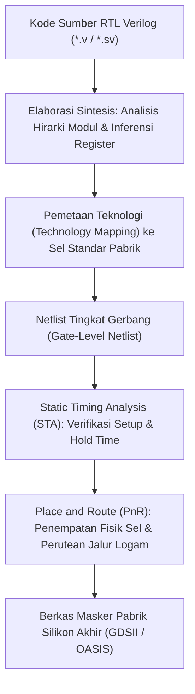

# Modul 058: Hardware Description Languages & Sintesis RTL (Verilog, SystemVerilog, VHDL, Testbench)

**Navigasi**: [⬅️ Master Index](../../INDEX.md) | [Tingkat 4: Tingkat 4: Logika Digital, Computer Engineering & Arsitektur Komputer](./README.md)
*Sebelumnya*: [057. mesin-keadaan-hingga-fsm](./057-mesin-keadaan-hingga-fsm.md) | *Berikutnya*: [059. teknologi-fpga](./059-teknologi-fpga.md)

---

## 1. Intuisi Dasar Tanpa Jargon ("Seperti Bayi Baru Lahir")
### 1.1 Konsep Inti & Analogi Tanpa Jargon
Pernahkah Anda membayangkan bagaimana insinyur mendesain chip prosesor modern yang memiliki **50 Miliar Transistor**? Apakah mereka menggambar garis kawat tembaga satu per satu di software grafis seperti orang menggambar rumah? Tentu saja mustahil! Manusia butuh 500 tahun untuk menyelesaikannya!

### 1.2 Urgensi Rekayasa & Signifikansi Sistemik
Insinyur tidak menggambar chip; insinyur **MENULIS KODE CHIP** menggunakan bahasa pemrograman khusus yang disebut **HDL (Hardware Description Language)** seperti **Verilog** atau **VHDL**:
Tetapi waspadalah! Verilog BUKAN bahasa pemrograman perangkat lunak seperti C atau Python:
- Di Python, baris 1 dieksekusi, lalu baris 2, lalu baris 3 (sekuensial lurus).
- Di Verilog, setiap baris kode yang Anda tulis merepresentasikan **perangkat keras fisik nyata (kabel dan gerbang silikon)** yang semuanya dialiri listrik dan bekerja **SECARA PARALEL SIMULTAN PADA DETIK YANG SAMA!**
Software synthesizer kemudian membaca kode teks Anda dan secara otomatis mengubahnya menjadi jaring-jaring miliaran transistor silikon di pabrik wafer.
[📚 Pelajari: Ashenden The Designer's Guide to VHDL / Verilog](https://www.elsevier.com/)

## 2. Fondasi Teoretis & Aksiomatik / Matematis
### 2.1 Kerangka Teori Aksiomatik & Formulasi Matematis
### 58.1 Tingkat Abstraksi HDL & Sintesis RTL ([IEEE Std 1364 Verilog](https://standards.ieee.org/ieee/1364/3482/))
Tingkat abstraksi perancangan chip:
1. **Behavioral / Algorithmic**: Menjelaskan fungsi algoritma tingkat tinggi tanpa detail struktur hardware.
2. **Register-Transfer Level (RTL)**: Menjelaskan aliran data antara register penyimpanan dan operasi kombinasional pada setiap siklus clock. Ini adalah format standar industri yang dapat disintesis (*synthesizable*).
3. **Gate-Level Netlist**: Jaringan gerbang primitif (AND, OR, Flip-Flop) yang dipetakan ke library sel standar pabrik semikonduktor (*Standard Cell Library*).
4. **Physical Layout (GDSII)**: Geometri masker litografi lapisan difusi, polisilikon, dan logam tembaga 3D.

### 2.2 Penurunan Matematis Langkah-demi-Langkah
### 58.2 Operator Blocking (`=`) vs Non-Blocking (`<=`) di Verilog ([Cummings Nonblocking Guidelines](http://www.sunburst-design.com/papers/CummingsSNUG2000SJ_NBA.pdf))
Aturan Emas Cliff Cummings untuk mencegah perlombaan simulasi (*Simulation Race Conditions*):
1. **Operator Blocking (`=`)**:
   Dieksekusi secara sekuensial seketika, memblokir baris berikutnya hingga baris ini selesai.
   **Wajib HANYA digunakan untuk Logika Kombinasional** (`always @(*)`).
2. **Operator Non-Blocking (`<=`)**:
   Seluruh nilai sisi kanan (*RHS*) dievaluasi terlebih dahulu pada tepi clock aktif, lalu seluruh nilai sisi kiri (*LHS*) diperbarui secara simultan pada akhir langkah waktu.
   **Wajib HANYA digunakan untuk Logika Sekuensial Clocked** (`always @(posedge clk)`).
Jika aturan ini dilanggar: register geser (*shift register*) akan gagal terbentuk karena data melompati seluruh tahap dalam 1 siklus clock simulasi.

### 58.3 Verifikasi RTL & Desain Testbench ([Sutherland SystemVerilog for Design](https://link.springer.com/))
Modul Testbench membungkus unit yang sedang diuji (*Device Under Test* DUT):
- Membangkitkan clock buatan (`always #5 clk = ~clk;`).
- Menerapkan stimulus vektor input terotomatisasi.
- Menggunakan pernyataan pengecekan mandiri (*Self-Checking Assertions*) untuk memverifikasi output tanpa perlu memeriksa gelombang waveform secara manual.

## 3. Anatomi Teknis & Cara Kerja Internal

Siklus Kerja Event-Driven Simulator (Model Event Queue IEEE Verilog):
Simulator membagi setiap langkah waktu menjadi wilayah berurutan: Active Region (evaluasi assignment blocking), Inactive Region, Non-blocking Assignment (NBA) Update Region, dan Monitor Region.

#### Tabel Penelusuran Inferensi Kait Transparan Tak Disengaja (Inadvertent Latch Inference) pada RTL
| Sinyal Masukan ($Sel$) | Kondisi Pernyataan `if-else` | Penugasan Sinyal Output ($Y$) | Keputusan Kompilator Sintesis RTL | Struktur Perangkat Keras Fisik yang Disintesis | Dampak Integritas Timing & Pengujian |
|---|---|---|---|---|---|
| $Sel = 0$ | Cabang `if (Sel == 0)` terpenuhi | $Y = Data\_A$ | Penugasan eksplisit | Gerbang multiplexer standar | Jalur kombinasi normal |
| $Sel = 1$ | Cabang `else if (Sel == 1)` terpenuhi | $Y = Data\_B$ | Penugasan eksplisit | Gerbang multiplexer standar | Jalur kombinasi normal |
| $Sel = 2$ | Tidak ada cabang yang cocok! | Nilai $Y$ tidak dispesifikasikan! | Kompilator berasumsi: "Nilai $Y$ harus dipertahankan!" | Disintesis menjadi Transparent D-Latch Fisik! | Komponen memori asinkron tak diinginkan tercipta! |
| $Sel = 3$ | Masukan terlarang | Nilai $Y$ tidak berubah | Latch menahan tegangan pada gerbang | Latch transparan fisik aktif saat Enable High | Jalur rentan terhadap glitch dan dering timing |
| Analisis Timing ASIC | Tool STA mengevaluasi jalur | Latch memiliki penundaan time-borrowing | Penutupan timing ASIC gagal | Boros area silikon & daya statis tinggi | Testability fault coverage ATPG ambruk |

## 4. Implementasi Praktis & Kode / Simulasi Riil
```verilog
// Contoh Modul Synthesizable RTL Verilog: Register Geser Universal 8-Bit
module universal_shift_reg_8bit (
    input  wire       clk,
    input  wire       rst_n,      // Asynchronous Reset Active-Low
    input  wire [1:0] mode,       // 00: Hold, 01: Shift Right, 10: Shift Left, 11: Parallel Load
    input  wire [7:0] data_in,
    input  wire       shift_in,
    output reg  [7:0] q_out
);

    // Selalu gunakan Non-blocking (<=) untuk rangkaian sekuensial clock!
    always @(posedge clk or negedge rst_n) begin
        if (!rst_n) begin
            q_out <= 8'h00;
        end else begin
            case (mode)
                2'b00: q_out <= q_out;                             // Tahan data lama
                2'b01: q_out <= {shift_in, q_out[7:1]};            // Geser ke Kanan
                2'b10: q_out <= {q_out[6:0], shift_in};            // Geser ke Kiri
                2'b11: q_out <= data_in;                           // Muat paralel
                default: q_out <= q_out;
            endcase
        end
    end

endmodule
```

## 5. Miskonsepsi & Jebakan Industri
1. **Mixing Blocking and Non-Blocking in the Same Always Block**: Mencampuradukkan `=` dan `<=` dalam satu blok sekuensial; memicu perilaku simulasi yang berbeda \$100\%$ dengan hasil sintesis chip silikon nyata (*Synthesis-Simulation Mismatch*).
2. **Incomplete Sensitivity List in Combinational Blocks**: Menulis `always @(a or b)` alih-alih `always @(*)` pada SystemVerilog/Verilog; jika variabel masukan `c` lupa dituliskan di daftar sensitivitas, simulator tidak akan memperbarui output saat `c` berubah, sementara rangkaian gerbang fisik tetap merespons.
3. **Using Delays `#delay` in Synthesizable Code**: Menulis waktu tunda `#5 a = b;` di dalam kode modul RTL prosesor; synthesizer perangkat keras akan mengabaikan seluruh penanda `#delay` karena kabel silikon tidak bisa disisipkan penunda waktu artifisial tanpa sel penyangga fisik.

### Studi Kasus Kegagalan Nyata: Terbentuknya Kait Transparan Tak Disengaja (Inadvertent Latch Inference) pada Blok RTL
- **Insiden Kegagalan Timing Tape-Out FPGA/ASIC**: Pada desain chip pengendali memori berkecepatan tinggi, perangkat lunak sintesis logika melaporkan puluhan peringatan (*warnings*) yang diabaikan oleh pengembang junior: `Latch inferred for signal 'cmd_decode'`. Ketika desain dimuat ke dalam chip silikon fisik, chip mengalami kegagalan fungsi intermittent acak yang sangat peka terhadap perubahan suhu ruang.
- **Akar Masalah Hardware Description Language (HDL) & Logika Inkomplit**: Dalam bahasa Verilog/VHDL, blok kombinasi `always @(*)` dimaksudkan untuk menyintesis rangkaian kombinasional murni (gerbang AND/OR/MUX) tanpa elemen memori. Namun, sesuai semantik standar bahasa HDL, jika sebuah variabel tidak diberikan nilai penugasan pada setiap kemungkinan percabangan jalur eksekusi (`if-else` tanpa `else`, atau pernyataan `case` tanpa seluruh kemungkinan nilai input terpetakan), kompilator sintesis perangkat lunak terpaksa mengasumsikan bahwa rangkaian harus mempertahankan nilai variabel sebelumnya (*hold previous value*). Satu-satunya cara perangkat keras silikon dapat menahan nilai tanpa adanya sinyal clock sinkron adalah dengan menyintesis gerbang fisik kait transparan (*transparent D-latch*). Kait transparan ini bersifat peka level (*level-sensitive*), meloloskan derau glitch masukan secara langsung saat enable aktif, memicu loop balapan timing (*timing race conditions*), dan menggagalkan analisis timing statis (STA) serta pengujian otomatis manufaktur (ATPG scan testing).

- **Potongan Kode / Arsitektur Cacat (Vulnerable Implementation)**:
```verilog
// Contoh Buruk vs Contoh Bersih Penulisan Kombinasional RTL
module decoder_latch_bad (
    input  wire [1:0] sel,
    input  wire       data_in,
    output reg        out_bad,
    output reg        out_clean
);
    // POLA CACAT: Tidak ada cabang penutup 'else' atau default
    // Kompilator menyintesis Transparent Latch fisik untuk out_bad!
    always @(*) begin
        if (sel == 2'b00)
            out_bad = data_in;
        else if (sel == 2'b01)
            out_bad = ~data_in;
        // Jika sel == 2'b10 atau 2'b11, out_bad mempertahankan nilai lama -> LATCH INFERRED!
    end

    // POLA BERSIH: Seluruh cabang terpetakan, atau gunakan inisialisasi default awal
    always @(*) begin
        out_clean = 1'b0; // Default assignment menjamin variabel selalu memiliki nilai!
        case (sel)
            2'b00:   out_clean = data_in;
            2'b01:   out_clean = ~data_in;
            default: out_clean = 1'b0; // Rangkaian disintesis murni sebagai multiplexer gerbang!
        endcase
    end
endmodule
```

- **Aturan Linting RTL & Nol Toleransi Latch**: Standar desain industri semikonduktor (seperti aturan SpyGlass RTL Linting) menetapkan peringatan inferensi latch sebagai *Fatal Error*. Praktik terbaik yang wajib diterapkan adalah memberikan nilai bawaan default (*default assignment*) pada baris paling awal dari setiap blok kombinasi `always @(*)`, atau menggunakan konstruk SystemVerilog modern `always_comb` yang secara otomatis membangkitkan galat kompilasi (*compile error*) jika ada struktur latch yang terbentuk.

## 6. Proyek Latihan & Rubrik Penilaian Mandiri
### Tingkat 1 (Pemula) - Modul Verilog Counter Biner 8-Bit dengan Testbench Mandiri
Tulis modul RTL Verilog untuk pencacah biner 8-bit sinkron dengan enable dan synchronous clear. Tulis berkas testbench mandiri (*self-checking testbench*) yang memverifikasi bahwa counter membungkus dari 255 ke 0 dan mengeluarkan pesan `$display("PASS")` atau `$fatal("FAIL")`.

### Tingkat 2 (Menengah) - UART Transmitter (TX) Synthesizable RTL
Implementasikan modul pemancar serial UART (*UART Transmitter*) lengkap dalam Verilog: generator baud rate baud generator (\$115.200	ext{ bps}$ dari clock sistem \$50	ext{ MHz}$), pembingkaian 1 start bit, 8 bit data, dan 1 stop bit, serta sinyal status `tx_busy` dan `tx_done`. Simulasikan menggunakan Icarus Verilog dan visualisasikan bentuk gelombangnya menggunakan GTKWave.

### Tingkat 3 (Mahir) - Pemecah Masalah Pipeline Stall FIFO dengan SystemVerilog Interface
Rancang antarmuka bus data pipeline terproteksi handshaking `valid-ready` (Skid Buffer / Pipeline Register) menggunakan SystemVerilog Interface. Buktikan secara formal bahwa modul mampu memotong jalur waktu kritis (*timing critical path*) tanpa menurunkan throughput pemrosesan (tetap mempertahankan laju 1 transfer per siklus clock saat tidak ada backpressure).

#### Rubrik Penilaian
- **40% Kepatuhan Aturan Non-Blocking**: Disiplin penggunaan operator `<=` pada logika register sinkron dipatuhi \$100\%$.
- **30% Sintesis Bersih Tanpa Peringatan**: Modul lolos sintesis Yosys/Vivado tanpa inferensi latch dan tanpa peringatan truncation bit width.
- **30% Kelengkapan Cakupan Testbench**: Testbench menguji kondisi reset, corner case overflow, dan assertions fungsional.

### Tingkat 1: Dasar
- **Tugas**: Bangun modul multiplexer 4-ke-1 kombinasional dalam Verilog menggunakan pernyataan `case` dengan penanganan lengkap seluruh kondisi, buktikan bahwa tidak ada latch yang disintesis.
- **Petunjuk Perancangan Arsitektur**:
  - Petakan selector 2-bit `sel` ke 4 input data $D_0, D_1, D_2, D_3$.
  - Tambahkan klausul `default: out = 1'b0;` untuk kepatuhan ketat standar linting.
- **Test Vector & Kasus Uji Ekstrem**:
  - *Evaluasi Seluruh Input*: Uji seluruh kombinasi `sel` dari `00` hingga `11`; verifikasi output mengikuti input terpilih tepat.
  - *Inspeksi Netlist Sintesis*: Pastikan netlist hanya menggunakan sel kombinasional MUX/AOI tanpa elemen level-sensitive latch.
- **Rubrik Penilaian Mandiri**: 40% Sintaks Verilog Kombinasional Bebas Latch Presisi, 30% Kepatuhan Aturan Default Assignment, 30% Verifikasi Seluruh Vektor Kasus Uji.

### Tingkat 2: Menengah
- **Tugas**: Bangun linter statis skrip Python parser AST sederhana untuk kode sumber Verilog yang mendeteksi inferensi latch pada blok `always @(*)` dengan memeriksa apakah semua variabel target yang ditulis memiliki jalur penugasan di setiap cabang percabangan `if-else` pohon sintaks.
- **Petunjuk Perancangan Arsitektur**:
  - Bangun graf kontrol aliran (Control Flow Graph / CFG) dari blok `always`.
  - Verifikasi bahwa setiap lintasan dari entri ke keluar melewati setidaknya satu pernyataan penugasan untuk setiap variabel yang dimodifikasi.
- **Test Vector & Kasus Uji Ekstrem**:
  - *Deteksi Missing Else*: Berikan kode `if (A) Y = B;` tanpa `else`; linter harus membangkitkan peringatan error latch pada variabel $Y$.
  - *Penugasan Default Awal*: Berikan kode dengan inisialisasi awal `Y = 0; if (A) Y = B;`; linter harus mengonfirmasi kode 100% bersih.
- **Rubrik Penilaian Mandiri**: 40% Analisis Jalur Kontrol Aliran CFG Verilog Tepat, 30% Deteksi Akurat Kondisi Latch Tanpa False Positive, 30% Penanganan Variabel Multi-Target.

### Tingkat 3: Mahir
- **Tugas**: Rancang ALU 32-bit parametrik synthesizable dalam SystemVerilog (`always_comb` dan `always_ff`) yang mendukung 16 operasi aritmatika dan logika lengkap (ADD, SUB, AND, OR, XOR, SLL, SRL, SRA, SLT, SLTU), buktikan kebersihan sintesis menggunakan Yosys open-source synthesis tool, dan verifikasi zero latch inference melalui assertion formal `assert property`.
- **Petunjuk Perancangan Arsitektur**:
  - Gunakan penugasan default di awal blok `always_comb`.
  - Tulis assertion formal SVA (SystemVerilog Assertions) untuk memastikan bahwa output ALU tidak pernah bernilai `X` (undefined) ketika input operasional valid.
- **Test Vector & Kasus Uji Ekstrem**:
  - *Yosys Netlist Inspection*: Jalankan perintah sintesis Yosys; verifikasi bahwa jumlah sel `$_DLATCH_*` tepat bernilai nol.
  - *Shift Negatif Ekstrem*: Uji operasi pergeseran aritmatika kanan (SRA) pada bilangan negatif bertanda; verifikasi penyalinan bit tanda MSB.
- **Rubrik Penilaian Mandiri**: 40% Arsitektur ALU 32-Bit SystemVerilog Lengkap Presisi, 30% Verifikasi Bersih Bebas Latch pada Yosys Synthesis Tool, 30% Assertion Formal Ketiadaan Nilai X.

## 7. Rekomendasi Sumber Belajar Standar Emas
| Kategori | Judul Sumber & Tautan Langsung | Deskripsi Singkat |
|---|---|---|
| 📖 Buku Teks | [Verilog HDL: A Guide to Digital Design and Synthesis (Samir Palnitkar)](https://www.pearson.com/) | Buku panduan industri standar internasional untuk sintesis dan pemodelan Verilog. |
| 🎓 Kuliah Terbuka | [MIT OCW 6.111 Introductory Digital Systems Laboratory](https://ocw.mit.edu/courses/6-111-introductory-digital-systems-laboratory-spring-2006/) | Laboratorium desain digital lanjutan MIT berbasis Verilog, FPGA, dan pemrosesan video. |
| 🔬 Makalah Seminal | [Correct Methods For Adding Delays To Verilog Behavioral Models (Cummings, 1999)](http://www.sunburst-design.com/papers/) | Panduan legendaris Cliff Cummings mengenai pencegahan race condition dalam simulasi RTL. |
| 💻 Lab Interaktif | [EDA Playground: Verilog & SystemVerilog Online IDE](https://www.edaplayground.com/) | Lingkungan kompilasi dan simulasi Verilog gratis langsung di web browser. |

---
*Navigasi Cepat*: [Ke Tingkat 4](./README.md) | [Ke Master Index](../../INDEX.md) | *Sebelumnya*: [057. mesin-keadaan-hingga-fsm](./057-mesin-keadaan-hingga-fsm.md) | *Berikutnya*: [059. teknologi-fpga](./059-teknologi-fpga.md)
