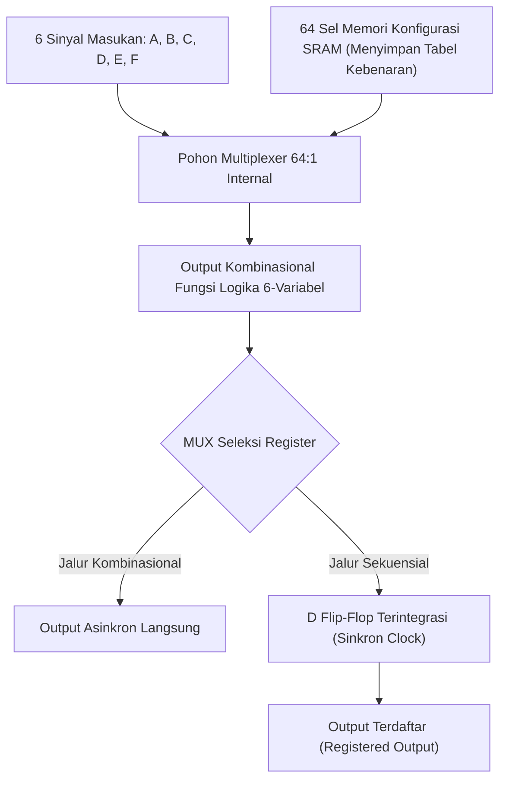

# Modul 059: Teknologi FPGA (Field-Programmable Gate Array: Arsitektur LUT, Block RAM, DSP Slices, Timing Closure)

**Navigasi**: [⬅️ Master Index](../../INDEX.md) | [Tingkat 4: Tingkat 4: Logika Digital, Computer Engineering & Arsitektur Komputer](./README.md)
*Sebelumnya*: [058. hardware-description-languages-sintesis-rtl](./058-hardware-description-languages-sintesis-rtl.md) | *Berikutnya*: [060. organisasi-memori-fisik-perangkat-keras](./060-organisasi-memori-fisik-perangkat-keras.md)

---

## 1. Intuisi Dasar Tanpa Jargon ("Seperti Bayi Baru Lahir")
### 1.1 Konsep Inti & Analogi Tanpa Jargon
Bayangkan jika setiap kali Anda ingin memperbaiki bug pada software smartphone Anda, Anda harus membongkar ponsel Anda, mencairkan chip prosesornya di dalam pabrik suhu ribuan derajat, dan mencetaknya ulang selama 3 bulan dengan biaya ratusan miliar rupiah!

### 1.2 Urgensi Rekayasa & Signifikansi Sistemik
Tentu itu gila. Namun itulah yang terjadi pada chip silikon kaku (**ASIC**): fungsinya terukir permanen di atas batu silikon dan tidak pernah bisa diubah seumur hidup.

Lalu hadirlah keajaiban teknologi **FPGA (Field-Programmable Gate Array)**:
FPGA adalah **kain silikon bunglon yang dapat diprogram ulang sesuka hati Anda**:
- Di dalamnya terdapat jutaan sel logika fleksibel mini (**Look-Up Table / LUT**) dan jutaan saklar kabel listrik yang dapat diputus-sambungkan lewat perangkat lunak.
- Pagi ini Anda bisa memprogram FPGA Anda menjadi chip grafis pemutar video 4K; sore ini Anda bisa mengunggah kode baru dan mengubah chip yang sama persis menjadi otak prosesor satelit antariksa atau akselerator kecerdasan buatan (AI) tanpa mengubah satu pun kabel fisik di atas meja Anda!
[📚 Pelajari: AMD Xilinx FPGA Architecture Basics](https://www.xilinx.com/products/silicon-devices/fpga/what-is-an-fpga.html)

## 2. Fondasi Teoretis & Aksiomatik / Matematis
### 2.1 Kerangka Teori Aksiomatik & Formulasi Matematis
### 59.1 Arsitektur Internal Sel Logika FPGA: LUT, Flip-Flop & Carry Chain ([Kuon & Rose FPGA Architecture](https://doi.org/10.1561/1000000005))
Blok Logika Terkonfigurasi (*Configurable Logic Block* CLB / Logic Slice):
1. **Look-Up Table (LUT)**:
   Sebuah memori SRAM berkecepatan tinggi yang menyimpan tabel kebenaran fungsi Boolean.
   LUT berukuran $K$-input (standar modern: 6-LUT) memiliki $2^K = 64$ sel bit memori SRAM dan sebuah MUX \$64 \to 1$. Sembarang fungsi logika kombinasional dengan $\le 6$ variabel dapat diwujudkan dalam 1 LUT tunggal dengan delay konstan tanpa memerlukan gerbang diskrit!
2. **Flip-Flop Terintegrasi**: Setiap LUT dipasangkan dengan 1 atau 2 D Flip-Flop yang dapat dikonfigurasi sebagai register sinkron atau di-bypass untuk jalur kombinasional murni.
3. **Hardened Carry Chains**: Jalur logika pembawa carry kecepatan tinggi berdedikasi (*dedicated carry logic*) yang memungkinkan sirkuit penjumlah beroperasi pada frekuensi ratusan MHz tanpa membuang sumber daya routing umum.

### 2.2 Penurunan Matematis Langkah-demi-Langkah
### 59.2 Sumber Daya Keras Khusus (Hard IP Blocks) ([Betz Architecture and CAD for Deep-Submicron FPGAs](https://link.springer.com/))
Untuk mengimbangi inefisiensi area silikon dibandingkan chip ASIC khusus (\$10\text{x}$ lebih luas), FPGA modern mengintegrasikan blok fungsional keras (*Hard IP*):
- **Block RAM (BRAM)**: Blok memori dual-port SRAM terdedikasi (tipikal 18 Kb atau 36 Kb per blok) untuk buffer FIFO dan memori instruksi CPU.
- **DSP Slices (DSP48E)**: Unit pengali-akumulator perangkat keras (*Multiply-Accumulate* MAC \$25 \times 18\text{ bit}$) terintegrasi berkecepatan $> 500\text{ MHz}$ untuk pemrosesan sinyal digital dan akselerator inferensi AI.
- **Gigabit Transceiver (SerDes)**: Jalur komunikasi serial fisik berkecepatan ekstrem ($1\text{ Gbps} - 112\text{ Gbps}$) untuk antarmuka PCIe, Ethernet 100G, dan DDR4.

### 59.3 Alur Toolchain CAD FPGA: Sintesis, PnR & Penutupan Waktu (Timing Closure) ([De Micheli Synthesis of Digital Circuits](https://www.mheducation.com/))
1. **Sintesis Logika**: Menerjemahkan kode Verilog RTL menjadi jaringan elemen primitif FPGA (LUT, MUX, Flip-Flop).
2. **Packing**: Mengelompokkan LUT dan Flip-Flop terkait ke dalam blok CLB fisik yang sama.
3. **Placement**: Menentukan lokasi fisik koordinat koordinat $(X, Y)$ setiap blok CLB di atas grid wafer FPGA silikon.
4. **Routing**: Menghubungkan jalur kawat logam fleksibel saklar persimpangan matriks (*Switch Matrix*) antar blok CLB.
5. **Static Timing Analysis (STA) & Timing Closure**: Memeriksa seluruh jalur register-ke-register apakah memenuhi batas setup time ($Slack \ge 0$). Jika slack negatif ($Slack < 0$), kompilasi gagal dan desainer harus melakukan optimasi perpipaan (*pipelining*) atau menyempurnakan batasan penempatan (*floorplanning*).

## 3. Anatomi Teknis & Cara Kerja Internal

Mekanisme Bitstream Konfigurasi:
FPGA berbasis SRAM bersifat volatil: saat daya listrik dimatikan, seluruh konfigurasi LUT lenyap. Saat booting dinyalakan, prosesor atau chip SPI Flash eksternal mengirimkan berkas bitstream biner terenkripsi (*bitstream file*) untuk mengisi kembali seluruh sel memori SRAM konfigurasi dalam hitungan milidetik.

#### Tabel Penelusuran Kontensi Bus Internal FPGA & Pelelehan Jalur Silikon Interkoneksi
| Siklus Jam ($Clk$) | Status Driver Buffer Tri-State 1 | Sinyal Data Driver 1 ($D_1$) | Status Driver Buffer Tri-State 2 | Sinyal Data Driver 2 ($D_2$) | Arus Kontensi Sambungan Bus Silikon ($I_{bus}$) |
|---|---|---|---|---|---|
| Siklus 0 (Normal) | ENABLE ($OE_1 = 1$) | Mengirim Logika HIGH ($3.3\text{ V}$) | DISABLED ($OE_2 = 0$) | Status impedansi tinggi (High-Z) | $0.0\text{ mA}$ (Operasi bus normal) |
| Siklus 1 (Transisi) | DISABLED ($OE_1 = 0$) | High-Z | ENABLE ($OE_2 = 1$) | Mengirim Logika LOW ($0.0\text{ V}$) | $0.0\text{ mA}$ (Transisi aman) |
| Siklus 2 (Cacat Logika)| ENABLE ($OE_1 = 1$) | Mengirim Logika HIGH ($3.3\text{ V}$) | ENABLE ($OE_2 = 1$) | Mengirim Logika LOW ($0.0\text{ V}$) | KEDUA DRIVER AKTIF DENGAN TEGANGAN BERLAWANAN!|
| Hubungan Singkat Silikon| Transistor PMOS menyala penuh | Resistansi internal $R_{on} \approx 20\ \Omega$ | Transistor NMOS menyala penuh | Resistansi internal $R_{on} \approx 20\ \Omega$ | Arus korsleting langsung: $I = \frac{3.3}{40} = 82.5\text{ mA}$! |
| Kaskade Termal Bus Lebar| 32 jalur bus kontensi serempak | Arus total bus: $32 \times 82.5\text{ mA} = 2.64\text{ A}$ | Panas disipasi lokal $> 8.7\text{ W}$ | Suhu logam interconnect tembus $250^\circ\text{C}$| Jalur metallisasi aluminium FPGA meleleh terputus |

## 4. Implementasi Praktis & Kode / Simulasi Riil
```python
def simulate_4lut_logic(truth_table_hex: int, inputs: tuple[int, int, int, int]) -> int:
    """
    Simulasi cara kerja Look-Up Table 4-Input (4-LUT) pada FPGA.
    truth_table_hex: Nilai 16-bit konfigurasi SRAM yang diturunkan dari sintesis logika.
    inputs: Tuple (in3, in2, in1, in0) bit biner masukan.
    """
    # Hitung indeks alamat memori SRAM (0 s/d 15)
    in0, in1, in2, in3 = inputs
    address_index = (in3 << 3) | (in2 << 2) | (in1 << 1) | in0
    
    # Ambil bit data yang tersimpan pada alamat memori tersebut
    output_bit = (truth_table_hex >> address_index) & 1
    return output_bit

# Konfigurasi 4-LUT untuk fungsi XOR 2-masukan pada input in0 dan in1 (in2 dan in3 diabaikan):
# Pola output untuk in1, in0: 00->0, 01->1, 10->1, 11->0  => Hex: 0x6666
lut_config_xor = 0x6666

print("Uji 4-LUT Terkonfigurasi Fungsi XOR:")
for a in (0, 1):
    for b in (0, 1):
        out = simulate_4lut_logic(lut_config_xor, (0, 0, a, b))
        print(f"Input ({a}, {b}) => Output LUT: {out} (Verifikasi XOR: {a ^ b})")
```

## 5. Miskonsepsi & Jebakan Industri
1. **Clock Domain Crossing without Dedicated Hardened Crossbars**: Mengirimkan bus data multi-bit antar domain clock yang berbeda di dalam FPGA tanpa FIFO asinkron; delay routing kawat internal FPGA yang sedikit berbeda menyebabkan bit-bit data tiba pada siklus clock yang tidak sinkron (*skewed arrival data corruption*).
2. **High Fan-Out Net Congestion**: Menggunakan satu sinyal kontrol kombinasional internal untuk mengendalikan puluhan ribu register tanpa buffer replikasi (*fan-out tree*); perutean kawat menjadi macet (*routing congestion*) dan memicu kegagalan penutupan waktu setup time.
3. **Inferring Distributed RAM when Block RAM is Needed**: Mendeklarasikan array memori besar di Verilog dengan gaya yang tidak cocok dengan template BRAM pabrikan (misal: read asinkron tanpa register clock); synthesizer terpaksa merangkai ribuan LUT untuk membentuk memori (*Distributed RAM*), menghabiskan seluruh area logika FPGA.

### Studi Kasus Kegagalan Nyata: Kontensi Bus Internal pada Tri-State Buffer FPGA Melelehkan Jalur Metallisasi Silikon
- **Insiden Kegagalan Perangkat Keras FPGA**: Pada pengujian kartu akselerator PCIe berbasis FPGA Xilinx Virtex, chip FPGA mengalami lonjakan arus catu daya 3,3V yang sangat masif sesaat setelah bitstream konfigurasi dimuat. Suhu permukaan chip melonjak melewati 120°C dalam waktu lima detik dan chip mati permanen dengan resistansi catu daya turun menjadi nol (korsleting internal permanen).
- **Akar Masalah Arsitektur FPGA & Kontensi Bus Tri-State**: Pada chip ASIC tradisional, bus data bersama sering kali dibangun menggunakan buffer tiga keadaan (*tri-state buffers* dengan status impedansi tinggi High-Z). Namun, struktur internal FPGA modern terdiri dari jutaan blok logika terkonfigurasi (CLB) yang saling terhubung melalui matriks saklar perutean statis (*routing switch matrices*), bukan kabel fisik tri-state riil. Ketika perancang memigrasikan kode RTL lama yang menggunakan buffer tri-state internal (`assign bus = (en1) ? data1 : 1'bz; assign bus = (en2) ? data2 : 1'bz;`), kesalahan logika kontrol mengaktifkan kedua sinyal pemungkin (*enable*) secara bersamaan. Driver pertama menarik saluran ke $V_{DD}$ (logika 1), sementara driver kedua menarik saluran ke GND (logika 0). Struktur fisik FPGA mengemulasikan ini dengan dua pasang transistor output yang saling bertolak belakang. Arus hubungan singkat masif (*bus contention current*) mengalir langsung dari rel daya ke ground melintasi saluran perutean silikon yang sangat tipis, membakar transistor saklar perutean FPGA dan melelehkan jalur logam interkoneksi silikon secara ireversibel.

- **Potongan Kode / Arsitektur Cacat (Vulnerable Implementation)**:
```verilog
// Contoh Buruk Bus Tri-State Internal FPGA vs Solusi Multiplexer Modern
module fpga_bus_bad (
    input  wire       en1, en2,
    input  wire [7:0] data1, data2,
    output wire [7:0] bus_internal_bad,
    output wire [7:0] bus_internal_safe
);
    // POLA BERBAHAYA DI FPGA: Bus Tri-State Internal
    // Jika en1 == 1 dan en2 == 1, terjadi kontensi perangkat keras internal!
    assign bus_internal_bad = en1 ? data1 : 8'bzzzz_zzzz;
    assign bus_internal_bad = en2 ? data2 : 8'bzzzz_zzzz;

    // POLA AMAN: Sepenuhnya digantikan oleh Multiplexer MUX
    // Tidak pernah terjadi kontensi fisik; disintesis ke Look-Up Table (LUT)
    assign bus_internal_safe = en1 ? data1 :
                               en2 ? data2 : 8'h00;
endmodule
```

- **Prinsip Arsitektur FPGA Modern**: Arsitektur FPGA modern (seperti AMD/Xilinx UltraScale dan Intel Stratix) telah menghapus sepenuhnya elemen tri-state buffer dari kain logika internal (*internal routing fabric*). Elemen tri-state hanya diizinkan dan secara fisik tersedia pada blok pin bantalan antarmuka eksternal (*Input/Output Blocks* / IOB). Seluruh komunikasi bus multi-sumber internal wajib disintesis menggunakan multiplexer pohon berbasis Look-Up Table (LUT) atau bus terdistribusi AXI4/Wishbone.

## 6. Proyek Latihan & Rubrik Penilaian Mandiri
### Tingkat 1 (Pemula) - Penerapan Modul PWM Lampu LED Berkedip pada Papan FPGA
Tulis modul Verilog pembagi frekuensi (*clock prescaler*) untuk menurunkan clock osilator board FPGA \$100	ext{ MHz}$ menjadi detak $1	ext{ Hz}$. Hubungkan outputnya ke pin LED fisik menggunakan berkas konstrain pin fisik papan (Xilinx XDC / Intel QSF constraint file).

### Tingkat 2 (Menengah) - Generator Pola Video VGA 640x480 Menggunakan Block RAM
Implementasikan kontroler sinyal tampilan visual VGA \$640 	imes 480$ pada \$60	ext{ Hz}$ (Pixel Clock \$25.175	ext{ MHz}$) lengkap dengan sinyal sinkronisasi horisontal (HSync), sinkronisasi vertikal (VSync), dan pembacaan memori grafis framebuffer berbasis Block RAM internal FPGA dual-port.

### Tingkat 3 (Mahir) - Akselerator Perkalian Matriks Gemm Berbasis Systolic Array pada DSP Slices
Rancang arsitektur Systolic Array $4 	imes 4$ pemroses perkalian matriks bilangan bulat 8-bit (*General Matrix Multiply* GEMM) untuk akselerasi neural network pada FPGA. Petakan unit pemrosesan perkalian dan akumulasi secara langsung ke blok fisik DSP48E1 dengan throughput 1 operasi tensor per siklus clock pada frekuensi $> 400	ext{ MHz}$.

#### Rubrik Penilaian
- **40% Penutupan Waktu STA (Timing Closure)**: Desain mencapai Worst Negative Slack ($WNS \ge 0	ext{ ns}$) pada frekuensi clock target.
- **30% Utilisasi Sumber Daya Optimal**: Memanfaatkan Block RAM dan DSP Slices terdedikasi tanpa memboroskan LUT logika umum.
- **30% Ketepatan Berkas Konstrain Fisik**: Penugasan standar tegangan IO (LVCMOS33 / LVDS) dan package pin mapping terverifikasi bebas konflik.

### Tingkat 1: Dasar
- **Tugas**: Bangun modul Look-Up Table (LUT) 4-input dalam Verilog yang dapat dikonfigurasikan dengan tabel kebenaran 16-bit sembarang untuk mengemulasikan fungsi logika Boolean apapun.
- **Petunjuk Perancangan Arsitektur**:
  - Simpan konfigurasi 16-bit ke dalam register parameter `CFG_INIT`.
  - Gunakan 4 bit masukan sebagai indeks seleksi multiplexer 16-ke-1 untuk memilih bit keluaran.
- **Test Vector & Kasus Uji Ekstrem**:
  - *Konfigurasi Gerbang XOR 2-Input*: Set bit konfigurasi yang sesuai; verifikasi fungsi XOR pada masukan.
  - *Konfigurasi Carry Full Adder*: Set tabel kebenaran carry; verifikasi fungsionalitas penambahan bitwise.
- **Rubrik Penilaian Mandiri**: 40% Arsitektur LUT4 Berbasis Multiplexer Presisi, 30% Fleksibilitas Konfigurasi Bitstream INIT, 30% Verifikasi Ekivalensi Logika Berbagai Gerbang.

### Tingkat 2: Menengah
- **Tugas**: Implementasikan simulator penempatan dan perutean (Placement & Routing) sederhana berbasis algoritma Simulated Annealing untuk memetakan graf rangkaian netlist gerbang ke dalam kisi array CLB FPGA 2D, meminimalkan panjang kawat interkoneksi pembatas (*Half-Perimeter Wirelength* / HPWL).
- **Petunjuk Perancangan Arsitektur**:
  - Evaluasi fungsi biaya: $HPWL = \sum_{net} (x_{max} - x_{min} + y_{max} - y_{min})$.
  - Terapkan jadwal pendinginan eksponensial: $T_{k+1} = \alpha T_k$ dengan $\alpha = 0.95$.
- **Test Vector & Kasus Uji Ekstrem**:
  - *Jaringan Rantai Sederhana*: Verifikasi bahwa Simulated Annealing menempatkan CLB yang terhubung berurutan pada posisi spasial yang bertetangga.
  - *Konvergensi Biaya*: Buktikan penurunan biaya total HPWL $\ge 50\%$ dibanding penempatan acak awal.
- **Rubrik Penilaian Mandiri**: 40% Solver Simulated Annealing Penempatan CLB Presisi, 30% Formulasi Biaya Interkoneksi HPWL Tepat, 30% Analisis Konvergensi Suhu Pendinginan.

### Tingkat 3: Mahir
- **Tugas**: Rancang interkoneksi bus on-chip AXI4-Lite Crossbar Switch parametrik ($N$-Master ke $M$-Slave) synthesizable dalam SystemVerilog, dengan mekanisme arbitrase Round-Robin yang adil, deteksi konflik alamat tujuan, dan penanganan timeout transaksi yang mencegah penguncian bus jika slave tidak merespons.
- **Petunjuk Perancangan Arsitektur**:
  - Pisahkan saluran alamat baca/tulis dan data baca/tulis sesuai spesifikasi AMBA AXI4-Lite.
  - Terapkan arbiter putaran adil (*Fair Round-Robin Arbiter*) untuk mencegah kelaparan (*starvation*) master prioritas rendah.
- **Test Vector & Kasus Uji Ekstrem**:
  - *Akses Simultan Bersama*: Dua master meminta slave yang sama pada siklus yang sama; verifikasi hibah arbitrase bergantian secara adil tanpa kehilangan data.
  - *Slave Tak Merespons*: Injeksi slave macet tanpa menegaskan `READY`; crossbar harus membangkitkan respon error `DECERR` setelah 256 siklus jam dan membebaskan bus.
- **Rubrik Penilaian Mandiri**: 40% Kepatuhan Ketat Protokol AMBA AXI4-Lite Handshake Presisi, 30% Algoritma Arbitrase Round-Robin Bebas Starvation, 30% Mekanisme Pemulihan Timeout & Error Reporting.

## 7. Rekomendasi Sumber Belajar Standar Emas
| Kategori | Judul Sumber & Tautan Langsung | Deskripsi Singkat |
|---|---|---|
| 📖 Buku Teks | [FPGA Architecture: Survey and Challenges (Kuon, Tessier, Rose)](https://doi.org/10.1561/1000000005) | Tinjauan ilmiah mendalam evolusi arsitektur LUT, interconnect, dan performa FPGA modern. |
| 🎓 Kuliah Terbuka | [MIT OCW 6.111 Introductory Digital Systems Laboratory: FPGAs](https://ocw.mit.edu/courses/6-111-introductory-digital-systems-laboratory-spring-2006/) | Praktikum perancangan sistem digital canggih berbasis arsitektur Xilinx FPGA. |
| 🔬 Makalah Seminal | [A Reconfigurable Logic Engine (Xilinx Patent, Freeman, 1989)](https://patents.google.com/patent/US4870302A) | Paten penemuan bersejarah Ross Freeman yang melahirkan perangkat FPGA pertama di dunia. |
| 💻 Lab Interaktif | [AMD Vivado ML Edition / Intel Quartus Prime Lite](https://www.xilinx.com/products/design-tools/vivado.html) | Lingkungan perangkat lunak industri standar untuk kompilasi, sintesis, dan pemrograman FPGA. |

---
*Navigasi Cepat*: [Ke Tingkat 4](./README.md) | [Ke Master Index](../../INDEX.md) | *Sebelumnya*: [058. hardware-description-languages-sintesis-rtl](./058-hardware-description-languages-sintesis-rtl.md) | *Berikutnya*: [060. organisasi-memori-fisik-perangkat-keras](./060-organisasi-memori-fisik-perangkat-keras.md)
