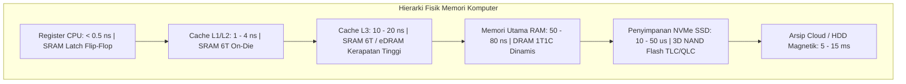

# Modul 060: Organisasi Memori Fisik Perangkat Keras (SRAM 6T, DRAM 1T1C, DDR4/DDR5, HBM, NAND Flash, NVMe)

**Navigasi**: [⬅️ Master Index](../../INDEX.md) | [Tingkat 4: Tingkat 4: Logika Digital, Computer Engineering & Arsitektur Komputer](./README.md)
*Sebelumnya*: [059. teknologi-fpga](./059-teknologi-fpga.md) | *Berikutnya*: [061. model-paradigma-arsitektur-komputer](./061-model-paradigma-arsitektur-komputer.md)

---

## 1. Intuisi Dasar Tanpa Jargon ("Seperti Bayi Baru Lahir")
Pernahkah Anda bertanya mengapa komputer membutuhkan dua jenis memori: **RAM (Random Access Memory)** yang kapasitasnya hanya belasan gigabyte, dan **SSD (Solid State Drive)** yang kapasitasnya ribuan gigabyte? Mengapa kita tidak membuat seluruh komputer menggunakan RAM saja, atau seluruh komputer menggunakan SSD saja?

Jawabannya adalah **Hukum Fisika dan Biaya Silikon**:
- Jika Anda ingin memori yang **Super Cepat** (bisa merespons dalam 1 nanodetik): Anda butuh 6 transistor silikon besar untuk menyimpan 1 bit data saja (**SRAM** di dalam cache CPU). Harganya sangat mahal dan ukurannya sangat boros area chip!
- Jika Anda ingin memori yang **Kompak dan Murah**: Anda bisa menyimpan elektron di dalam 'ember kapasitor mikroskopis' dengan hanya 1 transistor (**DRAM** pada keping RAM laptop). Tapi ember ini bocor setiap milidetik, sehingga Anda harus terus mengisinya ulang (*refresh*) jutaan kali per detik!
- Jika Anda ingin memori yang **Tidak Hilang Saat Mati Lampu**: Anda harus menjebak elektron di dalam 'penjara gerbang melayang' oksida silikon (**NAND Flash** di SSD). Tapi memori ini lambat dan aus setiap kali Anda menghapusnya.
Organisasi memori fisik adalah seni mengatur hierarki kompromi antara kecepatan cahaya, ukuran atom, dan batas ekonomi per gigabyte.
[📚 Pelajari: Micron Memory Technology Foundations](https://www.micron.com/about/blog/memory-technologies)

## 2. Fondasi Teoretis & Aksiomatik / Matematis
### 60.1 Sel Memori Statis (SRAM 6T) vs Dinamis (DRAM 1T1C) ([Rabaey Digital Integrated Circuits](https://www.pearson.com/))
1. **SRAM (Static RAM - Sel 6 Transistor)**:
   - Terdiri dari dua inverter CMOS berumpan balik silang bistabil (*cross-coupled inverters*) dan dua transistor akses (*pass transistors*) yang dikendalikan oleh Word Line (WL).
   - Menahan data secara kontinu tanpa memerlukan refresh selama daya aktif ($V_{DD} > 0$).
   - Kecepatan ultra-tinggi ($< 1\text{ ns}$), namun luas area silikon besar ($120 - 150 \times F^2$).
2. **DRAM (Dynamic RAM - Sel 1T1C)**:
   - Terdiri dari 1 transistor akses NMOS dan 1 kapasitor parit/tumpukan mikroskopis ($C_s \approx 25 - 30\text{ fF}$).
   - Kerapatan data ultra-padat (area sel hanya $6 \times F^2$).
   - Pembacaan bersifat merusak (*destructive readout*): muatan kapasitor terbagi ke Bit Line ($V_{BL} = \frac{C_s V_{DD} + C_{BL} V_{\text{pre}}}{C_s + C_{BL}}$) dan harus ditulis ulang seketika oleh *Sense Amplifier*.
   - Wajib di-refresh berkala (tipikal setiap $64\text{ ms}$ untuk seluruh baris) karena arus bocor dielektrik kapasitor.

### 60.2 Arsitektur Memori DDR4/DDR5 & Antarmuka Baris-Kolom ([JEDEC DDR5 SDRAM Standard](https://www.jedec.org/standards-documents/docs/jesd79-5))
Struktur pengalamatan matriks 2D/3D:
- Operasi `ACTIVATE`: Mengaktifkan Word Line baris dan menyalin seluruh baris data ke buffer Sense Amplifier (*Row Buffer* berukuran $1 - 2\text{ KB}$).
- Operasi `READ / WRITE`: Memilih kolom data dari Row Buffer menggunakan Column Address Strobe (CAS).
- Timing Parameters Kritis:
  - $t_{CL}$ (CAS Latency): Waktu tunggu antara perintah baca dan data pertama tiba di bus.
  - $t_{RCD}$ (RAS to CAS Delay): Waktu jeda antara aktivasi baris dan pembacaan kolom.
  - $t_{RP}$ (Row Precharge Time): Waktu menutup baris lama dan menyiapkan Bit Line ke $V_{DD}/2$.
DDR (Double Data Rate): Mentransfer data pada kedua tepi denyut clock (*rising edge* dan *falling edge* simultan).

### 60.3 NAND Flash 3D, Penyimpanan Multi-Level (SLC, MLC, TLC, QLC) & NVMe ([Micheloni 3D Flash Memories](https://link.springer.com/book/10.1007/978-981-15-5051-5))
Sel NAND Flash menjebak muatan elektron di dalam lapisan isolator Nitrida silikon (*Charge Trap Flash* CTF):
Tegangan ambang transistor $V_{TH}$ bergeser proporsional terhadap jumlah elektron yang terjebak:
- **SLC (Single-Level Cell)**: 1 bit per sel ($2^1 = 2$ tingkat tegangan). Ketahanan: $\approx 100.000$ siklus Program/Erase (P/E).
- **TLC (Triple-Level Cell)**: 3 bit per sel ($2^3 = 8$ tingkat tegangan presisi tinggi). Ketahanan: $\approx 1.500 - 3.000$ siklus P/E.
- **QLC (Quad-Level Cell)**: 4 bit per sel ($2^4 = 16$ tingkat tegangan mikroskopis).
Karakteristik Unik NAND Flash:
- Data dapat dibaca dan diprogram dalam unit **Halaman (Page)** (misal $4 - 16\text{ KB}$).
- Namun penghapusan HANYA bisa dilakukan dalam unit **Blok (Block)** yang berisi ratusan halaman (misal $4 - 8\text{ MB}$).
Flash Translation Layer (FTL) mengelola algoritma penataan keausan (*Wear Leveling*), pengumpulan sampah (*Garbage Collection*), dan Over-Provisioning untuk mencegah sel cepat rusak.

## 3. Anatomi Teknis & Cara Kerja Internal

Teknologi High Bandwidth Memory (HBM3):
Menumpuk 8 hingga 16 lapisan keping silikon DRAM secara vertikal 3D menggunakan ribuan lubang tembaga mikroskopis yang menembus silikon (*Through-Silicon Vias* TSV) di atas interposer silikon perantara, menghasilkan bus data selebar 1024-bit dengan bandwidth menembus $> 1.2	ext{ Terabyte/detik}$ untuk akselerator AI GPU.

## 4. Implementasi Praktis & Kode / Simulasi Riil
def calculate_dram_read_latency(t_rcd_ns: float, t_cl_ns: float, t_rp_ns: float, row_hit: bool) -> dict:
    """
    Menghitung total latensi pembacaan data DRAM untuk kondisi Row Buffer Hit vs Row Buffer Miss.
    """
    if row_hit:
        # Data yang dicari sudah berada di dalam Sense Amplifier Row Buffer: hanya butuh t_CL
        total_latency_ns = t_cl_ns
        status = "Row Buffer Hit (Akses Kolom Cepat)"
    else:
        # Data berada di baris lain: harus Precharge baris lama (t_RP), Activate baris baru (t_RCD), lalu Read (t_CL)
        total_latency_ns = t_rp_ns + t_rcd_ns + t_cl_ns
        status = "Row Buffer Miss (Penalti Pembacaan Penuh Tiga Tahap)"
        
    return {
        "scenario": status,
        "latency_ns": total_latency_ns,
        "penalty_factor": total_latency_ns / t_cl_ns
    }

# Spesifikasi DDR4-3200 Standar (Timing CAS 16-18-18: t_CL = 10ns, t_RCD = 11.25ns, t_RP = 11.25ns)
hit_res = calculate_dram_read_latency(t_rcd_ns=11.25, t_cl_ns=10.0, t_rp_ns=11.25, row_hit=True)
miss_res = calculate_dram_read_latency(t_rcd_ns=11.25, t_cl_ns=10.0, t_rp_ns=11.25, row_hit=False)

print(f"Kasus 1: {hit_res['scenario']} => Latensi: {hit_res['latency_ns']:.2f} ns")
print(f"Kasus 2: {miss_res['scenario']} => Latensi: {miss_res['latency_ns']:.2f} ns (Penalti {miss_res['penalty_factor']:.1f}x lebih lambat!)")

## 5. Miskonsepsi & Jebakan Industri
1. **DRAM Rowhammer Security Vulnerability**: Mengakses dan mengaktifkan satu baris DRAM yang sama jutaan kali per detik secara berulang-ulang (*hammering*); kebocoran medan elektromagnetik kapasitor sel bocor ke baris fisik tetangganya, membalikkan bit data di memori aman sistem operasi (*bit flipping privilege escalation*).
2. **Write Amplification in Solid State Drives (WAF)**: Melakukan penulisan data acak ukuran kecil ($4	ext{ KB}$) secara terus-menerus ke drive SSD tanpa trim; FTL terpaksa membaca, memodifikasi, dan menulis ulang seluruh blok fisik $4	ext{ MB}$, melipatgandakan Write Amplification Factor ($WAF > 10$) dan menghancurkan masa pakai endurance sel NAND flash dalam hitungan bulan.
3. **Ignoring DRAM Refresh Power Consumption in Deep Sleep**: Membiarkan modul DRAM aktif dalam mode self-refresh saat mikrokontroler tidur; siklus refresh periodik menyedot arus milliampere yang menghabiskan baterai portabel. Solusi: gunakan PSRAM (Pseudo-SRAM) berdaya rendah atau simpan state ke flash sebelum sleep.

## 6. Proyek Latihan & Rubrik Penilaian Mandiri
### Tingkat 1 (Pemula) - Simulasi Pembacaan Merusak Sel DRAM 1T1C
Tulis fungsi Python untuk menghitung perubahan tegangan delta $\Delta V_{BL}$ pada Bit Line ($C_{BL} = 250	ext{ fF}$) saat saklar transistor sel DRAM ($C_s = 25	ext{ fF}$) ditutup pada tegangan precharge awal $V_{	ext{pre}} = V_{DD} / 2 = 0.6	ext{ V}$. Tentukan resolusi sensitivitas minimum yang harus dimiliki oleh Sense Amplifier.

### Tingkat 2 (Menengah) - Model Simulasi Flash Translation Layer (FTL) Log-Structured
Implementasikan simulator FTL tingkat halaman (*Page-Level Mapping FTL*) dalam Python: kelola tabel pemetaan alamat logis ke fisik (LBA to PBA), lacak status halaman (Valid, Invalid, Free), dan terapkan algoritma pembersihan sampah (*Greedy Garbage Collection*) saat kapasitas blok bebas menipis. Hitung Write Amplification Factor (WAF).

### Tingkat 3 (Mahir) - Pengontrol Memori DDR4 RTL dengan Penjadwal Antrian Permintaan (Command Scheduler)
Rancang modul penjadwal pengontrol memori DDR4 (*DDR4 Memory Controller Command Scheduler*) dalam SystemVerilog: implementasikan antrian transaksi baca-tulis, prioritaskan transaksi yang menghasilkan *Row Buffer Hit*, dan terapkan aturan penegakan waktu tunda minimum JEDEC ($t_{	ext{RRD}}, t_{	ext{FAW}}, t_{	ext{RFC}}$ refresh timing controller).

#### Rubrik Penilaian
- **40% Ketepatan Parameter Fisik Memori**: Perhitungan pemisahan muatan sel, latensi timing JEDEC, dan degradasi P/E cycle akurat.
- **30% Arsitektur Manajemen Memori**: Penjadwal DRAM memaksimalkan efisiensi utilisasi bus data di atas $80\%$.
- **30% Analisis Keandalan Sistem**: Mengimplementasikan deteksi dan koreksi kesalahan Single Error Correction Double Error Detection (SECDED ECC).

## 7. Rekomendasi Sumber Belajar Standar Emas
| Kategori | Judul Sumber & Tautan Langsung | Deskripsi Singkat |
|---|---|---|
| 📖 Buku Teks | [Memory Systems: Cache, DRAM, Disk (Jacob, Ng, Wang)](https://www.elsevier.com/) | Ensiklopedia terlengkap arsitektur fisik memori komputer, bus DRAM, dan kontroler. |
| 🎓 Kuliah Terbuka | [CMU 18-447 Computer Architecture: Memory Systems (Onur Mutlu)](https://safari.ethz.ch/architecture/fall2020/) | Seri kuliah legendaris Onur Mutlu tentang sel DRAM, Rowhammer, dan sistem penyimpanan. |
| 🔬 Makalah Seminal | [Flipping Bits in Memory Without Accessing Them: An Experimental Study of DRAM Disturbance Errors (Kim et al., Rowhammer, 2014)](https://doi.org/10.1109/ISCA.2014.6853210) | Makalah penemuan kerentanan keamanan perangkat keras fisik Rowhammer pada keping DRAM. |
| 💻 Lab Interaktif | [DRAMSim3: A Cycle-Accurate DRAM Simulator](https://github.com/umd-memsys/DRAMSim3) | Simulator industri standar untuk memodelkan latensi DDR3/DDR4/DDR5 dan HBM. |

---
*Navigasi Cepat*: [Ke Tingkat 4](./README.md) | [Ke Master Index](../../INDEX.md) | *Sebelumnya*: [059. teknologi-fpga](./059-teknologi-fpga.md) | *Berikutnya*: [061. model-paradigma-arsitektur-komputer](./061-model-paradigma-arsitektur-komputer.md)
