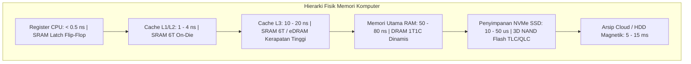

# Modul 060: Organisasi Memori Fisik Perangkat Keras (SRAM 6T, DRAM 1T1C, DDR4/DDR5, HBM, NAND Flash, NVMe)

**Navigasi**: [⬅️ Master Index](../../INDEX.md) | [Tingkat 4: Tingkat 4: Logika Digital, Computer Engineering & Arsitektur Komputer](./README.md)
*Sebelumnya*: [059. teknologi-fpga](./059-teknologi-fpga.md) | *Berikutnya*: [061. model-paradigma-arsitektur-komputer](./061-model-paradigma-arsitektur-komputer.md)

---

## 1. Intuisi Dasar Tanpa Jargon ("Seperti Bayi Baru Lahir")
### 1.1 Konsep Inti & Analogi Tanpa Jargon
Pernahkah Anda bertanya mengapa komputer membutuhkan dua jenis memori: **RAM (Random Access Memory)** yang kapasitasnya hanya belasan gigabyte, dan **SSD (Solid State Drive)** yang kapasitasnya ribuan gigabyte? Mengapa kita tidak membuat seluruh komputer menggunakan RAM saja, atau seluruh komputer menggunakan SSD saja?

### 1.2 Urgensi Rekayasa & Signifikansi Sistemik
Jawabannya adalah **Hukum Fisika dan Biaya Silikon**:
- Jika Anda ingin memori yang **Super Cepat** (bisa merespons dalam 1 nanodetik): Anda butuh 6 transistor silikon besar untuk menyimpan 1 bit data saja (**SRAM** di dalam cache CPU). Harganya sangat mahal dan ukurannya sangat boros area chip!
- Jika Anda ingin memori yang **Kompak dan Murah**: Anda bisa menyimpan elektron di dalam 'ember kapasitor mikroskopis' dengan hanya 1 transistor (**DRAM** pada keping RAM laptop). Tapi ember ini bocor setiap milidetik, sehingga Anda harus terus mengisinya ulang (*refresh*) jutaan kali per detik!
- Jika Anda ingin memori yang **Tidak Hilang Saat Mati Lampu**: Anda harus menjebak elektron di dalam 'penjara gerbang melayang' oksida silikon (**NAND Flash** di SSD). Tapi memori ini lambat dan aus setiap kali Anda menghapusnya.
Organisasi memori fisik adalah seni mengatur hierarki kompromi antara kecepatan cahaya, ukuran atom, dan batas ekonomi per gigabyte.
[📚 Pelajari: Micron Memory Technology Foundations](https://www.micron.com/about/blog/memory-technologies)

## 2. Fondasi Teoretis & Aksiomatik / Matematis
### 2.1 Kerangka Teori Aksiomatik & Formulasi Matematis
### 60.1 Sel Memori Statis (SRAM 6T) vs Dinamis (DRAM 1T1C) ([Rabaey Digital Integrated Circuits](https://www.pearson.com/))
1. **SRAM (Static RAM - Sel 6 Transistor)**:
   - Terdiri dari dua inverter CMOS berumpan balik silang bistabil (*cross-coupled inverters*) dan dua transistor akses (*pass transistors*) yang dikendalikan oleh Word Line (WL).
   - Menahan data secara kontinu tanpa memerlukan refresh selama daya aktif ($V_{DD} > 0$).
   - Kecepatan ultra-tinggi ($< 1\text{ ns}$), namun luas area silikon besar (\$120 - 150 \times F^2$).
2. **DRAM (Dynamic RAM - Sel 1T1C)**:
   - Terdiri dari 1 transistor akses NMOS dan 1 kapasitor parit/tumpukan mikroskopis ($C_s \approx 25 - 30\text{ fF}$).
   - Kerapatan data ultra-padat (area sel hanya $6 \times F^2$).
   - Pembacaan bersifat merusak (*destructive readout*): muatan kapasitor terbagi ke Bit Line ($V_{BL} = \frac{C_s V_{DD} + C_{BL} V_{\text{pre}}}{C_s + C_{BL}}$) dan harus ditulis ulang seketika oleh *Sense Amplifier*.
   - Wajib di-refresh berkala (tipikal setiap \$64\text{ ms}$ untuk seluruh baris) karena arus bocor dielektrik kapasitor.

### 2.2 Penurunan Matematis Langkah-demi-Langkah
### 60.2 Arsitektur Memori DDR4/DDR5 & Antarmuka Baris-Kolom ([JEDEC DDR5 SDRAM Standard](https://www.jedec.org/standards-documents/docs/jesd79-5))
Struktur pengalamatan matriks 2D/3D:
- Operasi `ACTIVATE`: Mengaktifkan Word Line baris dan menyalin seluruh baris data ke buffer Sense Amplifier (*Row Buffer* berukuran $1 - 2\text{ KB}$).
- Operasi `READ / WRITE`: Memilih kolom data dari Row Buffer menggunakan Column Address Strobe (CAS).
- Timing Parameters Kritis:
  - $t_{CL}$ (CAS Latency): Waktu tunggu antara perintah baca dan data pertama tiba di bus.
  - $t_{RCD}$ (RAS to CAS Delay): Waktu jeda antara aktivasi baris dan pembacaan kolom.
  - $t_{RP}$ (Row Precharge Time): Waktu menutup baris lama dan menyiapkan Bit Line ke $V_{DD}/2$.
DDR (Double Data Rate): Mentransfer data pada kedua tepi denyut clock (*rising edge* dan *falling edge* simultan).

### 60.3 NAND Flash 3D, Penyimpanan Multi-Level (SLC, MLC, TLC, QLC) & NVMe ([Micheloni 3D Flash Memories](https://link.springer.com/book/10.1007/978-981-15-5051-5))
Sel NAND Flash menjebak muatan elektron di dalam lapisan isolator Nitrida silikon (*Charge Trap Flash* CTF):
Tegangan ambang transistor $V_{TH}$ bergeser proporsional terhadap jumlah elektron yang terjebak:
- **SLC (Single-Level Cell)**: 1 bit per sel ($2^1 = 2$ tingkat tegangan). Ketahanan: $\approx 100.000$ siklus Program/Erase (P/E).
- **TLC (Triple-Level Cell)**: 3 bit per sel ($2^3 = 8$ tingkat tegangan presisi tinggi). Ketahanan: $\approx 1.500 - 3.000$ siklus P/E.
- **QLC (Quad-Level Cell)**: 4 bit per sel ($2^4 = 16$ tingkat tegangan mikroskopis).
Karakteristik Unik NAND Flash:
- Data dapat dibaca dan diprogram dalam unit **Halaman (Page)** (misal $4 - 16\text{ KB}$).
- Namun penghapusan HANYA bisa dilakukan dalam unit **Blok (Block)** yang berisi ratusan halaman (misal $4 - 8\text{ MB}$).
Flash Translation Layer (FTL) mengelola algoritma penataan keausan (*Wear Leveling*), pengumpulan sampah (*Garbage Collection*), dan Over-Provisioning untuk mencegah sel cepat rusak.

## 3. Anatomi Teknis & Cara Kerja Internal

Teknologi High Bandwidth Memory (HBM3):
Menumpuk 8 hingga 16 lapisan keping silikon DRAM secara vertikal 3D menggunakan ribuan lubang tembaga mikroskopis yang menembus silikon (*Through-Silicon Vias* TSV) di atas interposer silikon perantara, menghasilkan bus data selebar 1024-bit dengan bandwidth menembus $> 1.2	ext{ Terabyte/detik}$ untuk akselerator AI GPU.

#### Tabel Penelusuran Eksploitasi Perangkat Keras DRAM Rowhammer (CVE-2014-0417)
| Siklus Aktivasi DRAM | Operasi Memori CPU | Alamat Baris Memori Sasaran (Aggressor) | Kebocoran Muatan Kapasitor Sel Tetangga | Status Tegangan Baris Target (Victim) | Mutasi Bit Memori Terlindung Kernel |
|---|---|---|---|---|---|
| Inisialisasi ($t=0$) | Alokasi Halaman RAM | Baris $A$ (Alamat User), Baris $V$ (Kernel Page Table) | Isolasi parit dielektrik normal | Kapasitor penuh ($V_{cap} = 1.2\text{ V}$) | Nilai bit target $= 1$ biner |
| Siklus 1 - 50.000 | Eksekusi instruksi `clflush` | Baris $A$ diaktivasi dan ditutup berulang | Fluktuasi tegangan wordline frekuensi tinggi | Muatan mulai bocor melintasi isolator tipis | Kapasitor baris tetangga meluruh cepat |
| Siklus 150.000 | Akses bolak-balik (Double-Sided)| Baris $A_1$ dan $A_2$ memukul baris $V$ di tengah | Kopling kapasitif parasitik antar-sel DRAM | Tegangan kapasitor turun ke $0.65\text{ V}$ | Mendekati ambang batas switching sense amp |
| Siklus 300.000 | Interval refresh DRAM terlampaui| Pukulan cepat sebelum siklus refresh sempat tiba | Muatan tersisa terkuras habis | Tegangan anjlok ke $0.20\text{ V}$ ($< V_{ref}$) | BITHLIP TERJADI! Nilai bit berubah $1 \to 0$! |
| Dampak Keamanan | Penyerang memeriksa memori | Bit izin tabel halaman kernel terbalik | Status halaman berubah dari Read-Only ke Writable | Akses root diperoleh tanpa password! | Kernel dieksploitasi penuh dari mode unprivileged |

## 4. Implementasi Praktis & Kode / Simulasi Riil
```python
def calculate_dram_read_latency(t_rcd_ns: float, t_cl_ns: float, t_rp_ns: float, row_hit: bool) -> dict:
    """
    Menghitung total latensi pembacaan data DRAM untuk kondisi Row Buffer Hit vs Row Buffer Miss.
    """
    if row_hit:
        # Data yang dicari sudah berada di dalam Sense Amplifier Row Buffer: hanya butuh t_CL
        total_latency_ns = t_cl_ns
        status = "Row Buffer Hit (Akses Kolom Cepat)"
    else:
        # Data berada di baris lain: harus Precharge baris lama (t_RP), Activate baris baru (t_RCD), lalu Read (t_CL)
        total_latency_ns = t_rp_ns + t_rcd_ns + t_cl_ns
        status = "Row Buffer Miss (Penalti Pembacaan Penuh Tiga Tahap)"
        
    return {
        "scenario": status,
        "latency_ns": total_latency_ns,
        "penalty_factor": total_latency_ns / t_cl_ns
    }

# Spesifikasi DDR4-3200 Standar (Timing CAS 16-18-18: t_CL = 10ns, t_RCD = 11.25ns, t_RP = 11.25ns)
hit_res = calculate_dram_read_latency(t_rcd_ns=11.25, t_cl_ns=10.0, t_rp_ns=11.25, row_hit=True)
miss_res = calculate_dram_read_latency(t_rcd_ns=11.25, t_cl_ns=10.0, t_rp_ns=11.25, row_hit=False)

print(f"Kasus 1: {hit_res['scenario']} => Latensi: {hit_res['latency_ns']:.2f} ns")
print(f"Kasus 2: {miss_res['scenario']} => Latensi: {miss_res['latency_ns']:.2f} ns (Penalti {miss_res['penalty_factor']:.1f}x lebih lambat!)")
```

## 5. Miskonsepsi & Jebakan Industri
1. **DRAM Rowhammer Security Vulnerability**: Mengakses dan mengaktifkan satu baris DRAM yang sama jutaan kali per detik secara berulang-ulang (*hammering*); kebocoran medan elektromagnetik kapasitor sel bocor ke baris fisik tetangganya, membalikkan bit data di memori aman sistem operasi (*bit flipping privilege escalation*).
2. **Write Amplification in Solid State Drives (WAF)**: Melakukan penulisan data acak ukuran kecil ($4	ext{ KB}$) secara terus-menerus ke drive SSD tanpa trim; FTL terpaksa membaca, memodifikasi, dan menulis ulang seluruh blok fisik $4	ext{ MB}$, melipatgandakan Write Amplification Factor ($WAF > 10$) dan menghancurkan masa pakai endurance sel NAND flash dalam hitungan bulan.
3. **Ignoring DRAM Refresh Power Consumption in Deep Sleep**: Membiarkan modul DRAM aktif dalam mode self-refresh saat mikrokontroler tidur; siklus refresh periodik menyedot arus milliampere yang menghabiskan baterai portabel. Solusi: gunakan PSRAM (Pseudo-SRAM) berdaya rendah atau simpan state ke flash sebelum sleep.

### Studi Kasus Kegagalan Nyata: Eksploitasi Perangkat Keras DRAM Rowhammer Membalik Bit Kernel Tanpa Hak Akses (2014)
- **Penemuan Kerentanan Silikon Global**: Pada tahun 2014, peneliti dari Carnegie Mellon University dan Google Project Zero membuktikan bahwa kelemahan fisik pada transistor memori DRAM modern memungkinkan program tingkat pengguna (*unprivileged user process*) membalik bit data pada halaman memori milik sistem operasi atau pengguna lain tanpa mengeksploitasi cacat perangkat lunak satupun.
- **Akar Masalah Fisika Memori Semikonduktor & Kopling Kapasitif**: Untuk meningkatkan kapasitas memori RAM menjadi gigabit pada chip silikon kecil, ukuran sel penyimpanan DRAM (1 transistor, 1 kapasitor / 1T-1C) dipipihkan hingga skala nanometer, menempatkan jutaan kawat jalur baris (*wordlines*) saling berdampingan dalam jarak sangat rapat. Ketika sebuah baris memori diakses berulang kali dengan kecepatan jutaan kali per detik (menggunakan instruksi perakitan pembersih cache CPU `clflush` untuk melewati cache prosesor), tegangan listrik pada wordline baris agresor (*aggressor row*) dihidupkan dan dimatikan secara ekstrem. Kopling elektromagnetik parasitik dan pergerakan muatan terakselerasi membocorkan elektron dari kapasitor sel memori tetangga (*victim row*). Jika kebocoran terjadi lebih cepat daripada interval penyegaran otomatis DRAM (siklus refresh standar 64 ms), kapasitor sel tetangga kehilangan muatannya sebelum sempat di-refresh, menyebabkan bit biner terbalik secara spontan (*bitflip* dari 1 menjadi 0 atau sebaliknya). Penyerang memanfaatkan ini untuk membalik bit izin pada *Page Table Entry* (PTE), memperoleh hak akses tulis ke memori kernel fisik.

- **Potongan Kode / Arsitektur Cacat (Vulnerable Implementation)**:
```c
// Rekonstruksi Proof-of-Concept Perangkat Keras DRAM Rowhammer (Assembly x86_64)
#include <stdio.h>
#include <stdint.h>

void execute_double_sided_rowhammer(volatile uint32_t *aggressor1, volatile uint32_t *aggressor2, int iterations) {
    // Membaca baris agresor 1 dan 2 secara bergantian sembari membuang cache line
    // Memaksa pengontrol memori membuka dan menutup baris DRAM (ACTIVATE/PRECHARGE) jutaan kali
    for (int i = 0; i < iterations; i++) {
        // 1. Baca data dari agresor 1 (paksa aktivasi baris DRAM)
        uint32_t val1 = *aggressor1;
        // 2. Baca data dari agresor 2
        uint32_t val2 = *aggressor2;
        
        // 3. Bersihkan baris memori dari L1/L2/L3 cache CPU menggunakan clflush
        asm volatile (
            "clflush (%0)\n\t"
            "clflush (%1)\n\t"
            :
            : "r" (aggressor1), "r" (aggressor2)
            : "memory"
        );
    }
}
```

- **Solusi Mitigasi Perangkat Keras**: Bencana Rowhammer memaksa standardisasi JEDEC merevisi arsitektur DRAM DDR4 dan DDR5 dengan mengintegrasikan fitur mitigasi perangkat keras: 1) *Targeted Row Refresh* (TRR) di mana chip DRAM mendeteksi baris yang diakses secara agresif dan secara otomatis menyegarkan baris tetangganya di luar siklus normal; 2) Penggunaan memori dengan kode koreksi kesalahan *Error-Correcting Code* (ECC) yang mampu mendeteksi dan mengoreksi bitflip tunggal secara transparan.

## 6. Proyek Latihan & Rubrik Penilaian Mandiri
### Tingkat 1 (Pemula) - Simulasi Pembacaan Merusak Sel DRAM 1T1C
Tulis fungsi Python untuk menghitung perubahan tegangan delta $\Delta V_{BL}$ pada Bit Line ($C_{BL} = 250	ext{ fF}$) saat saklar transistor sel DRAM ($C_s = 25	ext{ fF}$) ditutup pada tegangan precharge awal $V_{	ext{pre}} = V_{DD} / 2 = 0.6	ext{ V}$. Tentukan resolusi sensitivitas minimum yang harus dimiliki oleh Sense Amplifier.

### Tingkat 2 (Menengah) - Model Simulasi Flash Translation Layer (FTL) Log-Structured
Implementasikan simulator FTL tingkat halaman (*Page-Level Mapping FTL*) dalam Python: kelola tabel pemetaan alamat logis ke fisik (LBA to PBA), lacak status halaman (Valid, Invalid, Free), dan terapkan algoritma pembersihan sampah (*Greedy Garbage Collection*) saat kapasitas blok bebas menipis. Hitung Write Amplification Factor (WAF).

### Tingkat 3 (Mahir) - Pengontrol Memori DDR4 RTL dengan Penjadwal Antrian Permintaan (Command Scheduler)
Rancang modul penjadwal pengontrol memori DDR4 (*DDR4 Memory Controller Command Scheduler*) dalam SystemVerilog: implementasikan antrian transaksi baca-tulis, prioritaskan transaksi yang menghasilkan *Row Buffer Hit*, dan terapkan aturan penegakan waktu tunda minimum JEDEC ($t_{	ext{RRD}}, t_{	ext{FAW}}, t_{	ext{RFC}}$ refresh timing controller).

#### Rubrik Penilaian
- **40% Ketepatan Parameter Fisik Memori**: Perhitungan pemisahan muatan sel, latensi timing JEDEC, dan degradasi P/E cycle akurat.
- **30% Arsitektur Manajemen Memori**: Penjadwal DRAM memaksimalkan efisiensi utilisasi bus data di atas \$80\%$.
- **30% Analisis Keandalan Sistem**: Mengimplementasikan deteksi dan koreksi kesalahan Single Error Correction Double Error Detection (SECDED ECC).

### Tingkat 1: Dasar
- **Tugas**: Bangun fungsi penyandi dan pemeriksa paritas matriks Hamming Code (7, 4) dalam Python yang mampu mendeteksi dan mengoreksi kesalahan bitflip tunggal (Single Error Correction / SEC) pada blok data 4-bit.
- **Petunjuk Perancangan Arsitektur**:
  - Matriks Generator $G_{4 \times 7}$ dan Matriks Pemeriksa Paritas $H_{3 \times 7}$.
  - Hitung vektor sindrom $S = r \cdot H^T$; jika $S \ne 0$, vektor sindrom menunjukkan indeks kolom bit yang mengalami kesalahan.
- **Test Vector & Kasus Uji Ekstrem**:
  - *Data Normal*: Data 4-bit `1011`; verifikasi kodeword 7-bit yang dihasilkan.
  - *Injeksi Bitflip*: Ubah bit ke-5; buktikan bahwa vektor sindrom mengidentifikasi posisi bit 5 dan mengoreksi nilainya kembali ke data asli.
- **Rubrik Penilaian Mandiri**: 40% Formulasi Matriks Generator & Paritas Hamming Tepat, 30% Algoritma Perhitungan Sindrom & Koreksi Bitflip Presisi, 30% Verifikasi Fungsionalitas Data Uji.

### Tingkat 2: Menengah
- **Tugas**: Implementasikan simulator siklus refresh DRAM dan estimasi probabilitas kegagalan retensi muatan kapasitor sel terhadap temperatur operasi silikon berdasarkan hukum kebocoran arus deplesi sambungan PN eksponensial.
- **Petunjuk Perancangan Arsitektur**:
  - Muatan kapasitor: $Q(t) = Q_0 - \int I_{leak}(T) dt$ dengan arus bocor mengganda setiap kenaikan $10^\circ\text{C}$ ($I_{leak} \propto 2^{\Delta T / 10}$).
  - Simulasikan interval penyegaran standar $t_{ref} = 64\text{ ms}$ pada $25^\circ\text{C}$ vs $85^\circ\text{C}$.
- **Test Vector & Kasus Uji Ekstrem**:
  - *Suhu Kamar $25^\circ\text{C}$*: Muatan tersisa saat siklus refresh tiba $\ge 85\% Q_0$ (sangat aman).
  - *Suhu Tinggi $95^\circ\text{C}$*: Muatan terkuras di bawah ambang deteksi Sense Amplifier sebelum 64 ms (memerlukan adaptive refresh rate 32 ms).
- **Rubrik Penilaian Mandiri**: 40% Model Ketergantungan Suhu Kebocoran Muatan Eksponensial Tepat, 30% Simulasi Siklus Refresh & Sense Amp Sensing, 30% Evaluasi Batas Waktu Retensi Data.

### Tingkat 3: Mahir
- **Tugas**: Rancang modul pengontrol memori perangkat keras (Memory Controller) dengan logika mitigasi Targeted Row Refresh (TRR) berbasis penjejak baris agresif menggunakan algoritma Space-Saving atau Misra-Gries Stream Summary, identifikasi baris memori yang frekuensi aksesnya melampaui batas ambang bahaya Rowhammer, dan jadwalkan penyegaran preventif baris korban secara instan.
- **Petunjuk Perancangan Arsitektur**:
  - Pantau aliran perintah aktivasi DRAM `ACTIVATE` baris secara streaming dalam memori terikat kecil (16 register penjejak).
  - Jika sebuah baris diakses $> K$ kali dalam jendela refresh saat ini, bangkitkan perintah penyegaran khusus untuk baris $Row + 1$ dan $Row - 1$.
- **Test Vector & Kasus Uji Ekstrem**:
  - *Serangan Rowhammer Terdistribusi*: Simulasikan penyerang yang memukul 10 baris berbeda secara acak; buktikan algoritma TRR mendeteksi seluruh baris agresor utama.
  - *Zero False Starvation*: Operasi refresh normal tidak boleh terganggu dengan latensi tambahan $\le 2\%$.
- **Rubrik Penilaian Mandiri**: 40% Implementasi Algoritma Streaming Stream-Summary Presisi, 30% Logika Penjadwalan Perintah Refresh Target TRR Tepat, 30% Pembuktian Penekanan Bitflip di Bawah Beban Serangan.

## 7. Rekomendasi Sumber Belajar Standar Emas
| Kategori | Judul Sumber & Tautan Langsung | Deskripsi Singkat |
|---|---|---|
| 📖 Buku Teks | [Memory Systems: Cache, DRAM, Disk (Jacob, Ng, Wang)](https://www.elsevier.com/) | Ensiklopedia terlengkap arsitektur fisik memori komputer, bus DRAM, dan kontroler. |
| 🎓 Kuliah Terbuka | [CMU 18-447 Computer Architecture: Memory Systems (Onur Mutlu)](https://safari.ethz.ch/architecture/fall2020/) | Seri kuliah legendaris Onur Mutlu tentang sel DRAM, Rowhammer, dan sistem penyimpanan. |
| 🔬 Makalah Seminal | [Flipping Bits in Memory Without Accessing Them: An Experimental Study of DRAM Disturbance Errors (Kim et al., Rowhammer, 2014)](https://doi.org/10.1109/ISCA.2014.6853210) | Makalah penemuan kerentanan keamanan perangkat keras fisik Rowhammer pada keping DRAM. |
| 💻 Lab Interaktif | [DRAMSim3: A Cycle-Accurate DRAM Simulator](https://github.com/umd-memsys/DRAMSim3) | Simulator industri standar untuk memodelkan latensi DDR3/DDR4/DDR5 dan HBM. |

---
*Navigasi Cepat*: [Ke Tingkat 4](./README.md) | [Ke Master Index](../../INDEX.md) | *Sebelumnya*: [059. teknologi-fpga](./059-teknologi-fpga.md) | *Berikutnya*: [061. model-paradigma-arsitektur-komputer](./061-model-paradigma-arsitektur-komputer.md)
