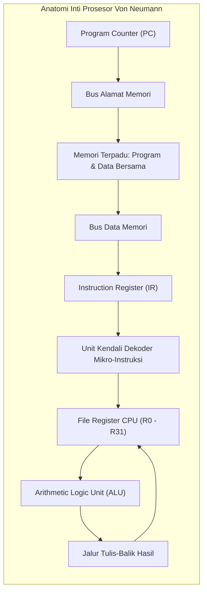

# Modul 061: Model & Paradigma Arsitektur Komputer (Mesin Von Neumann vs Harvard, Siklus Fetch-Decode-Execute)

**Navigasi**: [⬅️ Master Index](../../INDEX.md) | [Tingkat 4: Tingkat 4: Logika Digital, Computer Engineering & Arsitektur Komputer](./README.md)
*Sebelumnya*: [060. organisasi-memori-fisik-perangkat-keras](./060-organisasi-memori-fisik-perangkat-keras.md) | *Berikutnya*: [062. instruction-set-architecture-isa](./062-instruction-set-architecture-isa.md)

---

## 1. Intuisi Dasar Tanpa Jargon ("Seperti Bayi Baru Lahir")
### 1.1 Konsep Inti & Analogi Tanpa Jargon
Bayangkan seorang koki yang bekerja di dapur restoran:
- Koki tersebut membaca selembar resep masakan dari buku resep (Ambil Instruksi / **Fetch**).
- Koki memahami bahwa resep itu menyuruhnya memotong bawang bombay (Terjemahkan Instruksi / **Decode**).
- Koki mengambil pisau dan memotong bawang bombay di atas talenan (Eksekusi / **Execute**).
- Koki menaruh potongan bawang ke dalam mangkuk sup (Simpan Hasil / **Writeback**).
Setelah selesai, koki membaca baris resep berikutnya.

### 1.2 Urgensi Rekayasa & Signifikansi Sistemik
Inilah **Siklus Mesin Komputer (Instruction Cycle)** yang dikemukakan oleh matematikawan legendaris John von Neumann pada tahun 1945!
Sebelum Von Neumann, komputer di masa perang dunia adalah mesin kaku: jika Anda ingin mengubah program dari menghitung lintasan peluru ke menghitung cuaca, insinyur harus membongkar ratusan kabel dan saklar fisik.
Ide revolusioner Von Neumann adalah: **Program instruksi dan data angka diperlakukan SAMA PERSIS dan disimpan di dalam wadah memori yang sama!** Komputer menjadi mesin universal fleksibel yang dapat menjalankan program apa pun cukup dengan memuat file baru ke dalam memori.
[📚 Pelajari: Von Neumann Architecture Primer](https://plato.stanford.edu/entries/computing-history/)

## 2. Fondasi Teoretis & Aksiomatik / Matematis
### 2.1 Kerangka Teori Aksiomatik & Formulasi Matematis
### 61.1 Model Arsitektur Von Neumann vs Harvard ([Patterson & Hennessy](https://www.elsevier.com/))
1. **Arsitektur Von Neumann (Stored-Program Concept)**:
   - Memori terpadu tunggal menyimpan kode program (instruksi) dan data secara bersamaan.
   - Menggunakan satu bus alamat dan bus data bersama.
   - **Kemacetan Von Neumann (Von Neumann Bottleneck)**: Throughput pemrosesan CPU dibatasi secara fatal karena CPU tidak dapat membaca instruksi baru dan membaca/menulis data memori pada siklus waktu yang sama.
2. **Arsitektur Harvard Murni**:
   - Memori instruksi (ROM/Flash) dan memori data (RAM) terpisah secara fisik dengan bus alamat dan data independen.
   - CPU dapat mengambil instruksi baru secara simultan bersamaan dengan membaca data memori.
   - Banyak digunakan pada mikrokontroler kecil (PIC, AVR/Arduino) dan prosesor sinyal digital DSP.
3. **Arsitektur Harvard Termodifikasi (Komputer Modern)**:
   - Pada tingkat inti dalam CPU (Core), menggunakan struktur Harvard: Cache L1 Instruksi (L1-I) dan Cache L1 Data (L1-D) terpisah mandiri.
   - Pada tingkat luar (L2/L3 dan RAM utama), menggunakan struktur Von Neumann: memori fisik bersama terpadu untuk fleksibilitas sistem operasi.

### 2.2 Penurunan Matematis Langkah-demi-Langkah
### 61.2 Anatomi Siklus Fetch-Decode-Execute ([Hennessy & Patterson](https://www.elsevier.com/))
Siklus instruksi prosesor klasik:
1. **Fetch (IF)**: Mengambil instruksi 32-bit dari memori pada alamat yang ditunjuk oleh pencatat alamat Program Counter ($PC$):
   $$IR \leftarrow \text{Memory}[PC], \quad PC \leftarrow PC + 4$$
2. **Decode (ID)**: Unit kendali memecah bit instruksi (*Opcode*, register sumber $Rs_1, Rs_2$, register tujuan $Rd$, immediate offset), dan membaca isi nilai register dari Register File.
3. **Execute (EX)**: ALU mengeksekusi operasi aritmatika, logika, atau menghitung alamat target cabang (*branch address*).
4. **Memory Access (MEM)**: Jika instruksi Load/Store, CPU membaca atau menulis data ke memori RAM:
   $$R_{\text{data}} \leftarrow \text{Memory}[ALU_{\text{result}}]$$
5. **Writeback (WB)**: Menuliskan hasil akhir kembali ke register tujuan $Rd$ di dalam Register File.

### 61.3 Mesin Akumulator, Stack, dan Register-Register ([Tanenbaum Structured Computer Organization](https://www.pearson.com/))
Evolusi model penyimpanan operan CPU:
- **Arsitektur Stack (Zero-Address Machine)**: Seluruh operasi mengambil operan dari puncak tumpukan (*stack push/pop*), misal Java Virtual Machine (JVM) dan kalkulator RPN HP.
- **Arsitektur Akumulator (One-Address Machine)**: Menggunakan satu register khusus implisit ($Acc$); operasi berbentuk $Acc \leftarrow Acc + \text{Memory}[A]$, misal prosesor kuno MOS 6502.
- **Arsitektur Register-Memory (Two-Address Machine)**: Mengizinkan satu operan berada di register dan operan lain langsung di memori RAM, misal arsitektur CISC x86.
- **Arsitektur Load-Store / Register-Register (Three-Address Machine)**: Hanya instruksi `LOAD` dan `STORE` yang boleh menyentuh memori; seluruh operasi matematika wajib terjadi di dalam register prosesor ($R_d \leftarrow R_{s1} \text{ op } R_{s2}$), menjadi fondasi seluruh prosesor modern RISC (ARM64 dan RISC-V).

## 3. Anatomi Teknis & Cara Kerja Internal

Turing Completeness:
Model arsitektur Von Neumann adalah implementasi fisik praktis dari Mesin Turing Universal (*Universal Turing Machine*): sembarang fungsi matematika atau algoritma logika komputasi yang dapat dihitung di alam semesta dapat dieksekusi oleh siklus sederhana Fetch-Decode-Execute ini selama memori mencukupi.

#### Tabel Penelusuran Ketiadaan Koherensi Instruction Cache (I-Cache) pada Kompilator JIT
| Tahap Eksekusi JIT | Komponen Sistem / Alamat Memori | Aksi Penulisan / Pembacaan CPU | Status Data Cache (D-Cache L1) | Status Instruction Cache (I-Cache L1) | Instruksi yang Dieksekusi CPU Core |
|---|---|---|---|---|---|
| Kompilasi JIT | Compiler Runtime (Ring 3) | Emisi kode mesin baru ke memori RAM | Menulis kode biner baru | I-Cache masih memuat data kode lama | Belum melompat ke fungsi baru |
| Penulisan Selesai | Buffer Alamat `0x4000_1000` | Penulisan selesai di memori data | Baris cache berstatus DIRTY | Kosong atau memuat instruksi usang | Siap mengeksekusi fungsi |
| Pemanggilan Fungsi | CPU melompat: `JMP 0x4000_1000` | Fetch unit mengambil instruksi | Menahan instruksi baru di D-Cache | I-Cache Miss / Hit kode usang sebelumnya! | CPU mengeksekusi instruksi dari I-Cache! |
| Ketiadaan Koherensi | Arsitektur Modified Harvard | D-Cache dan I-Cache terpisah fisik | D-Cache tidak mem-flush data ke RAM | I-Cache tidak meng-invalidasi entri | CPU mengeksekusi instruksi usang / byte nol sampah! |
| Dampak Crash | CPU menjumpai instruksi ilegal | Instruksi biner terkorupsi dieksekusi | - | Alamat return rusak | Illegal Instruction Exception / SIGSEGV crash! |
| Dengan Flush Sinkron | Instruksi `fence.i` / clear cache | D-Cache di-flush ke PoU; I-Cache di-invalidate | Data sinkron di RAM fisik | I-Cache memuat ulang instruksi baru | Fungsi JIT berjalan mulus berkecepatan tinggi! |

## 4. Implementasi Praktis & Kode / Simulasi Riil
```python
class SimpleVonNeumannCPU:
    """
    Simulator siklus instruksi Fetch-Decode-Execute arsitektur Von Neumann Load-Store.
    Instruksi 16-bit: [Opcode 4-bit][Reg Dest 4-bit][Reg Src 4-bit][Immediate/Addr 4-bit]
    """
    def __init__(self, memory_size=64):
        self.memory = [0] * memory_size # Memori terpadu program dan data
        self.registers = [0] * 8       # 8 Register CPU (R0 s/d R7)
        self.pc = 0                    # Program Counter
        self.running = True
        
    def step(self):
        if not self.running or self.pc >= len(self.memory):
            return
        
        # 1. FETCH
        instruction = self.memory[self.pc]
        self.pc += 1
        
        # 2. DECODE
        opcode = (instruction >> 12) & 0xF
        rd = (instruction >> 8) & 0x7
        rs = (instruction >> 4) & 0x7
        imm = instruction & 0xF
        
        # 3. EXECUTE & WRITEBACK
        if opcode == 0x1:   # LOAD_IMM: R[rd] = imm
            self.registers[rd] = imm
        elif opcode == 0x2: # ADD: R[rd] = R[rd] + R[rs]
            self.registers[rd] += self.registers[rs]
        elif opcode == 0x3: # STORE: Memory[imm] = R[rd]
            self.memory[imm] = self.registers[rd]
        elif opcode == 0xF: # HALT
            self.running = False

# Program: Muat 5 ke R1, Muat 3 ke R2, Tambahkan R1 = R1 + R2 (Hasil = 8), Simpan ke Memory[30]
cpu = SimpleVonNeumannCPU()
cpu.memory[0] = (0x1 << 12) | (1 << 8) | 5      # R1 = 5
cpu.memory[1] = (0x1 << 12) | (2 << 8) | 3      # R2 = 3
cpu.memory[2] = (0x2 << 12) | (1 << 8) | (2 << 4) # R1 = R1 + R2
cpu.memory[3] = (0x3 << 12) | (1 << 8) | 30     # Memory[30] = R1
cpu.memory[4] = (0xF << 12)                     # HALT

while cpu.running:
    cpu.step()

print(f"Hasil Eksekusi Program di R1       : {cpu.registers[1]}")
print(f"Hasil Tersimpan di Memori Alamat 30: {cpu.memory[30]} (Sukses: 5 + 3 = 8!)")
```

## 5. Miskonsepsi & Jebakan Industri
1. **Self-Modifying Code Security Catastrophe**: Karena arsitektur Von Neumann menyimpan kode dan data di memori yang sama, program dapat secara tidak sengaja atau sengaja menimpa instruksinya sendiri; menjadi gerbang eksploitasi serangan injeksi kode biner *Buffer Overflow*. Solusi sistem modern: proteksi hardware halaman memori Data Execution Prevention (W^X / NX bit - Never Execute).
2. **Von Neumann Memory Bandwidth Starvation**: Mengharapkan prosesor berkinerja tinggi tanpa cache; CPU clock GHz akan menghabiskan \$90\%$ waktunya menganggur (*stalling*) menunggu transfer data memori yang lambat melintasi bus tunggal bersama.
3. **Instruction Cache Incoherency during JIT Compilation**: Mengompilasi kode biner baru secara dinamis (JIT di browser JavaScript / JVM) dan langsung melompat mengeksekusinya tanpa membuang (*flushing*) cache instruksi L1-I; CPU akan mengeksekusi instruksi usang yang masih tersangkut di cache instruksi lama.

### Studi Kasus Kegagalan Nyata: Kegagalan Koherensi Instruction Cache (I-Cache) pada Kompilator JIT Mesin Virtual
- **Insiden Kegagalan Mesin Virtual JIT**: Saat melakukan porting mesin eksekusi JavaScript V8 / Java JVM ke prosesor arsitektur ARM64 dan RISC-V terbaru, perancang mendapati browser dan server web mengalami crash mendadak `SIGILL` (Illegal Instruction) atau `SIGSEGV` secara sporadis setiap kali fungsi kode yang baru saja dikompilasi oleh Just-In-Time (JIT) compiler dipanggil untuk pertama kali.
- **Akar Masalah Model Arsitektur Komputer & Modified Harvard Architecture**: Sebagian besar prosesor modern menerapkan arsitektur Modified Harvard: CPU memiliki dua cache L1 fisik terpisah—L1 Data Cache (D-Cache) untuk membaca dan menulis variabel, serta L1 Instruction Cache (I-Cache) untuk mengambil instruksi mesin yang akan dieksekusi. Karena kode mesin dianggap tidak pernah dimodifikasi saat eksekusi normal (*read-only*), perangkat keras CPU tidak menerapkan koherensi cache otomatis antara D-Cache dan I-Cache demi efisiensi kecepatan. Ketika kompilator JIT menghasilkan kode biner baru, ia menulis instruksi tersebut ke memori laksana data biasa; kode baru ini tertahan di dalam D-Cache berstatus *dirty*. Ketika CPU segera melompat ke alamat memori tersebut untuk mengeksekusinya, unit instruksi CPU membaca instruksi dari I-Cache atau RAM fisik yang masih berisi instruksi usang atau byte nol sampah. Ketiadaan instruksi sinkronisasi penyelarasan memori eksplisit menyebabkan CPU mengeksekusi data sampah dan memicu crash seketika.

- **Potongan Kode / Arsitektur Cacat (Vulnerable Implementation)**:
```c
// Kode Kompilator JIT C: Sinkronisasi Wajib D-Cache dan I-Cache
#include <stdio.h>
#include <sys/mman.h>
#include <string.h>

typedef int (*jit_func_t)(int);

jit_func_t compile_and_flush_jit() {
    // 1. Alokasi halaman memori yang dapat ditulis dan dieksekusi
    void *mem = mmap(NULL, 4096, PROT_READ | PROT_WRITE | PROT_EXEC,
                     MAP_ANONYMOUS | MAP_PRIVATE, -1, 0);
                     
    // 2. Tulis kode mesin (misal fungsi sederhana return x + 1 dalam ARM64 atau x86)
    unsigned char code[] = {
        0xb8, 0x01, 0x00, 0x00, 0x00, // mov eax, 1 (x86_64)
        0xc3                          // ret
    };
    memcpy(mem, code, sizeof(code));

    // 3. KRUSIAL: Pada ARM/RISC-V, sinkronisasi cache wajib dipanggil eksplisit!
    // Memaksa D-Cache menulis ke memori dan membersihkan I-Cache
    #if defined(__GNUC__)
    __builtin___clear_cache((char *)mem, (char *)mem + sizeof(code));
    #endif
    
    // Pada RISC-V assembly: perintah eksplisit `fence.i`
    // Pada ARM64 assembly: `dc cvau, reg` (clean D-cache) lalu `ic ivau, reg` (invalidate I-cache)

    return (jit_func_t)mem;
}
```

- **Prinsip Point of Unification (PoU)**: Dalam arsitektur sistem operasi dan kompilator modern, transisi dari penulisan data ke eksekusi instruksi mewajibkan pemanggilan sistem sinkronisasi *Point of Unification*. Sistem operasi menyediakan antarmuka seperti `sys_cacheflush()` di Linux atau instruksi arsitektur khusus seperti `fence.i` (RISC-V) dan `ISB / DSB` (ARM) untuk menjamin bahwa seluruh modifikasi data telah dikomit ke titik penyatuan memori sebelum pipa dekoder instruksi memuat instruksi baru.

## 6. Proyek Latihan & Rubrik Penilaian Mandiri
### Tingkat 1 (Pemula) - Eksekusi Jejak Instruksi (Instruction Trace) Manual
Diberikan program bahasa mesin 4 instruksi untuk prosesor akumulator sederhana (LOAD 10, ADD 11, STORE 12, HALT). Buat tabel penelusuran status langkah demi langkah yang mencatat nilai $PC$, $IR$, Akumulator, dan sel memori terkait pada setiap siklus Fetch-Decode-Execute.

### Tingkat 2 (Menengah) - Simulator Komputer Tumpukan (Stack Machine Interpreter)
Rancang dan implementasikan simulator interpreter prosesor berbasis stack (*Stack-based CPU*) yang mengeksekusi ekspresi matematika notasi Polish terbalik (RPN): evaluasi ekspresi `((15 - 3) * (2 + 4)) / 3` menggunakan instruksi PUSH, POP, ADD, SUB, MUL, DIV.

### Tingkat 3 (Mahir) - Perancangan Siklus Tunggal CPU Harvard 16-Bit dalam Verilog
Rancang prosesor siklus tunggal (*Single-Cycle CPU*) arsitektur Harvard 16-bit lengkap dalam Verilog synthesizable: sertakan memori instruksi ROM terpisah (\$256 	imes 16	ext{-bit}$), memori data RAM terpisah, 8 register serbaguna 16-bit, ALU, dan decoder kendali cabang bersyarat (BEQ, BNE, JUMP). Jalankan program uji perhitungan deret Fibonacci pada simulator Verilog.

#### Rubrik Penilaian
- **40% Kepatuhan Siklus Mesin**: Alur tahapan Fetch, Decode, Execute, Memory, dan Writeback dirumuskan konsisten.
- **30% Penanganan Pemisahan Instruksi & Data**: Memahami batas arsitektur Harvard dan mitigasi Von Neumann bottleneck.
- **30% Validitas Jalur Data RTL**: Pengalamatan program counter ($PC$), multiplexer cabang, dan penulisan register bebas hazard.

### Tingkat 1: Dasar
- **Tugas**: Bangun simulator mesin von Neumann sederhana berbasis register 8-bit dalam Python dengan memori terpadu (Unified Memory) 256 byte, buktikan konsep kode modifikasi diri (*Self-Modifying Code*) di mana program menulis instruksi baru ke memorinya sendiri dan kemudian mengeksekusinya.
- **Petunjuk Perancangan Arsitektur**:
  - Siklus Fetch-Decode-Execute dengan Program Counter ($PC$) dan Akumulator ($ACC$).
  - Eksekusi program yang memodifikasi opcode instruksi berikutnya di alamat memori $PC+2$ sebelum melewatinya.
- **Test Vector & Kasus Uji Ekstrem**:
  - *Modifikasi Diri Berhasil*: Instruksi `ADD 5` dimodifikasi menjadi `SUB 5` saat berjalan; verifikasi hasil akumulator berubah sesuai instruksi baru.
  - *Batas Memori*: Eksekusi melintasi batas 255 byte wrap-around kembali ke alamat 0 dengan aman.
- **Rubrik Penilaian Mandiri**: 40% Simulator Siklus Instruksi Von Neumann Presisi, 30% Pembuktian Eksekusi Self-Modifying Code Tepat, 30% Penanganan Status Register & Flags.

### Tingkat 2: Menengah
- **Tugas**: Implementasikan simulator hierarki cache dua-tingkat (L1 Data Cache dan L1 Instruction Cache terpisah / Split Harvard) yang melacak status koherensi baris cache (Valid, Dirty, Invalid) dan mendeteksi kondisi eksekusi data basi (*stale instruction execution bug*) jika fungsi penulisan memori tidak diiringi operasi pembersihan cache.
- **Petunjuk Perancangan Arsitektur**:
  - Modelkan ukuran blok cache 64-byte dengan pemetaan asosiatif set ganda.
  - Bangun metode `write_data(addr, val)` yang memperbarui D-Cache dan menandai baris sebagai DIRTY.
  - Bangun metode `fetch_instruction(addr)` yang membaca dari I-Cache; bangkitkan peringatan bahaya jika alamat tersebut berstatus DIRTY di D-Cache namun I-Cache belum di-invalidate.
- **Test Vector & Kasus Uji Ekstrem**:
  - *Deteksi Inkoherensi JIT*: Tulis kode baru ke RAM; panggil fetch tanpa `flush()`; simulator wajib melaporkan pelanggaran koherensi instruksi.
  - *Siklus Sinkronisasi Lengkap*: Jalankan `flush_and_invalidate()`; buktikan fetch berhasil memuat instruksi terbaru.
- **Rubrik Penilaian Mandiri**: 40% Arsitektur Split L1 I-Cache & D-Cache Tepat, 30% Deteksi Otomatis Kondisi Stale Instruction Hazard, 30% Verifikasi Operasi Penyelarasan Point of Unification.

### Tingkat 3: Mahir
- **Tugas**: Rancang mesin kompilasi mikro JIT assembler runtime untuk subset instruksi RISC-V 32-bit (RV32I) dalam C/Rust yang secara dinamis menyusun bytecode operasi aritmatika menjadi kode mesin biner di memori eksekusi, lengkap dengan eksekusi urutan barrier memori perangkat keras (`fence` dan `fence.i`) yang mematuhi standar memori model RISC-V Weak Memory Ordering (RVWMO).
- **Petunjuk Perancangan Arsitektur**:
  - Alokasikan memori halaman executable menggunakan `mprotect()` atau `VirtualProtect()`.
  - Terjemahkan ekspresi aritmatika stack menjadi deretan instruksi biner RV32I (`addi`, `add`, `sub`).
  - Sisipkan instruksi sinkronisasi instruksi `fence.i` sebelum memanggil fungsi melalui penunjuk fungsi.
- **Test Vector & Kasus Uji Ekstrem**:
  - *Eksekusi Fungsi Majemuk*: Kompilasi ekspresi $(x \times 3) - 7$; eksekusi untuk $x = 10$; buktikan hasil keluaran tepat $23$.
  - *Verifikasi Barrier Memori*: Buktikan secara empiris bahwa pemanggilan tanpa memory barrier gagal pada arsitektur perangkat keras non-koheren.
- **Rubrik Penilaian Mandiri**: 40% Emitor Kode Biner RISC-V RV32I JIT Presisi, 30% Kepatuhan Ketat Barrier Memori RVWMO `fence.i`, 30% Manajemen Izin Halaman Memori Virtual Dinamis.

## 7. Rekomendasi Sumber Belajar Standar Emas
| Kategori | Judul Sumber & Tautan Langsung | Deskripsi Singkat |
|---|---|---|
| 📖 Buku Teks | [Computer Organization and Design RISC-V Edition (Patterson & Hennessy)](https://www.elsevier.com/) | Rujukan fundamental pemodelan siklus prosesor, jalur data datapath, dan unit kendali. |
| 🎓 Kuliah Terbuka | [MIT OCW 6.004 Computation Structures: The Processor](https://ocw.mit.edu/courses/6-004-computation-structures-spring-2017/) | Desain tahap demi tahap pembuatan prosesor 32-bit dari gerbang logika dasar. |
| 🔬 Makalah Seminal | [First Draft of a Report on the EDVAC (John von Neumann, 1945)](https://doi.org/10.1109/85.238389) | Naskah bersejarah paling monumental yang mendefinisikan arsitektur komputer modern. |
| 💻 Lab Interaktif | [CPUlator: Web-Based ARM / RISC-V Simulator](https://cpulator.01xz.net/) | Simulator grafis interaktif eksekusi instruksi CPU, register, dan memori di browser. |

---
*Navigasi Cepat*: [Ke Tingkat 4](./README.md) | [Ke Master Index](../../INDEX.md) | *Sebelumnya*: [060. organisasi-memori-fisik-perangkat-keras](./060-organisasi-memori-fisik-perangkat-keras.md) | *Berikutnya*: [062. instruction-set-architecture-isa](./062-instruction-set-architecture-isa.md)
