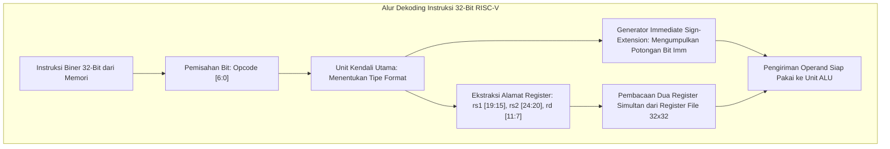

# Modul 062: Instruction Set Architecture / ISA (CISC vs RISC, ISA x86-64, ARM64, dan RISC-V Ekstensi Kustom)

**Navigasi**: [⬅️ Master Index](../../INDEX.md) | [Tingkat 4: Tingkat 4: Logika Digital, Computer Engineering & Arsitektur Komputer](./README.md)
*Sebelumnya*: [061. model-paradigma-arsitektur-komputer](./061-model-paradigma-arsitektur-komputer.md) | *Berikutnya*: [063. perancangan-datapath-control-unit-prosesor](./063-perancangan-datapath-control-unit-prosesor.md)

---

## 1. Intuisi Dasar Tanpa Jargon ("Seperti Bayi Baru Lahir")
Bayangkan dua bahasa manusia: Bahasa Jerman dan Bahasa Indonesia.
- Dalam Bahasa Jerman, Anda bisa menggabungkan banyak kata menjadi satu kata raksasa yang sangat panjang dan rumit (misal: *Rindfleischetikettierungsüberwachungsaufgabenübertragungsgesetz*).
- Dalam Bahasa Indonesia, kita menggunakan kata-kata dasar yang pendek dan sederhana, lalu menyusunnya menjadi kalimat.

Inilah perbandingan dua filosofi besar desain prosesor:
- **CISC (Complex Instruction Set Computer - x86 Intel/AMD)**: Seperti bahasa Jerman: memiliki ratusan instruksi rumit yang panjangnya bervariasi ($1 - 15	ext{ byte}$), di mana satu instruksi tunggal bisa langsung menghitung matematika sekaligus menulis ke memori RAM.
- **RISC (Reduced Instruction Set Computer - ARM64 & RISC-V)**: Seperti bahasa sederhana: hanya memiliki instruksi-instruksi dasar sederhana berukuran seragam (tepat 32 bit). Karena instruksinya sangat teratur dan mudah ditebak, sirkuit silikon prosesor menjadi jauh lebih hemat listrik, dingin, dan kencang. Inilah mengapa ponsel iPhone, smartphone Android, dan superkomputer tercepat di dunia semuanya beralih ke arsitektur RISC!
[📚 Pelajari: RISC-V Official Architecture Specifications](https://riscv.org/technical/specifications/)

## 2. Fondasi Teoretis & Aksiomatik / Matematis
### 62.1 Perbandingan Filosofi Arsitektur CISC vs RISC ([Hennessy & Patterson](https://www.elsevier.com/))
Persamaan Kinerja Dasar Komputer (*Iron Law of Processor Performance*):
$$\text{Waktu CPU} = \frac{\text{Instruksi}}{\text{Program}} \times \frac{\text{Siklus Clock}}{\text{Instruksi}} \times \frac{\text{Detik}}{\text{Siklus Clock}} = \text{IC} \times \text{CPI} \times T_{\text{clk}}$$
- **Filosofi CISC (x86-64)**: Mengurangi jumlah instruksi per program ($\text{IC} \downarrow$) dengan menyediakan instruksi kompleks berkode rapat, namun menaikkan kompleksitas perangkat keras dan siklus clock per instruksi ($\text{CPI} > 1$).
- **Filosofi RISC (ARM64, RISC-V)**: Menargetkan satu instruksi selesai dalam satu siklus clock ($\text{CPI} \approx 1$), instruksi berukuran tetap (32-bit), arsitektur Load-Store murni, dan mengandalkan compiler cerdas untuk optimalisasi kode.

### 62.2 Arsitektur Terbuka RISC-V (RV32I / RV64I) ([Waterman & Asanovic RISC-V Reader](http://www.riscvbook.com/))
Format 6 tipe instruksi dasar 32-bit RISC-V yang dirancang tanpa overlap bit field:
1. **R-Type (Register)**: Operasi register-ke-register (ADD, SUB, SLL, SLT, XOR, SRL, OR, AND).
   `[funct7 (7)][rs2 (5)][rs1 (5)][funct3 (3)][rd (5)][opcode (7)]`
2. **I-Type (Immediate)**: Operasi aritmatika konstanta dan Load memori (ADDI, LW, JALR).
   `[imm[11:0] (12)][rs1 (5)][funct3 (3)][rd (5)][opcode (7)]`
3. **S-Type (Store)**: Menulis data ke memori RAM (SW, SH, SB).
   `[imm[11:5] (7)][rs2 (5)][rs1 (5)][funct3 (3)][imm[4:0] (5)][opcode (7)]`
4. **B-Type (Branch)**: Percabangan bersyarat (BEQ, BNE, BLT, BGE).
5. **U-Type (Upper Immediate)**: Memuat 20-bit konstanta atas (LUI, AUIPC).
6. **J-Type (Jump)**: Lompatan tak bersyarat berjarak jauh (JAL).

Register Bebas: 32 register integer ($x_0 - x_{31}$), dengan $x_0$ terkunci keras (*hardwired*) bernilai nol mutlak ($0$).

### 62.3 Ekstensi Standar Modular RISC-V ([RISC-V Foundation](https://riscv.org/))
Struktur modular ISA RISC-V:
- **RV32I / RV64I**: Base Integer ISA (hanya 40 instruksi dasar, cukup untuk menjalankan Linux).
- **M (Multiplication/Division)**: Pengali dan pembagi hardware integer.
- **A (Atomic Instructions)**: Operasi Load-Reserved / Store-Conditional dan fetch-and-op untuk sinkronisasi multithreading.
- **F & D (Single & Double Precision Floating Point)**: Register floating point mandiri $f_0 - f_{31}$ mematuhi IEEE 754.
- **C (Compressed Instructions)**: Instruksi 16-bit berdensitas tinggi, memangkas ukuran kode binary hingga $25 - 30\%$.
- **V (Vector Extension)**: Operasi SIMD/Vektor fleksibel tanpa batas panjang register tetap (*vector-length agnostic*).
- Kombinasi Standar: **RV64GC** (General Purpose + Compressed).

## 3. Anatomi Teknis & Cara Kerja Internal

Konvensi Panggilan ABI (Application Binary Interface):
- $a_0 - a_7$ ($x_{10} - x_{17}$): Argumen fungsi dan nilai kembalian (*Return Values*).
- $s_0 - s_{11}$ ($x_8, x_9, x_{18} - x_{27}$): Register tersimpan (*Callee-Saved Registers*, wajib dipulihkan sebelum kembali).
- $t_0 - t_6$ ($x_5 - x_7, x_{28} - x_{31}$): Register sementara (*Caller-Saved Registers*).
- $sp$ ($x_2$): Penunjuk tumpukan (*Stack Pointer*).
- $ra$ ($x_1$): Alamat kembali fungsi (*Return Address*).

## 4. Implementasi Praktis & Kode / Simulasi Riil
def decode_riscv_instruction(instruction_hex: int) -> dict:
    """
    Dekoder perangkat lunak sederhana untuk format instruksi dasar RISC-V 32-bit.
    """
    opcode = instruction_hex & 0x7F
    rd = (instruction_hex >> 7) & 0x1F
    funct3 = (instruction_hex >> 12) & 0x07
    rs1 = (instruction_hex >> 15) & 0x1F
    rs2 = (instruction_hex >> 20) & 0x1F
    funct7 = (instruction_hex >> 25) & 0x7F
    
    # Deteksi Operasi R-Type Dasar (Opcode 0x33)
    if opcode == 0x33:
        if funct3 == 0x0 and funct7 == 0x00: op_name = "ADD"
        elif funct3 == 0x0 and funct7 == 0x20: op_name = "SUB"
        elif funct3 == 0x7 and funct7 == 0x00: op_name = "AND"
        elif funct3 == 0x6 and funct7 == 0x00: op_name = "OR"
        elif funct3 == 0x4 and funct7 == 0x00: op_name = "XOR"
        else: op_name = "R-TYPE_LAIN"
        return {"type": "R-Type", "instruction": f"{op_name} x{rd}, x{rs1}, x{rs2}", "rd": rd, "rs1": rs1, "rs2": rs2}
        
    # Deteksi Operasi I-Type ADDI (Opcode 0x13, funct3 0x0)
    elif opcode == 0x13 and funct3 == 0x0:
        imm = instruction_hex >> 20
        # Sign extension untuk immediate 12-bit
        if imm & 0x800: imm -= 0x1000
        return {"type": "I-Type", "instruction": f"ADDI x{rd}, x{rs1}, {imm}", "rd": rd, "rs1": rs1, "imm": imm}
        
    return {"type": "Unknown", "opcode": hex(opcode)}

# Uji dekoding kode mesin biner: addi x1, x0, 10 (Hex: 0x00A00093) dan add x3, x1, x2 (Hex: 0x002081B3)
dec1 = decode_riscv_instruction(0x00A00093)
dec2 = decode_riscv_instruction(0x002081B3)

print(f"Biner 0x00A00093 => Tipe: {dec1['type']} | Assembler: {dec1['instruction']}")
print(f"Biner 0x002081B3 => Tipe: {dec2['type']} | Assembler: {dec2['instruction']}")

## 5. Miskonsepsi & Jebakan Industri
1. **Writing to Hardwired Zero Register x0**: Menulis hasil operasi ke register `x0` (misal `ADD x0, x1, x2`); perangkat keras RISC-V akan membuang hasil tersebut secara diam-diam dan membaca `x0` akan selalu menghasilkan nol ($0$).
2. **Branch Offset Calculation Confusion**: Lupa bahwa pada arsitektur RISC-V, offset lompatan cabang B-Type dan J-Type dihitung dalam satuan kelipatan 2-byte (setengah kata / half-word), dan bit terendah imm[0] selalu implisit bernilai nol (`0`).
3. **Misaligned Memory Access Penalties**: Melakukan pembacaan data 32-bit dari alamat ganjil yang tidak kelipatan 4 pada prosesor RISC tanpa dukungan hardware unaligned access; memicu jebakan pengecualian perangkat keras (*Hardware Alignment Trap Exception*) yang memperlambat eksekusi hingga ribuan siklus clock.

## 6. Proyek Latihan & Rubrik Penilaian Mandiri
### Tingkat 1 (Pemula) - Penerjemahan Manual Bahasa C ke Assembly RISC-V
Terjemahkan cuplikan fungsi bahasa C berikut ke dalam barisan instruksi murni Assembly RISC-V RV32I menggunakan konvensi register ABI standar:
```c
int compute(int a, int b) {
    if (a < b) return (b - a) * 2;
    else return (a + b);
}
```

### Tingkat 2 (Menengah) - Simulator Set Instruksi (Instruction Set Simulator - ISS)
Kembangkan simulator perangkat lunak (*Instruction Set Simulator*) Python/C++ untuk subset 15 instruksi RISC-V RV32I. Muat file biner ELF yang dihasilkan oleh compiler `riscv64-unknown-elf-gcc` dan jalankan program komputasi faktorial hingga instruksi ECALL keluar.

### Tingkat 3 (Mahir) - Perancangan Ekstensi Kustom RISC-V Kriptografi
Rancang instruksi kustom baru untuk arsitektur RISC-V (`AES_ENCROUND rd, rs1, rs2`) yang mengeksekusi 1 putaran transformasi AES (SubBytes, ShiftRows, MixColumns, AddRoundKey) dalam 1 siklus clock. Definisikan opcode kustom pada ruang opcode kustom 0 (`custom-0`), dan tulis modul Verilog datapath yang merealisasikannya.

#### Rubrik Penilaian
- **40% Kepatuhan Spesifikasi ISA**: Penguraian bit field instruksi biner mematuhi manual resmi RISC-V Volume I.
- **30% Kepatuhan Konvensi ABI**: Penggunaan register argumen, saved registers, dan manipulasi stack pointer akurat.
- **30% Kelayakan Perangkat Keras Ekstensi**: Ekstensi kustom tidak mengganggu decoding instruksi standar yang sudah ada.

## 7. Rekomendasi Sumber Belajar Standar Emas
| Kategori | Judul Sumber & Tautan Langsung | Deskripsi Singkat |
|---|---|---|
| 📖 Buku Teks | [The RISC-V Reader: An Open Architecture Atlas (Waterman & Asanović)](http://www.riscvbook.com/) | Buku panduan ringkas dan otoritatif dari para pencipta arsitektur RISC-V di UC Berkeley. |
| 🎓 Kuliah Terbuka | [Berkeley CS61C Great Ideas in Computer Architecture](https://cs61c.org/) | Kuliah legendaris UC Berkeley mengenai pemrograman assembly RISC-V, datapath, dan memori. |
| 🔬 Makalah Seminal | [The Case for the Reduced Instruction Set Computer (Patterson & Ditzel, 1980)](https://doi.org/10.1145/641914.641917) | Makalah bersejarah yang memicu revolusi arsitektur RISC di seluruh dunia. |
| 💻 Lab Interaktif | [Venus: Web-based RISC-V Simulator](https://venus.kvakil.me/) | Simulator assembly RISC-V interaktif online lengkap dengan visualisasi register dan memori. |

---
*Navigasi Cepat*: [Ke Tingkat 4](./README.md) | [Ke Master Index](../../INDEX.md) | *Sebelumnya*: [061. model-paradigma-arsitektur-komputer](./061-model-paradigma-arsitektur-komputer.md) | *Berikutnya*: [063. perancangan-datapath-control-unit-prosesor](./063-perancangan-datapath-control-unit-prosesor.md)
