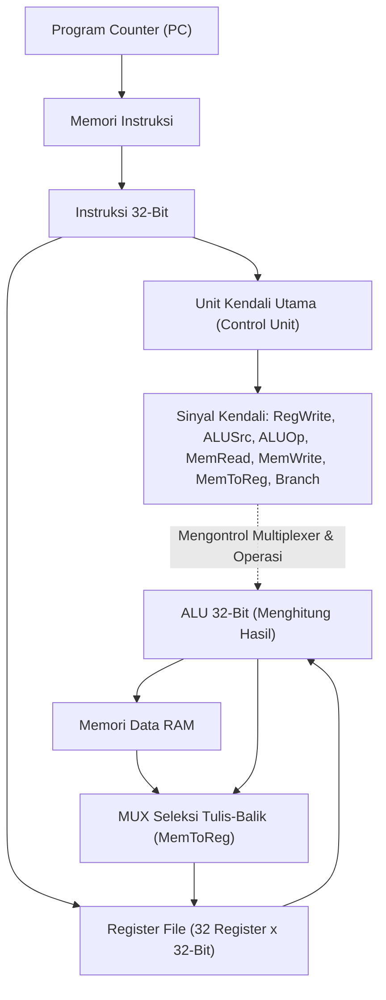

# Modul 063: Perancangan Datapath & Control Unit Prosesor (Single-Cycle, Multi-Cycle, Logika Keras vs Mikrokode)

**Navigasi**: [⬅️ Master Index](../../INDEX.md) | [Tingkat 4: Tingkat 4: Logika Digital, Computer Engineering & Arsitektur Komputer](./README.md)
*Sebelumnya*: [062. instruction-set-architecture-isa](./062-instruction-set-architecture-isa.md) | *Berikutnya*: [064. teknik-pipelining-prosesor-hazards](./064-teknik-pipelining-prosesor-hazards.md)

---

## 1. Intuisi Dasar Tanpa Jargon ("Seperti Bayi Baru Lahir")
### 1.1 Konsep Inti & Analogi Tanpa Jargon
Bayangkan sebuah pabrik perakitan mobil:
Pabrik memiliki dua bagian utama:
1. **Lantai Produksi (Datapath)**: Ban berjalan mekanis, lengan robot pengelas, dan mesin pengecatan yang secara fisik memegang dan membentuk rangka mobil dari pelat besi mentah menjadi mobil utuh.
2. **Ruang Manajer Kendali (Control Unit)**: Komputer pusat yang menekan tombol: kapan ban berjalan maju, warna cat apa yang harus disemprotkan ke mobil A vs mobil B, dan kapan pintu keluar harus dibuka.

### 1.2 Urgensi Rekayasa & Signifikansi Sistemik
Di dalam prosesor komputer:
- **Datapath** adalah kumpulan modul perangkat keras komputasi: Program Counter (PC), Register File, ALU, dan memori RAM yang memproses angka biner.
- **Control Unit** adalah sang sutradara: ia membaca instruksi biner dari memori, lalu menyalakan atau mematikan kabel-kabel saklar seleksi (*Multiplexer select, ALUOp, RegWrite, MemRead, MemWrite*) agar data mengalir ke tempat yang benar pada waktu yang tepat.
[📚 Pelajari: MIT OCW 6.004 Processor Datapath Design](https://ocw.mit.edu/courses/6-004-computation-structures-spring-2017/)

## 2. Fondasi Teoretis & Aksiomatik / Matematis
### 2.1 Kerangka Teori Aksiomatik & Formulasi Matematis
### 63.1 Arsitektur Datapath Siklus Tunggal (Single-Cycle Datapath) ([Patterson & Hennessy](https://www.elsevier.com/))
Dalam datapath siklus tunggal, setiap instruksi dieksekusi secara lengkap dari awal hingga akhir dalam tepat 1 siklus clock:
Elemen status (*State Elements*):
- $PC$ (Program Counter): Menyimpan alamat instruksi saat ini.
- Register File: Membaca dua register ($Rs_1, Rs_2$) secara asinkron dan menulis satu register ($Rd$) pada tepi clock aktif.
- Data Memory: Mengakses data pada siklus yang sama.

### 2.2 Penurunan Matematis Langkah-demi-Langkah
Kelemahan Fatal Siklus Tunggal:
Periode clock prosesor ($T_{\text{clock}}$) dibatasi oleh instruksi paling lambat di seluruh sistem (yaitu instruksi `LOAD` yang harus melewati Fetch $\to$ Decode $\to$ ALU $\to$ Memory $\to$ Writeback):
$$T_{\text{clock}} = t_{\text{IF}} + t_{\text{ID}} + t_{\text{EX}} + t_{\text{MEM}} + t_{\text{WB}}$$
Instruksi cepat seperti `ADD` terpaksa menunggu siklus panjang yang sama, membuang sebagian besar efisiensi komputasi.

### 63.2 Arsitektur Multi-Siklus (Multi-Cycle Datapath) ([Hennessy & Patterson](https://www.elsevier.com/))
Memecah eksekusi instruksi menjadi beberapa siklus clock yang lebih pendek (tipikal 3 hingga 5 siklus per instruksi):
- Periode clock dipercepat hingga sebanding dengan blok fungsional terlama tunggal ($T_{\text{clock}} \approx \max(t_{\text{ALU}}, t_{\text{MEM}})$).
- Komponen mahal (seperti ALU dan Memori) dapat digunakan kembali (*reused*) pada siklus yang berbeda dalam satu instruksi yang sama.
- Register antara ditambahkan untuk menyimpan data antar siklus: $IR$ (Instruction Register), $MDR$ (Memory Data Register), $A, B$ (Operand Registers), dan $ALUOut$.

### 63.3 Perancangan Unit Kendali: Hardwired Logic vs Mikrokode ([Wilkes Microprogramming, 1951](https://doi.org/10.1109/AFIPS.1951.14))
1. **Hardwired Control**:
   Unit kendali dibangun murni menggunakan kombinasi gerbang logika kombinasional atau FSM sequencer keras. Kecepatan eksekusi ultra-tinggi ($< 1\text{ ns}$), namun sangat kaku dan mustahil diubah pasca fabrikasi silikon (standar arsitektur RISC).
2. **Microcoded Control (Mikrokode)**:
   Instruksi mesin diterjemahkan menjadi barisan instruksi tingkat lebih rendah (*micro-instructions* / $\mu\text{ops}$) yang disimpan di dalam memori baca-saja kendali internal chip (*Control Store ROM*):
   - Sangat fleksibel: instruksi baru yang rumit dapat ditambahkan cukup dengan memperbarui tabel ROM mikrokode.
   - Menjadi basis seluruh prosesor CISC modern (Intel Core / AMD Ryzen): prosesor mendekode instruksi kompleks x86 menjadi $\mu\text{ops}$ bergaya RISC sederhana yang kemudian dieksekusi oleh inti hardware super cepat.

## 3. Anatomi Teknis & Cara Kerja Internal

Tabel Sinyal Kendali Utama Datapath RISC-V:
| Instruksi | ALUSrc | MemtoReg | RegWrite | MemRead | MemWrite | Branch | ALUOp |
|---|:---:|:---:|:---:|:---:|:---:|:---:|:---:|
| `R-Type` (ADD) | 0 (Reg) | 0 (ALU) | 1 | 0 | 0 | 0 | 10 |
| `I-Type` (LW) | 1 (Imm) | 1 (Mem) | 1 | 1 | 0 | 0 | 00 |
| `S-Type` (SW) | 1 (Imm) | X | 0 | 0 | 1 | 0 | 00 |
| `B-Type` (BEQ) | 0 (Reg) | X | 0 | 0 | 0 | 1 | 01 |

#### Tabel Penelusuran Siklus Datapath & Unit Kontrol CPU (Single-Cycle vs Multi-Cycle)
| Siklus Jam / Tahap CPU | Instruksi di Dekoder (`IR`) | Sinyal Kontrol Dibangkitkan (`ALUSrc, RegWrite, MemRead`) | Operasi Datapath Terpilih | Register Diperbarui | Status Bus Sistem & Status Flag |
|---|---|---|---|---|---|
| Siklus 1 (Fetch) | Instruksi Biner Diambil dari RAM | `PCWrite = 1, MemRead = 1` | Memuat instruksi ke `IR` | $PC \leftarrow PC + 4$ | Bus alamat memori aktif |
| Siklus 2 (Decode) | Opcode `0110011` (R-Type `ADD`) | `ALUSrcA = 1, ALUSrcB = 00` | Membaca register $rs1$ dan $rs2$ | Register file siap | Unit kontrol memetakan funct3/funct7 |
| Siklus 3 (Execute) | Funct3 `000`, Funct7 `0000000` | `ALUOp = ADD, ALUSrc = Reg` | $ALU\_Out = R[rs1] + R[rs2]$ | ALU menghitung penjumlahan | Flag $Z, C, V$ diperbarui |
| Siklus 4 (Writeback) | Menuliskan hasil ke tujuan | `RegWrite = 1, MemtoReg = 0` | Menulis $ALU\_Out$ ke $R[rd]$ | $R[rd] \leftarrow ALU\_Out$ | Transaksi datapath selesai tuntas |
| Cacat Mikrokode Unit Kontrol | Bit mikrokode terkorupsi | Sinyal `RegWrite` aktif saat branch! | Data salah menimpa register $rd$ | Register penting rusak | Korupsi data tersembunyi tanpa trap CPU! |

## 4. Implementasi Praktis & Kode / Simulasi Riil
```python
def simulate_single_cycle_control_signals(opcode: int) -> dict:
    """
    Menghasilkan vektor sinyal kendali prosesor Single-Cycle berdasarkan Opcode RISC-V.
    """
    signals = {
        "RegWrite": 0, "ALUSrc": 0, "MemRead": 0, "MemWrite": 0,
        "MemtoReg": 0, "Branch": 0, "ALUOp": "00"
    }
    
    if opcode == 0x33:   # R-Type: ADD, SUB, dll
        signals["RegWrite"] = 1
        signals["ALUSrc"] = 0
        signals["ALUOp"] = "10 (Func)"
    elif opcode == 0x03: # Load: LW
        signals["RegWrite"] = 1
        signals["ALUSrc"] = 1
        signals["MemRead"] = 1
        signals["MemtoReg"] = 1
        signals["ALUOp"] = "00 (Add)"
    elif opcode == 0x23: # Store: SW
        signals["ALUSrc"] = 1
        signals["MemWrite"] = 1
        signals["ALUOp"] = "00 (Add)"
    elif opcode == 0x63: # Branch: BEQ
        signals["Branch"] = 1
        signals["ALUSrc"] = 0
        signals["ALUOp"] = "01 (Sub)"
        
    return signals

print("Sinyal Kendali Instruksi LW (Load Word):")
for k, v in simulate_single_cycle_control_signals(0x03).items():
    print(f" - {k:10s}: {v}")
```

## 5. Miskonsepsi & Jebakan Industri
1. **Critical Path Calculation Oversight**: Menghitung frekuensi clock prosesor siklus tunggal hanya berdasarkan operasi ALU, mengabaikan jalur kritis terpanjang melalui memori instruksi, pembacaan register file, penjumlahan offset memori, pembacaan RAM, dan penulisan kembali register; menyebabkan timing violation parah pada chip riil.
2. **Asynchronous Memory Write Races**: Merancang memori data dengan penulisan asinkron tanpa penguncian clock; sinyal kontrol `MemWrite` yang berkedip sesaat saat transisi dekoding instruksi dapat merusak data memori secara acak. Selalu gunakan *Synchronous Write*.
3. **Register File Read-After-Write Hazard in Single-Cycle**: Menulis ke register tujuan $Rd$ dan mencoba membaca register yang sama pada siklus yang sama tanpa mekanisme internal forwarding; pembacaan akan mengembalikan nilai lama sebelum ditulis.

### Studi Kasus Kegagalan Nyata: Cacat Mikrokode CPU IBM System/360 Model 50 Menghasilkan Korupsi Aritmatika Tak Terdeteksi
- **Insiden Komputasi Mainframe Historis**: Pada era awal komputer mainframe komersial IBM System/360 Model 50, beberapa instalasi pusat data ilmiah melaporkan hasil perhitungan matriks ilmiah berskala besar menghasilkan angka yang anjlok secara perlahan setelah berjalan selama puluhan jam, tanpa pernah membangkitkan sinyal error atau interupsi sistem.
- **Akar Masalah Unit Kontrol & Pemetaan Mikrokode Memori ROM**: Unit kontrol prosesor Model 50 menggunakan arsitektur berbasis mikrokode (*microprogrammed control unit*) yang disimpan di dalam memori baca-saja magnetik Read-Only Memory (ROS). Setiap instruksi bahasa mesin dipetakan menjadi serangkaian mikro-instruksi yang mengendalikan saklar transfer datapath (multiplexer, enable register, operasi ALU). Akibat kesalahan pengkabelan matriks bit mikrokode pada pola penanganan instruksi aritmatika desimal khusus yang dieksekusi tepat bersamaan dengan interupsi timer eksternal, sinyal kontrol penulisan register penumpuk (*accumulator write-enable*) tertahan aktif satu siklus lebih lama dari yang seharusnya. Sinyal ini menyebabkan nilai sisa sementara (*intermediate temporary scratchpad value*) menimpa isi register data tujuan pengguna secara diam-diam. Karena korupsi terjadi secara tersembunyi (*silent data corruption*) tanpa memicu exception, perangkat lunak terus berjalan dengan data yang telah rusak.

- **Potongan Kode / Arsitektur Cacat (Vulnerable Implementation)**:
```verilog
// Modul Unit Kontrol Dekoder Datapath RISC-V (Hardwired Control Unit)
module control_unit_decoder (
    input  wire [6:0] opcode,
    input  wire [2:0] funct3,
    input  wire [6:0] funct7,
    output reg        RegWrite,
    output reg        ALUSrc,
    output reg        MemRead,
    output reg        MemWrite,
    output reg        MemtoReg,
    output reg        Branch,
    output reg  [3:0] ALUControl
);
    always @(*) begin
        // Nilai default awal mencegah inferensi latch dan penulisan ilegal
        RegWrite   = 1'b0;
        ALUSrc     = 1'b0;
        MemRead    = 1'b0;
        MemWrite   = 1'b0;
        MemtoReg   = 1'b0;
        Branch     = 1'b0;
        ALUControl = 4'b0000;

        case (opcode)
            7'b0110011: begin // R-Type (ADD, SUB, AND, OR, SLT)
                RegWrite = 1'b1;
                ALUSrc   = 1'b0; // Operand dari Register rs2
                case (funct3)
                    3'b000: ALUControl = (funct7[5]) ? 4'b0001 : 4'b0000; // SUB : ADD
                    3'b111: ALUControl = 4'b0010; // AND
                    3'b110: ALUControl = 4'b0011; // OR
                    default: ALUControl = 4'b0000;
                endcase
            end
            7'b0000011: begin // I-Type Load (LW)
                RegWrite = 1'b1;
                ALUSrc   = 1'b1; // Operand dari Immediate
                MemRead  = 1'b1;
                MemtoReg = 1'b1; // Tulis data memori ke Register
                ALUControl = 4'b0000; // Operasi hitung alamat (ADD)
            end
            7'b0100011: begin // S-Type Store (SW)
                RegWrite = 1'b0; // PENTING: Jangan menulis ke register saat Store!
                ALUSrc   = 1'b1;
                MemWrite = 1'b1;
                ALUControl = 4'b0000;
            end
            7'b1100011: begin // B-Type Branch (BEQ)
                Branch   = 1'b1;
                ALUSrc   = 1'b0;
                ALUControl = 4'b0001; // SUB untuk komparasi kesamaan
            end
            default: ; // NOP aman
        endcase
    end
endmodule
```

- **Keunggulan Unit Kontrol Hardwired vs Mikrokode**: Perancangan CPU modern berkecepatan tinggi meninggalkan arsitektur mikrokode sekuensial yang lambat dan beralih ke unit kontrol logika terprogram (*Hardwired Control Unit*) berbasis kombinasi gerbang langsung yang disintesis dari tabel kebenaran RTL. Logika hardwired mampu menghasilkan seluruh sinyal kendali datapath dalam fraksi nanodetik, dan diverifikasi kebenarannya menggunakan metode pembuktian formal untuk menjamin ketiadaan bit kendali yang salah aktif.

## 6. Proyek Latihan & Rubrik Penilaian Mandiri
### Tingkat 1 (Pemula) - Jalur Kritis (Critical Path) Datapath Siklus Tunggal
Diberikan latensi modul perangkat keras berikut: Memori Instruksi = \$200	ext{ ps}$, Memori Data = \$200	ext{ ps}$, Register File Read/Write = \$100	ext{ ps}$, ALU = \$150	ext{ ps}$, Multiplexer = \$30	ext{ ps}$, Unit Kendali = \$50	ext{ ps}$. Hitung waktu eksekusi instruksi `ADD`, `LW`, `SW`, dan `BEQ`. Tentukan frekuensi clock maksimum prosesor.

### Tingkat 2 (Menengah) - Perancangan Modul Control Unit Verilog untuk RV32I
Tulis modul synthesizable Verilog untuk Unit Kendali Utama (*Main Control Unit*) yang menerima opcode 7-bit dan membangkitkan seluruh sinyal kendali bus (ALUSrc, MemtoReg, RegWrite, MemRead, MemWrite, Branch, ALUOp). Uji dengan testbench mandiri untuk seluruh format instruksi RV32I.

### Tingkat 3 (Mahir) - Prosesor Multi-Siklus FSM dengan Shared Memory Bus
Rancang prosesor multi-siklus lengkap dalam SystemVerilog yang hanya menggunakan satu blok memori terpadu tunggal (*Unified Memory*) untuk instruksi dan data. Bangun Unit Kendali berbasis FSM 5-keadaan (FETCH, DECODE, EXECUTE, MEMORY, WRITEBACK) dan buktikan ketiadaan tabrakan akses bus memori (*bus contention*).

#### Rubrik Penilaian
- **40% Ketepatan Dekoding Sinyal Kendali**: Tabel kebenaran unit kendali mencakup seluruh instruksi tanpa memicu penulisan memori/register ilegal.
- **30% Analisis Waktu Jalur Kritis**: Perhitungan batasan periode clock minimum terverifikasi secara matematis.
- **30% Validitas Integrasi Datapath RTL**: Koneksi multiplexer data, tanda ekstensi immediate, dan writeback bus teruji bebas bug.

### Tingkat 1: Dasar
- **Tugas**: Bangun modul Register File 32-bit (32 register $x0 - x31$) dengan 2 port pembacaan asinkron ($rs1, rs2$) dan 1 port penulisan sinkron ($rd$), verifikasi invarian arsitektur RISC-V di mana register $x0$ selalu bernilai tepat nol secara permanen.
- **Petunjuk Perancangan Arsitektur**:
  - Array register: `reg [31:0] registers [31:1];` (Register 0 tidak dialokasikan di RAM fisik).
  - Pembacaan: `rdata1 = (raddr1 == 0) ? 32'b0 : registers[raddr1]`.
  - Penulisan: `if (RegWrite && waddr != 0) registers[waddr] <= wdata;`.
- **Test Vector & Kasus Uji Ekstrem**:
  - *Penulisan ke Register x0*: Tulis nilai $0\text{xFFFF\_FFFF}$ ke register $x0$; buktikan pembacaan berikutnya dari $x0$ tetap bernilai tepat $0\text{x0000\_0000}$.
  - *Bypass Penulisan-Pembacaan Serentak*: Tulis dan baca register yang sama pada siklus yang sama; verifikasi perilaku penulisan sinkron.
- **Rubrik Penilaian Mandiri**: 40% Modul Register File 3-Port Verilog Presisi, 30% Kepatuhan Ketat Invarian Hardwired Register x0 = 0, 30% Verifikasi Port Pembacaan Asinkron Ganda.

### Tingkat 2: Menengah
- **Tugas**: Implementasikan prosesor Single-Cycle datapath lengkap untuk subset instruksi RISC-V (ADD, SUB, ADDI, LW, SW, BEQ, JAL) dalam Verilog/Python, menghubungkan Instruction Memory, Register File, Control Unit, ALU, dan Data Memory, lalu jalankan program assembly kalkulasi deret Fibonacci.
- **Petunjuk Perancangan Arsitektur**:
  - Hitung periode jam terpendek yang diizinkan berdasarkan jalur kritis terpanjang (biasanya instruksi `LW`: $t_{clk} \ge t_{fetch} + t_{rf\_read} + t_{alu} + t_{mem\_read} + t_{rf\_setup}$).
  - Implementasikan percabangan $PC$: $PC_{next} = (Branch \ \&\ Zero) \ ?\ PC + Imm : PC + 4$.
- **Test Vector & Kasus Uji Ekstrem**:
  - *Eksekusi Program Fibonacci*: Muat program deret Fibonacci ke memori; verifikasi register $x10$ memuat nilai suku ke-7 ($Fib(7) = 13$) saat program selesai.
  - *Percabangan Kondisional*: Uji instruksi `BEQ` saat kedua register sama dan saat berbeda; verifikasi aliran $PC$.
- **Rubrik Penilaian Mandiri**: 40% Datapath Single-Cycle RISC-V Lengkap Terintegrasi Tepat, 30% Kalkulasi Analisis Jalur Kritis Timing, 30% Eksekusi Program Uji Assembly Nyata.

### Tingkat 3: Mahir
- **Tugas**: Rancang CPU Multi-Cycle dengan unit kontrol Finite State Machine (FSM) mikro-terprogram yang membagi eksekusi instruksi menjadi 5 siklus terpisah (Instruction Fetch, Instruction Decode/Register Fetch, Execution/Address Calculation, Memory Access, Memory Read Completion / Writeback), meminimalkan penggunaan sumber daya perangkat keras melalui penggunaan ALU tunggal bersama untuk penghitungan $PC$ dan aritmatika data.
- **Petunjuk Perancangan Arsitektur**:
  - Sisipkan register perantara datapath: $IR, MDR, A, B, ALUOut$.
  - Desain FSM pengendali yang membutuhkan siklus bervariasi sesuai tipe instruksi (R-type: 4 siklus, Store: 4 siklus, Load: 5 siklus, Branch: 3 siklus).
- **Test Vector & Kasus Uji Ekstrem**:
  - *Efisiensi Siklus CPI*: Hitung rata-rata Cycles Per Instruction (CPI) pada beban instruksi campuran; buktikan $CPI_{avg} \approx 4.0$.
  - *Berbagi ALU Fisik*: Buktikan bahwa datapath hanya menggunakan 1 modul ALU fisik untuk increment $PC$ dan eksekusi instruksi.
- **Rubrik Penilaian Mandiri**: 40% Arsitektur Multi-Cycle FSM Datapath Presisi, 30% Pembagian Sumber Daya Perangkat Keras ALU Tunggal, 30% Analisis Performa Throughput CPI Ekstrem.

## 7. Rekomendasi Sumber Belajar Standar Emas
| Kategori | Judul Sumber & Tautan Langsung | Deskripsi Singkat |
|---|---|---|
| 📖 Buku Teks | [Computer Organization and Design (Patterson & Hennessy)](https://www.elsevier.com/) | Rujukan utama perancangan datapath siklus tunggal, multi-siklus, dan unit kendali. |
| 🎓 Kuliah Terbuka | [MIT OCW 6.004 Computation Structures: Datapath & Control](https://ocw.mit.edu/courses/6-004-computation-structures-spring-2017/) | Seri kuliah interaktif membangun datapath prosesor lengkap langkah demi langkah. |
| 🔬 Makalah Seminal | [The Best Way to Design an Automatic Calculating Machine (Wilkes, 1951)](https://doi.org/10.1109/AFIPS.1951.14) | Makalah monumental Maurice Wilkes yang pertama kali mencetuskan konsep kontrol mikrokode. |
| 💻 Lab Interaktif | [RipES: Visual RISC-V Architecture Simulator & Datapath Visualizer](https://github.com/mortbopet/Ripes) | Simulator grafis interaktif nomor satu dunia yang menampilkan aliran sinyal datapath secara real-time. |

---
*Navigasi Cepat*: [Ke Tingkat 4](./README.md) | [Ke Master Index](../../INDEX.md) | *Sebelumnya*: [062. instruction-set-architecture-isa](./062-instruction-set-architecture-isa.md) | *Berikutnya*: [064. teknik-pipelining-prosesor-hazards](./064-teknik-pipelining-prosesor-hazards.md)
