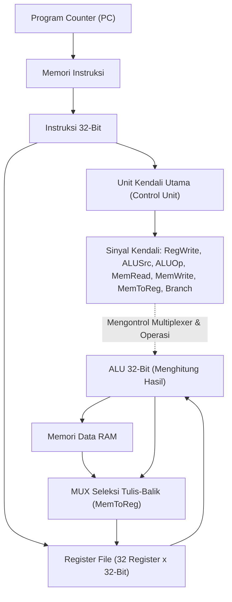

# Modul 063: Perancangan Datapath & Control Unit Prosesor (Single-Cycle, Multi-Cycle, Logika Keras vs Mikrokode)

**Navigasi**: [⬅️ Master Index](../../INDEX.md) | [Tingkat 4: Tingkat 4: Logika Digital, Computer Engineering & Arsitektur Komputer](./README.md)
*Sebelumnya*: [062. instruction-set-architecture-isa](./062-instruction-set-architecture-isa.md) | *Berikutnya*: [064. teknik-pipelining-prosesor-hazards](./064-teknik-pipelining-prosesor-hazards.md)

---

## 1. Intuisi Dasar Tanpa Jargon ("Seperti Bayi Baru Lahir")
Bayangkan sebuah pabrik perakitan mobil:
Pabrik memiliki dua bagian utama:
1. **Lantai Produksi (Datapath)**: Ban berjalan mekanis, lengan robot pengelas, dan mesin pengecatan yang secara fisik memegang dan membentuk rangka mobil dari pelat besi mentah menjadi mobil utuh.
2. **Ruang Manajer Kendali (Control Unit)**: Komputer pusat yang menekan tombol: kapan ban berjalan maju, warna cat apa yang harus disemprotkan ke mobil A vs mobil B, dan kapan pintu keluar harus dibuka.

Di dalam prosesor komputer:
- **Datapath** adalah kumpulan modul perangkat keras komputasi: Program Counter (PC), Register File, ALU, dan memori RAM yang memproses angka biner.
- **Control Unit** adalah sang sutradara: ia membaca instruksi biner dari memori, lalu menyalakan atau mematikan kabel-kabel saklar seleksi (*Multiplexer select, ALUOp, RegWrite, MemRead, MemWrite*) agar data mengalir ke tempat yang benar pada waktu yang tepat.
[📚 Pelajari: MIT OCW 6.004 Processor Datapath Design](https://ocw.mit.edu/courses/6-004-computation-structures-spring-2017/)

## 2. Fondasi Teoretis & Aksiomatik / Matematis
### 63.1 Arsitektur Datapath Siklus Tunggal (Single-Cycle Datapath) ([Patterson & Hennessy](https://www.elsevier.com/))
Dalam datapath siklus tunggal, setiap instruksi dieksekusi secara lengkap dari awal hingga akhir dalam tepat 1 siklus clock:
Elemen status (*State Elements*):
- $PC$ (Program Counter): Menyimpan alamat instruksi saat ini.
- Register File: Membaca dua register ($Rs_1, Rs_2$) secara asinkron dan menulis satu register ($Rd$) pada tepi clock aktif.
- Data Memory: Mengakses data pada siklus yang sama.

Kelemahan Fatal Siklus Tunggal:
Periode clock prosesor ($T_{\text{clock}}$) dibatasi oleh instruksi paling lambat di seluruh sistem (yaitu instruksi `LOAD` yang harus melewati Fetch $\to$ Decode $\to$ ALU $\to$ Memory $\to$ Writeback):
$$T_{\text{clock}} = t_{\text{IF}} + t_{\text{ID}} + t_{\text{EX}} + t_{\text{MEM}} + t_{\text{WB}}$$
Instruksi cepat seperti `ADD` terpaksa menunggu siklus panjang yang sama, membuang sebagian besar efisiensi komputasi.

### 63.2 Arsitektur Multi-Siklus (Multi-Cycle Datapath) ([Hennessy & Patterson](https://www.elsevier.com/))
Memecah eksekusi instruksi menjadi beberapa siklus clock yang lebih pendek (tipikal 3 hingga 5 siklus per instruksi):
- Periode clock dipercepat hingga sebanding dengan blok fungsional terlama tunggal ($T_{\text{clock}} \approx \max(t_{\text{ALU}}, t_{\text{MEM}})$).
- Komponen mahal (seperti ALU dan Memori) dapat digunakan kembali (*reused*) pada siklus yang berbeda dalam satu instruksi yang sama.
- Register antara ditambahkan untuk menyimpan data antar siklus: $IR$ (Instruction Register), $MDR$ (Memory Data Register), $A, B$ (Operand Registers), dan $ALUOut$.

### 63.3 Perancangan Unit Kendali: Hardwired Logic vs Mikrokode ([Wilkes Microprogramming, 1951](https://doi.org/10.1109/AFIPS.1951.14))
1. **Hardwired Control**:
   Unit kendali dibangun murni menggunakan kombinasi gerbang logika kombinasional atau FSM sequencer keras. Kecepatan eksekusi ultra-tinggi ($< 1\text{ ns}$), namun sangat kaku dan mustahil diubah pasca fabrikasi silikon (standar arsitektur RISC).
2. **Microcoded Control (Mikrokode)**:
   Instruksi mesin diterjemahkan menjadi barisan instruksi tingkat lebih rendah (*micro-instructions* / $\mu\text{ops}$) yang disimpan di dalam memori baca-saja kendali internal chip (*Control Store ROM*):
   - Sangat fleksibel: instruksi baru yang rumit dapat ditambahkan cukup dengan memperbarui tabel ROM mikrokode.
   - Menjadi basis seluruh prosesor CISC modern (Intel Core / AMD Ryzen): prosesor mendekode instruksi kompleks x86 menjadi $\mu\text{ops}$ bergaya RISC sederhana yang kemudian dieksekusi oleh inti hardware super cepat.

## 3. Anatomi Teknis & Cara Kerja Internal

Tabel Sinyal Kendali Utama Datapath RISC-V:
| Instruksi | ALUSrc | MemtoReg | RegWrite | MemRead | MemWrite | Branch | ALUOp |
|---|:---:|:---:|:---:|:---:|:---:|:---:|:---:|
| `R-Type` (ADD) | 0 (Reg) | 0 (ALU) | 1 | 0 | 0 | 0 | 10 |
| `I-Type` (LW) | 1 (Imm) | 1 (Mem) | 1 | 1 | 0 | 0 | 00 |
| `S-Type` (SW) | 1 (Imm) | X | 0 | 0 | 1 | 0 | 00 |
| `B-Type` (BEQ) | 0 (Reg) | X | 0 | 0 | 0 | 1 | 01 |

## 4. Implementasi Praktis & Kode / Simulasi Riil
def simulate_single_cycle_control_signals(opcode: int) -> dict:
    """
    Menghasilkan vektor sinyal kendali prosesor Single-Cycle berdasarkan Opcode RISC-V.
    """
    signals = {
        "RegWrite": 0, "ALUSrc": 0, "MemRead": 0, "MemWrite": 0,
        "MemtoReg": 0, "Branch": 0, "ALUOp": "00"
    }
    
    if opcode == 0x33:   # R-Type: ADD, SUB, dll
        signals["RegWrite"] = 1
        signals["ALUSrc"] = 0
        signals["ALUOp"] = "10 (Func)"
    elif opcode == 0x03: # Load: LW
        signals["RegWrite"] = 1
        signals["ALUSrc"] = 1
        signals["MemRead"] = 1
        signals["MemtoReg"] = 1
        signals["ALUOp"] = "00 (Add)"
    elif opcode == 0x23: # Store: SW
        signals["ALUSrc"] = 1
        signals["MemWrite"] = 1
        signals["ALUOp"] = "00 (Add)"
    elif opcode == 0x63: # Branch: BEQ
        signals["Branch"] = 1
        signals["ALUSrc"] = 0
        signals["ALUOp"] = "01 (Sub)"
        
    return signals

print("Sinyal Kendali Instruksi LW (Load Word):")
for k, v in simulate_single_cycle_control_signals(0x03).items():
    print(f" - {k:10s}: {v}")

## 5. Miskonsepsi & Jebakan Industri
1. **Critical Path Calculation Oversight**: Menghitung frekuensi clock prosesor siklus tunggal hanya berdasarkan operasi ALU, mengabaikan jalur kritis terpanjang melalui memori instruksi, pembacaan register file, penjumlahan offset memori, pembacaan RAM, dan penulisan kembali register; menyebabkan timing violation parah pada chip riil.
2. **Asynchronous Memory Write Races**: Merancang memori data dengan penulisan asinkron tanpa penguncian clock; sinyal kontrol `MemWrite` yang berkedip sesaat saat transisi dekoding instruksi dapat merusak data memori secara acak. Selalu gunakan *Synchronous Write*.
3. **Register File Read-After-Write Hazard in Single-Cycle**: Menulis ke register tujuan $Rd$ dan mencoba membaca register yang sama pada siklus yang sama tanpa mekanisme internal forwarding; pembacaan akan mengembalikan nilai lama sebelum ditulis.

## 6. Proyek Latihan & Rubrik Penilaian Mandiri
### Tingkat 1 (Pemula) - Jalur Kritis (Critical Path) Datapath Siklus Tunggal
Diberikan latensi modul perangkat keras berikut: Memori Instruksi = $200	ext{ ps}$, Memori Data = $200	ext{ ps}$, Register File Read/Write = $100	ext{ ps}$, ALU = $150	ext{ ps}$, Multiplexer = $30	ext{ ps}$, Unit Kendali = $50	ext{ ps}$. Hitung waktu eksekusi instruksi `ADD`, `LW`, `SW`, dan `BEQ`. Tentukan frekuensi clock maksimum prosesor.

### Tingkat 2 (Menengah) - Perancangan Modul Control Unit Verilog untuk RV32I
Tulis modul synthesizable Verilog untuk Unit Kendali Utama (*Main Control Unit*) yang menerima opcode 7-bit dan membangkitkan seluruh sinyal kendali bus (ALUSrc, MemtoReg, RegWrite, MemRead, MemWrite, Branch, ALUOp). Uji dengan testbench mandiri untuk seluruh format instruksi RV32I.

### Tingkat 3 (Mahir) - Prosesor Multi-Siklus FSM dengan Shared Memory Bus
Rancang prosesor multi-siklus lengkap dalam SystemVerilog yang hanya menggunakan satu blok memori terpadu tunggal (*Unified Memory*) untuk instruksi dan data. Bangun Unit Kendali berbasis FSM 5-keadaan (FETCH, DECODE, EXECUTE, MEMORY, WRITEBACK) dan buktikan ketiadaan tabrakan akses bus memori (*bus contention*).

#### Rubrik Penilaian
- **40% Ketepatan Dekoding Sinyal Kendali**: Tabel kebenaran unit kendali mencakup seluruh instruksi tanpa memicu penulisan memori/register ilegal.
- **30% Analisis Waktu Jalur Kritis**: Perhitungan batasan periode clock minimum terverifikasi secara matematis.
- **30% Validitas Integrasi Datapath RTL**: Koneksi multiplexer data, tanda ekstensi immediate, dan writeback bus teruji bebas bug.

## 7. Rekomendasi Sumber Belajar Standar Emas
| Kategori | Judul Sumber & Tautan Langsung | Deskripsi Singkat |
|---|---|---|
| 📖 Buku Teks | [Computer Organization and Design (Patterson & Hennessy)](https://www.elsevier.com/) | Rujukan utama perancangan datapath siklus tunggal, multi-siklus, dan unit kendali. |
| 🎓 Kuliah Terbuka | [MIT OCW 6.004 Computation Structures: Datapath & Control](https://ocw.mit.edu/courses/6-004-computation-structures-spring-2017/) | Seri kuliah interaktif membangun datapath prosesor lengkap langkah demi langkah. |
| 🔬 Makalah Seminal | [The Best Way to Design an Automatic Calculating Machine (Wilkes, 1951)](https://doi.org/10.1109/AFIPS.1951.14) | Makalah monumental Maurice Wilkes yang pertama kali mencetuskan konsep kontrol mikrokode. |
| 💻 Lab Interaktif | [RipES: Visual RISC-V Architecture Simulator & Datapath Visualizer](https://github.com/mortbopet/Ripes) | Simulator grafis interaktif nomor satu dunia yang menampilkan aliran sinyal datapath secara real-time. |

---
*Navigasi Cepat*: [Ke Tingkat 4](./README.md) | [Ke Master Index](../../INDEX.md) | *Sebelumnya*: [062. instruction-set-architecture-isa](./062-instruction-set-architecture-isa.md) | *Berikutnya*: [064. teknik-pipelining-prosesor-hazards](./064-teknik-pipelining-prosesor-hazards.md)
