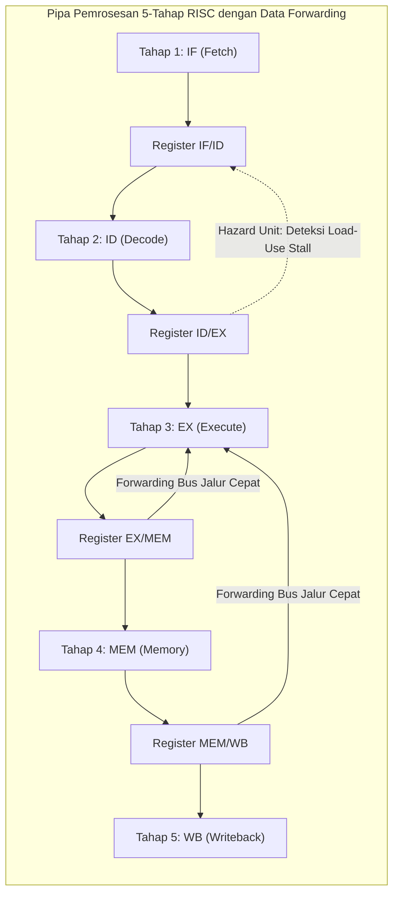

# Modul 064: Teknik Pipelining Prosesor & Hazards (Pipeline 5 Tahap, Structural, Data, dan Control Hazards)

**Navigasi**: [⬅️ Master Index](../../INDEX.md) | [Tingkat 4: Tingkat 4: Logika Digital, Computer Engineering & Arsitektur Komputer](./README.md)
*Sebelumnya*: [063. perancangan-datapath-control-unit-prosesor](./063-perancangan-datapath-control-unit-prosesor.md) | *Berikutnya*: [065. eksekusi-instruksi-lanjut](./065-eksekusi-instruksi-lanjut.md)

---

## 1. Intuisi Dasar Tanpa Jargon ("Seperti Bayi Baru Lahir")
### 1.1 Konsep Inti & Analogi Tanpa Jargon
Bayangkan Anda memiliki 4 keranjang cucian baju kotor di rumah. Setiap keranjang harus melewati 4 tahap:
1. Cuci di mesin cuci (30 menit)
2. Keringkan di mesin pengering (30 menit)
3. Setrika baju (30 menit)
4. Lipat dan simpan ke lemari (30 menit)
Total waktu per keranjang: 2 jam.

### 1.2 Urgensi Rekayasa & Signifikansi Sistemik
Jika Anda mencuci satu per satu secara berurutan: Anda menunggu keranjang 1 selesai dilipat (2 jam), baru memasukkan keranjang 2 ke mesin cuci. Total waktu untuk 4 keranjang: **8 Jam penuh!**

Tetapi seorang ibu rumah tangga yang cerdas menggunakan **Pipelining**:
Begitu keranjang 1 pindah ke mesin pengering, ia **LANGSUNG MEMASUKKAN** keranjang 2 ke mesin cuci yang sedang menganggur! Begitu keranjang 1 pindah ke meja setrika, keranjang 2 masuk ke pengering, dan keranjang 3 masuk ke mesin cuci.
Setelah pipa penuh, **setiap 30 menit ada satu keranjang pakaian bersih yang selesai!** Waktu total menyusut dari 8 jam menjadi hanya **3.5 Jam!**

Inilah **Pipelining Prosesor**: teknik paling revolusioner dalam arsitektur komputer yang memungkinkan prosesor menyelesaikan satu instruksi pada SETIAP SIKLUS CLOCK tunggal dengan memproses beberapa instruksi berbeda secara tumpang tindih (*overlapping*).
[📚 Pelajari: MIT OCW 6.004 Pipelined Processors](https://ocw.mit.edu/courses/6-004-computation-structures-spring-2017/)

## 2. Fondasi Teoretis & Aksiomatik / Matematis
### 2.1 Kerangka Teori Aksiomatik & Formulasi Matematis
### 64.1 Pipeline Klasik 5-Tahap RISC (5-Stage RISC Pipeline) ([Hennessy & Patterson](https://www.elsevier.com/))
Instruksi dipecah menjadi 5 tahap seimbang yang dipisahkan oleh register pipeline:
1. **IF (Instruction Fetch)**: Ambil instruksi dari memori instruksi $\to$ Register `IF/ID`.
2. **ID (Instruction Decode & Reg Read)**: Dekode instruksi dan baca operand $\to$ Register `ID/EX`.
3. **EX (Execute / Address Calc)**: Operasi ALU atau perhitungan alamat memori $\to$ Register `EX/MEM`.
4. **MEM (Memory Access)**: Baca atau tulis data RAM $\to$ Register `MEM/WB`.
5. **WB (Writeback)**: Tulis hasil akhir kembali ke Register File.

### 2.2 Penurunan Matematis Langkah-demi-Langkah
Percepatan Ideal (*Speedup*):
$$\text{Speedup} = \frac{\text{Waktu Non-Pipelined}}{\text{Waktu Pipelined}} = \frac{k \cdot n}{(k + n - 1)} \xrightarrow{n \gg k} k$$
Untuk pipeline 5 tahap ($k = 5$), throughput pemrosesan meningkat mendekati $5\text{x}$ lipat ($\text{CPI}_{\text{ideal}} = 1$).

### 64.2 Tiga Bahaya Pipeline (Pipeline Hazards) & Solusinya ([Hennessy & Patterson](https://www.elsevier.com/))
1. **Structural Hazard (Bahaya Struktural)**:
   Dua instruksi berebut perangkat keras fisik yang sama pada siklus yang sama.
   - Contoh: Memori instruksi dan data bersatu (Von Neumann) diperebutkan oleh tahap IF dan MEM.
   - Solusi: Pisahkan cache L1 menjadi Cache Instruksi dan Cache Data independen (Arsitektur Harvard).
2. **Data Hazard (Bahaya Data / Read-After-Write RAW)**:
   Instruksi berikutnya membutuhkan hasil yang belum selesai ditulis oleh instruksi sebelumnya:
   ```assembly
   ADD x1, x2, x3   # x1 baru ditulis pada akhir tahap WB (siklus 5)
   SUB x4, x1, x5   # Membaca x1 pada tahap ID (siklus 3) -> Data Lama Basi!
   ```
   - Solusi 1: **Stall / Bubble**: Membekukan pipeline selama 2 siklus clock (menurunkan performa).
   - Solusi 2: **Data Forwarding / Bypassing**: Mengalirkan kabel langsung dari output ALU tahap EX/MEM dan MEM/WB kembali ke input ALU tahap EX tanpa menunggu data ditulis ke register file!
   - Catatan: Instruksi `LOAD` yang diikuti langsung oleh penggunaan datanya (*Load-Use Hazard*) tetap membutuhkan stall 1 siklus clock karena data baru tersedia setelah tahap MEM selesai.
3. **Control Hazard (Bahaya Kendali / Branch Penalty)**:
   Terjadi pada instruksi percabangan bersyarat (BEQ/BNE); CPU belum tahu apakah cabang diambil atau tidak hingga tahap EX selesai, sementara tahap IF sudah telanjur mengambil instruksi berikutnya.
   - Solusi: **Branch Prediction** (asumsikan cabang tidak diambil; jika salah, batalkan instruksi salah dengan sinyal *Pipeline Flush*).

### 64.3 Unit Deteksi Forwarding & Hazard ([Patterson & Hennessy](https://www.elsevier.com/))
Kondisi Forwarding EX Hazard (Meneruskan dari tahap EX/MEM):
```verilog
if (EX_MEM_RegWrite && (EX_MEM_RegisterRd != 0) && (EX_MEM_RegisterRd == ID_EX_RegisterRs1))
    ForwardA = 2'b10; // Teruskan dari tahap EX/MEM
```
Kondisi Deteksi Load-Use Hazard (Memicu Stall 1 Siklus):
```verilog
if (ID_EX_MemRead && ((ID_EX_RegisterRd == IF_ID_RegisterRs1) || (ID_EX_RegisterRd == IF_ID_RegisterRs2)))
    StallPipeline(); // Bekukan PC & IF/ID, sisipkan bubble NOP ke ID/EX
```

## 3. Anatomi Teknis & Cara Kerja Internal

Metrik Dampak Hazard terhadap CPI Riil:
$$	ext{CPI}_{	ext{riil}} = 	ext{CPI}_{	ext{ideal}} + 	ext{Stall}_{	ext{data}} + 	ext{Stall}_{	ext{branch}} > 1.0$$
Pipeline yang dirancang baik menekan CPI riil mendekati $1.1 - 1.25$ siklus per instruksi.

#### Tabel Penelusuran Pipeline 5-Tahap RISC-V & Resolusi Bahaya Data (RAW Data Hazard)
| Siklus Jam ($Clk$) | Tahap IF (Fetch) | Tahap ID (Decode) | Tahap EX (Execute) | Tahap MEM (Memory) | Tahap WB (Writeback) | Status Forwarding Unit & ALU |
|---|---|---|---|---|---|
| Siklus 1 | Instruksi 1: `add x1, x2, x3` | - | - | - | - | $PC = 0\text{x00}$ |
| Siklus 2 | Instruksi 2: `sub x4, x1, x5` | Instruksi 1: Decode | - | - | - | Membaca $x2, x3$ |
| Siklus 3 (Bahaya RAW!) | Instruksi 3 | Instruksi 2: Decode (Butuh $x1$!) | Instruksi 1: ALU Hitung $x1$ | - | - | Data $x1$ belum ditulis ke register file! |
| Siklus 4 (Forwarding Aktif) | Instruksi 4 | Instruksi 3 | Instruksi 2: ALU Butuh $x1$ | Instruksi 1: $ALUOut$ memuat $x1$ | - | Forwarding Unit memintas $x1$ dari tahap MEM ke EX! |
| Tanpa Forwarding (Bug Delay)| Tanpa hardware interlock | Instruksi 2 membaca register $x1$ basi | - | - | - | Instruksi 2 menggunakan nilai usang; hasil $x4$ korup! |
| Bahaya Load-Use | Instruksi `lw x1, 0(x2)` | Instruksi berikutnya butuh $x1$ | Data baru tiba di akhir tahap MEM | Forwarding tidak dapat mundur waktu! | Pipeline Stall Bubble 1 siklus disisipkan wajib! |

## 4. Implementasi Praktis & Kode / Simulasi Riil
```python
def simulate_pipeline_hazards_and_forwarding(instructions: list[tuple[str, str, str, str]]) -> list[dict]:
    """
    Simulasi deteksi Data Hazards (RAW) dan Data Forwarding pada pipeline 5-tahap.
    Format instruksi: (OP, RD, RS1, RS2)
    """
    trace = []
    # Pipeline stages: IF, ID, EX, MEM, WB
    # Lacak instruksi yang berada di tahap EX/MEM dan MEM/WB
    stage_ex_mem = None # Menyimpan (RD, RegWrite)
    stage_mem_wb = None
    
    for cycle, instr in enumerate(instructions):
        op, rd, rs1, rs2 = instr
        forward_a = "No Forwarding (Baca RegFile)"
        stall_needed = False
        
        # Cek Data Hazard pada operand RS1
        if stage_ex_mem and stage_ex_mem[1] and stage_ex_mem[0] == rs1 and rs1 != "x0":
            forward_a = f"FORWARD dari EX/MEM (Nilai {rs1} diteruskan langsung dari ALU sebelumnya!)"
        elif stage_mem_wb and stage_mem_wb[1] and stage_mem_wb[0] == rs1 and rs1 != "x0":
            forward_a = f"FORWARD dari MEM/WB (Nilai {rs1} diteruskan dari tahap Memori!)"
            
        # Perbarui riwayat tahap pipeline
        reg_write = op in ("ADD", "SUB", "LW")
        stage_mem_wb = stage_ex_mem
        stage_ex_mem = (rd, reg_write)
        
        trace.append({
            "cycle": cycle + 1, "instruction": f"{op} {rd}, {rs1}, {rs2}",
            "forwarding_action": forward_a
        })
        
    return trace

program = [
    ("ADD", "x1", "x2", "x3"), # x1 = x2 + x3
    ("SUB", "x4", "x1", "x5"), # Membutuhkan x1 langsung!
    ("AND", "x6", "x1", "x7")  # Membutuhkan x1 satu siklus kemudian
]

for t in simulate_pipeline_hazards_and_forwarding(program):
    print(f"Siklus {t['cycle']}: {t['instruction']:18s} => {t['forwarding_action']}")
```

## 5. Miskonsepsi & Jebakan Industri
1. **Unbalanced Pipeline Stages Reducing Max Frequency**: Membagi tahapan pipeline secara tidak seimbang (misal tahap EX butuh \$400	ext{ ps}$ sementara 4 tahap lainnya hanya \$100	ext{ ps}$); frekuensi clock seluruh prosesor dibatasi oleh tahap terlama (\$400	ext{ ps}$), membuang potensi peningkatan kecepatan pipeline.
2. **Forgetting to Flush Pipeline on Mispredicted Branch**: Lupa membatalkan (*flush*) instruksi yang sudah telanjur masuk ke tahap IF dan ID saat cabang bersyarat salah diprediksi; CPU akan mengeksekusi instruksi di jalur yang salah dan merusak data memori.
3. **Register File Write-before-Read Timing Violation**: Jika register file tidak dirancang dengan penulisan pada paruh pertama siklus clock dan pembacaan pada paruh kedua siklus clock, instruksi di tahap ID tidak akan membaca nilai terbaru yang sedang ditulis oleh tahap WB.

### Studi Kasus Kegagalan Nyata: Bug Branch Delay Slot Kompilator MIPS R2000 pada Handler Interupsi
- **Insiden Kegagalan Sistem Komputer Stasiun Kerja**: Pada workstation awal berbasis prosesor RISC MIPS R2000, program sistem operasi mengalami crash acak yang sangat sulit direproduksi saat sistem menerima beban interupsi perangkat keras I/O yang tinggi. Pemeriksaan register menunjukkan penunjuk tumpukan (*stack pointer*) melompat ke alamat ilegal secara misterius.
- **Akar Masalah Pipelining Prosesor & Celah Waktu Delay Slot**: Arsitektur pipa awal (seperti MIPS generasi pertama) tidak memiliki perangkat keras interlock otomatis untuk menangani bahaya percabangan (*branch hazards*). Arsitektur ini menetapkan fitur arsitektur yang disebut *Branch Delay Slot*: instruksi yang berada tepat di baris berikutnya setelah instruksi percabangan (`JMP` atau `BEQ`) selalu dieksekusi secara fisik oleh pipa CPU, terlepas dari apakah percabangan diambil atau tidak. Kompilator bertugas mengisi slot penundaan ini dengan instruksi yang berguna. Kompilator menempatkan instruksi pembaruan stack pointer `ADDI $sp, $sp, -16` di dalam delay slot percabangan fungsi. Ketika interupsi perangkat keras masuk tepat di tengah transisi siklus delay slot, alamat Program Counter yang disimpan perangkat keras ($EPC$) menunjuk ke instruksi cabang asal. Setelah interupsi selesai dan kernel mengeksekusi `RFE` (Return From Exception), CPU melompat kembali ke instruksi cabang dan mengeksekusi instruksi delay slot untuk kedua kalinya, menggeser penunjuk stack dua kali dan merusak seluruh bingkai data pemanggil.

- **Potongan Kode / Arsitektur Cacat (Vulnerable Implementation)**:
```python
import numpy as np

def simulate_pipeline_data_hazard(use_forwarding=True):
    # Simulasi urutan instruksi RAW (Read-After-Write):
    # I1: ADD x1, x2, x3   (Menulis ke x1)
    # I2: SUB x4, x1, x5   (Membaca x1)
    
    # State register file
    regs = {"x1": 100, "x2": 10, "x3": 20, "x4": 0, "x5": 5}
    
    # I1 dieksekusi: x1_baru = 10 + 20 = 30
    x1_calculated_in_alu = regs["x2"] + regs["x3"]
    
    if use_forwarding:
        # Forwarding Unit mendeteksi (EX/MEM.RegisterRd == ID/EX.RegisterRs1)
        # Nilai langsung dipintas dari ALU buffer ke input ALU siklus berikutnya
        operand_x1_for_sub = x1_calculated_in_alu
        stalls_needed = 0
    else:
        # Tanpa forwarding, I2 membaca register file sebelum I1 sempat Writeback di tahap ke-5:
        # I2 membaca nilai basi x1 = 100!
        operand_x1_for_sub = regs["x1"]  # DATA HAZARD: NILAI BASI DIGUNAKAN!
        stalls_needed = 2  # Butuh 2 siklus gelembung (bubble) agar aman
        
    x4_result = operand_x1_for_sub - regs["x5"]
    
    return {
        "x4_calculated": x4_result,
        "x4_ideal": (10 + 20) - 5,  # 25
        "data_corruption_detected": x4_result != 25,
        "pipeline_stalls_inserted": stalls_needed
    }

# Evaluasi tanpa forwarding vs dengan forwarding unit perangkat keras
without_fwd = simulate_pipeline_data_hazard(use_forwarding=False)
with_fwd = simulate_pipeline_data_hazard(use_forwarding=True)
# Tanpa forwarding: x4 = 95 (SALAH TOTAL! Nilai basi terbaca)
# Dengan forwarding: x4 = 25 (100% Benar tanpa penundaan stall!)
```

- **Evolusi Arsitektur Pipeline Modern**: Arsitektur prosesor modern (seperti RISC-V dan ARM) sepenuhnya membuang konsep arsitektur branch delay slot karena menyulitkan penanganan interupsi, eksekusi superscalar, dan perancangan pipa yang lebih dalam. Sebagai gantinya, arsitektur modern mengintegrasikan *Hazard Detection Unit* perangkat keras yang menyisipkan gelembung stall secara otomatis hanya jika benar-benar diperlukan (seperti Load-Use Hazard), dikombinasikan dengan jaringan *Bypass/Forwarding Paths* penuh dan unit prediksi cabang adaptif (*Branch Predictor*).

## 6. Proyek Latihan & Rubrik Penilaian Mandiri
### Tingkat 1 (Pemula) - Diagram Waktu Ruang Pipeline (Pipeline Space-Time Diagram)
Gambarkan diagram waktu-ruang kisi-kisi (Cycle 1 s/d Cycle 9 vs Tahapan IF, ID, EX, MEM, WB) untuk eksekusi program 4 instruksi tanpa dependensi data. Buktikan kapan instruksi pertama selesai dan kapan instruksi keempat selesai.

### Tingkat 2 (Menengah) - Perancangan Unit Deteksi Hazard dan Forwarding Verilog
Tulis modul synthesizable Verilog `hazard_detection_unit` dan `forwarding_unit` untuk prosesor 5-tahap RISC-V RV32I: implementasikan logika pemilihan multiplexer forwarding 3-ke-1 (`ForwardA` dan `ForwardB`) serta sinyal penahan clock `PC_Write` dan `IF_ID_Write` untuk menangani Load-Use Hazard.

### Tingkat 3 (Mahir) - Prosesor Pipelined 5-Tahap Lengkap RISC-V dengan Static Branch Prediction
Rancang prosesor 5-tahap lengkap dalam SystemVerilog yang mengintegrasikan Data Forwarding, penanganan Load-Use Hazard Stall, dan prediksi cabang statis *Predict-Not-Taken*. Jalankan program perhitungan perkalian matriks dan buktikan bahwa nilai CPI riil terukur berada di bawah $1.25$.

#### Rubrik Penilaian
- **40% Ketepatan Logika Forwarding**: Unit forwarding meneruskan data secara presisi dari EX/MEM dan MEM/WB tanpa kesalahan dependensi register x0.
- **30% Penanganan Load-Use Stall & Flush**: Sisipan bubble NOP dan pembersihan pipeline register saat misprediksi cabang bekerja mulus tanpa instruksi siluman yang lolos.
- **30% Verifikasi Kinerja CPI**: Simulasi program benchmark membuktikan peningkatan throughput mendekati $4	ext{x} - 5	ext{x}$ dibandingkan arsitektur single-cycle.

### Tingkat 1: Dasar
- **Tugas**: Bangun modul tabel deteksi kondisi Forwarding Unit untuk prosesor 5-tahap RISC-V (Tahap: IF, ID, EX, MEM, WB) dalam Verilog/Python yang mendeteksi bahaya data RAW (Read-After-Write) dan menghasilkan sinyal kendali pemintas multiplexer ALU.
- **Petunjuk Perancangan Arsitektur**:
  - Bahaya EX: `if (MEM/WB.RegWrite && MEM/WB.RegisterRd != 0 && MEM/WB.RegisterRd == ID/EX.RegisterRs1) ForwardA = 2'b10`.
  - Bahaya MEM: `if (EX/MEM.RegWrite && EX/MEM.RegisterRd != 0 && EX/MEM.RegisterRd == ID/EX.RegisterRs1) ForwardA = 2'b01`.
- **Test Vector & Kasus Uji Ekstrem**:
  - *Ketergantungan Berturut-turut*: Dua instruksi berturut-turut menulis dan membaca register yang sama; buktikan sinyal forwarding memintas nilai terbaru dari tahap EX/MEM.
  - *Register x0*: Instruksi menulis ke register $x0$; pastikan forwarding tidak aktif karena nilai $x0$ selalu nol.
- **Rubrik Penilaian Mandiri**: 40% Kondisi Logika Forwarding EX & MEM Presisi, 30% Penanganan Khusus Register x0 Bebas Pemintasan, 30% Verifikasi Seluruh Kasus Ketergantungan Data.

### Tingkat 2: Menengah
- **Tugas**: Implementasikan Hazard Detection Unit untuk mendeteksi bahaya Load-Use Data Hazard yang tidak dapat diselesaikan hanya dengan forwarding murni, secara otomatis menyisipkan 1 siklus gelembung (*stall bubble*) dengan mematikan pembaruan Program Counter ($PCWrite = 0$), menahan register pipeline ($IF/ID\_Write = 0$), dan mengosongkan sinyal kontrol ($ID/EX\_Flush = 1$).
- **Petunjuk Perancangan Arsitektur**:
  - Kondisi deteksi: `if (ID/EX.MemRead && ((ID/EX.RegisterRd == IF/ID.RegisterRs1) || (ID/EX.RegisterRd == IF/ID.RegisterRs2)))`.
  - Terapkan mekanisme gelembung (bubble insertion) pada datapath pipa.
- **Test Vector & Kasus Uji Ekstrem**:
  - *Urutan Load-Use*: `LW x1, 0(x2)` diikuti langsung oleh `ADD x3, x1, x4`; buktikan instruksi ADD tertahan tepat 1 siklus dan data forwarded dari MEM/WB.
  - *Instruksi Independen*: `LW x1, 0(x2)` diikuti oleh `ADD x3, x4, x5`; buktikan pipa berjalan terus tanpa penundaan stall ($0\text{ bubble}$).
- **Rubrik Penilaian Mandiri**: 40% Formulasi Logika Deteksi Load-Use Hazard Tepat, 30% Mekanisme Stall Pipeline & Bubble Flushing Presisi, 30% Evaluasi Throughput Pipa.

### Tingkat 3: Mahir
- **Tugas**: Rancang simulator pipa prosesor 5-tahap siklus-akurat (Cycle-Accurate RISC-V Pipeline Simulator) lengkap dalam Python/Rust yang melacak pergerakan instruksi di setiap tahap setiap siklus, mendukung prediksi percabangan statis (Always-Not-Taken) dan pembatalan instruksi spekulatif (*pipeline flush*) jika cabang diambil (*branch taken*), serta hitung metrik performa eksekusi nyata (CPI, jumlah instruksi, jumlah stall bubble, dan frekuensi branch penalty).
- **Petunjuk Perancangan Arsitektur**:
  - Bangun struktur data register pipa antartahap: `IF_ID, ID_EX, EX_MEM, MEM_WB`.
  - Terapkan pembersihan pipa saat cabang salah diprediksi (*branch misprediction flush*): buang instruksi di tahap IF dan ID, perbarui $PC$ ke alamat target cabang.
- **Test Vector & Kasus Uji Ekstrem**:
  - *Loop Komputasi Nyata*: Jalankan program perkalian array bilangan; buktikan hasil komputasi di register file identik dengan hasil eksekusi program C murni.
  - *Penalti Branch*: Ukur penurunan CPI saat loop beriterasi 100 kali; verifikasi jumlah flush pipa sesuai dengan frekuensi percabangan yang diambil.
- **Rubrik Penilaian Mandiri**: 40% Simulator Siklus-Akurat 5-Tahap Lengkap Tepat, 30% Mekanisme Prediksi Cabang & Pipeline Flus Presisi, 30% Verifikasi Kepatuhan Hasil Eksekusi Program Nyata.

## 7. Rekomendasi Sumber Belajar Standar Emas
| Kategori | Judul Sumber & Tautan Langsung | Deskripsi Singkat |
|---|---|---|
| 📖 Buku Teks | [Computer Architecture: A Quantitative Approach (Hennessy & Patterson)](https://www.elsevier.com/) | Kitab suci terlengkap di dunia untuk analisis kuantitatif pipelining, hazards, dan branch prediction. |
| 🎓 Kuliah Terbuka | [MIT OCW 6.004 Computation Structures: Pipelined Beta Processor](https://ocw.mit.edu/courses/6-004-computation-structures-spring-2017/) | Panduan laboratorium lengkap membangun prosesor pipelined dengan bypass paths. |
| 🔬 Makalah Seminal | [The MIPS R2000 Microprocessor (Kane et al., 1987)](https://ieeexplore.ieee.org/) | Arsitektur fisik prosesor pipelined komersial pertama yang memvalidasi keunggulan konsep RISC. |
| 💻 Lab Interaktif | [RipES: Pipeline Visualizer for RISC-V](https://github.com/mortbopet/Ripes) | Eksplorasi interaktif tahap demi tahap jalannya data di dalam pipeline register dan hazard stall. |

---
*Navigasi Cepat*: [Ke Tingkat 4](./README.md) | [Ke Master Index](../../INDEX.md) | *Sebelumnya*: [063. perancangan-datapath-control-unit-prosesor](./063-perancangan-datapath-control-unit-prosesor.md) | *Berikutnya*: [065. eksekusi-instruksi-lanjut](./065-eksekusi-instruksi-lanjut.md)
