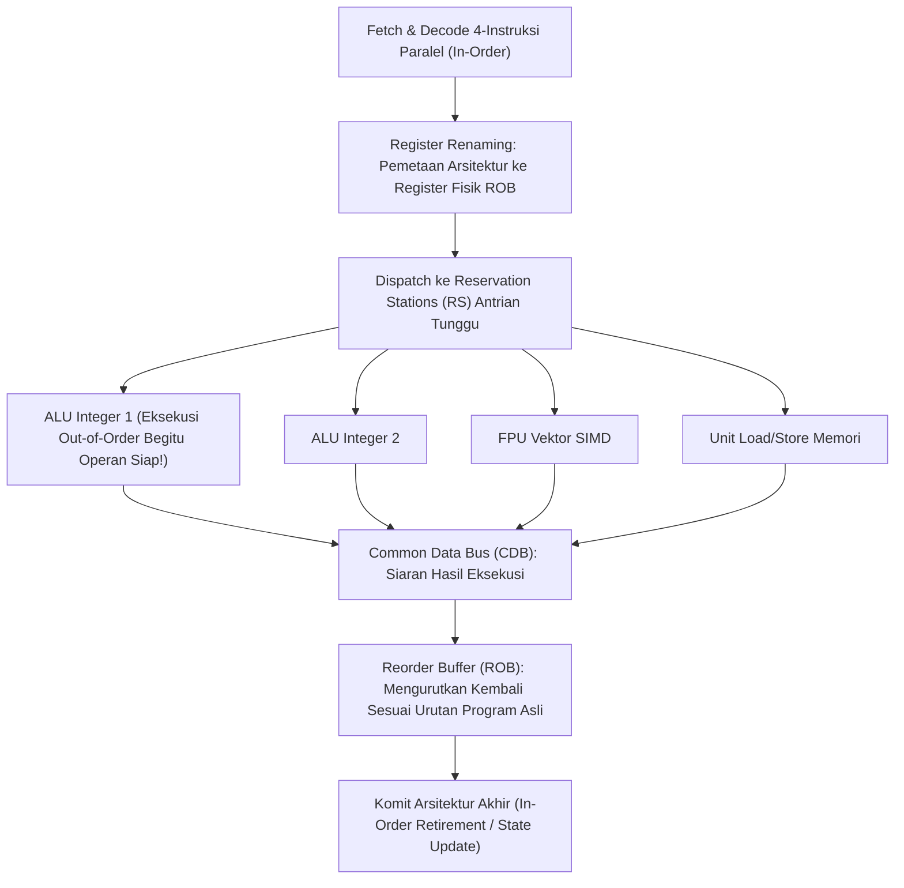

# Modul 065: Eksekusi Instruksi Lanjut (Superscalar, Branch Prediction, Out-of-Order Tomasulo, SMT/Hyper-Threading)

**Navigasi**: [⬅️ Master Index](../../INDEX.md) | [Tingkat 4: Tingkat 4: Logika Digital, Computer Engineering & Arsitektur Komputer](./README.md)
*Sebelumnya*: [064. teknik-pipelining-prosesor-hazards](./064-teknik-pipelining-prosesor-hazards.md) | *Berikutnya*: [066. hierarki-memori-arsitektur-cache-cpu](./066-hierarki-memori-arsitektur-cache-cpu.md)

---

## 1. Intuisi Dasar Tanpa Jargon ("Seperti Bayi Baru Lahir")
Pernahkah Anda mengamati jalan tol yang macet karena hanya memiliki 1 jalur kendaraan? Jika mobil di depan mogok, seluruh ratusan mobil di belakangnya berhenti total!

Solusi pertama: Bangun jalan tol dengan **4 Jalur Paralel (Superscalar)**: empat mobil bisa melaju berdampingan pada saat yang sama!
Solusi kedua yang jauh lebih gila: Bagaimana jika mobil nomor 4 diizinkan menyalip dan mendahului mobil nomor 1 yang sedang mogok jika jalurnya kosong?
Inilah **Eksekusi Di Luar Urutan (Out-of-Order Execution / OoO)**:
Sebuah prosesor canggih (seperti Apple M3 atau Intel Core i9) membaca puluhan instruksi ke depan, melihat instruksi mana yang datanya sudah siap, lalu **mengekskusinya duluan tanpa mempedulikan urutan baris kode Anda!**
Setelah selesai, prosesor menyusun kembali hasilnya secara rapi sesuai urutan semula sebelum menyerahkannya ke sistem operasi seolah-olah semuanya berjalan teratur.
[📚 Pelajari: Tomasulo's Algorithm Explained](https://courses.cs.washington.edu/courses/csep548/06au/lectures/tomasulo.pdf)

## 2. Fondasi Teoretis & Aksiomatik / Matematis
### 65.1 Arsitektur Superscalar & Batas Throughput IPC > 1 ([Hennessy & Patterson](https://www.elsevier.com/))
Prosesor skalar tradisional dibatasi oleh $\text{IPC} \le 1.0$ (Instructions Per Cycle).
Prosesor **Superscalar Berderajat-$N$ ($N$-Way Issue)** mengambil, mendekode, dan mengeksekusi hingga $N$ instruksi secara paralel dalam 1 siklus clock tunggal ($\text{IPC}_{\max} = N$):
- Memerlukan beberapa unit fungsional paralel (*Multiple Execution Units*): 4 unit ALU integer, 2 unit FPU vektor, 2 unit Load/Store agen.
- Pemeriksaan dependensi instruksi multi-arah (*Multi-Issue Dependency Checking*) pada tahap decode.

### 65.2 Prediksi Cabang Dinamis (Dynamic Branch Prediction) ([Yeh & Patt Two-Level Adaptive Predictor](https://doi.org/10.1109/ISCA.1991.145003))
Pada pipeline dalam ($15 - 25\text{ tahap}$), kesalahan prediksi cabang (*Branch Misprediction Penalty*) membuang puluhan siklus clock.
- **Prediktor 2-Bit Saturating Counter**:
  Empat keadaan: *Strongly Not Taken (00)*, *Weakly Not Taken (01)*, *Weakly Taken (10)*, *Strongly Taken (11)*.
  Membutuhkan dua kali kesalahan berturut-turut untuk mengubah keputusan prediksi (sangat efektif untuk loop perulangan yang hanya keluar satu kali di akhir).
- **Two-Level Adaptive Predictor (Tournament / TAGE Predictor)**:
  Menggabungkan riwayat global percabangan masa lalu (*Branch History Register* BHR) dengan pola lokal untuk mencapai akurasi prediksi mencengangkan: **$> 97\%$ akurat!**

### 65.3 Algoritma Tomasulo & Register Renaming ([Tomasulo Original Paper, 1967](https://doi.org/10.1147/rd.111.0025))
Mengeliminasi ketergantungan palsu akibat keterbatasan jumlah nama register arsitektur:
- **True Dependency (RAW - Read After Write)**: Ketergantungan data sejati yang tidak bisa dihindari.
- **Anti-Dependency (WAR - Write After Read)**: Bahaya penamaan register palsu.
- **Output Dependency (WAW - Write After Write)**: Bahaya penamaan register palsu.

Solusi Tomasulo: **Register Renaming**:
Memetakan nama register arsitektur logis ($R_1 - R_{31}$) ke wadah register fisik yang jumlahnya jauh lebih banyak ($P_1 - P_{128}$) menggunakan:
1. **Reservation Stations (RS)**: Antrian penyangga di depan setiap unit ALU yang menahan instruksi hingga seluruh operannya siap.
2. **Common Data Bus (CDB)**: Bus siaran hasil eksekusi yang langsung didengarkan oleh seluruh Reservation Station tanpa harus lewat register file.
3. **Reorder Buffer (ROB)**: Menjamin bahwa instruksi yang dieksekusi secara acak (*Out-of-Order Execution*) diselesaikan dan dicatat hasilnya ke status arsitektur secara tertib teratur (*In-Order Commit / Retirement*), mempertahankan konsistensi eksepsi persis (*Precise Exception Support*).

### 65.4 Simultaneous Multithreading (SMT / Intel Hyper-Threading) ([Tullsen SMT Paper](https://doi.org/10.1145/223982.224449))
Satu inti prosesor fisik (Core) menduplikasi register arsitektur dan status thread sehingga tampak sebagai 2 prosesor logis bagi sistem operasi:
Mengeksekusi instruksi dari dua thread perangkat lunak independen secara bercampur di unit fungsional eksekusi yang sama, mengisi celah-celah kosong gelembung pipeline (*horizontal and vertical waste*) saat satu thread mengalami cache miss.

## 3. Anatomi Teknis & Cara Kerja Internal

Precise Exceptions:
Jika sebuah instruksi di tengah menghasilkan pembagian dengan nol (*Division by Zero Exception*), prosesor tidak boleh langsung crash saat instruksi itu dieksekusi out-of-order; ROB menahan eksepsi tersebut hingga seluruh instruksi sebelumnya selesai dikomit secara teratur, lalu membatalkan seluruh instruksi spekulatif setelahnya.

## 4. Implementasi Praktis & Kode / Simulasi Riil
class TwoBitBranchPredictor:
    """
    Simulasi mesin prediktor cabang saturasi 2-bit (Saturating 2-Bit Counter).
    Keadaan: 0 (Strongly Not Taken), 1 (Weakly Not Taken), 2 (Weakly Taken), 3 (Strongly Taken).
    """
    def __init__(self):
        self.state = 2 # Inisialisasi: Weakly Taken
        
    def predict(self) -> bool:
        # Prediksi Taken jika state >= 2
        return self.state >= 2
        
    def update(self, actual_taken: bool):
        # Update counter saturasi dengan batas min 0 dan max 3
        if actual_taken:
            self.state = min(3, self.state + 1)
        else:
            self.state = max(0, self.state - 1)

predictor = TwoBitBranchPredictor()
# Pola cabang loop: 5 kali Taken (T), lalu 1 kali Not-Taken (NT) keluar loop
actual_history = [True, True, True, True, True, False]
correct_predictions = 0

print("Evaluasi Prediktor Cabang 2-Bit:")
for i, actual in enumerate(actual_history):
    pred = predictor.predict()
    is_correct = (pred == actual)
    if is_correct: correct_predictions += 1
    print(f"Iterasi {i+1}: Prediksi={pred:5s} | Aktual={str(actual):5s} | Tepat={is_correct}")
    predictor.update(actual)

print(f"Akurasi Prediksi: {correct_predictions / len(actual_history) * 100:.1f}%")

## 5. Miskonsepsi & Jebakan Industri
1. **Speculative Execution Security Exploits (Spectre & Meltdown)**: Inti Out-of-Order yang mengeksekusi instruksi secara spekulatif melintasi batas hak akses keamanan (melompati pemeriksaan izin); meski hasil instruksi dibatalkan oleh ROB saat terjadi kesalahan, jejak pembacaan data rahasia tertinggal di dalam L1 Cache dan dapat diekstraksi penyerang via serangan saluran samping waktu (*Cache Timing Side-Channel Attack*).
2. **Reorder Buffer Sizing Deadlocks**: Mengabaikan ukuran kedalaman antrian Reorder Buffer (ROB); jika ROB penuh dengan instruksi yang terhambat oleh cache miss memori DRAM yang lambat, seluruh pemrosesan superscalar berhenti total (*head-of-line blocking*).
3. **Branch Target Buffer (BTB) Aliasing**: Tabel BTB berukuran kecil dapat mengalami tabrakan alamat hash (*aliasing*) antara dua percabangan yang berbeda, menyebabkan prosesor melompat spekulatif ke alamat kode yang salah dan membuang ratusan siklus clock untuk recovery flush.

## 6. Proyek Latihan & Rubrik Penilaian Mandiri
### Tingkat 1 (Pemula) - Simulasi Prediktor Cabang Dinamis 2-Bit vs 1-Bit
Tulis skrip Python yang menerima berkas jejak percabangan (*branch trace*) berisi $10.000$ keputusan percabangan nyata. Bandingkan persentase akurasi prediksi antara prediktor 1-bit bimodal sederhana vs prediktor saturasi 2-bit.

### Tingkat 2 (Menengah) - Diagram Eksekusi Tomasulo Manual Menggunakan Tabel Reservation Station
Diberikan barisan 5 instruksi floating point dengan ketergantungan RAW, WAR, dan WAW yang dieksekusi pada arsitektur Tomasulo 2-FPU Adder dan 2-FPU Multiplier. Isi tabel Reservation Station, Register Result Status, dan Reorder Buffer untuk setiap siklus clock dari siklus 1 hingga siklus 12.

### Tingkat 3 (Mahir) - Simulator Reorder Buffer (ROB) Out-of-Order dengan Register Renaming
Rancang dan implementasikan simulator berorientasi objek dalam Python/C++ untuk modul Reorder Buffer (ROB 32-entry) dan Register Alias Table (RAT): lakukan pemetaan register arsitektur ke register fisik, tangani eksekusi out-of-order 2 unit ALU integer, dan buktikan mekanisme *in-order retirement* serta pemulihan rollback status yang mulus saat terjadi eksepsi traps buatan.

#### Rubrik Penilaian
- **40% Ketepatan Resolusi Bahaya Data**: Mengeliminasi seluruh bahaya semu WAR dan WAW melalui mekanisme penamaan ulang register secara sempurna.
- **30% Integritas Komit In-Order**: Menjamin bahwa seluruh modifikasi status register arsitektur terjadi tepat sesuai urutan program asli.
- **30% Evaluasi Kinerja Throughput**: Mampu memvalidasi peningkatan metrik IPC prosesor Out-of-Order terhadap prosesor in-order pada benchmark intensif percabangan.

## 7. Rekomendasi Sumber Belajar Standar Emas
| Kategori | Judul Sumber & Tautan Langsung | Deskripsi Singkat |
|---|---|---|
| 📖 Buku Teks | [Computer Architecture: A Quantitative Approach (Hennessy & Patterson)](https://www.elsevier.com/) | Analisis paling otoritatif mengenai arsitektur Superscalar, Tomasulo, SMT, dan Branch Prediction. |
| 🎓 Kuliah Terbuka | [CMU 18-447 Computer Architecture: Out-of-Order Execution (Onur Mutlu)](https://safari.ethz.ch/architecture/fall2020/) | Seri kuliah mendalam Onur Mutlu mengenai Tomasulo, ROB, dan eksekusi spekulatif. |
| 🔬 Makalah Seminal | [An Efficient Algorithm for Exploiting Multiple Arithmetic Units (Robert Tomasulo, 1967)](https://doi.org/10.1147/rd.111.0025) | Makalah monumental penemuan algoritma Tomasulo di IBM System/360 Model 91. |
| 💻 Lab Interaktif | [Gem5 Architectural Simulator](https://www.gem5.org/) | Simulator arsitektur komputer siklus-akurat paling banyak digunakan di dunia akademis dan industri chip. |

---
*Navigasi Cepat*: [Ke Tingkat 4](./README.md) | [Ke Master Index](../../INDEX.md) | *Sebelumnya*: [064. teknik-pipelining-prosesor-hazards](./064-teknik-pipelining-prosesor-hazards.md) | *Berikutnya*: [066. hierarki-memori-arsitektur-cache-cpu](./066-hierarki-memori-arsitektur-cache-cpu.md)
