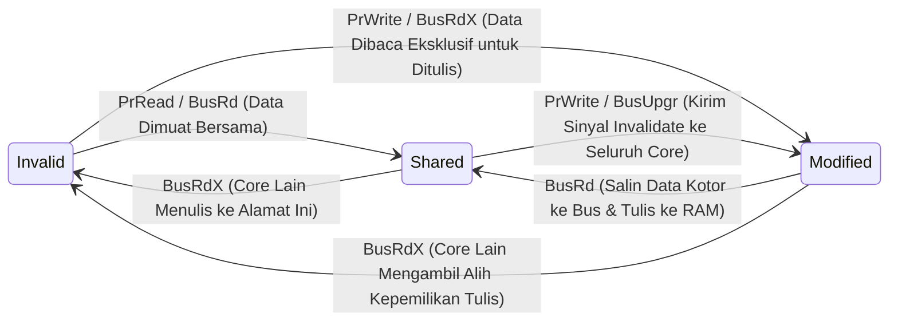

# Modul 066: Hierarki Memori & Arsitektur Cache CPU (L1/L2/L3 Cache, Mapping, Protokol Koherensi MESI/MOESI)

**Navigasi**: [⬅️ Master Index](../../INDEX.md) | [Tingkat 4: Tingkat 4: Logika Digital, Computer Engineering & Arsitektur Komputer](./README.md)
*Sebelumnya*: [065. eksekusi-instruksi-lanjut](./065-eksekusi-instruksi-lanjut.md) | *Berikutnya*: [067. dukungan-hardware-memori-virtual](./067-dukungan-hardware-memori-virtual.md)

---

## 1. Intuisi Dasar Tanpa Jargon ("Seperti Bayi Baru Lahir")
Bayangkan seorang mahasiswa yang sedang menulis skripsi di meja belajarnya:
- Di atas mejanya ada buku catatan kecil yang sedang terbuka: ia bisa membaca dan menulis dalam tempo **1 detik** (**Cache L1**).
- Di rak buku di samping mejanya ada 5 buku referensi: ia butuh **10 detik** untuk mengambilnya (**Cache L2/L3**).
- Di perpustakaan kampus di seberang jalan ada ribuan buku: ia butuh berjalan kaki **15 menit** ke sana untuk meminjam buku (**RAM Utama**).
- Di gudang arsip nasional di kota lain ada jutaan dokumen kuno: ia butuh naik kereta api **3 hari** ke sana (**Harddisk / SSD**).

Jika mahasiswa tersebut harus berjalan ke perpustakaan kampus setiap kali ia ingin membaca satu kalimat, skripsinya tidak akan pernah selesai seumur hidup!
Karena kecepatan prosesor modern ($5	ext{ GHz} pprox 0.2	ext{ ns}$) melesat ribuan kali lebih cepat daripada kecepatan memori RAM ($80	ext{ ns}$), prosesor mengandalkan **Hierarki Cache Memori**:
Menyimpan salinan data yang sering diakses di dalam keping memori SRAM kecil ultra-cepat yang menempel langsung tepat di atas inti CPU.
[📚 Pelajari: MIT OCW 6.004 Caches and Memory Hierarchy](https://ocw.mit.edu/courses/6-004-computation-structures-spring-2017/)

## 2. Fondasi Teoretis & Aksiomatik / Matematis
### 66.1 Prinsip Lokalitas Komputasi (Principle of Locality) ([Bryant & O'Hallaron](https://csapp.cs.cmu.edu/))
Hierarki cache berhasil karena program komputer nyata tidak mengakses memori secara acak seragam, melainkan mematuhi dua hukum alam lokalitas:
1. **Lokalitas Temporal (Temporal Locality)**: Data yang baru saja diakses saat ini kemungkinan besar akan diakses kembali dalam waktu dekat (misal: variabel pencacah loop `i++`).
2. **Lokalitas Spasial (Spatial Locality)**: Data yang beralamat fisik berdekatan dengan data yang baru saja diakses kemungkinan besar akan segera diakses berikutnya (misal: membaca elemen array terurut `array[0], array[1], array[2]`).

### 66.2 Organisasi Cache: Direct Mapped vs Set Associative ([Hennessy & Patterson](https://www.elsevier.com/))
Alamat memori fisik 32/64-bit dipecah menjadi tiga bagian:
`[ Tag ][ Set Index ][ Block Offset ]`
- **Direct Mapped Cache**: Setiap blok memori utama hanya memiliki tepat 1 lokasi sel yang pasti di cache ($Index = (\text{Block Address}) \bmod (\text{Number of Sets})$). Sangat cepat dan murah, namun rentan mengalami tabrakan konflik (*Conflict Misses*).
- **$N$-Way Set Associative Cache**: Setiap blok memori dapat diletakkan di salah satu dari $N$ baris (*ways*) di dalam set yang sama. Mengurangi conflict miss drastis (standar industri: L1 8-way, L2 16-way).
- **Fully Associative Cache**: Blok memori dapat diletakkan di sembarang lokasi cache (hanya Tag dan Offset, tanpa Index). Memerlukan komparator paralel masif, digunakan pada TLB berukuran kecil.

Rata-Rata Waktu Akses Memori (*Average Memory Access Time* AMAT):
$$\text{AMAT} = \text{Hit Time} + (\text{Miss Rate} \times \text{Miss Penalty})$$

### 66.3 Tiga Penyebab Cache Miss (The 3Cs Model) & Kebijakan Penggantian ([Hill 3C Model, 1987](https://doi.org/10.1145/30350.30353))
1. **Compulsory Miss (Cold Miss)**: Akses pertama kali ke blok data yang belum pernah dimuat ke cache.
2. **Capacity Miss**: Ukuran total cache fisik terlalu kecil untuk menampung seluruh himpunan kerja (*working set*) program.
3. **Conflict Miss**: Terjadi pada direct-mapped atau set-associative di mana beberapa blok data yang aktif memetakan ke set indeks yang sama persis dan saling menendang keluar.
4. **Coherence Miss**: Pada sistem multi-core, data ditendang karena core lain memodifikasi alamat tersebut.

Kebijakan Penggantian Baris Cache (*Eviction Policy*):
- **Least Recently Used (LRU)**: Menendang blok yang paling lama tidak disentuh.
- **Pseudo-LRU (PLRU)**: Aproksimasi pohon bit hierarkis hemat area silikon.

Kebijakan Penulisan (*Write Policy*):
- **Write-Through**: Menulis ke cache dan langsung menulis ke RAM utama simultan (aman, tapi boros bandwidth bus).
- **Write-Back**: Menulis hanya ke cache dan menandai bendera *Dirty Bit*; data baru ditulis kembali ke RAM saat baris tersebut ditendang keluar (*evicted*).

### 66.4 Protokol Koherensi Cache Multi-Core MESI ([Papamarcos & Patel MESI Protocol, 1984](https://doi.org/10.1145/800015.808204))
Pada prosesor multi-core di mana setiap core memiliki cache L1 privat sendiri:
Setiap baris cache L1 dilacak oleh finite state machine dengan 4 keadaan:
1. **Modified (M)**: Data kotor (*dirty*), hanya ada di cache ini, berbeda dengan memori utama.
2. **Exclusive (E)**: Data bersih (*clean*), hanya ada di cache ini, sama persis dengan memori utama.
3. **Shared (S)**: Data bersih, tersalin di beberapa cache core lain sekaligus (hanya boleh dibaca).
4. **Invalid (I)**: Data basi tidak valid, tidak boleh dibaca.

Mekanisme Bus Snooping: Setiap core memantau (*snoop*) lalu lintas bus data bersama; jika Core A ingin menulis ke baris dalam status *Shared*, Core A menyiarkan sinyal pembatalan *Invalidate*, memaksa seluruh core lain membalikkan status barisnya menjadi *Invalid*.

## 3. Anatomi Teknis & Cara Kerja Internal

Fenomena False Sharing:
Dua thread independen pada dua core yang berbeda memodifikasi dua variabel independen terpisah ($A$ dan $B$), tetapi kedua variabel tersebut kebetulan berada di dalam baris cache 64-byte yang sama (*Cache Line*). Protokol MESI akan saling memantulkan sinyal invalidasi terus-menerus bolak-balik antar core (*cache line ping-ponging*), meruntuhkan performa komputasi paralel multi-core hingga puluhan kali lipat!

## 4. Implementasi Praktis & Kode / Simulasi Riil
def simulate_direct_mapped_cache(cache_size_bytes: int, block_size_bytes: int, access_addresses: list[int]) -> dict:
    """
    Simulasi Direct-Mapped Cache hit and miss tracker.
    """
    num_blocks = cache_size_bytes // block_size_bytes
    # Setiap entry cache menyimpan: (valid_bit, tag)
    cache_table = [(False, None)] * num_blocks
    
    hits = 0
    misses = 0
    
    # Hitung jumlah bit untuk offset dan index
    offset_bits = int(np.log2(block_size_bytes))
    index_bits = int(np.log2(num_blocks))
    
    for addr in access_addresses:
        block_addr = addr >> offset_bits
        set_index = block_addr % num_blocks
        tag = block_addr >> index_bits
        
        valid, current_tag = cache_table[set_index]
        if valid and current_tag == tag:
            hits += 1
        else:
            misses += 1
            # Muat blok baru ke cache (Cold atau Conflict Miss)
            cache_table[set_index] = (True, tag)
            
    total_accesses = len(access_addresses)
    hit_rate = (hits / total_accesses) * 100.0
    
    return {
        "total_accesses": total_accesses,
        "hits": hits, "misses": misses,
        "hit_rate_pct": hit_rate
    }

import numpy as np
# Akses array sekuensial (Lokalitas Spasial Kuat): membaca 64 byte berturutan pada blok 16-byte
seq_addrs = [0, 4, 8, 12, 16, 20, 24, 28, 32, 36, 40, 44, 48, 52, 56, 60]
res_seq = simulate_direct_mapped_cache(cache_size_bytes=64, block_size_bytes=16, access_addresses=seq_addrs)

print(f"Akses Sekuensial: Hits={res_seq['hits']} | Misses={res_seq['misses']} | Hit Rate={res_seq['hit_rate_pct']:.1f}%")
print(f"Catatan: Hanya ada 4 Miss (Cold Miss awal setiap blok 16-byte), 12 akses lainnya HIT instan!")

## 5. Miskonsepsi & Jebakan Industri
1. **Matrix Multiplication Row-Major vs Column-Major Disaster**: Mengiterasi matriks 2D $N 	imes N$ besar dengan urutan kolom (*column-major traversal* `for i in range: for j in range: A[j][i]`) dalam bahasa C/C++ yang menyimpan array secara row-major; setiap pembacaan melompati seluruh baris memori, menghasilkan cache miss $100\%$ dan memperlambat komputasi hingga $20	ext{x}$ lipat dibandingkan iterasi baris `A[i][j]`.
2. **False Sharing in Multi-Threaded Code**: Menaruh variabel counter akumulator thread `long counter[num_threads]` dalam array padat; semua thread saling menginvalidasi cache line 64-byte yang sama, menghancurkan skalabilitas multi-core CPU. Solusi: berikan padding kosong 64 byte antar variabel (`alignas(64)`).
3. **Ignoring Cache Flush on DMA Buffers**: Mentransfer data dari modul peripheral hardware langsung ke memori RAM via Direct Memory Access (DMA) tanpa menginvalidasi baris cache CPU terkait; CPU akan terus membaca data usang yang tertinggal di cache L1 alih-alih membaca data baru yang baru saja disuntikkan DMA ke RAM.

## 6. Proyek Latihan & Rubrik Penilaian Mandiri
### Tingkat 1 (Pemula) - Perhitungan AMAT Hierarki Memori 3-Tingkat
Diberikan CPU dengan L1 Hit Time = $1	ext{ ns}$ (Miss Rate = $5\%$), L2 Hit Time = $4	ext{ ns}$ (Miss Rate = $15\%$), L3 Hit Time = $12	ext{ ns}$ (Miss Rate = $25\%$), dan Latensi RAM Utama = $80	ext{ ns}$. Hitung Rata-Rata Waktu Akses Memori (AMAT) total sistem dalam nanodetik.

### Tingkat 2 (Menengah) - Optimasi Algoritma Perkalian Matriks Cache Blocking (Tiling)
Tulis implementasi perkalian matriks $1024 	imes 1024$ double-precision dalam C atau Python menggunakan teknik *Loop Tiling / Cache Blocking*: bagi matriks besar menjadi sub-matriks blok $B 	imes B$ yang muat sempurna di dalam Cache L1 data ($32	ext{ KB}$). Ukur dan bandingkan waktu eksekusi algoritma naif $O(N^3)$ vs algoritma tiled.

### Tingkat 3 (Mahir) - Simulator Koherensi Cache Multi-Core MESI Cycle-Accurate
Rancang dan implementasikan simulator bus-snooping protokol koherensi MESI 4-core dalam Python/C++: kelola 4 modul cache L1 2-way set-associative yang terhubung ke satu bus siaran memori bersama, simulasikan transisi status FSM (M, E, S, I) untuk skenario transaksi baca/tulis multi-thread konkuren, dan hitung persentase latensi siklus yang terbuang akibat fenomena False Sharing.

#### Rubrik Penilaian
- **40% Ketepatan Pemetaan Alamat Cache**: Penguraian bit Tag, Index, dan Offset serta penanganan baris kotor Dirty Bit akurat.
- **30% Kepatuhan Protokol Koherensi MESI**: Seluruh transisi status bus read/write invalidation mematuhi model formal Papamarcos-Patel.
- **30% Optimasi Lokalitas Komputasi**: Algoritma komputasi membuktikan pemaksimalan lokalitas temporal dan spasial dengan cache miss rate minimal.

## 7. Rekomendasi Sumber Belajar Standar Emas
| Kategori | Judul Sumber & Tautan Langsung | Deskripsi Singkat |
|---|---|---|
| 📖 Buku Teks | [Computer Systems: A Programmer's Perspective (Bryant & O'Hallaron)](https://csapp.cs.cmu.edu/) | Bab hierarki memori dan optimasi cache-friendly code paling terkenal di dunia ilmu komputer. |
| 🎓 Kuliah Terbuka | [MIT OCW 6.004 Computation Structures: Memory Hierarchy](https://ocw.mit.edu/courses/6-004-computation-structures-spring-2017/) | Desain organisasi cache set-associative, AMAT, dan protokol koherensi multi-core. |
| 🔬 Makalah Seminal | [A Low-Overhead Coherence Solution for Multiprocessors with Private Cache Memories (Papamarcos & Patel, MESI, 1984)](https://doi.org/10.1145/800015.808204) | Makalah asli yang mendefinisikan protokol status koherensi cache MESI yang digunakan di seluruh CPU modern. |
| 💻 Lab Interaktif | [Interactive Cache Simulator (University of Texas)](https://courses.cs.washington.edu/courses/cse378/09wi/cache_sim.html) | Simulator grafis interaktif visualisasi penempatan blok cache direct-mapped dan set-associative. |

---
*Navigasi Cepat*: [Ke Tingkat 4](./README.md) | [Ke Master Index](../../INDEX.md) | *Sebelumnya*: [065. eksekusi-instruksi-lanjut](./065-eksekusi-instruksi-lanjut.md) | *Berikutnya*: [067. dukungan-hardware-memori-virtual](./067-dukungan-hardware-memori-virtual.md)
