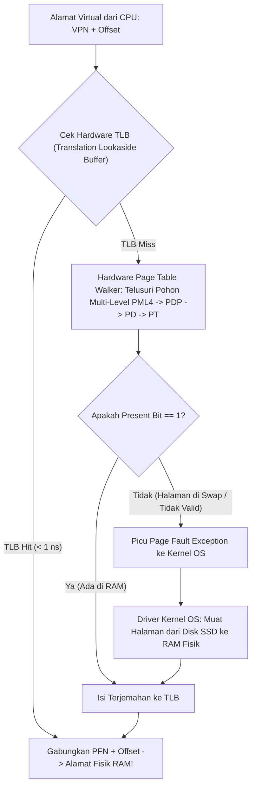

# Modul 067: Dukungan Hardware Memori Virtual (Memory Management Unit / MMU, Page Tables, Hardware TLB)

**Navigasi**: [⬅️ Master Index](../../INDEX.md) | [Tingkat 4: Tingkat 4: Logika Digital, Computer Engineering & Arsitektur Komputer](./README.md)
*Sebelumnya*: [066. hierarki-memori-arsitektur-cache-cpu](./066-hierarki-memori-arsitektur-cache-cpu.md) | *Berikutnya*: [068. bus-sistem-antarmuka-interkoneksi](./068-bus-sistem-antarmuka-interkoneksi.md)

---

## 1. Intuisi Dasar Tanpa Jargon ("Seperti Bayi Baru Lahir")
Bayangkan Anda menjalankan 10 aplikasi sekaligus di komputer Anda: web browser Google Chrome dengan 50 tab, game 3D, pemutar musik Spotify, dan software compiler. Jika semua program ini menulis langsung ke kabel memori RAM fisik yang sama tanpa pengawas:
- Tab browser yang crash bisa secara tidak sengaja menimpa saldo rekening bank Anda di tab sebelah!
- Program jahat (virus) bisa membaca password Anda yang sedang tersimpan di RAM aplikasi lain!

Untuk mencegah malapetaka ini, komputer menciptakan **Ilusi Terbesar dalam Ilmu Komputer: Memori Virtual (Virtual Memory)**!
Setiap program yang berjalan di komputer dibuat merasa seolah-olah ia adalah **satu-satunya penguasa di alam semesta** yang memiliki memori raksasa pribadi mulai dari alamat nol `0x00000000` hingga tak hingga.
Di dalam chip CPU terdapat polisi lalu lintas perangkat keras yang disebut **MMU (Memory Management Unit)**:
Setiap kali program mencoba membaca memori, MMU secara transparan menerjemahkan alamat khayalan program (**Alamat Virtual**) menjadi alamat kabel RAM nyata (**Alamat Fisik**), sambil mengunci pintu agar tidak ada satu program pun yang bisa mengintip memori program lain!
[📚 Pelajari: OSTEP Chapter 13 - Address Spaces & Virtual Memory](https://pages.cs.wisc.edu/~remzi/OSTEP/vm-intro.pdf)

## 2. Fondasi Teoretis & Aksiomatik / Matematis
### 67.1 Konsep Ruang Alamat Virtual & Pembagian Halaman (Paging) ([Arpaci-Dusseau OSTEP](https://pages.cs.wisc.edu/~remzi/OSTEP/))
Memori dibagi menjadi blok berukuran tetap yang disebut **Halaman (Page)** (standar arsitektur: $4\text{ KB} = 4096\text{ byte} = 2^{12}\text{ byte}$).
Memori fisik RAM dibagi menjadi blok dengan ukuran yang sama yang disebut **Page Frame**.
Pemisahan Alamat Virtual 32-bit:
`[ Virtual Page Number (VPN) - 20 Bit ][ Page Offset - 12 Bit ]`
- Bit Offset ($12\text{ bit}$) diteruskan langsung tanpa perubahan ($Offset_{\text{virtual}} = Offset_{\text{fisik}}$).
- VPN diterjemahkan oleh unit MMU menjadi Physical Frame Number (PFN) melalui Tabel Halaman (*Page Table*):
$$\text{Physical Address} = (\text{PFN} \ll 12) \mid \text{Page Offset}$$

Keuntungan Mutlak Memori Virtual:
1. **Proteksi & Isolasi Antar Proses**: Bit izin pada entri tabel halaman (`R/W/X`, `User/Supervisor`) mencegah aplikasi biasa membaca atau mengeksekusi memori kernel sistem operasi.
2. **Berbagi Memori Aman (Shared Memory)**: Dua proses berbeda dapat memetakan halaman virtual privat mereka ke page frame fisik yang sama di RAM (misal library bersama `libc.so`).
3. **Ekspansi Ruang Swap Disk**: Jika RAM fisik penuh, halaman memori yang jarang digunakan dapat dibuang sementara ke harddisk/SSD (*Swapping* / *Paging to Disk*).

### 67.2 Struktur Tabel Halaman Bertingkat (Multi-Level Page Tables) ([Silberschatz OS Concepts](https://www.os-book.com/))
Pada arsitektur 64-bit (misal x86-64 model 4-level paging / Page Map Level 4 PML4):
Tabel halaman linier 1-tingkat akan membutuhkan $2^{52}$ entri yang menghabiskan jutaan Terabyte RAM hanya untuk menyimpan tabel itu sendiri!
Solusi: **Pohon Hierarki Tabel Bertingkat (Radix Tree Multi-Level Paging)**:
Alamat virtual 48-bit x86-64 dipecah menjadi:
`[ PML4 (9 bit) ][ PDP (9 bit) ][ PD (9 bit) ][ PT (9 bit) ][ Offset (12 bit) ]`
Tabel halaman tingkat bawah hanya dialokasikan di RAM jika wilayah memori tersebut benar-benar digunakan oleh program (*sparse memory allocation*), memangkas penggunaan memori tabel dari Gigabyte menjadi hanya beberapa Kilobyte.

Register Penunjuk Tabel Halaman:
- x86-64: Register `CR3` menyimpan alamat fisik akar tabel PML4.
- ARM64: Register `TTBR0_EL1` (User space) dan `TTBR1_EL1` (Kernel space).
- RISC-V: Register `satp` (Supervisor Address Translation and Protection).

### 67.3 Translation Lookaside Buffer (TLB) & Page Fault Exception ([Hennessy & Patterson](https://www.elsevier.com/))
Penerjemahan memori multi-level membutuhkan 4 kali pembacaan RAM tambahan untuk setiap 1 kali akses data tunggal ($4\text{x}$ penalti latensi!).
Solusi Penyelamat: **Translation Lookaside Buffer (TLB)**:
Cache perangkat keras SRAM asosiatif penuh (*Fully Associative Cache*) di dalam inti CPU yang menyimpan terjemahan VPN-ke-PFN terbaru.
- Hit Time TLB: $< 0.5\text{ ns}$ (hanya 1 siklus clock, penalti terjemahan mendekati nol!).
- Miss Rate TLB: Tipikal $< 1\%$.
- Jika TLB Miss: Hardware Page Table Walker menelusuri hierarki pohon tabel di RAM secara otomatis.

Pengecualian Gangguan Halaman (*Page Fault Exception*):
Terjadi jika program mengakses alamat virtual yang bit keberadaannya tidak aktif (`Present Bit = 0`):
1. MMU membekukan eksekusi CPU dan memicu interupsi hardware *Page Fault Interrupt* (vektor 14 di x86).
2. Sistem operasi mengambil alih: membaca halaman yang bersangkutan dari disk SSD/Swap ke dalam RAM fisik kosong.
3. Sistem operasi memperbarui entri tabel halaman (`Present = 1`), memperbarui TLB, dan memutar ulang instruksi yang gagal tadi tanpa diketahui oleh program pengguna (*Transparent Handling*).

## 3. Anatomi Teknis & Cara Kerja Internal

Teknik Huge Pages (Transparent Huge Pages):
Menggunakan ukuran halaman raksasa ($2	ext{ MB}$ atau $1	ext{ GB}$) alih-alih standar $4	ext{ KB}$ untuk database dan aplikasi memori masif. Mengurangi jumlah entri TLB yang dibutuhkan hingga $500	ext{x}$ lipat, melenyapkan TLB miss pada dataset puluhan Gigabyte.

## 4. Implementasi Praktis & Kode / Simulasi Riil
def simulate_two_level_paging_mmu(virtual_address: int, page_directory: dict, tlb_cache: dict) -> dict:
    """
    Simulasi penerjemahan alamat virtual ke alamat fisik oleh MMU 2-tingkat dengan TLB.
    Format 32-Bit: [ Directory Index 10-bit ][ Page Table Index 10-bit ][ Offset 12-bit ]
    """
    offset = virtual_address & 0xFFF
    pt_index = (virtual_address >> 12) & 0x3FF
    pd_index = (virtual_address >> 22) & 0x3FF
    vpn = virtual_address >> 12
    
    # 1. Periksa TLB Hit
    if vpn in tlb_cache:
        pfn = tlb_cache[vpn]
        phys_addr = (pfn << 12) | offset
        return {"status": "TLB HIT", "vpn": hex(vpn), "pfn": hex(pfn), "phys_addr": hex(phys_addr)}
        
    # 2. Page Table Walk
    if pd_index in page_directory:
        page_table = page_directory[pd_index]
        if pt_index in page_table:
            entry = page_table[pt_index] # (pfn, present_bit, writable)
            if entry["present"]:
                pfn = entry["pfn"]
                tlb_cache[vpn] = pfn # Masukkan ke TLB
                phys_addr = (pfn << 12) | offset
                return {"status": "TLB MISS (Page Table Walk Lolos)", "pfn": hex(pfn), "phys_addr": hex(phys_addr)}
                
    return {"status": "PAGE FAULT EXCEPTION (Alamat tidak dipetakan ke RAM!)", "address": hex(virtual_address)}

# Inisialisasi struktur tabel halaman tiruan
mock_pt = {5: {"pfn": 0x1A2B, "present": True}}
mock_pd = {1: mock_pt}
mock_tlb = {}

# Alamat Virtual: Directory=1, PT=5, Offset=0x4A0 => (1 << 22) | (5 << 12) | 0x4A0 = 0x4054A0
va_test = (1 << 22) | (5 << 12) | 0x4A0
res1 = simulate_two_level_paging_mmu(va_test, mock_pd, mock_tlb)
res2 = simulate_two_level_paging_mmu(va_test, mock_pd, mock_tlb) # Akses kedua harus TLB Hit

print(f"Akses Pertama: {res1['status']} => Alamat Fisik: {res1.get('phys_addr')}")
print(f"Akses Kedua  : {res2['status']} => Alamat Fisik: {res2.get('phys_addr')}")

## 5. Miskonsepsi & Jebakan Industri
1. **TLB Shootdown Overhead in Multiprocessors**: Saat sistem operasi mengubah entri tabel halaman pada Core A, Core A harus mengirimkan interupsi antar-prosesor (IPI) ke seluruh core CPU lain untuk membuang (*flush*) entri TLB usang mereka; memicu badai interupsi (*TLB Shootdown Storm*) yang melumpuhkan performa server virtualisasi cloud.
2. **Thrashing Due to Excessive Memory Pressure**: Terjadi ketika memori fisik RAM terlalu penuh dan proses-proses aktif saling berebut; sistem operasi menghabiskan $99\%$ waktu CPU hanya untuk membaca dan menulis halaman swap ke disk (*Thrashing*), membuat komputer macet total.
3. **Dereferencing NULL Pointers**: Pointer NULL (`0x00000000`) sengaja dibiarkan tidak pernah dipetakan oleh sistem operasi di halaman pertama (*Page 0 unmapped*); setiap upaya membaca alamat nol langsung memicu Page Fault hardware yang menembak mati program seketika (*Segmentation Fault*).

## 6. Proyek Latihan & Rubrik Penilaian Mandiri
### Tingkat 1 (Pemula) - Penguraian Komponen Alamat Virtual Manual
Diberikan sistem memori virtual 32-bit dengan ukuran halaman $4	ext{ KB}$ dan tabel halaman bertingkat dua ($10	ext{ bit}$ Direktori, $10	ext{ bit}$ Tabel, $12	ext{ bit}$ Offset). Uraikan alamat virtual heksadesimal `0x7B43A120` menjadi nomor Page Directory Index, Page Table Index, dan Byte Offset dalam representasi desimal dan heksa.

### Tingkat 2 (Menengah) - Simulasi Kebijakan Penggantian Halaman LRU vs FIFO
Implementasikan simulator algoritma pergantian halaman (*Page Replacement Algorithm*) dalam Python: simulasikan string referensi halaman sepanjang $1.000$ akses pada memori fisik dengan kapasitas 4 frame halaman. Hitung dan bandingkan jumlah terjadinya Page Fault antara algoritma FIFO (tunjukkan Anomali Belady) dan algoritma Optimal / LRU.

### Tingkat 3 (Mahir) - Perancangan Modul Hardware MMU TLB 4-Way Set Associative dalam Verilog
Rancang unit perangkat keras TLB 4-Way Set Associative (16 set, total 64 entri) dalam Verilog: implementasikan pencocokan Tag paralel menggunakan komparator hardware, pelacakan penggantian Pseudo-LRU (PLRU), deteksi ASID (Address Space Identifier) untuk mencegah flush TLB saat pergantian konteks (*context switch*), dan antarmuka interupsi Page Fault Exception.

#### Rubrik Penilaian
- **40% Ketepatan Matematika Penerjemahan Alamat**: Pemisahan bit VPN, pemetaan PFN, dan perakitan alamat fisik akurat.
- **30% Penanganan Status Bit Proteksi**: Menegakkan validasi bit read/write/execute dan hak akses supervisor/user.
- **30% Kinerja Latensi TLB Hit**: Desain sirkuit TLB menghasilkan keputusan hit/miss dalam 1 siklus clock tunggal.

## 7. Rekomendasi Sumber Belajar Standar Emas
| Kategori | Judul Sumber & Tautan Langsung | Deskripsi Singkat |
|---|---|---|
| 📖 Buku Teks | [Operating Systems: Three Easy Pieces (Remzi & Andrea Arpaci-Dusseau)](https://pages.cs.wisc.edu/~remzi/OSTEP/) | Buku teks sistem operasi terbuka terbaik di dunia untuk pemahaman konsep memori virtual dan paging. |
| 🎓 Kuliah Terbuka | [MIT OCW 6.004 Computation Structures: Virtual Memory](https://ocw.mit.edu/courses/6-004-computation-structures-spring-2017/) | Arsitektur perangkat keras MMU, struktur entri tabel halaman, dan operasi TLB. |
| 🔬 Makalah Seminal | [One-Level Storage System (Kilburn et al., Atlas Computer, 1962)](https://doi.org/10.1109/JRPROC.1962.288001) | Makalah monumental penemuan konsep memori virtual pertama kali di komputer Atlas University of Manchester. |
| 💻 Lab Interaktif | [Virtual Memory Simulator (OSTEP Tools)](https://github.com/remzi-arpacidusseau/ostep-code/tree/master/vm-paging) | Skrip simulator Python interaktif resmi OSTEP untuk mengeksplorasi penerjemahan alamat virtual. |

---
*Navigasi Cepat*: [Ke Tingkat 4](./README.md) | [Ke Master Index](../../INDEX.md) | *Sebelumnya*: [066. hierarki-memori-arsitektur-cache-cpu](./066-hierarki-memori-arsitektur-cache-cpu.md) | *Berikutnya*: [068. bus-sistem-antarmuka-interkoneksi](./068-bus-sistem-antarmuka-interkoneksi.md)
