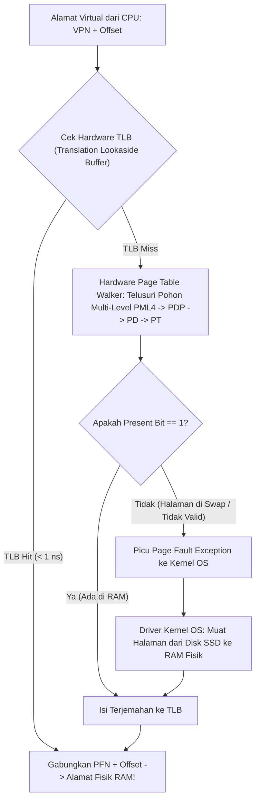

# Modul 067: Dukungan Hardware Memori Virtual (Memory Management Unit / MMU, Page Tables, Hardware TLB)

**Navigasi**: [⬅️ Master Index](../../INDEX.md) | [Tingkat 4: Tingkat 4: Logika Digital, Computer Engineering & Arsitektur Komputer](./README.md)
*Sebelumnya*: [066. hierarki-memori-arsitektur-cache-cpu](./066-hierarki-memori-arsitektur-cache-cpu.md) | *Berikutnya*: [068. bus-sistem-antarmuka-interkoneksi](./068-bus-sistem-antarmuka-interkoneksi.md)

---

## 1. Intuisi Dasar Tanpa Jargon ("Seperti Bayi Baru Lahir")
### 1.1 Konsep Inti & Analogi Tanpa Jargon
Bayangkan Anda menjalankan 10 aplikasi sekaligus di komputer Anda: web browser Google Chrome dengan 50 tab, game 3D, pemutar musik Spotify, dan software compiler. Jika semua program ini menulis langsung ke kabel memori RAM fisik yang sama tanpa pengawas:
- Tab browser yang crash bisa secara tidak sengaja menimpa saldo rekening bank Anda di tab sebelah!
- Program jahat (virus) bisa membaca password Anda yang sedang tersimpan di RAM aplikasi lain!

### 1.2 Urgensi Rekayasa & Signifikansi Sistemik
Untuk mencegah malapetaka ini, komputer menciptakan **Ilusi Terbesar dalam Ilmu Komputer: Memori Virtual (Virtual Memory)**!
Setiap program yang berjalan di komputer dibuat merasa seolah-olah ia adalah **satu-satunya penguasa di alam semesta** yang memiliki memori raksasa pribadi mulai dari alamat nol `0x00000000` hingga tak hingga.
Di dalam chip CPU terdapat polisi lalu lintas perangkat keras yang disebut **MMU (Memory Management Unit)**:
Setiap kali program mencoba membaca memori, MMU secara transparan menerjemahkan alamat khayalan program (**Alamat Virtual**) menjadi alamat kabel RAM nyata (**Alamat Fisik**), sambil mengunci pintu agar tidak ada satu program pun yang bisa mengintip memori program lain!
[📚 Pelajari: OSTEP Chapter 13 - Address Spaces & Virtual Memory](https://pages.cs.wisc.edu/~remzi/OSTEP/vm-intro.pdf)

## 2. Fondasi Teoretis & Aksiomatik / Matematis
### 2.1 Kerangka Teori Aksiomatik & Formulasi Matematis
### 67.1 Konsep Ruang Alamat Virtual & Pembagian Halaman (Paging) ([Arpaci-Dusseau OSTEP](https://pages.cs.wisc.edu/~remzi/OSTEP/))
Memori dibagi menjadi blok berukuran tetap yang disebut **Halaman (Page)** (standar arsitektur: $4\text{ KB} = 4096\text{ byte} = 2^{12}\text{ byte}$).
Memori fisik RAM dibagi menjadi blok dengan ukuran yang sama yang disebut **Page Frame**.
Pemisahan Alamat Virtual 32-bit:
`[ Virtual Page Number (VPN) - 20 Bit ][ Page Offset - 12 Bit ]`
- Bit Offset (\$12\text{ bit}$) diteruskan langsung tanpa perubahan ($Offset_{\text{virtual}} = Offset_{\text{fisik}}$).
- VPN diterjemahkan oleh unit MMU menjadi Physical Frame Number (PFN) melalui Tabel Halaman (*Page Table*):
$$\text{Physical Address} = (\text{PFN} \ll 12) \mid \text{Page Offset}$$

### 2.2 Penurunan Matematis Langkah-demi-Langkah
Keuntungan Mutlak Memori Virtual:
1. **Proteksi & Isolasi Antar Proses**: Bit izin pada entri tabel halaman (`R/W/X`, `User/Supervisor`) mencegah aplikasi biasa membaca atau mengeksekusi memori kernel sistem operasi.
2. **Berbagi Memori Aman (Shared Memory)**: Dua proses berbeda dapat memetakan halaman virtual privat mereka ke page frame fisik yang sama di RAM (misal library bersama `libc.so`).
3. **Ekspansi Ruang Swap Disk**: Jika RAM fisik penuh, halaman memori yang jarang digunakan dapat dibuang sementara ke harddisk/SSD (*Swapping* / *Paging to Disk*).

### 67.2 Struktur Tabel Halaman Bertingkat (Multi-Level Page Tables) ([Silberschatz OS Concepts](https://www.os-book.com/))
Pada arsitektur 64-bit (misal x86-64 model 4-level paging / Page Map Level 4 PML4):
Tabel halaman linier 1-tingkat akan membutuhkan $2^{52}$ entri yang menghabiskan jutaan Terabyte RAM hanya untuk menyimpan tabel itu sendiri!
Solusi: **Pohon Hierarki Tabel Bertingkat (Radix Tree Multi-Level Paging)**:
Alamat virtual 48-bit x86-64 dipecah menjadi:
`[ PML4 (9 bit) ][ PDP (9 bit) ][ PD (9 bit) ][ PT (9 bit) ][ Offset (12 bit) ]`
Tabel halaman tingkat bawah hanya dialokasikan di RAM jika wilayah memori tersebut benar-benar digunakan oleh program (*sparse memory allocation*), memangkas penggunaan memori tabel dari Gigabyte menjadi hanya beberapa Kilobyte.

Register Penunjuk Tabel Halaman:
- x86-64: Register `CR3` menyimpan alamat fisik akar tabel PML4.
- ARM64: Register `TTBR0_EL1` (User space) dan `TTBR1_EL1` (Kernel space).
- RISC-V: Register `satp` (Supervisor Address Translation and Protection).

### 67.3 Translation Lookaside Buffer (TLB) & Page Fault Exception ([Hennessy & Patterson](https://www.elsevier.com/))
Penerjemahan memori multi-level membutuhkan 4 kali pembacaan RAM tambahan untuk setiap 1 kali akses data tunggal ($4\text{x}$ penalti latensi!).
Solusi Penyelamat: **Translation Lookaside Buffer (TLB)**:
Cache perangkat keras SRAM asosiatif penuh (*Fully Associative Cache*) di dalam inti CPU yang menyimpan terjemahan VPN-ke-PFN terbaru.
- Hit Time TLB: $< 0.5\text{ ns}$ (hanya 1 siklus clock, penalti terjemahan mendekati nol!).
- Miss Rate TLB: Tipikal $< 1\%$.
- Jika TLB Miss: Hardware Page Table Walker menelusuri hierarki pohon tabel di RAM secara otomatis.

Pengecualian Gangguan Halaman (*Page Fault Exception*):
Terjadi jika program mengakses alamat virtual yang bit keberadaannya tidak aktif (`Present Bit = 0`):
1. MMU membekukan eksekusi CPU dan memicu interupsi hardware *Page Fault Interrupt* (vektor 14 di x86).
2. Sistem operasi mengambil alih: membaca halaman yang bersangkutan dari disk SSD/Swap ke dalam RAM fisik kosong.
3. Sistem operasi memperbarui entri tabel halaman (`Present = 1`), memperbarui TLB, dan memutar ulang instruksi yang gagal tadi tanpa diketahui oleh program pengguna (*Transparent Handling*).

## 3. Anatomi Teknis & Cara Kerja Internal

Teknik Huge Pages (Transparent Huge Pages):
Menggunakan ukuran halaman raksasa ($2	ext{ MB}$ atau $1	ext{ GB}$) alih-alih standar $4	ext{ KB}$ untuk database dan aplikasi memori masif. Mengurangi jumlah entri TLB yang dibutuhkan hingga \$500	ext{x}$ lipat, melenyapkan TLB miss pada dataset puluhan Gigabyte.

#### Tabel Penelusuran Penjelajahan Tabel Halaman 2-Tingkat (Page Walk) & Invalidation Stale TLB Shootdown
| Siklus CPU / Tahap Transaksi | Komponen MMU / Core CPU | Masukan Alamat Virtual ($VA$) | Operasi MMU / Interupsi IPI | Status Translasi (TLB & PTE) | Hasil Akses / Potensi Eksploitasi UAF |
|---|---|---|---|---|---|
| Core 1 (User Access) | MMU Core 1 | `VA: 0x7FFF_1000` | Cek TLB lokal | TLB Hit: `PTE -> PFN: 0x4000` (RW) | Akses memori cepat 1 siklus |
| Core 2 (Kernel Munmap) | Kernel Thread (Core 2) | Membebaskan Halaman `0x7FFF_1000` | Core 2 menghapus PTE dari RAM | PTE di RAM diubah menjadi `0x00` (Not Present) | Halaman fisik `PFN: 0x4000` siap dialokasi ulang |
| TLB Shootdown Tertunda | Core 2 kirim IPI Shootdown | Pengiriman interupsi IPI tertunda di bus | TLB Core 1 belum dibersihkan! | TLB Core 1 masih memuat entri usang (*stale PTE*)! | Core 1 belum tahu halaman sudah dibebaskan! |
| Kernel Alokasi Ulang | Subsistem I/O Kernel | Alokasi struktur sensitif kernel | Halaman `0x4000` dialokasikan ke kernel | Memuat kredensial proses sistem | Memori fisik digunakan oleh proses lain |
| Akses Liar Core 1 | Core 1 menulis ke `VA` | Menulis data penyerang | MMU Core 1 membaca TLB lokal usang | Menulis langsung ke `PFN: 0x4000`! | PENULISAN MEMORI KERNEL TANPA IZIN! (CVE-2022-42895) |

## 4. Implementasi Praktis & Kode / Simulasi Riil
```rust
def simulate_two_level_paging_mmu(virtual_address: int, page_directory: dict, tlb_cache: dict) -> dict:
    """
    Simulasi penerjemahan alamat virtual ke alamat fisik oleh MMU 2-tingkat dengan TLB.
    Format 32-Bit: [ Directory Index 10-bit ][ Page Table Index 10-bit ][ Offset 12-bit ]
    """
    offset = virtual_address & 0xFFF
    pt_index = (virtual_address >> 12) & 0x3FF
    pd_index = (virtual_address >> 22) & 0x3FF
    vpn = virtual_address >> 12
    
    # 1. Periksa TLB Hit
    if vpn in tlb_cache:
        pfn = tlb_cache[vpn]
        phys_addr = (pfn << 12) | offset
        return {"status": "TLB HIT", "vpn": hex(vpn), "pfn": hex(pfn), "phys_addr": hex(phys_addr)}
        
    # 2. Page Table Walk
    if pd_index in page_directory:
        page_table = page_directory[pd_index]
        if pt_index in page_table:
            entry = page_table[pt_index] # (pfn, present_bit, writable)
            if entry["present"]:
                pfn = entry["pfn"]
                tlb_cache[vpn] = pfn # Masukkan ke TLB
                phys_addr = (pfn << 12) | offset
                return {"status": "TLB MISS (Page Table Walk Lolos)", "pfn": hex(pfn), "phys_addr": hex(phys_addr)}
                
    return {"status": "PAGE FAULT EXCEPTION (Alamat tidak dipetakan ke RAM!)", "address": hex(virtual_address)}

# Inisialisasi struktur tabel halaman tiruan
mock_pt = {5: {"pfn": 0x1A2B, "present": True}}
mock_pd = {1: mock_pt}
mock_tlb = {}

# Alamat Virtual: Directory=1, PT=5, Offset=0x4A0 => (1 << 22) | (5 << 12) | 0x4A0 = 0x4054A0
va_test = (1 << 22) | (5 << 12) | 0x4A0
res1 = simulate_two_level_paging_mmu(va_test, mock_pd, mock_tlb)
res2 = simulate_two_level_paging_mmu(va_test, mock_pd, mock_tlb) # Akses kedua harus TLB Hit

print(f"Akses Pertama: {res1['status']} => Alamat Fisik: {res1.get('phys_addr')}")
print(f"Akses Kedua  : {res2['status']} => Alamat Fisik: {res2.get('phys_addr')}")
```

## 5. Miskonsepsi & Jebakan Industri
1. **TLB Shootdown Overhead in Multiprocessors**: Saat sistem operasi mengubah entri tabel halaman pada Core A, Core A harus mengirimkan interupsi antar-prosesor (IPI) ke seluruh core CPU lain untuk membuang (*flush*) entri TLB usang mereka; memicu badai interupsi (*TLB Shootdown Storm*) yang melumpuhkan performa server virtualisasi cloud.
2. **Thrashing Due to Excessive Memory Pressure**: Terjadi ketika memori fisik RAM terlalu penuh dan proses-proses aktif saling berebut; sistem operasi menghabiskan \$99\%$ waktu CPU hanya untuk membaca dan menulis halaman swap ke disk (*Thrashing*), membuat komputer macet total.
3. **Dereferencing NULL Pointers**: Pointer NULL (`0x00000000`) sengaja dibiarkan tidak pernah dipetakan oleh sistem operasi di halaman pertama (*Page 0 unmapped*); setiap upaya membaca alamat nol langsung memicu Page Fault hardware yang menembak mati program seketika (*Segmentation Fault*).

### Studi Kasus Kegagalan Nyata: Kegagalan Invalidation TLB Multi-Core (Stale TLB Shootdown Race) pada Kernel Linux (CVE-2022-42895)
- **Penemuan Kerentanan Kenaikan Hak Akses Kernel**: Pada tahun 2022, periset keamanan menemukan kerentanan kritis *race condition* pada subsistem memori virtual kernel Linux (CVE-2022-42895). Kerentanan ini memungkinkan proses lokal tanpa hak akses (*unprivileged local user*) mengambil alih kontrol kernel penuh dan mendapatkan akses root dalam hitungan detik.
- **Akar Masalah Manajemen Memori Virtual: MMU, TLB, & Ketiadaan Sinkronisasi IPI**: Setiap core CPU memiliki Translation Lookaside Buffer (TLB) lokal berkecepatan tinggi untuk menyimpan sementara hasil translasi alamat virtual ke alamat fisik (*Page Table Entry* / PTE). Ketika satu core CPU membebaskan atau mengubah izin halaman memori virtual (misal melalui panggilan sistem `munmap()` atau `mprotect()`), halaman fisik tersebut dapat langsung dialokasikan kembali untuk tujuan lain. Namun, entri translasi lama masih tersimpan di dalam TLB lokal core CPU tetangga (*stale TLB entry*). Untuk mencegah bahaya keamanan, kernel wajib mengeksekusi *TLB Shootdown*: mengirimkan interupsi antar-prosesor (Inter-Processor Interrupt / IPI) ke seluruh core tetangga untuk memaksa mereka membersihkan TLB lokal masing-masing menggunakan instruksi `invlpg` sebelum halaman fisik dialokasikan kembali. Akibat kesalahan pengoptimalan pengelompokan (*lazy TLB flushing batching*) pada kernel, jeda balapan waktu tercipta di mana halaman fisik telah dialokasikan kembali ke struktur sensitif milik kernel lain sementara Core 1 masih memiliki hak tulis ke halaman tersebut melalui TLB usang, membuka celah eksploitasi *Use-After-Free* (UAF) yang fatal.

- **Potongan Kode / Arsitektur Cacat (Vulnerable Implementation)**:
```c
// Rekonstruksi Konseptual Dua-Tingkat Page Table Walk & TLB Hit/Miss dalam C
#include <stdio.h>
#include <stdint.h>
#include <stdbool.h>

#define PAGE_SIZE 4096
#define TLB_ENTRIES 16

typedef struct {
    uint32_t virtual_page;
    uint32_t physical_frame;
    bool valid;
    bool writable;
} TLBEntry;

TLBEntry tlb[TLB_ENTRIES];
uint32_t page_directory[1024]; // L1 Page Directory
uint32_t *page_tables[1024];   // L2 Page Tables

uint32_t translate_virtual_address(uint32_t vaddr, bool write_intent) {
    uint32_t vpn = vaddr / PAGE_SIZE;
    uint32_t offset = vaddr % PAGE_SIZE;

    // 1. Cek Fast-Path: Translation Lookaside Buffer (TLB)
    for (int i = 0; i < TLB_ENTRIES; i++) {
        if (tlb[i].valid && tlb[i].virtual_page == vpn) {
            if (write_intent && !tlb[i].writable) {
                printf("PAGE FAULT: Permission Denied (Write to Read-Only Page!)\n");
                return 0xFFFFFFFF;
            }
            return (tlb[i].physical_frame * PAGE_SIZE) + offset; // TLB HIT!
        }
    }

    // 2. Slow-Path: Hardware Page Table Walk (2-Tingkat)
    uint32_t pde_index = (vaddr >> 22) & 0x3FF; // 10 bit teratas
    uint32_t pte_index = (vaddr >> 12) & 0x3FF; // 10 bit tengah

    if (!(page_directory[pde_index] & 0x1)) {
        printf("PAGE FAULT: Page Directory Entry Not Present!\n");
        return 0xFFFFFFFF;
    }

    uint32_t *pt = page_tables[pde_index];
    uint32_t pte = pt[pte_index];
    if (!(pte & 0x1)) {
        printf("PAGE FAULT: Page Table Entry Not Present!\n");
        return 0xFFFFFFFF;
    }

    uint32_t pfn = pte >> 12;
    // Update TLB entry
    tlb[0].virtual_page = vpn;
    tlb[0].physical_frame = pfn;
    tlb[0].valid = true;
    tlb[0].writable = (pte & 0x2) != 0;

    return (pfn * PAGE_SIZE) + offset;
}
```

- **Pelajaran Rekayasa Sistem Operasi Modern**: Sinkronisasi memori multi-core menuntut invarian konsistensi ketat: *TLB shootdown wajib selesai secara sinkron sebelum halaman fisik didaur ulang*. Perangkat keras prosesor modern juga mulai mengintegrasikan instruksi invalidasi TLB berbasis perangkat keras yang disiarkan langsung melalui interconnect bus (seperti instruksi `tlbi` pada arsitektur ARM64) untuk mengeliminasi ketergantungan pada interupsi IPI perangkat lunak yang lambat.

## 6. Proyek Latihan & Rubrik Penilaian Mandiri
### Tingkat 1 (Pemula) - Penguraian Komponen Alamat Virtual Manual
Diberikan sistem memori virtual 32-bit dengan ukuran halaman $4	ext{ KB}$ dan tabel halaman bertingkat dua (\$10	ext{ bit}$ Direktori, \$10	ext{ bit}$ Tabel, \$12	ext{ bit}$ Offset). Uraikan alamat virtual heksadesimal `0x7B43A120` menjadi nomor Page Directory Index, Page Table Index, dan Byte Offset dalam representasi desimal dan heksa.

### Tingkat 2 (Menengah) - Simulasi Kebijakan Penggantian Halaman LRU vs FIFO
Implementasikan simulator algoritma pergantian halaman (*Page Replacement Algorithm*) dalam Python: simulasikan string referensi halaman sepanjang $1.000$ akses pada memori fisik dengan kapasitas 4 frame halaman. Hitung dan bandingkan jumlah terjadinya Page Fault antara algoritma FIFO (tunjukkan Anomali Belady) dan algoritma Optimal / LRU.

### Tingkat 3 (Mahir) - Perancangan Modul Hardware MMU TLB 4-Way Set Associative dalam Verilog
Rancang unit perangkat keras TLB 4-Way Set Associative (16 set, total 64 entri) dalam Verilog: implementasikan pencocokan Tag paralel menggunakan komparator hardware, pelacakan penggantian Pseudo-LRU (PLRU), deteksi ASID (Address Space Identifier) untuk mencegah flush TLB saat pergantian konteks (*context switch*), dan antarmuka interupsi Page Fault Exception.

#### Rubrik Penilaian
- **40% Ketepatan Matematika Penerjemahan Alamat**: Pemisahan bit VPN, pemetaan PFN, dan perakitan alamat fisik akurat.
- **30% Penanganan Status Bit Proteksi**: Menegakkan validasi bit read/write/execute dan hak akses supervisor/user.
- **30% Kinerja Latensi TLB Hit**: Desain sirkuit TLB menghasilkan keputusan hit/miss dalam 1 siklus clock tunggal.

### Tingkat 1: Dasar
- **Tugas**: Bangun fungsi kalkulator pemecahan alamat virtual 32-bit ke dalam indeks Page Directory (10-bit), indeks Page Table (10-bit), dan Page Offset (12-bit) untuk sistem memori virtual berukuran halaman 4 KB.
- **Petunjuk Perancangan Arsitektur**:
  - $PDE\_Index = (vaddr \gg 22) \ \&\ 0x3FF$.
  - $PTE\_Index = (vaddr \gg 12) \ \&\ 0x3FF$.
  - $Offset = vaddr \ \&\ 0xFFF$.
- **Test Vector & Kasus Uji Ekstrem**:
  - *Alamat Virtual `0xC000_1234`*: Hitung PDE Index, PTE Index, dan Offset heksadesimal.
  - *Batas Halaman Terakhir*: Alamat `0xFFFF_FFFF`; buktikan PDE Index = 1023, PTE Index = 1023, dan Offset = 4095.
- **Rubrik Penilaian Mandiri**: 40% Dekomposisi Bit Alamat Virtual 2-Tingkat Tepat, 30% Perhitungan Offset Halaman 4KB Presisi, 30% Penanganan Nilai Alamat Batas Ekstrem.

### Tingkat 2: Menengah
- **Tugas**: Implementasikan simulator siklus penjelajahan tabel halaman 4-tingkat arsitektur x86-64 (Paging 48-bit: PML4, PDPT, PD, PT) lengkap dengan emulasi penanganan Page Fault (bit Present, bit Read/Write, dan bit User/Supervisor), serta catat statistik penundaan akses memori antara TLB Hit vs TLB Miss.
- **Petunjuk Perancangan Arsitektur**:
  - Ekstraksi 9-bit indeks untuk setiap dari 4 tingkat hierarki tabel halaman.
  - Jika salah satu entri memiliki $Present = 0$, bangkitkan exception Page Fault dengan kode kesalahan yang sesuai.
- **Test Vector & Kasus Uji Ekstrem**:
  - *Pelanggaran Izin User/Supervisor*: Proses mode pengguna mencoba mengakses alamat dengan bit $US = 0$; buktikan timbulnya page fault dengan kode proteksi izin.
  - *Translasi Sukses*: Lakukan penjelajahan penuh hingga tingkat ke-4; hitung alamat fisik akhir yang dihasilkan.
- **Rubrik Penilaian Mandiri**: 40% Algoritma 4-Level Page Walk x86-64 Presisi, 30% Emulasi Bit Proteksi Present/RW/US Tepat, 30% Analisis Statistik Penalti Waktu TLB Miss.

### Tingkat 3: Mahir
- **Tugas**: Rancang simulator multi-core MMU terdistribusi (4 Core CPU) dalam Python yang memodelkan TLB lokal di setiap core, mengeksekusi operasi modifikasi tabel halaman bersama, menyimulasikan protokol pengiriman Inter-Processor Interrupt (IPI) untuk TLB Shootdown, dan mendeteksi secara formal adanya jendela balapan waktu (*race window*) di mana satu core mengeksekusi instruksi menggunakan entri TLB basi (*stale TLB entry*).
- **Petunjuk Perancangan Arsitektur**:
  - Modelkan status TLB per core dengan antrean pesan IPI antar-core.
  - Simulasikan skenario penghapusan halaman oleh Core 0 tanpa menunggu konfirmasi ACK shootdown dari Core 1, 2, dan 3.
  - Deteksi akses memori fisik ilegal pada jendela asinkron tersebut.
- **Test Vector & Kasus Uji Ekstrem**:
  - *Deteksi Celah UAF*: Buktikan terjadinya akses memori tak sah saat penundaan IPI diinjeksi sebesar 50 siklus jam.
  - *Protokol Shootdown Terkunci (Synchronous Barrier)*: Terapkan penghalang tunggu ACK; buktikan hilangnya 100% pelanggaran stale access.
- **Rubrik Penilaian Mandiri**: 40% Model Multi-Core MMU & IPI TLB Shootdown Presisi, 30% Deteksi Formal Balapan Akses Halaman Didaur Ulang, 30% Verifikasi Keamanan Protokol Sinkronisasi Barrier.

## 7. Rekomendasi Sumber Belajar Standar Emas
| Kategori | Judul Sumber & Tautan Langsung | Deskripsi Singkat |
|---|---|---|
| 📖 Buku Teks | [Operating Systems: Three Easy Pieces (Remzi & Andrea Arpaci-Dusseau)](https://pages.cs.wisc.edu/~remzi/OSTEP/) | Buku teks sistem operasi terbuka terbaik di dunia untuk pemahaman konsep memori virtual dan paging. |
| 🎓 Kuliah Terbuka | [MIT OCW 6.004 Computation Structures: Virtual Memory](https://ocw.mit.edu/courses/6-004-computation-structures-spring-2017/) | Arsitektur perangkat keras MMU, struktur entri tabel halaman, dan operasi TLB. |
| 🔬 Makalah Seminal | [One-Level Storage System (Kilburn et al., Atlas Computer, 1962)](https://doi.org/10.1109/JRPROC.1962.288001) | Makalah monumental penemuan konsep memori virtual pertama kali di komputer Atlas University of Manchester. |
| 💻 Lab Interaktif | [Virtual Memory Simulator (OSTEP Tools)](https://github.com/remzi-arpacidusseau/ostep-code/tree/master/vm-paging) | Skrip simulator Python interaktif resmi OSTEP untuk mengeksplorasi penerjemahan alamat virtual. |

---
*Navigasi Cepat*: [Ke Tingkat 4](./README.md) | [Ke Master Index](../../INDEX.md) | *Sebelumnya*: [066. hierarki-memori-arsitektur-cache-cpu](./066-hierarki-memori-arsitektur-cache-cpu.md) | *Berikutnya*: [068. bus-sistem-antarmuka-interkoneksi](./068-bus-sistem-antarmuka-interkoneksi.md)
