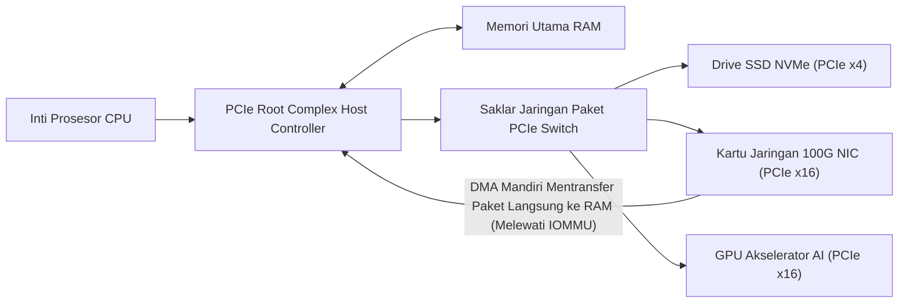

# Modul 068: Bus Sistem, Antarmuka & Interkoneksi (PCIe Lanes, Direct Memory Access / DMA, IOMMU, CXL)

**Navigasi**: [⬅️ Master Index](../../INDEX.md) | [Tingkat 4: Tingkat 4: Logika Digital, Computer Engineering & Arsitektur Komputer](./README.md)
*Sebelumnya*: [067. dukungan-hardware-memori-virtual](./067-dukungan-hardware-memori-virtual.md) | *Berikutnya*: [069. akselerator-komputasi-paralel](./069-akselerator-komputasi-paralel.md)

---

## 1. Intuisi Dasar Tanpa Jargon ("Seperti Bayi Baru Lahir")
Bayangkan sebuah kota metropolitan modern:
- CPU adalah pusat pemerintahan yang sangat cerdas di pusat kota.
- RAM adalah kawasan pergudangan logistik raksasa.
- Kartu Grafis GPU, kartu jaringan internet 100 Gbps, dan drive SSD NVMe adalah pelabuhan dan bandara internasional di pinggiran kota.

Jika seluruh barang dan paket yang ingin dikirim dari bandara ke pelabuhan harus diantar oleh Presiden (CPU) sendiri satu per satu dengan berjalan kaki, Presiden tidak akan sempat mengurus negara, dan kota akan lumpuh total!
Oleh karena itu, kota membangun **Jalan Tol Bebas Hambatan Super Cepat (Bus Sistem & Interkoneksi PCIe)** dan mengangkat petugas kurir khusus (**Direct Memory Access / DMA**):
DMA diizinkan mengangkut jutaan ton barang langsung dari bandara (SSD/Jaringan) ke pergudangan (RAM) secara mandiri di jalur tol tanpa mengganggu atau meminta bantuan CPU sedikit pun!
[📚 Pelajari: MindShare PCI Express System Architecture](https://www.mindshare.com/books/titles/pci_express_system_architecture/)

## 2. Fondasi Teoretis & Aksiomatik / Matematis
### 68.1 Arsitektur PCI Express (PCIe Gen 4 / Gen 5) ([PCI-SIG Specifications](https://pcisig.com/specifications))
Evolusi dari bus paralel lebar bersama (PCI 32-bit $33\text{ MHz}$) menjadi antarmuka serial point-to-point berkecepatan ekstrem dengan jalur diferensial ganda (*Full-Duplex Differential Lanes*):
- Standar PCIe Gen 4: Laju transfer $16\text{ GT/s}$ per lane (skema penyandian 128b/130b $\approx 1.97\text{ GB/s}$ per lane).
- Standar PCIe Gen 5: Laju transfer $32\text{ GT/s}$ per lane ($\approx 3.94\text{ GB/s}$ per lane, atau $\approx 63\text{ GB/s}$ pada slot x16).
- Standar PCIe Gen 6: Laju transfer $64\text{ GT/s}$ menggunakan modulasi amplitudo pulsa 4-tingkat (PAM4) dan Forward Error Correction (FEC).

Tiga Lapisan Protokol PCIe:
1. **Transaction Layer**: Membangun paket transaksi TLP (*Transaction Layer Packets*): Memory Read/Write, I/O, Configuration, dan Messages.
2. **Data Link Layer**: Menjamin keandalan pengiriman paket tanpa kesalahan via Sequence Number, 32-bit CRC (LCRC), dan protokol jabat tangan ACK/NAK otomatis.
3. **Physical Layer**: Pengacakan data (*scrambling*), penyandian bit (128b/130b), serialisasi, dan pemancar/penerima diferensial analog SerDes.

### 68.2 Direct Memory Access (DMA) & Arsitektur Scatter-Gather ([Bovet & Cesati Understanding the Linux Kernel](https://www.oreilly.com/))
DMA Controller (DMAC) membebaskan CPU dari loop transfer data I/O ($O(N)$ CPU cycle):
1. CPU mengonfigurasi DMAC: Alamat sumber, alamat tujuan, panjang byte, dan mode pemicu.
2. CPU melepas kendali bus (*Bus Mastership*) dan dapat mengeksekusi instruksi komputasi lain.
3. DMAC mentransfer seluruh blok data langsung antara peripheral dan RAM melalui bus sistem.
4. DMAC memicu interupsi hardware *Interrupt* ke CPU saat transfer selesai $100\%$.
- **Mode Scatter-Gather DMA**: Membaca atau menulis data dari potongan-potongan halaman memori fisik yang terfragmentasi di berbagai lokasi RAM hanya menggunakan satu rantai deskriptor linked list tunggal (*Descriptor Ring Buffer*).

### 68.3 IOMMU (Input-Output Memory Management Unit) & Komputasi Akselerator CXL ([Intel VT-d Specification](https://www.intel.com/content/www/us/en/developer/articles/technical/intel-virtualization-technology-for-directed-io-architecture-specification.html))
- **IOMMU (Intel VT-d / AMD-Vi)**:
  Menerjemahkan alamat memori virtual perangkat DMA perangkat periferal (Device Virtual Address) menjadi alamat fisik RAM (Physical Address).
  - Mencegah serangan DMA berbahaya: kartu PCIe nakal tidak bisa membaca seluruh RAM sistem di luar ruang memori yang diizinkan (DMA Isolation & Device Sandboxing).
  - Memungkinkan penyerahan perangkat langsung (*PCIe Passthrough*) ke Mesin Virtual KVM/VMware tanpa overhead software emulation.
- **Compute Express Link (CXL 3.0)**:
  Protokol interkoneksi koheren generasi baru di atas lapisan fisik PCIe Gen 5/6 yang memungkinkan akselerator AI (GPU/TPU) dan CPU berbagi memori RAM secara koheren (*Cache-Coherent Memory Sharing*) dengan latensi ultra-rendah melalui protokol CXL.io, CXL.cache, dan CXL.mem.

## 3. Anatomi Teknis & Cara Kerja Internal

Penyandian Garis 128b/130b PCIe:
Menyisipkan 2 bit sinkronisasi (`01` untuk data, `10` untuk kontrol) pada setiap 128 bit muatan muatan payload, memangkas overhead pemborosan transmisi menjadi hanya $1.5\%$ (dibandingkan skema 8b/10b lama yang memboroskan $20\%$ bandwidth).

## 4. Implementasi Praktis & Kode / Simulasi Riil
def calculate_pcie_bandwidth(generation: int, lane_count: int) -> dict:
    """
    Menghitung throughput data teoritis dan efektif untuk berbagai generasi PCI Express.
    """
    specs = {
        1: (2.5, 8/10),    # GT/s, rasio efisiensi encoding 8b/10b (80%)
        2: (5.0, 8/10),
        3: (8.0, 128/130), # 128b/130b (~98.46%)
        4: (16.0, 128/130),
        5: (32.0, 128/130),
        6: (64.0, 242/256) # PAM4 + FLIT FEC mode
    }
    
    raw_gt_s, encoding_eff = specs[generation]
    # 1 GT/s = 1 Giga bit per detik mentah per lane
    raw_bandwidth_gbps_per_lane = raw_gt_s
    effective_gbps_per_lane = raw_gt_s * encoding_eff
    
    # Konversi ke GigaByte per detik (GB/s) total untuk seluruh lane
    total_effective_gbyte_s = (effective_gbps_per_lane * lane_count) / 8.0
    
    return {
        "generation": f"PCIe Gen {generation}",
        "lanes": f"x{lane_count}",
        "raw_gt_s_per_lane": raw_gt_s,
        "effective_throughput_gbyte_s": total_effective_gbyte_s
    }

res_gen4 = calculate_pcie_bandwidth(generation=4, lane_count=16)
res_gen5 = calculate_pcie_bandwidth(generation=5, lane_count=16)

print(f"{res_gen4['generation']} {res_gen4['lanes']} => Bandwidth Efektif: {res_gen4['effective_throughput_gbyte_s']:.2f} GB/s")
print(f"{res_gen5['generation']} {res_gen5['lanes']} => Bandwidth Efektif: {res_gen5['effective_throughput_gbyte_s']:.2f} GB/s (Dua kali lipat!)")

## 5. Miskonsepsi & Jebakan Industri
1. **Malicious PCIe Peripheral DMA Attacks**: Memasukkan perangkat keras PCIe/Thunderbolt jahat tanpa perlindungan IOMMU yang aktif; perangkat peripheral dapat menggunakan hak master DMA untuk menyedot seluruh isi memori RAM fisik, membocorkan kunci enkripsi disk BitLocker dan sandi login sistem operasi.
2. **Cache Coherency Hazards in Non-Coherent DMA**: Menulis data dari CPU ke buffer memori yang masih tersangkut di cache L1 write-back, lalu memicu peripheral DMA membaca RAM fisik; peripheral akan membaca data usang yang belum terkirim dari cache. Selalu lakukan operasi `cache clean/flush` sebelum memicu transfer DMA!
3. **PCIe Completion Timeout**: Mengirim paket permintaan baca TLP ke perangkat periferal yang lambat atau hang; jika perangkat tidak mengembalikan paket balasan *Completion TLP* sebelum batas waktu kedaluwarsa ($50	ext{ ms}$), CPU akan mengalami fatal crash kernel panic (*AER / PCIe Uncorrectable Error*).

## 6. Proyek Latihan & Rubrik Penilaian Mandiri
### Tingkat 1 (Pemula) - Perhitungan Throughput Transfer Kartu Grafis PCIe
Hitung waktu transfer teoritis minimum yang dibutuhkan untuk mengunggah tekstur grafis 3D berukuran 4 Gigabyte dari RAM komputer ke memori VRAM kartu grafis melalui slot PCIe Gen 4 x16 dan PCIe Gen 3 x8.

### Tingkat 2 (Menengah) - Model Simulasi Ring Buffer DMA Scatter-Gather
Rancang simulator perangkat lunak pengontrol DMA mode Scatter-Gather dalam Python: bangun struktur linked list deskriptor memori di RAM (alamat pointer buffer, panjang byte, flag interupsi), dan simulasikan transfer data jaringan berukuran 64 KB yang terpecah ke dalam 16 halaman memori fisik acak tak beraturan.

### Tingkat 3 (Mahir) - Perancangan Modul AXI-Stream DMA Packet Filter dalam Verilog
Rancang modul IP core pengendali DMA antarmuka AXI4-Stream ke AXI4-Memory Mapped (AXI DMA) dalam SystemVerilog: implementasikan sirkuit FIFO penyangga paket, handshaking `TVALID`/`TREADY`, penanganan bit `TLAST` penanda akhir paket data, dan mesin master bus penulisan burst memori berpanjang 256 beat.

#### Rubrik Penilaian
- **40% Kepatuhan Protokol Bus Standar**: Handshaking sinyal valid-ready dan pembentukan paket transaksi mematuhi spesifikasi AXI/PCIe.
- **30% Manajemen Koherensi DMA**: Penanganan sinkronisasi cache buffer memori CPU dan interupsi completion terverifikasi bebas bug.
- **30% Efisiensi Utilisasi Bandwidth**: Jalur transfer data memanfaatkan mode burst transfer berkecepatan penuh tanpa bubble stall.

## 7. Rekomendasi Sumber Belajar Standar Emas
| Kategori | Judul Sumber & Tautan Langsung | Deskripsi Singkat |
|---|---|---|
| 📖 Buku Teks | [PCI Express Technology 3.0 / 4.0 / 5.0 (MindShare, Mike Jackson)](https://www.mindshare.com/) | Buku panduan paling mendalam di dunia untuk spesifikasi arsitektur internal protokol PCI Express. |
| 🎓 Kuliah Terbuka | [MIT OCW 6.033 Computer System Engineering: Interconnects](https://ocw.mit.edu/courses/6-033-computer-system-engineering-spring-2018/) | Prinsip perancangan bus sistem, topologi jaringan interkoneksi, dan keandalan I/O. |
| 🔬 Makalah Seminal | [Direct Memory Access for Digital Computers (Flores, 1964)](https://doi.org/10.1145/321203.321208) | Makalah awal Ivan Flores yang meletakkan dasar metodologi transfer memori DMA mandiri tanpa CPU. |
| 💻 Lab Interaktif | [PCIe Packet Inspector & Wireshark PCIe Dissector](https://www.wireshark.org/) | Alat analisa lalu lintas paket TLP dan data link layer protokol PCIe. |

---
*Navigasi Cepat*: [Ke Tingkat 4](./README.md) | [Ke Master Index](../../INDEX.md) | *Sebelumnya*: [067. dukungan-hardware-memori-virtual](./067-dukungan-hardware-memori-virtual.md) | *Berikutnya*: [069. akselerator-komputasi-paralel](./069-akselerator-komputasi-paralel.md)
