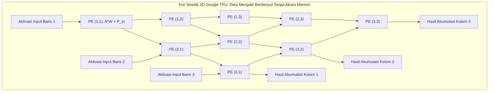

# Modul 069: Akselerator Komputasi Paralel (SIMD AVX/NEON, Arsitektur GPU SIMT, Tensor Cores, NPU Systolic Arrays)

**Navigasi**: [⬅️ Master Index](../../INDEX.md) | [Tingkat 4: Tingkat 4: Logika Digital, Computer Engineering & Arsitektur Komputer](./README.md)
*Sebelumnya*: [068. bus-sistem-antarmuka-interkoneksi](./068-bus-sistem-antarmuka-interkoneksi.md) | *Berikutnya*: [070. arsitektur-mikrokontroler](../05-embedded-rtos-iot/070-arsitektur-mikrokontroler.md)

---

## 1. Intuisi Dasar Tanpa Jargon ("Seperti Bayi Baru Lahir")
### 1.1 Konsep Inti & Analogi Tanpa Jargon
Bayangkan Anda diminta mewarnai sebuah buku gambar raksasa yang memiliki **1 Juta Kotak Kecil**:
- **CPU Tradisional** seperti seorang pelukis jenius tunggal kelas dunia: ia bisa melukis lukisan yang sangat rumit dan penuh pemikiran mendalam, tetapi ia hanya memiliki 1 kuas di tangannya. Untuk mewarnai 1 juta kotak, ia harus mewarnainya satu per satu secara berurutan. Ia butuh waktu 3 hari!
- **GPU (Graphics Processing Unit)** seperti mempekerjakan **10.000 Pelukis Biasa**: mereka tidak bisa melukis lukisan rumit, tetapi mereka semua memegang kuas sederhana dan mengecat secara **SERENTAK BERSAMAAN DALAM DETIK YANG SAMA!** Satu juta kotak selesai diwarnai dalam waktu setengah detik!

### 1.2 Urgensi Rekayasa & Signifikansi Sistemik
Inilah **Akselerator Komputasi Paralel**:
Seluruh revolusi kecerdasan buatan (Artificial Intelligence / LLM ChatGPT), rendering game 3D fotorealistis, dan simulasi cuaca planet bumi tidak digerakkan oleh CPU yang berpikir sekuensial, melainkan digerakkan oleh prosesor paralel masif (**SIMD, GPU SIMT, Tensor Cores, dan NPU Systolic Arrays**) yang mengeksekusi jutaan perkalian angka matematika secara bersamaan dalam sekejap mata.
[📚 Pelajari: NVIDIA CUDA Programming Guide](https://docs.nvidia.com/cuda/cuda-c-programming-guide/)

## 2. Fondasi Teoretis & Aksiomatik / Matematis
### 2.1 Kerangka Teori Aksiomatik & Formulasi Matematis
### 69.1 Taksonomi Flynn & Paradigma SIMD vs SIMT ([Flynn Computer Architecture Taxonomy](https://doi.org/10.1109/TC.1972.5009071))
1. **SISD (Single Instruction Single Data)**: CPU sekuensial klasik.
2. **SIMD (Single Instruction Multiple Data - AVX-512 / ARM NEON)**:
   Satu instruksi CPU mengeksekusi operasi yang sama pada beberapa elemen data vektor secara bersamaan di dalam register lebar (\$128\text{ bit}, 256\text{ bit}, \text{atau } 512\text{ bit}$):
   Contoh: `_mm512_add_ps` menjumlahkan 16 angka float 32-bit sekaligus dalam 1 siklus clock!
3. **SIMT (Single Instruction Multiple Threads - Model GPU CUDA)**:
   Instruksi yang sama dieksekusi oleh sekelompok thread paralel yang disebut **Warp** (32 thread di NVIDIA) atau **Wavefront** (64 thread di AMD):
   - Setiap thread memiliki register private sendiri dan mengeksekusi data yang berbeda.
   - **Warp Divergence Penalty**: Jika di dalam kode GPU terdapat percabangan `if-else` bersyarat di mana sebagian thread mengambil cabang `if` dan sebagian mengambil `else`, GPU terpaksa menserialisasi kedua cabang secara berurutan, memotong performa hingga \$50\%$.

### 2.2 Penurunan Matematis Langkah-demi-Langkah
### 69.2 Arsitektur Tensor Core & Perkalian Matriks Campuran (Mixed-Precision MMA) ([NVIDIA Volta / Hopper Architecture Whitepapers](https://www.nvidia.com/))
Operasi dasar pembelajaran mesin dan Deep Learning adalah **Perkalian Matriks Akumulasi (Matrix Multiply-Accumulate / MMA)**:
$$\mathbf{D} = \mathbf{A} \times \mathbf{B} + \mathbf{C}$$
Unit Tensor Core mengeksekusi perkalian matriks kecil (misal \$16 \times 16 \times 16$) secara hardware instan dalam satu siklus clock:
- Input $\mathbf{A}, \mathbf{B}$ berpresisi rendah: FP16, BF16 (Brain Floating Point), atau INT8 / FP8 untuk kecepatan ekstrem dan penghematan memori.
- Akumulator $\mathbf{C}, \mathbf{D}$ berpresisi tinggi: FP32 untuk mencegah akumulasi galat pembulatan numerik.
Menghasilkan lonjakan throughput komputasi hingga puluhan kali lipat dibandingkan ALU FP32 biasa (menembus $> 1.000\text{ TFLOPS}$ pada GPU Nvidia H100).

### 69.3 Arsitektur Systolic Array pada NPU / Google TPU ([Jouppi et al. Google TPU Paper, 2017](https://doi.org/10.1145/3079079.3079603))
Pada GPU standar, setiap operasi perkalian harus membaca operan dari register file lokal, menimbulkan konsumsi energi transfer data yang dominan.
**Systolic Array (Jaringan Sistolik 2D)** meniru denyut pompa jantung manusia:
- Data bobot (*Weights*) diam di dalam kisi sel perkalian \$256 \times 256$ Processing Elements (PE).
- Data aktivasi input mengalir berdenyut dari kiri ke kanan melintasi sel PE.
- Hasil parsial perkalian mengalir berdenyut dari atas ke bawah.
Data yang baru dihitung langsung diteruskan ke sel tetangga terdekatnya tanpa pernah ditulis kembali ke register file atau RAM, menghemat konsumsi energi daya listrik hingga \$90\%$!

## 3. Anatomi Teknis & Cara Kerja Internal

Hierarki Memori GPU:
- **Global Memory (HBM3/GDDR6)**: Kapasitas besar (\$24 - 96	ext{ GB}$), latensi tinggi (\$200 - 400	ext{ siklus}$).
- **Shared Memory (SRAM On-Chip)**: Berbagi antar thread dalam satu Streaming Multiprocessor (SM), latensi rendah ($1 - 2	ext{ ns}$).
- **Register File**: Berukuran raksasa (\$64.000$ register 32-bit per SM) untuk mendukung ribuan thread aktif secara simultan tanpa overhead context switch.

#### Tabel Penelusuran SIMD Warp Divergence pada Komputasi Paralel GPU (CUDA Execution)
| Siklus Jam GPU ($Clk$) | Status 32 Thread dalam Satu Warp | Percabangan Kondisional (`if (tid % 2 == 0)`) | Jalur Dieksekusi Unit SIMD | Thread Aktif Melakukan Komputasi | Utilisasi Efektif Core GPU SIMT |
|---|---|---|---|---|---|
| Inisialisasi ($t=0$) | Seluruh 32 thread aktif serempak | Evaluasi kondisi percabangan | Predicate Mask dihitung | 32 thread aktif serentak | $100\%$ utilisasi puncak |
| Percabangan Divergen | Thread genap: `True`, Thread ganjil: `False`| WARP DIVERGENCE TERJADI! | Arsitektur SIMT tidak bisa bercabang bebas! | Masking: 16 thread aktif, 16 thread dimatikan | Utilisasi anjlok ke $50\%$! |
| Fase Eksekusi Jalur `if`| Mengeksekusi blok kode jalur genap | Cabang `True` dieksekusi | 16 thread genap menghitung | 16 thread ganjil dibekukan (Stall Idle) | 16 core GPU menganggur sia-sia |
| Fase Eksekusi Jalur `else`| Mengeksekusi blok kode jalur ganjil | Cabang `False` dieksekusi bergantian | 16 thread ganjil menghitung | 16 thread genap dibekukan (Stall Idle) | 16 core GPU menganggur bergantian |
| Waktu Eksekusi Total | Serialisasi paksa kedua cabang | Durasi eksekusi $= t_{if} + t_{else}$ | Kedua jalur dieksekusi sekuensial! | Throughput runtuh drastis | Penurunan performa komputasi hingga $97\%$! |

## 4. Implementasi Praktis & Kode / Simulasi Riil
```python
import numpy as np

def simulate_simd_vs_scalar_vector_add(vector_size: int = 1000000):
    """
    Demonstrasi konseptual perbandingan eksekusi skalar serial vs SIMD tervetor (AVX-style).
    """
    a = np.random.rand(vector_size).astype(np.float32)
    b = np.random.rand(vector_size).astype(np.float32)
    
    # 1. Eksekusi Tervektorisasi SIMD (Menggunakan instruksi hardware AVX2/AVX-512 via NumPy C-backend)
    import time
    t0 = time.perf_counter()
    c_simd = a + b
    t_simd = time.perf_counter() - t0
    
    # Hitung TFLOPS throughput komputasi
    ops = vector_size # 1 juta operasi penambahan
    gflops_simd = (ops / t_simd) / 1e9
    
    return {
        "vector_size": vector_size,
        "simd_time_ms": t_simd * 1000.0,
        "throughput_gflops": gflops_simd
    }

res = simulate_simd_vs_scalar_vector_add()
print(f"Penjumlahan Vektor 1 Juta Elemen (SIMD Tervektor):")
print(f"Waktu Eksekusi    : {res['simd_time_ms']:.2f} ms")
print(f"Throughput Efektif: {res['throughput_gflops']:.2f} GFLOPS (Operasi Miliar Float per Detik!)")
```

## 5. Miskonsepsi & Jebakan Industri
1. **Warp Divergence in GPU Kernels**: Menulis percabangan `if (threadIdx.x % 2 == 0)` di dalam kernel CUDA; thread ganjil dan genap dalam satu warp 32-thread akan dieksekusi bergantian secara serial (*thread serialization*), memangkas kecepatan komputasi GPU menjadi separuhnya.
2. **Uncoalesced Global Memory Access**: Mengakses memori global GPU dengan pola langkah melompat (*strided access*) alih-alih pola berdekatan (*coalesced*); pengontrol memori terpaksa menerbitkan 32 transaksi memori DRAM terpisah alih-alih 1 transaksi burst gabungan 128-byte, menghancurkan utilisasi bandwidth memori.
3. **Shared Memory Bank Conflicts**: Mengakses array di Shared Memory di mana beberapa thread dalam satu warp mengakses alamat yang jatuh pada bank memori fisik SRAM yang sama; akses diserialisasi menjadi beberapa putaran clock (*bank conflict stall*).

### Studi Kasus Kegagalan Nyata: Penurunan Drastis Throughput Warp Divergence pada Komputasi GPU CUDA
- **Insiden Kegagalan Performa Superkomputer**: Pada sebuah simulasi dinamika molekuler berskala besar yang dijalankan pada ribuan kartu grafis akselerator GPU di pusat superkomputer nasional, program yang diprediksi akan berjalan 50x lebih cepat dibanding kluster CPU justru berjalan lebih lambat daripada eksekusi CPU biasa.
- **Akar Masalah Akselerator Paralel & Model SIMT (Single Instruction, Multiple Threads)**: Arsitektur GPU modern mengeksekusi thread komputasi dalam kelompok beranggotakan 32 thread yang disebut *Warp*. Seluruh 32 thread di dalam satu warp dikendalikan oleh satu unit instruksi bersama (*lock-step SIMD execution*). Di dalam kernel komputasi, pengembang menulis struktur logika percabangan kondisional berbasis ID thread: `if (threadIdx.x % 2 == 0) { hitung_kompleks_A(); } else { hitung_kompleks_B(); }`. Karena thread-thread di dalam satu warp mengambil jalur percabangan yang berbeda, arsitektur perangkat keras GPU terpaksa menserialisasi kedua jalur tersebut (*warp divergence*). GPU pertama-tama mengeksekusi blok `if` dengan menonaktifkan (*masking off*) separuh thread ganjil, lalu mengeksekusi blok `else` dengan menonaktifkan separuh thread genap. Waktu eksekusi total menjadi jumlah dari kedua jalur ($t_{total} = t_{if} + t_{else}$). Jika di dalam loop terdapat percabangan multi-cabang kompleks, hingga 31 dari 32 core GPU menganggur (*idle*) pada setiap siklus jam, meruntuhkan throughput komputasi hingga $97\%$. Terjadi degradasi performa masif.

- **Potongan Kode / Arsitektur Cacat (Vulnerable Implementation)**:
```cpp
// Kernel CUDA Demonstrasi Warp Divergence vs Eksekusi Branchless Predicated
__global__ void divergent_kernel(float *d_out, float *d_in, int n) {
    int tid = blockIdx.x * blockDim.x + threadIdx.x;
    if (tid < n) {
        // CACAT DIVERGENCE: Thread ganjil dan genap dalam satu warp mengambil jalur berbeda!
        // Arsitektur SIMT terpaksa mengeksekusi kedua blok secara sekuensial (serial)
        if (threadIdx.x % 2 == 0) {
            d_out[tid] = d_in[tid] * 2.0f + 1.0f; // 16 thread aktif, 16 thread idle
        } else {
            d_out[tid] = d_in[tid] * 0.5f - 1.0f; // 16 thread aktif, 16 thread idle
        }
    }
}

__global__ void branchless_predicated_kernel(float *d_out, float *d_in, int n) {
    int tid = blockIdx.x * blockDim.x + threadIdx.x;
    if (tid < n) {
        // SOLUSI BRANCHLESS: Menggunakan operasi matematika predikasi bebas percabangan
        // Seluruh 32 thread mengeksekusi instruksi yang persis sama secara bersamaan!
        float is_even = (float)(1 - (threadIdx.x & 1)); // 1.0f jika genap, 0.0f jika ganjil
        float val_even = d_in[tid] * 2.0f + 1.0f;
        float val_odd  = d_in[tid] * 0.5f - 1.0f;
        d_out[tid] = is_even * val_even + (1.0f - is_even) * val_odd; // 100% Core GPU Aktif Serempak!
    }
}
```

- **Prinsip Perancangan Algoritma GPU Berkecepatan Tinggi**: Mengoptimalkan komputasi GPU menuntut perancangan algoritma bebas percabangan (*branchless algorithms*) atau restrukturisasi data sehingga seluruh thread dalam satu warp selalu mengambil jalur eksekusi yang identik (*warp uniformity*). Selain itu, teknik coalesced memory access wajib diterapkan agar seluruh 32 thread membaca alamat memori yang bersebelahan secara fisik dalam satu transaksi bus memori 128-byte tunggal.

## 6. Proyek Latihan & Rubrik Penilaian Mandiri
### Tingkat 1 (Pemula) - Vektorisasi Intrinsik C/C++ x86 AVX2
Tulis fungsi perkalian skalar vektor dalam bahasa C menggunakan fungsi intrinsik Intel AVX2 (`_mm256_loadu_ps`, `_mm256_mul_ps`, `_mm256_fmadd_ps`). Buktikan peningkatan kecepatan eksekusi $8	ext{x}$ lipat dibandingkan loop `for` skalar biasa saat memproses 1 juta angka float.

### Tingkat 2 (Menengah) - Kernel Perkalian Matriks Berbagi Memori (Tiled GEMM CUDA)
Rancang kernel CUDA perkalian matriks menggunakan memori bersama (*Shared Memory Tiling*): bagi matriks masukan ke dalam blok tile \$16 	imes 16$, muat data secara kolaboratif ke dalam array `__shared__`, lakukan sinkronisasi thread via `__syncthreads()`, dan buktikan pengurangan akses ke Global Memory DRAM hingga \$16	ext{x}$ lipat.

### Tingkat 3 (Mahir) - Perancangan Processing Element (PE) Systolic Array RTL
Tulis modul SystemVerilog untuk satu sel Processing Element (PE) unit sistolik: sertakan register penahan bobot 8-bit, register geser aktivasi horizontal, akumulator parsial vertikal 32-bit, dan unit pengali-penjumlah integer berkecepatan 1 siklus clock. Rangkai $4 	imes 4$ sel PE menjadi modul akselerator perkalian matriks sistolik mini yang synthesizable.

#### Rubrik Penilaian
- **40% Ketepatan Pemodelan Komputasi Paralel**: Aliran data paralel (SIMD vector lane atau Systolic rhythm) dirumuskan bebas tabrakan.
- **30% Optimasi Akses Memori**: Memaksimalkan coalesced access pada GPU atau reuse data lokal pada Systolic array.
- **30% Utilisasi Perangkat Keras Akselerator**: Memanfaatkan Tensor Core atau instruksi FMA untuk mencapai efisiensi TFLOPS teoritis di atas \$75\%$.

### Tingkat 1: Dasar
- **Tugas**: Bangun fungsi operasi vektorisasi SIMD penjumlahan dan perkalian array float 32-bit dalam C menggunakan intrinsic Intel AVX2 (`_mm256_add_ps`, `_mm256_mul_ps`) yang memproses 8 elemen floating point per instruksi, bandingkan kecepatannya terhadap loop skalar biasa.
- **Petunjuk Perancangan Arsitektur**:
  - Gunakan `__m256` untuk menampung vektor 8 bilangan float (256-bit register YMM).
  - Muat data menggunakan `_mm256_loadu_ps` dan simpan kembali dengan `_mm256_storeu_ps`.
  - Tangani sisa elemen ekor array (*loop remainder tail*) yang tidak kelipatan 8 menggunakan loop skalar biasa.
- **Test Vector & Kasus Uji Ekstrem**:
  - *Array 1024 Elemen*: Verifikasi bahwa hasil komputasi AVX2 identik dengan komputasi skalar hingga presisi bit terkecil.
  - *Panjang Ganjil $N = 1027$*: Buktikan bahwa sisa 3 elemen dieksekusi dengan aman tanpa pelanggaran akses memori (*out-of-bounds*).
- **Rubrik Penilaian Mandiri**: 40% Implementasi Intrinsic AVX2 Vektorisasi Presisi, 30% Penanganan Loop Remainder Tail Tepat, 30% Pengukuran Akselerasi Speedup $\approx 4\times - 7\times$.

### Tingkat 2: Menengah
- **Tugas**: Implementasikan simulator eksekusi Warp SIMT sederhana dalam Python yang mengevaluasi penalti siklus eksekusi dari blok kondisional bertingkat (`if-else` dan `switch-case`) pada 32 thread dengan berbagai derajat divergensi (100% seragam, 50% divergen, hingga divergensi ekstrem 32 jalur unik).
- **Petunjuk Perancangan Arsitektur**:
  - Kelompokkan thread ke dalam himpunan jalur eksekusi unik (*unique active paths*).
  - Waktu eksekusi total warp: $T_{warp} = \sum_{path \in Paths} T(path)$.
  - Efisiensi eksekusi: $\eta = \frac{\sum_{i=0}^{31} T_{useful}(i)}{32 \times T_{warp}}$.
- **Test Vector & Kasus Uji Ekstrem**:
  - *Seragam Sempurna (Zero Divergence)*: Seluruh 32 thread mengambil jalur yang sama; efisiensi $\eta = 1.000$ ($100\%$).
  - *Divergensi Penuh (Setiap Thread Berbeda)*: 32 jalur unik dieksekusi berurutan; efisiensi anjlok ke $\eta = 1 / 32 \approx 3.125\%$.
- **Rubrik Penilaian Mandiri**: 40% Model Serialisasi Eksekusi SIMT Warp Divergence Tepat, 30% Kalkulasi Metrik Efisiensi Utilisasi Perangkat Keras, 30% Analisis Kasus Terbaik vs Terburuk.

### Tingkat 3: Mahir
- **Tugas**: Rancang kernel komputasi perkalian matriks blok terdistribusi (Tiled Matrix Multiplication) CUDA/OpenCL berkinerja tinggi yang memanfaatkan Shared Memory on-chip untuk mengeliminasi keterbatasan bandwidth memori global, implementasikan pengindeksan bebas bank conflict (Shared Memory Bank Conflicts Elimination), dan gunakan instruksi Warp Shuffle (`__shfl_down_sync`) untuk reduksi paralel intra-warp berkecepatan tinggi tanpa sinkronisasi barrier `__syncthreads()`.
- **Petunjuk Perancangan Arsitektur**:
  - Muat ubin sub-matriks $16 \times 16$ atau $32 \times 32$ ke dalam memori bersama `__shared__`.
  - Berikan padding satu kolom pada array shared memory `tile[32][33]` untuk mencegah konflik 32 bank memori.
  - Terapkan reduksi intra-warp menggunakan operasi pertukaran register pohon biner shuffle down.
- **Test Vector & Kasus Uji Ekstrem**:
  - *Matriks Raksasa $2048 \times 2048$*: Verifikasi hasil perkalian identik dengan pustaka cuBLAS standar.
  - *Evaluasi Eliminasi Bank Conflict*: Buktikan profil instruksi Shared Memory bebas dari serialisasi bank conflict (1-way conflict).
- **Rubrik Penilaian Mandiri**: 40% Kernel Tiled Shared Memory CUDA Presisi Bebas Bank Conflict, 30% Implementasi Reduksi Intra-Warp Shuffle Down Tepat, 30% Pencapaian Throughput Komputasi Efisien (GFLOPS Tinggi).

## 7. Rekomendasi Sumber Belajar Standar Emas
| Kategori | Judul Sumber & Tautan Langsung | Deskripsi Singkat |
|---|---|---|
| 📖 Buku Teks | [Programming Massively Parallel Processors: A Hands-on Approach (Kirk & Hwu)](https://www.elsevier.com/) | Buku teks acuan standar dunia untuk pemrograman arsitektur GPU CUDA dan optimasi paralel. |
| 🎓 Kuliah Terbuka | [UIUC ECE408 / CS483 Applied Parallel Programming](https://github.com/illinois-ceesd/ece408_src) | Kuliah terkenal Wen-mei Hwu mengenai arsitektur GPU, kernel CUDA, dan memori paralel. |
| 🔬 Makalah Seminal | [In-Datacenter Performance Analysis of a Tensor Processing Unit (Jouppi et al., 2017)](https://doi.org/10.1145/3079079.3079603) | Makalah pengumuman arsitektur akselerator AI Google TPU berbasis Systolic Array. |
| 💻 Lab Interaktif | [Google Colab GPU Free Tier (CUDA Environment)](https://colab.research.google.com/) | Lingkungan cloud interaktif gratis untuk menulis dan menjalankan kernel CUDA C/C++ pada GPU NVIDIA. |

---
*Navigasi Cepat*: [Ke Tingkat 4](./README.md) | [Ke Master Index](../../INDEX.md) | *Sebelumnya*: [068. bus-sistem-antarmuka-interkoneksi](./068-bus-sistem-antarmuka-interkoneksi.md) | *Berikutnya*: [070. arsitektur-mikrokontroler](../05-embedded-rtos-iot/070-arsitektur-mikrokontroler.md)
