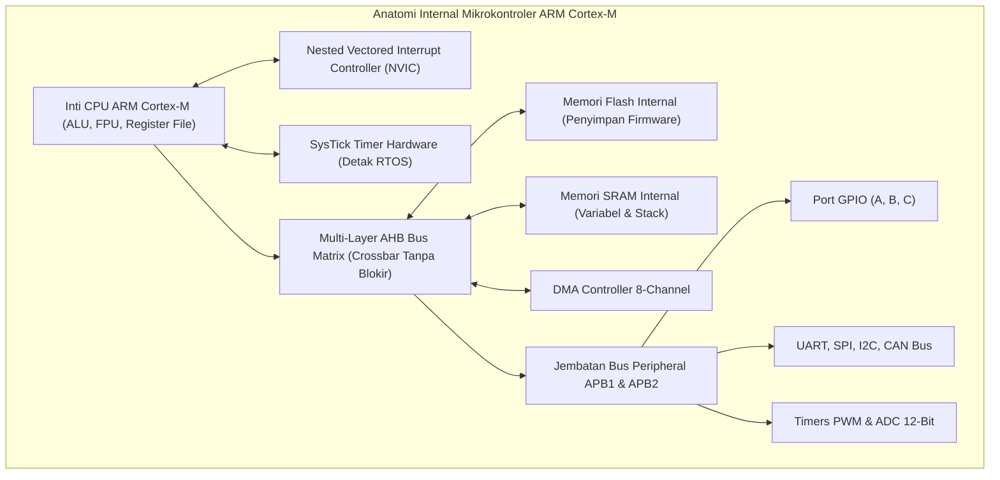

# Modul 070: Arsitektur Mikrokontroler (MCU vs MPU: AVR/Arduino, ESP32 Tensilica/RISC-V, STM32 ARM Cortex-M)

**Navigasi**: [⬅️ Master Index](../../INDEX.md) | [Tingkat 5: Tingkat 5: Embedded Systems, Firmware Bare-Metal & RTOS / IoT](./README.md)
*Sebelumnya*: [069. akselerator-komputasi-paralel](../04-logika-digital-arsitektur-komputer/069-akselerator-komputasi-paralel.md) | *Berikutnya*: [071. metodologi-pembacaan-lembar-data](./071-metodologi-pembacaan-lembar-data.md)

---

## 1. Intuisi Dasar Tanpa Jargon ("Seperti Bayi Baru Lahir")
Bayangkan perbedaan antara sebuah mobil balap Formula 1 raksasa dengan seekor kuda beban pekerja yang tangguh:
- **Mikroprosesor (MPU - seperti Intel Core / Apple M-series)** seperti mobil balap F1: sangat kencang dan bertenaga monster, tetapi sangat manja! Ia membutuhkan tangki bensin khusus di luar (keping RAM DDR eksternal), tim mekanik (sistem operasi Linux), kipas pendingin raksasa, dan menelan daya listrik ratusan watt.
- **Mikrokontroler (MCU - seperti STM32, ESP32, Arduino AVR)** seperti seekor kuda pekerja tangguh: seluruh organ tubuhnya (**CPU, RAM, Flash memori, pengatur waktu, dan port kabel**) sudah menyatu di dalam satu keping chip silikon tunggal seukuran kuku jari (**System-on-Chip**)! Ia bisa menyala seketika dalam tempo 1 mikrodetik hanya dari baterai kancing jam tangan dan bertahan hidup selama 5 tahun di tengah hutan tanpa pernah mati atau crash.

Mikrokontroler adalah otak pengendali rahasia dunia modern: ada di dalam rem ABS mobil Anda, pengatur suhu kulkas, gimbal drone, hingga alat pacu jantung manusia.
[📚 Pelajari: Embedded Systems - Shape the World (Jonathan Valvano)](https://users.ece.utexas.edu/~valvano/edX/)

## 2. Fondasi Teoretis & Aksiomatik / Matematis
### 70.1 Taksonomi MCU vs MPU & Profil Keluarga ARM Cortex ([ARM Cortex-M Architecture Reference](https://developer.arm.com/documentation/ddi0403/latest))
1. **Mikrokontroler (MCU)**:
   - Terintegrasi penuh (*Self-Contained*): CPU Core, SRAM internal ($16\text{ KB} - 1\text{ MB}$), Flash internal ($32\text{ KB} - 2\text{ MB}$), dan periferal analog/digital dalam satu die silikon.
   - Booting deterministik instan ($< 10 \, \mu\text{s}$), eksekusi bare-metal atau RTOS real-time.
2. **Keluarga Inti ARM Cortex-M**:
   - **Cortex-M0 / M0+**: Arsitektur pipeline 2-tahap, set instruksi Von Neumann 32-bit Thumb-2 minimal, konsumsi daya ultra-rendah ($< 5 \, \mu\text{W/MHz}$), ideal untuk sensor IoT baterai.
   - **Cortex-M3**: Arsitektur Harvard pipeline 3-tahap, instruksi pembagian hardware, penanganan interupsi NVIC vektor hardware bersarang.
   - **Cortex-M4**: Menambahkan instruksi DSP single-cycle SIMD dan unit FPU floating-point presisi tunggal terintegrasi hardware.
   - **Cortex-M7**: Arsitektur superscalar pipeline 6-tahap, FPU presisi ganda (Double Precision), cache L1 I/D terintegrasi, dan memori tightly-coupled (TCM) berlatensi 0 siklus clock untuk kontrol avionik dan audio profesional.

### 70.2 Arsitektur ESP32 (Xtensa Dual-Core LX6 vs RISC-V) ([Espressif ESP32 Technical Reference](https://www.espressif.com/en/support/documents/technical-documents))
- **ESP32 Klasik**: Prosesor 32-bit dual-core Tensilica Xtensa LX6 berkecepatan hingga $240\text{ MHz}$, dilengkapi akselerator hardware Wi-Fi 802.11 b/g/n dan Bluetooth 4.2 BR/EDR/BLE.
- **ESP32-C3 / C6**: Bermigrasi penuh ke arsitektur prosesor terbuka **RISC-V 32-bit (RV32IMC)** dengan instruksi kompresi dan konsumsi daya tidur ultra-rendah ($5 \, \mu\text{A}$ deep-sleep).
- **Koproser Daya Rendah (ULP Coprocessor)**: Inti FSM/RISC-V independen berdaya nano-ampere yang tetap terjaga saat dua inti utama CPU tidur lelap, memantau sensor analog ADC dan membangunkan CPU utama hanya saat terjadi anomali ambang batas.

### 70.3 Peta Memori Terpadu (Memory-Mapped I/O Architecture) ([Valvano Embedded Systems](https://users.ece.utexas.edu/~valvano/))
Arsitektur ARM Cortex-M menggunakan ruang pengalamatan 32-bit linier terpadu sebesar 4 Gigabyte ($0x00000000$ s/d $0xFFFFFFFF$):
- $0x00000000 - 0x1FFFFFFF$ ($512\text{ MB}$): Kode Program (Flash Memori Internal / Boot ROM).
- $0x20000000 - 0x3FFFFFFF$ ($512\text{ MB}$): Data SRAM Internal (SRAM1, SRAM2).
- $0x40000000 - 0x5FFFFFFF$ ($512\text{ MB}$): Periferal Hardware (Bus APB1, APB2, AHB: GPIO, UART, SPI, I2C, Timers).
- $0xE0000000 - 0xE00FFFFF$: Sistem Internal CPU (NVIC, SysTick Timer, MPU, Debug Core DWT).

## 3. Anatomi Teknis & Cara Kerja Internal

Tightly-Coupled Memory (ITCM / DTCM):
Jalur memori SRAM khusus yang terhubung langsung ke inti prosesor tanpa melalui bus matrix umum; menjamin akses baca instruksi dan data selesai dalam tepat 1 siklus clock tanpa pernah mengalami penalti latensi antrian bus arbitrase.

## 4. Implementasi Praktis & Kode / Simulasi Riil
def parse_cortex_m_memory_map(address_hex: int) -> str:
    """
    Menganalisis alamat memori fisik pada mikrokontroler ARM Cortex-M 32-bit.
    """
    addr = address_hex
    if 0x00000000 <= addr <= 0x1FFFFFFF:
        return f"Alamat 0x{addr:08X} berada di Region KODE / FLASH (Memori Program)"
    elif 0x20000000 <= addr <= 0x3FFFFFFF:
        return f"Alamat 0x{addr:08X} berada di Region SRAM INTERNAL (Variabel, Heap, Stack)"
    elif 0x40000000 <= addr <= 0x5FFFFFFF:
        return f"Alamat 0x{addr:08X} berada di Region PERIFERAL (Register Kontrol GPIO/UART/Timer)"
    elif 0xE0000000 <= addr <= 0xFFFFFFFF:
        return f"Alamat 0x{addr:08X} berada di Region KONTROL INTI CPU (NVIC, SysTick, MPU)"
    else:
        return f"Alamat 0x{addr:08X} berada di Region Memori Eksternal / Cadangan"

print(parse_cortex_m_memory_map(0x08001240)) # Alamat eksekusi Flash STM32
print(parse_cortex_m_memory_map(0x20000400)) # Alamat variabel SRAM
print(parse_cortex_m_memory_map(0x40020000)) # Alamat register GPIOA
print(parse_cortex_m_memory_map(0xE000E100)) # Alamat NVIC Interrupt Enable Register

## 5. Miskonsepsi & Jebakan Industri
1. **Choosing MPU when Real-Time Determinism is Critical**: Menggunakan komputer papan tunggal Raspberry Pi (Linux OS MPU) untuk mengendalikan inverter motor mobil balap berkecepatan tinggi; scheduler multitasking Linux dapat menghentikan thread kontrol selama puluhan milidetik (jitter non-deterministik) yang membakar motor listrik. Gunakan MCU bare-metal atau RTOS!
2. **Accessing Unpowered Peripheral Registers**: Mencoba membaca atau menulis ke register periferal (misal GPIO atau UART) sebelum menyalakan jalur clock gerbang periferal tersebut di register RCC (*Reset and Clock Control*); memicu interupsi kesalahan fatal *HardFault Exception* seketika.
3. **Flash Wait States Violation**: Menaikkan frekuensi clock CPU inti (misal dari $16	ext{ MHz}$ ke $168	ext{ MHz}$) tanpa menambah siklus tunggu memori Flash (*Flash Latency Wait States*); CPU akan membaca instruksi yang rusak dari memori Flash yang lebih lambat dari clock inti, menyebabkan chip crash saat booting.

## 6. Proyek Latihan & Rubrik Penilaian Mandiri
### Tingkat 1 (Pemula) - Audit Pemilihan MCU untuk Alat Medis Portabel
Buat matriks komparasi teknis pemilihan mikrokontroler antara 3 kandidat: Microchip ATmega328P (8-bit AVR), STMicroelectronics STM32L4 (32-bit ARM Cortex-M4), dan Espressif ESP32-C3 (32-bit RISC-V) untuk produk termometer medis portabel berdaya baterai kancing CR2032. Evaluasi aspek konsumsi arus sleep, resolusi ADC, dan kapabilitas konektivitas.

### Tingkat 2 (Menengah) - Perhitungan Siklus Akses Memori Flash Wait-States
Diberikan mikrokontroler STM32F407 dengan waktu akses memori Flash internal $t_{	ext{access}} = 30	ext{ ns}$. Hitung jumlah Flash Wait States (siklus tunda LATENCY) minimum yang wajib dikonfigurasikan pada register `FLASH_ACR` saat clock sistem dinaikkan bertahap: $30	ext{ MHz}, 84	ext{ MHz}, 120	ext{ MHz}, 	ext{dan } 168	ext{ MHz}$.

### Tingkat 3 (Mahir) - Perancangan Firmware Bootloader Multi-Image Dual-Bank
Rancang arsitektur partisi memori Flash internal dual-bank ($2 	imes 512	ext{ KB}$) untuk firmware over-the-air (OTA): Bank 1 menyimpan image aktif saat ini, Bank 2 menerima firmware baru, dan sektor awal memuat Bootloader terproteksi write-protect. Tulis alur verifikasi tanda tangan kriptografi ECDSA SHA-256 sebelum membalikkan vektor booting (*bank swap*).

#### Rubrik Penilaian
- **40% Ketepatan Pemetaan Ruang Memori**: Alokasi segmen Flash, SRAM, dan periferal register mematuhi memory map vendor.
- **30% Analisis Manajemen Daya & Clock**: Menghitung anggaran arus aktif vs sleep dalam satuan mikroampere ($\mu	ext{A}$).
- **30% Keandalan Penanganan Kesalahan Booting**: Menyertakan mekanisme fallback rollback otomatis jika firmware baru gagal boot.

## 7. Rekomendasi Sumber Belajar Standar Emas
| Kategori | Judul Sumber & Tautan Langsung | Deskripsi Singkat |
|---|---|---|
| 📖 Buku Teks | [The Definitive Guide to ARM Cortex-M3 and Cortex-M4 Processors (Joseph Yiu)](https://www.elsevier.com/) | Kitab rujukan arsitektur terlengkap di dunia untuk internal prosesor ARM Cortex-M. |
| 🎓 Kuliah Terbuka | [UT Austin / edX Embedded Systems - Shape the World (Jonathan Valvano)](https://users.ece.utexas.edu/~valvano/edX/) | Seri kuliah laboratorium mikrokontroler embedded systems paling populer di dunia. |
| 🔬 Makalah Seminal | [The Internet of Things: A Survey (Atzori et al., 2010)](https://doi.org/10.1016/j.comnet.2010.05.010) | Makalah komprehensif evolusi mikrokontroler cerdas dan konektivitas peranti IoT. |
| 💻 Lab Interaktif | [Wokwi Online Arduino, ESP32, and STM32 Simulator](https://wokwi.com/) | Simulator sirkuit mikrokontroler dan periferal perangkat keras online real-time di browser. |

---
*Navigasi Cepat*: [Ke Tingkat 5](./README.md) | [Ke Master Index](../../INDEX.md) | *Sebelumnya*: [069. akselerator-komputasi-paralel](../04-logika-digital-arsitektur-komputer/069-akselerator-komputasi-paralel.md) | *Berikutnya*: [071. metodologi-pembacaan-lembar-data](./071-metodologi-pembacaan-lembar-data.md)
