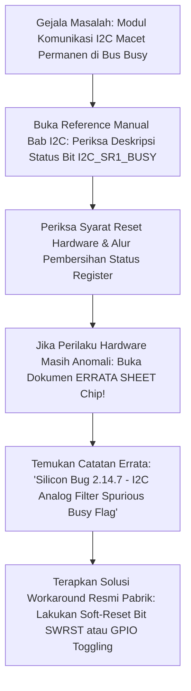

# Modul 071: Metodologi Pembacaan Lembar Data (Datasheet, Memory Map Registers, Errata Sheets)

**Navigasi**: [⬅️ Master Index](../../INDEX.md) | [Tingkat 5: Tingkat 5: Embedded Systems, Firmware Bare-Metal & RTOS / IoT](./README.md)
*Sebelumnya*: [070. arsitektur-mikrokontroler](./070-arsitektur-mikrokontroler.md) | *Berikutnya*: [072. pemrograman-bare-metal-c-cpp-rust](./072-pemrograman-bare-metal-c-cpp-rust.md)

---

## 1. Intuisi Dasar Tanpa Jargon ("Seperti Bayi Baru Lahir")
Pernahkah Anda membeli perabot lemari kayu rakitan yang memiliki 500 sekrup dan 50 papan kayu? Jika Anda mencoba merakitnya tanpa membaca buku panduan manualnya, Anda pasti salah pasang sekrup dan lemari Anda akan roboh miring!

Dalam dunia rekayasa embedded systems, chip mikrokontroler modern memiliki dokumen manual resmi yang tebalnya bisa menembus **2.000 hingga 3.500 Halaman**!
Dokumen ini disebut **Datasheet** dan **Reference Manual**:
- Banyak pemula ketakutan melihat ribuan halaman bahasa teknis ini dan memilih mencari 'tutorial blog instan'. Akibatnya, saat menghadapi bug perangkat keras yang membingungkan, mereka menyerah.
- Seorang insinyur profesional **TIDAK MEMBACA DARI HALAMAN 1 KE HALAMAN 2000 SEPERTI MEMBACA NOVEL!** Mereka memiliki metodologi navigasi cepat: tahu persis bagaimana membedah peta memori (*Memory Map*), cara membaca tabel deskripsi bit register (*Bitfield Table*), dan yang paling penting: memeriksa **Errata Sheet**—yaitu dokumen rahasia pabrik yang mencatat bug-bug cacat silikon yang gagal diperbaiki sebelum chip diproduksi massal!
[📚 Pelajari: EEVblog How to Read a Semiconductor Datasheet](https://www.youtube.com/watch?v=0h5G295lK1Q)

## 2. Fondasi Teoretis & Aksiomatik / Matematis
### 71.1 Tiga Dokumen Wajib Produsen Semikonduktor ([STMicroelectronics Technical Documentation Guide](https://www.st.com/))
1. **Datasheet (DS - Tipikal 100 - 200 Halaman)**:
   - Karakteristik elektrikal fisik spesifik part number: Tegangan suplai mutlak ($V_{DD\max}$), batas suhu ambien, konsumsi arus di setiap mode sleep, rating batas frekuensi maksimum.
   - Penetapan pin fisik (*Pinout*) dan fungsi alternatif multiplexing (*Alternate Functions* AF0 - AF15).
   - Dimensi fisik kemasan paket chip (QFP, QFN, BGA).
2. **Reference Manual (RM - Tipikal 1.500 - 3.000 Halaman)**:
   - Penjelasan arsitektur fungsional internal setiap modul periferal (Timer, I2C, SPI, DMA).
   - Diagram blok register internal dan diagram status state machine perangkat keras.
   - **Tabel Peta Register Detail**: Alamat offset heksadesimal, deskripsi fungsi setiap bit, nilai reset bawaan pabrik, dan tipe akses (`R/W`, `RO` Read-Only, `WO` Write-Only, `W1C` Write-1-to-Clear).
3. **Errata Sheet (ES - Tipikal 30 - 60 Halaman)**:
   - Dokumentasi cacat desain silikon (*hardware bugs*) pada revisi wafer tertentu beserta instruksi solusi kerja (*workarounds* perangkat lunak).

### 71.2 Dekonstruksi Alamat Register Hardware: Alamat Dasar + Offset ([Cortex-M Memory Map](https://developer.arm.com/))
Setiap register kendali periferal memiliki alamat memori fisik 32-bit unik yang dihitung dengan rumus:
$$\text{Alamat Register Fisik} = \text{Alamat Dasar Bus Periferal} + \text{Offset Modul} + \text{Offset Register}$$
Contoh pada STM32:
- Alamat Dasar Bus AHB1: `0x40020000`
- Alamat Dasar Modul Port GPIOA: `0x40020000`
- Offset Register Output Data (`GPIOA_ODR`): `0x14`
$$\text{Alamat Fisik } GPIOA\_ODR = 0x40020000 + 0x14 = 0x40020014$$

### 71.3 Tipe Akses Register Kritis: Read-Only, Write-1-to-Clear (W1C), dan Shadow Registers ([ARM CMSIS Core](https://arm-software.github.io/CMSIS_5/Core/html/index.html))
- `R/W`: Dapat dibaca dan ditulis normal.
- `RO` (*Read-Only*): Ditulis tidak berpengaruh, mencerminkan status perangkat keras fisik (misal: pin input status).
- `W1C` (*Write-1-to-Clear*): Digunakan pada register bendera interupsi (*Interrupt Status Flags*):
  Untuk menghapus bendera interupsi, perangkat lunak harus menulis angka '1' ke bit tersebut. Menulis angka '0' tidak mengubah apa pun. Ini mencegah *race condition* di mana interupsi lain yang tiba bersamaan terhapus secara tidak sengaja!
- *Shadow Registers* (Buffered Registers): Register pembaruan preload pada Timer PWM; nilai baru yang Anda tulis tidak langsung aktif seketika di tengah siklus gelombang, melainkan ditahan di buffer bayangan dan baru disalin ke register aktif tepat pada saat timer meluap (*Update Event* UEV) untuk mencegah pulsa runt pendek yang merusak motor.

## 3. Anatomi Teknis & Cara Kerja Internal

Navigasi Cepat Datasheet 4-Langkah Insinyur Profesional:
1. Periksa tabel *Pin Description* untuk memastikan pin multiplexing tidak bentrok dengan periferal lain.
2. Periksa diagram *Clock Tree* untuk mencatat sumber clock dan batas prescaler bus maksimum.
3. Buka bab periferal di Reference Manual, langsung lompat ke sub-bab *Register Description*.
4. Telusuri dokumen Errata Sheet untuk periferal yang sedang Anda gunakan sebelum mulai menulis kode driver.

## 4. Implementasi Praktis & Kode / Simulasi Riil
def decode_register_bitfield(reg_value_32bit: int, bit_definitions: dict) -> dict:
    """
    Membongkar isi nilai heksadesimal 32-bit register periferal berdasarkan deskripsi lembar data Reference Manual.
    bit_definitions: {nama_field: (start_bit, bit_width, deskripsi)}
    """
    decoded = {}
    for name, (start, width, desc) in bit_definitions.items():
        mask = (1 << width) - 1
        val = (reg_value_32bit >> start) & mask
        decoded[name] = {
            "value_raw": val,
            "value_hex": hex(val),
            "description": desc
        }
    return decoded

# Contoh: Dekoding Register Kontrol Timer STM32 TIMx_CR1 (Alamat Offset 0x00)
# Nilai terbaca dari debugger: 0x00000085
tim_cr1_fields = {
    "CEN":  (0, 1, "Counter Enable: 1=Timer Aktif Mencacah"),
    "UDIS": (1, 1, "Update Disable: 0=Update Event Diaktifkan"),
    "URS":  (2, 1, "Update Request Source: 1=Hanya Overflow yang Memicu Interupsi"),
    "OPM":  (3, 1, "One-Pulse Mode: 0=Mencacah Periodik Berulang"),
    "DIR":  (4, 1, "Direction: 0=Upcounter (Mencacah Naik)"),
    "ARPE": (7, 1, "Auto-Reload Preload Enable: 1=Gunakan Register Bayangan Buffer")
}

result = decode_register_bitfield(0x00000085, tim_cr1_fields)
print("Hasil Analisis Register TIMx_CR1 (Nilai: 0x0085):")
for field, data in result.items():
    print(f" - Bit {field:5s} = {data['value_raw']} | {data['description']}")

## 5. Miskonsepsi & Jebakan Industri
1. **Ignoring Errata Workarounds**: Menghabiskan waktu 3 minggu mencoba men-debug modul hardware yang macet secara misterius menggunakan osiloskop; padahal masalah tersebut sudah terdaftar secara resmi di dokumen Errata Sheet sebagai cacat silikon pabrik yang membutuhkan 2 baris kode workaround khusus.
2. **Writing 0 to Clear Interrupt Flags**: Menulis angka 0 ke register berstatus Write-1-to-Clear (`W1C`) dengan harapan menghapus interupsi; bendera interupsi tetap aktif membara dan CPU terjebak dalam loop pemanggilan ISR tanpa henti.
3. **Absolute Maximum Ratings Confusion**: Mengira tabel *Absolute Maximum Ratings* adalah kondisi operasional yang diizinkan (misal tegangan $4.0	ext{ V}$ pada pin $3.3	ext{ V}$); mengoperasikan chip pada batas absolut merusak keandalan silikon secara permanen dan membatalkan garansi pabrikan.

## 6. Proyek Latihan & Rubrik Penilaian Mandiri
### Tingkat 1 (Pemula) - Ekstraksi Alamat Register Hardware dari Reference Manual
Buka Reference Manual mikrokontroler STM32F103 (tersedia bebas di internet). Tentukan alamat dasar bus APB2, offset port GPIOC, dan offset register konfigurasi `GPIOC_CRH`. Hitung alamat fisik memori 32-bit dari register `GPIOC_CRH`.

### Tingkat 2 (Menengah) - Analisis Tabel Pin Alternate Function Multiplexing
Gunakan Datasheet mikrokontroler STM32 untuk memetakan pin periferal UART1 (TX dan RX), SPI1 (SCK, MISO, MOSI), dan I2C1 (SCL, SDA). Tentukan nomor register `AFR[0]` dan `AFR[1]` serta nilai 4-bit nibble yang wajib ditulis ke register alternate function untuk mengarahkan pin PB6 dan PB7 menjadi saluran I2C1.

### Tingkat 3 (Mahir) - Mitigasi Bug Hardware I2C Analog Filter Menggunakan Errata Sheet
Pelajari dokumen Errata Sheet STM32F4 terkait cacat hardware "I2C bus lockup when master receives NACK". Rancang prosedur pemulihan perangkat lunak mandiri (*Software Bus Clearing Sequence*): jika bus I2C terdeteksi terkunci, lepaskan kontrol hardware periferal, alihkan pin SCL dan SDA menjadi GPIO Output Open-Drain, kirimkan 9 pulsa detak clock manual untuk memaksa slave melepas jalur data, dan lakukan inisialisasi ulang periferal.

#### Rubrik Penilaian
- **40% Ketepatan Perhitungan Alamat Memori**: Alamat dasar bus, offset periferal, dan offset register dihitung tepat tanpa salah alamat.
- **30% Pemahaman Semantik Bit Register**: Membedakan fungsi bit reserved, bitfield konfigurasi multi-bit, dan mekanisme W1C.
- **30% Validitas Solusi Rekayasa Errata**: Prosedur pemulihan bus I2C mematuhi spesifikasi pemulihan standar industri NXP I2C Bus.

## 7. Rekomendasi Sumber Belajar Standar Emas
| Kategori | Judul Sumber & Tautan Langsung | Deskripsi Singkat |
|---|---|---|
| 📖 Buku Teks | [Mastering STM32 (Carmine Noviello)](https://leanpub.com/mastering-stm32) | Buku panduan terstruktur membaca Reference Manual dan menulis driver bare-metal STM32. |
| 🎓 Kuliah Terbuka | [EEVblog #914 - How to Read a Semiconductor Datasheet](https://www.youtube.com/watch?v=0h5G295lK1Q) | Tutorial praktis David Jones mengenai cara menavigasi datasheet semikonduktor tanpa tersesat. |
| 🔬 Makalah Seminal | [ARM Cortex-M for Beginners (ARM Infocenter Guide)](https://developer.arm.com/) | Panduan arsitektur resmi ARM mengenai organisasi register kontrol inti dan memory mapping. |
| 💻 Lab Interaktif | [STMicroelectronics STM32CubeIDE & Datasheet Finder](https://www.st.com/en/development-tools/stm32cubeide.html) | Lingkungan IDE profesional terintegrasi dengan akses langsung ke seluruh dokumentasi resmi STM32. |

---
*Navigasi Cepat*: [Ke Tingkat 5](./README.md) | [Ke Master Index](../../INDEX.md) | *Sebelumnya*: [070. arsitektur-mikrokontroler](./070-arsitektur-mikrokontroler.md) | *Berikutnya*: [072. pemrograman-bare-metal-c-cpp-rust](./072-pemrograman-bare-metal-c-cpp-rust.md)
