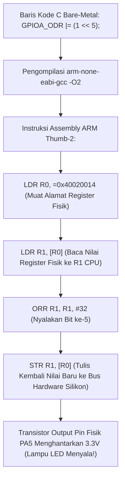

# Modul 072: Pemrograman Bare-Metal C/C++/Rust (Manipulasi Bitwise, Pointer Fisik, Kata Kunci Volatile)

**Navigasi**: [⬅️ Master Index](../../INDEX.md) | [Tingkat 5: Tingkat 5: Embedded Systems, Firmware Bare-Metal & RTOS / IoT](./README.md)
*Sebelumnya*: [071. metodologi-pembacaan-lembar-data](./071-metodologi-pembacaan-lembar-data.md) | *Berikutnya*: [073. anatomi-booting-mikrokontroler-linker-script](./073-anatomi-booting-mikrokontroler-linker-script.md)

---

## 1. Intuisi Dasar Tanpa Jargon ("Seperti Bayi Baru Lahir")
### 1.1 Konsep Inti & Analogi Tanpa Jargon
Bayangkan seorang pengemudi mobil balap profesional: ia menolak menggunakan transmisi otomatis yang lambat, menolak menggunakan power steering elektrik yang mati rasa, dan menolak sistem navigasi komputer yang mengambil alih kendali. Ia ingin merasakan setiap getaran aspal jalan langsung di ujung jari tangannya dan memindahkan gigi persneling secara mekanis seketika tanpa jeda milidetik pun.

### 1.2 Urgensi Rekayasa & Signifikansi Sistemik
Dalam pemrograman komputer, itulah **Pemrograman Bare-Metal (C/C++ dan Rust)**:
Anda menulis kode yang berjalan **LANGSUNG DI ATAS LOGAM SILIKON FISIK (Bare-Metal)** tanpa ada sistem operasi Windows, Linux, atau driver perantara di bawahnya!
- Setiap baris kode yang Anda ketik langsung mengubah tegangan kabel tembaga mikroskopis di pin chip silikon.
- Anda memegang kendali mutlak \$100\%$ atas setiap siklus clock CPU dan setiap byte alamat memori RAM.
- Di sinilah dua senjata terhebat insinyur sistem beroperasi: **Manipulasi Bitwise** untuk membolak-balik saklar register, dan kata kunci ajaib **`volatile`** yang melarang compiler komputer bersikap sok pintar menghapus instruksi Anda.
[📚 Pelajari: Embedded Rust Book Official Documentation](https://docs.rust-embedded.org/book/)

## 2. Fondasi Teoretis & Aksiomatik / Matematis
### 2.1 Kerangka Teori Aksiomatik & Formulasi Matematis
### 72.1 Operasi Manipulasi Bitwise Primitif ([Kernighan & Ritchie The C Programming Language](https://www.pearson.com/))
Dalam pemrograman sistem tingkat rendah, register kendali perangkat keras dimanipulasi per-bit menggunakan operasi bitwise biner:
1. **Set Bit ke '1' (Mengaktifkan Fitur)**: Menggunakan operator bitwise OR (`|`):
   $$\text{REG} = \text{REG} \mid (1 \ll n)$$
2. **Clear Bit ke '0' (Mematikan Fitur)**: Menggunakan operator bitwise AND dengan inversi tilde (`& ~`):
   $$\text{REG} = \text{REG} \ \& \ \sim(1 \ll n)$$
3. **Toggle Bit (Membalikkan Keadaan $0 \leftrightarrow 1$)**: Menggunakan operator bitwise XOR (`^`):
   $$\text{REG} = \text{REG} \oplus (1 \ll n)$$
4. **Membaca Status Bit Tunggal**: Menggunakan masking bitwise AND:
   $$\text{Status} = (\text{REG} \gg n) \ \& \ 1$$
5. **Modifikasi Multi-Bit Masking**: Menghapus field lama sebelum menulis nilai baru:
   $$\text{REG} = (\text{REG} \ \& \ \sim(0xF \ll \text{shift})) \mid ((\text{value} \ \& \ 0xF) \ll \text{shift})$$

### 2.2 Penurunan Matematis Langkah-demi-Langkah
### 72.2 Akses Pointer Fisik & Kata Kunci `volatile` ([Meyers Effective Modern C++](https://www.oreilly.com/))
Dalam arsitektur Memory-Mapped I/O, register hardware diakses melalui pointer C yang menunjuk langsung ke alamat memori fisik integer 32-bit:
```c
#define GPIOA_ODR  (*(volatile uint32_t *)0x40020014)
```
Mengapa Wajib Menggunakan Kata Kunci `volatile`?
Compiler modern (GCC / Clang dengan optimasi `-O2` atau `-O3`) mengasumsikan bahwa nilai di memori hanya berubah jika program perangkat lunak itu sendiri yang memodifikasinya:
- Jika Anda menulis loop penunggu status hardware: `while (*status_reg == 0);`, compiler cerdas akan menganggap nilai `*status_reg` tidak pernah berubah di dalam loop, sehingga compiler memindahkan pembacaan ke luar loop menjadi `if (*status_reg == 0) while(1);` (Loop Macet Abadi!).
- Kata kunci `volatile` adalah perintah tegas kepada compiler: *"Nilai di alamat fisik ini dapat berubah sewaktu-waktu oleh perangkat keras fisik eksternal di luar kendali software! Jangan pernah meng-cache nilai ini di register CPU, dan wajib baca/tulis langsung ke kabel memori fisik di setiap baris!"*

### 72.3 Pemrograman Embedded Aman Menggunakan Rust Bare-Metal (`no_std`) ([The Embedded Rust Book](https://docs.rust-embedded.org/book/))
Rust menghadirkan keamanan memori mutlak (*Memory Safety without Garbage Collector*):
- Direktif `#![no_std]`: Mematikan runtime standar sistem operasi, hanya menggunakan pustaka inti `core`.
- Tipe Pembungkus Register Zero-Cost Abstraction (PAC / HAL): Mengubah manipulasi bit mentah menjadi API tipe data yang kebal terhadap kesalahan salah ketik bit:
```rust
// Rust Embedded HAL: Menjamin secara tipe data bahwa pin tidak bisa salah konfigurasi
gpioa.odr.modify(|_, w| w.odr5().set_bit());
```
- Menghilangkan bahaya data race dan pointer liar (*Dangling Pointers*) saat kompilasi (*Compile-Time Borrow Checker*).

## 3. Anatomi Teknis & Cara Kerja Internal

Bit-Banding Memory Aliasing (Cortex-M3 / M4):
Fitur khusus perangkat keras yang memetakan setiap 1 bit individual di dalam SRAM dan periferal menjadi satu kata 32-bit terpisah di wilayah alias ($0x22000000$ dan $0x42000000$). Memungkinkan operasi modifikasi bit tunggal secara atomik murni dalam 1 instruksi `STR` tanpa memerlukan siklus Read-Modify-Write yang rentan interupsi race condition.

#### Tabel Penelusuran Optimasi Kompilator Tanpa Kata Kunci `volatile` & Kasus Akselerasi Toyota
| Baris Kode Sumber C | Kode Assembly Dihasilkan (Tanpa `volatile` `-O2`) | Siklus CPU / Loop Polling | Status Memori Register I/O Fisik Pedal Gas | Nilai Terbaca oleh Prosesor | Dampak Tindakan Aktuator Throttle Mobil |
|---|---|---|---|---|---|
| `while (pedal == 0)` | `LDR R0, [R1]` (Baca `pedal` SEKALI ke R0) | Siklus 0 (Awal) | Posisi pedal gas: Diinjak $0\%$ (`0`) | $R_0 = 0$ | Mobil melaju santai |
| Loop Polling Berjalan| `CMP R0, #0` ; `BEQ loop` (BACA DARI REGISTER R0!)| Siklus 1 - 100.000 | Kompilator mengasumsikan variabel RAM tidak berubah!| Terus menggunakan $R_0 = 0$ basi | Kompilator membuang pembacaan memori berulang! |
| Pengemudi Injak Rem | Perangkat keras menulis nilai baru ke pin I/O | Detik ke-5 | Nilai pedal rem berubah fisik di memori | Register $R_0$ tidak pernah diperbarui! | CPU TIDAK PERNAH TAHU REM DIINJAK! |
| Penghapusan Dead-Code| Kompilator menganggap loop tak pernah selesai| Pembaruan variabel dihapus | - | Variabel kontrol dibuang | Mobil terus melaju kencang tanpa kendali! |
| Dengan `volatile` | `loop: LDR R0, [R1]` ; `CMP R0, #0` | Setiap siklus loop | Nilai fisik dibaca ulang dari memori setiap iterasi | Nilai baru langsung terdeteksi seketika | Rem aktif; mobil berhenti selamat! |

## 4. Implementasi Praktis & Kode / Simulasi Riil
```c
#include <stdint.h>
#include <stdbool.h>

// Definisi Alamat Dasar Register Fisik STM32F4 (RCC dan GPIOA)
#define RCC_BASE        0x40023800
#define RCC_AHB1ENR     (*(volatile uint32_t *)(RCC_BASE + 0x30))

#define GPIOA_BASE      0x40020000
#define GPIOA_MODER     (*(volatile uint32_t *)(GPIOA_BASE + 0x00))
#define GPIOA_ODR       (*(volatile uint32_t *)(GPIOA_BASE + 0x14))
#define GPIOA_BSRR      (*(volatile uint32_t *)(GPIOA_BASE + 0x18))

// Demonstrasi Menyalakan Lampu LED pada Pin PA5 Bare-Metal Murni
void led_init(void) {
    // 1. Nyalakan clock bus untuk port GPIOA (Set Bit ke-0 pada RCC_AHB1ENR)
    RCC_AHB1ENR |= (1U << 0);
    
    // 2. Konfigurasikan Pin PA5 sebagai General Purpose Output (Mode '01' pada bit 11:10)
    GPIOA_MODER &= ~(3U << (5 * 2)); // Bersihkan 2 bit konfigurasi lama
    GPIOA_MODER |=  (1U << (5 * 2)); // Tulis mode '01' (Output)
}

void led_toggle(void) {
    // Balikkan keadaan bit ke-5 menggunakan XOR bitwise
    GPIOA_ODR ^= (1U << 5);
}

void led_set_atomic(bool state) {
    // Menggunakan register BSRR (Bit Set/Reset Register) untuk operasi atomik 1-siklus bebas race condition!
    if (state) {
        GPIOA_BSRR = (1U << 5);       // Menyalakan PA5 (Bit 0-15 adalah Set)
    } else {
        GPIOA_BSRR = (1U << (5 + 16)); // Mematikan PA5 (Bit 16-31 adalah Reset)
    }
}
```

## 5. Miskonsepsi & Jebakan Industri
1. **Omitting `volatile` on Hardware Register Pointers**: Menulis driver periferal tanpa `volatile`; compiler yang mengoptimalkan kode dengan `-O2` atau `-O3` akan menganggap operasi baca-tulis berulang ke alamat yang sama sebagai kode redundan yang tidak berguna (*Dead Code Elimination*) dan menghapus seluruh rutinitas inisialisasi hardware Anda.
2. **Non-Atomic Read-Modify-Write Race Condition**: Menggunakan operasi `GPIOA_ODR |= (1 << 5)` untuk menyalakan pin di dalam kode utama, sementara fungsi interupsi ISR memodifikasi pin lain di port yang sama secara mendadak di tengah siklus eksekusi; nilai yang baru diubah ISR akan tertimpa kembali oleh kode utama. Solusi: selalu gunakan register atomik khusus hardware seperti `BSRR`!
3. **Signed Bit Shift Overflow**: Melakukan pergeseran bitwise pada bilangan bertanda signed integer tanpa akhiran unsigned `U` (misal `1 << 31`); menggeser bit ke posisi MSB memicu signed overflow yang merupakan *Undefined Behavior* dalam standar bahasa C/C++. Selalu tulis `1U << 31`.

### Studi Kasus Kegagalan Nyata: Kasus Akselerasi Tak Terkendali Mobil Toyota & Kata Kunci Volatile (Bookout v. Toyota)
- **Skandal Perangkat Lunak Otomotif Global**: Antara tahun 2004 hingga 2014, ratusan kecelakaan fatal terjadi akibat mobil Toyota Camry dan Lexus mengalami akselerasi mendadak tanpa kendali (*Unintended Acceleration* / UA) yang menewaskan banyak korban jiwa. Investigasi forensik independen dalam persidangan *Bookout v. Toyota* (2013) membongkar kerentanan sistematis pada arsitektur perangkat lunak Electronic Throttle Control System (ETCS).
- **Akar Masalah Pemrograman Bare-Metal C & Ketiadaan Kata Kunci `volatile`**: Dalam sistem embedded bare-metal, register periferal pengontrol perangkat keras dipetakan langsung ke alamat memori fisik (*Memory-Mapped I/O* / MMIO). Pengoptimal kompilator C (seperti GCC/Clang dengan opsi `-O2` atau `-O3`) mengasumsikan bahwa isi sebuah variabel di memori RAM tidak akan pernah berubah kecuali jika diubah secara eksplisit oleh instruksi penugasan di dalam kode itu sendiri. Jika sebuah pointer penunjuk register status perangkat keras dideklarasikan sebagai pointer biasa tanpa kualifikasi `volatile` (`uint32_t *p_status` alih-alih `volatile uint32_t *p_status`), pengoptimal kompilator akan memindahkan instruksi pembacaan memori ke luar perulangan (*loop-invariant code motion*), membaca nilainya hanya sekali ke dalam register CPU, dan kemudian melakukan perulangan pengecekan tanpa henti terhadap register CPU lokal tersebut. Meskipun sensor fisik pedal gas telah berubah nilai di dunia nyata, CPU terus membaca data lama yang tersimpan di register cache lokal. Selain itu, investigasi menemukan kegagalan pembatasan tumpukan memori (*stack overflow*) yang menimpa variabel kritis kendali throttle dan minimnya kepatuhan terhadap standar MISRA-C.

- **Potongan Kode / Arsitektur Cacat (Vulnerable Implementation)**:
```c
// Demonstrasi Perbedaan Kode Assembly Kompilator C dengan vs tanpa volatile
#include <stdint.h>
#include <stdbool.h>

#define SENSOR_ADC_MMIO_ADDR ((uint32_t *)0x40020000)
#define SENSOR_ADC_VOLATILE_ADDR ((volatile uint32_t *)0x40020000)

void bad_hardware_poll_loop() {
    uint32_t *sensor_reg = SENSOR_ADC_MMIO_ADDR;
    // CACAT FATAL: Kompilator mengoptimalkan ini menjadi:
    // LDR R0, [R1] (Baca sekali)
    // .loop: CMP R0, #0; BEQ .loop (Infinite loop tanpa membaca memori fisik lagi!)
    while (*sensor_reg == 0) {
        // Menunggu hardware... tetapi hardware tidak pernah dibaca ulang!
    }
}

void safe_hardware_poll_loop() {
    volatile uint32_t *sensor_reg = SENSOR_ADC_VOLATILE_ADDR;
    // POLA BENAR: Kata kunci 'volatile' memaksa kompilator membangkitkan instruksi LDR
    // membaca langsung dari alamat fisik memori pada SETIAP iterasi perulangan!
    while (*sensor_reg == 0) {
        // Aman: membaca perubahan sinyal fisik waktu riil
    }
}
```

- **Aturan Baku Semantik `volatile` C/C++**: Dalam pemrograman sistem tertanam, kata kunci `volatile` wajib digunakan pada tiga skenario fundamental: 1) Setiap alamat register memori periferal perangkat keras (*Memory-Mapped I/O*); 2) Setiap variabel global yang dimodifikasi di dalam rutinitas layanan interupsi (*Interrupt Service Routine* / ISR) dan dibaca oleh program utama; 3) Variabel yang diakses bersama oleh beberapa task dalam sistem operasi multi-threading tanpa perlindungan mutex.

## 6. Proyek Latihan & Rubrik Penilaian Mandiri
### Tingkat 1 (Pemula) - Makro Bitwise Standar C Industri
Tulis file header bahasa C `bitwise_utils.h` yang mendefinisikan 5 makro prapemroses yang aman dan bertanda kurung lengkap: `BIT(n)`, `SET_BIT(reg, n)`, `CLEAR_BIT(reg, n)`, `TOGGLE_BIT(reg, n)`, dan `READ_BIT(reg, n)`. Tulis program uji verifikasi konsistensinya.

### Tingkat 2 (Menengah) - Driver Bare-Metal Pengirim Karakter UART Serial
Tulis driver bare-metal murni dalam bahasa C tanpa library HAL vendor untuk menginisialisasi periferal USART2 pada mikrokontroler STM32 (Baud Rate \$115.200	ext{ bps}$ pada clock \$16	ext{ MHz}$): konfigurasikan register baud rate `USART_BRR`, aktifkan transmitter pada `USART_CR1`, dan buat fungsi transmisi `uart_send_char(char c)` yang memantau register status `USART_SR_TXE` dengan benar menggunakan `volatile`.

### Tingkat 3 (Mahir) - Driver Sensor I2C Bare-Metal Aman dalam Rust `no_std`
Tulis driver perangkat tertanam bare-metal (*Bare-Metal Embedded Driver*) dalam bahasa Rust menggunakan direktif `#![no_std]` untuk membaca sensor akselerometer I2C 3-sumbu: bangun struktur abstraksi register zero-cost, implementasikan pembacaan data koordinat akselerasi $(X, Y, Z)$ 16-bit Two's Complement, dan cegah pembagian dengan nol menggunakan enum Rust `Result<T, SensorError>`.

#### Rubrik Penilaian
- **40% Ketepatan Sintaks Bitwise & Penggunaan Volatile**: Seluruh manipulasi register menggunakan masking aman dan kata kunci `volatile` wajib.
- **30% Keamanan Atomik Eksekusi**: Menghindari fenomena Read-Modify-Write race condition menggunakan register BSRR atau bit-banding.
- **30% Portabilitas & Kerapian Kode**: Tidak ada hardcoded magic number tanpa pendefinisian konstanta simbolik yang jelas.

### Tingkat 1: Dasar
- **Tugas**: Bangun fungsi driver akses bitwise Memory-Mapped I/O (MMIO) dalam C yang memetakan struktur register periferal GPIO menggunakan pointer pointer `volatile struct`, verifikasi bahwa seluruh akses membaca dan menulis menghasilkan instruksi memori fisik.
- **Petunjuk Perancangan Arsitektur**:
  - Deklarasikan: `typedef struct { volatile uint32_t MODER; volatile uint32_t ODR; volatile uint32_t IDR; } GPIO_TypeDef;`.
  - Definisikan instans: `#define GPIOA ((GPIO_TypeDef *) 0x40020000)`.
- **Test Vector & Kasus Uji Ekstrem**:
  - *Penulisan Berulang*: Tulis nilai $0\text{x01}$ lalu $0\text{x02}$ ke register yang sama berurutan; buktikan kompilator tidak menghapus penulisan pertama (*dead-store elimination prevented*).
  - *Konversi Alamat Tepat*: Verifikasi alamat fisik offset `IDR` berada tepat pada `0x40020008`.
- **Rubrik Penilaian Mandiri**: 40% Deklarasi Struktur Struct MMIO Volatile Presisi, 30% Kepatuhan Offset Ukuran Memori Alamat Fisik, 30% Pencegahan Optimasi Dead-Store Kompilator.

### Tingkat 2: Menengah
- **Tugas**: Implementasikan antrean sirkular bebas-kunci (*Lock-Free Single-Producer Single-Consumer / SPSC Ring Buffer*) berkapasitas $2^N$ dalam C murni untuk transfer data aman antara Interrupt Service Routine (Producer) dan Loop Utama (Consumer) tanpa menggunakan penonaktifan interupsi (*interrupt masking*).
- **Petunjuk Perancangan Arsitektur**:
  - Gunakan indeks kepala (*head*) dan ekor (*tail*) yang dideklarasikan sebagai `volatile uint32_t`.
  - Terapkan bitmask masking modulo cepat: `index = counter & (BUFFER_SIZE - 1)`.
  - Sisipkan compiler memory barrier `asm volatile("" ::: "memory")` untuk mencegah instruksi reordering.
- **Test Vector & Kasus Uji Ekstrem**:
  - *Batas Buffer Penuh*: Tulis hingga buffer penuh; operasi `enqueue()` harus mengembalikan false tanpa menimpa data yang belum dibaca.
  - *Batas Buffer Kosong*: Baca dari buffer kosong; operasi `dequeue()` harus mengembalikan false secara instan.
- **Rubrik Penilaian Mandiri**: 40% Arsitektur SPSC Ring Buffer Lock-Free Tepat, 30% Penggunaan Indeks Volatile & Compiler Memory Barrier, 30% Verifikasi Integritas Transmisi Data Simultan.

### Tingkat 3: Mahir
- **Tugas**: Rancang alat pemantau konsumsi tumpukan memori waktu riil (*Watermark Stack Usage Profiler*) untuk firmware bare-metal berbasis arsitektur ARM Cortex-M, terapkan teknik kanari pewarnaan memori (*Stack Painting with Magic Pattern `0xA5A5A5A5`*) saat startup, dan hitung persentase pemakaian tumpukan maksimum (*high-water mark*) serta bangkitkan interupsi darurat saat margin batas keselamatan tumpukan dilanggar.
- **Petunjuk Perancangan Arsitektur**:
  - Saat startup sebelum `main()`, isi seluruh ruang RAM tumpukan dari `_sstack` ke `_estack` dengan pola byte `0xA5`.
  - Fungsi profiler memindai dari dasar tumpukan ke atas untuk mencari byte pertama yang nilainya bukan `0xA5`.
  - Ruang terpakai maksimum: $Usage = StackSize - FreeBytes$.
- **Test Vector & Kasus Uji Ekstrem**:
  - *Simulasi Pemanggilan Fungsi Rekursif Dalam*: Panggil fungsi rekursif terkontrol; verifikasi kalkulator profiler melaporkan pertumbuhan watermark tumpukan secara presisi $\pm 8\text{ byte}$.
  - *Deteksi Pelanggaran Ambang Batas*: Jika sisa ruang tumpukan $< 128\text{ byte}$; sistem harus memicu penghentian fail-safe otomatis.
- **Rubrik Penilaian Mandiri**: 40% Algoritma Stack Painting & Watermark Scanning Presisi, 30% Integrasi Simbol Batas Memori Linker Script CMSIS, 30% Deteksi Pelanggaran Ambang Batas Keselamatan Stack.

## 7. Rekomendasi Sumber Belajar Standar Emas
| Kategori | Judul Sumber & Tautan Langsung | Deskripsi Singkat |
|---|---|---|
| 📖 Buku Teks | [The C Programming Language (Brian Kernighan & Dennis Ritchie)](https://www.pearson.com/) | Kitab suci bahasa C yang mendefinisikan operasi bitwise, pointer memori, dan tipe data. |
| 🎓 Kuliah Terbuka | [The Embedded Rust Book Documentation](https://docs.rust-embedded.org/book/) | Panduan resmi komunitas Rust mengenai pengembangan firmware bare-metal aman `no_std`. |
| 🔬 Makalah Seminal | [Volatile: Almost Useless for Multi-Threading (Boehm, 2005)](https://doi.org/10.1145/1105651.1105659) | Analisis mendalam Hans Boehm mengenai fungsi sejati kata kunci volatile untuk memory-mapped I/O. |
| 💻 Lab Interaktif | [Compiler Explorer (Godbolt): Bare-Metal C to ARM Assembly](https://godbolt.org/) | Eksplorasi langsung bagaimana kode C bare-metal diubah menjadi instruksi assembly mesin nyata oleh GCC. |

---
*Navigasi Cepat*: [Ke Tingkat 5](./README.md) | [Ke Master Index](../../INDEX.md) | *Sebelumnya*: [071. metodologi-pembacaan-lembar-data](./071-metodologi-pembacaan-lembar-data.md) | *Berikutnya*: [073. anatomi-booting-mikrokontroler-linker-script](./073-anatomi-booting-mikrokontroler-linker-script.md)
